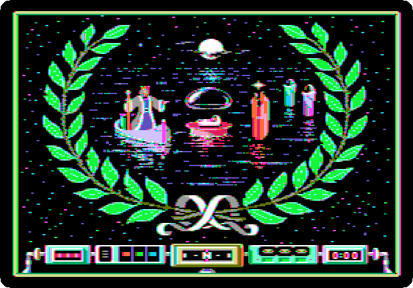
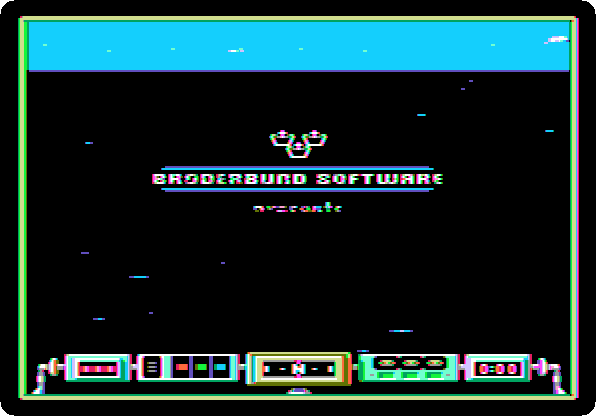
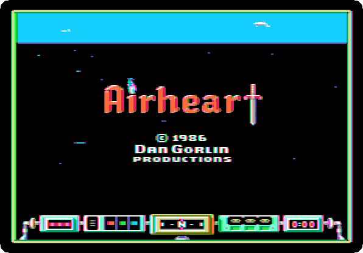
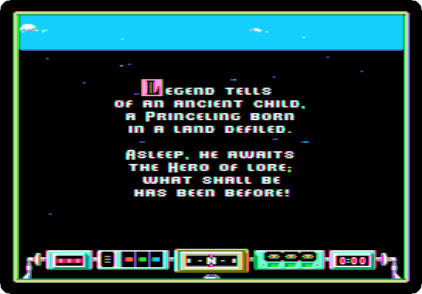
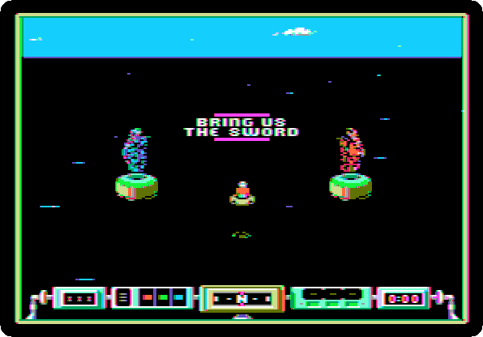
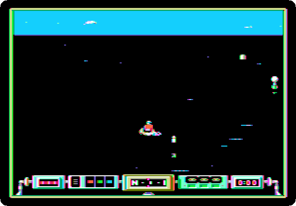

# Airheart: a game for 128 KB

[Activities](../README.md) › [Play](../sections/play.md)

The //e with its extended 80 column card, and every Apple IIc, have 128 KB
of memory, and double high resolution, sixteen colours and dots twice as
small across as high resolution. **Airheart**, of Dan Gorlin, the author of
*Choplifter*, published by Broderbund in 1986, asked for them: a raft over
a sea, turning as the joystick turns it, in double high resolution, on a
128 KB //e, IIc or IIgs.

This page watches its title, its legend and the game playing itself, and
then starts a game and steers the raft a while.

## What you need

**`airheart (san inc crack).dsk`**, in the
[folder of Airheart](https://mirrors.apple2.org.za/ftp.apple.asimov.net/images/games/action/airheart/)
on Asimov. `./fetch-disks.sh` in this repository downloads it into
`disks/`.

## The machine

The Apple IIc of 1984, on a colour monitor, with a joystick:

- the 65C02 processor at 1 MHz and 128 KB of memory: 64 KB, the top 16 KB
  of it the memory of a language card, which izapple2 puts in slot 0 as for
  the //e, and 64 KB more where the //e has its extended 80 column card;
- its two serial ports, in slots 1 and 2 for the programs;
- its port for a joystick or a mouse, at the back; izapple2 gives it the
  joystick of the computer it runs on;
- its disk drive, the controller in slot 6, with Airheart in it.

```bash
izapple2 -model none -board 2c -cpu 65c02 -screen color \
    -rom "<internal>/Apple2c_ROM255.rom" \
    -charrom "<internal>/Apple IIe Video Enhanced.bin" \
    -s0 language \
    -s1 iicserial \
    -s2 iicserial \
    -s6 "diskii,disk1=disks/airheart (san inc crack).dsk"
```

## The title, and the legend

1. **Start izapple2** with the command above: the title of the game, in
   double high resolution.

   

   Then Broderbund, the name of the game with a sword, and the legend.

   

   

   

2. Then **the game plays itself**: the raft on the sea, and what it fights.

   

   The title, the legend and the game playing itself go round until a game
   starts.

## A game

3. **Press the button of the joystick**, the left Alt or Option key in
   izapple2: a game starts. Two guardians, and what they want.

   

4. **Steer the raft with the joystick**, and **press its button** to fire:
   the raft turns where the joystick points, and the compass at the bottom
   says where it heads.

   

## What next

**Next:** [Akalabeth: Lord British's first world](akalabeth.md).

[The RGB card and its fourteen video modes](rgb-card.md) shows double high
resolution on the //e.
