# Akalabeth: Lord British's first world

[Activities](../README.md) › [Play](../sections/play.md)

**Akalabeth** was written by Richard Garriott, a teenager in Texas, on an
Apple II, in Applesoft BASIC, and sold first in plastic bags in the computer
shop where he worked, in 1979. California Pacific Computer published it in
1980. Garriott signed it as **Lord British**, a nickname his friends gave
him, and
put himself in the game as the king who gives the quests. It has what his
next game would have: a world seen from above, a town with a shop, and
dungeons in three dimensions, drawn in lines, with monsters that come
closer as you walk. That next game was **Ultima**, in 1981, and Akalabeth
is now called Ultima 0. Garriott went on to found Origin Systems, to make
the Ultimas and Ultima Online, and in 2008 he flew to the International
Space Station.

The whole game is a program of Applesoft, about 21 KB of BASIC with
`HPLOT` for each line of the dungeons. This page makes a character, walks to
the castle of Lord British, takes his quest, a giant rat, goes down into a
dungeon to kill it, and comes back for the reward. The game takes a lucky
number to start its random numbers: with the number of the page, 5, the
world, the dungeons and the fights are the same every time the same keys
are pressed, so this game can be played again exactly.

## What you need

**`Akalabeth_original.dsk`**, in
[the Akalabeth folder of Asimov](https://mirrors.apple2.org.za/ftp.apple.asimov.net/images/games/rpg/akalabeth/):
a copy of the original without its copy protection, *almost identical to
the original*, says the note beside it. `./fetch-disks.sh` in this
repository downloads it into `disks/` and checks it.

## The machine

An Apple \]\[+:

- the 6502 processor at 1 MHz, 48 KB of memory, and Applesoft BASIC in its
  ROM, which the game is written in;
- the keyboard of the \]\[+, which types only capitals;
- a Disk II controller card in slot 6, with Akalabeth in drive 1.

```bash
izapple2 -model none -board 2plus -cpu 6502 -screen color \
    -rom "<internal>/Apple2_Plus.rom" \
    -charrom "<internal>/Apple2rev7CharGen.rom" -forceCaps \
    -s6 diskii,disk1=disks/Akalabeth_original.dsk
```

The model `2plus` of izapple2 has this machine, with a 16 KB language card
in slot 0 and a Videx Videoterm in slot 3 more:

```bash
izapple2 -model 2plus -screen color disks/Akalabeth_original.dsk
```

## A character

1. **Start izapple2** with the command above. *Welcome, foolish mortal,
   into the world Akalabeth!*

   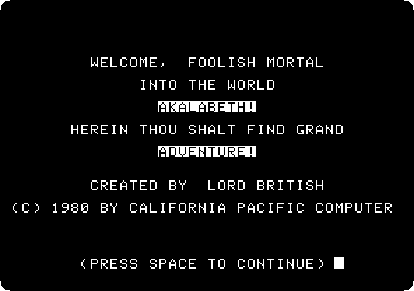

2. **Press the space bar.** The pictures of the title are drawn while the
   game loads, in high resolution: Akalabeth, World of Doom, the door of a
   dungeon, and the hall of a dungeon with a lizard man. At the speed of the
   machine:

   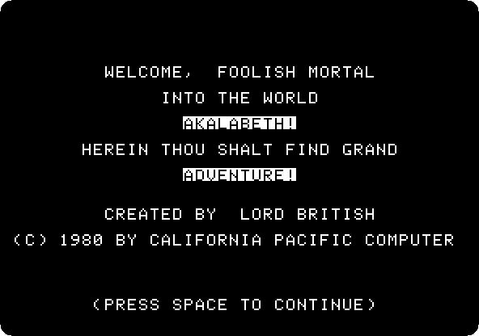

3. **Type `5`** and Return, for the lucky number, and **`1`** and Return,
   for the level of play, the easiest of ten. The game draws the qualities
   of the character from the lucky number: hit points, strength, dexterity,
   stamina, wisdom and gold.

   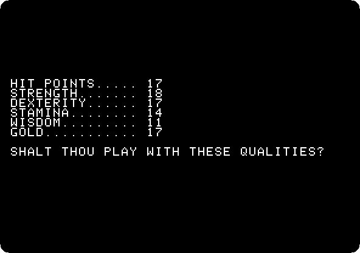

   Any other answer than **`Y`** draws other qualities. **Press `Y`**, and
   **`F`**, to be a fighter, not a mage: a mage can't use a rapier or a bow.

4. **The shop.** The prices and the items are at the bottom, what you have
   at the top. With 17 pieces of gold: **press `R`**, a rapier for 8, and
   **`F` eight times**, ten portions of food for each piece, 80; 1 piece
   is left. **Press `Q`** to leave.

   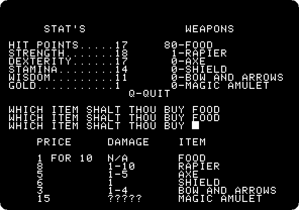

## The world

The game makes a world of 19 by 19 squares from the lucky number, a few
seconds, and shows the nine around you: you are the cross in the middle.
Mountains are in lines like steps, trees are small squares, a town is four
squares, a dungeon is an X, and the castle of Lord British is a square with
an X inside. Moving costs a portion of food.

5. **The keys:** Return goes north, `/` south, ← west and → east. At the
   bottom, the last commands and food, hit points and gold. You start in a
   town.

   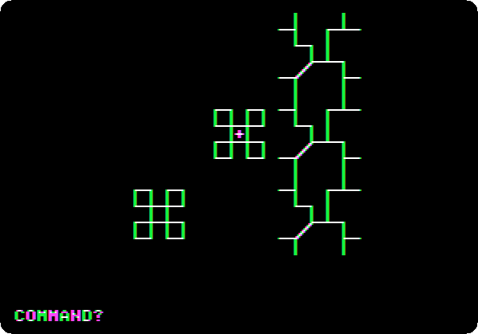

6. **Walk to the castle:** **Return twice, ← once, Return seven times, ← six
   times, Return three times and ← once.** On the way, the six steps to the
   west go over a dungeon, the X, which comes later. The castle is in the
   middle at the end.

   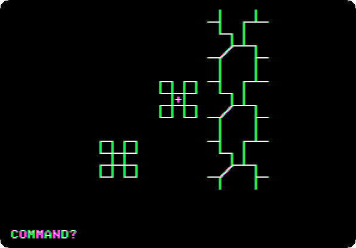

7. **Press `X`**, to go in. Lord British asks for your name: **type `ADA`**
   and Return, and **`Y`**, for grand adventure. The quest: to go into the
   dungeons and to come back only after killing a giant rat. **Press the
   space bar.**

   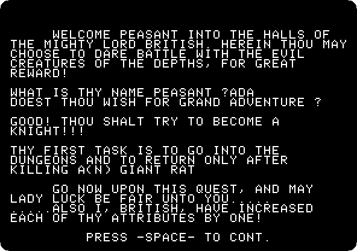

   The monster comes from the wisdom of the character: it is the one of the
   number of the wisdom divided by 3, 11 / 3, the third of the ten, the giant
   rat. The program on the disk, line 7050:

   ```text
   7050 PRINT : PRINT "GOOD! THOU SHALT TRY TO BECOME A ": PRINT "KNIGHT!!!": PRINT : PRINT "THY FIRST TASK IS TO GO INTO THE": PRINT "DUNGEONS AND TO RETURN ONLY AFTER": PRINT "KILLING A(N) ";:TASK = INT (C(4) / 3): PRINT M$(TASK)
   ```

## The dungeon

In a dungeon the same keys turn you: Return goes forward, → turns right, ←
turns left and `/` turns around. **`A`** attacks, and asks with what: **`R`**
for the rapier. **`X`** climbs a ladder, up or down. The dungeons are drawn
in lines, a step deeper for each square ahead, with doors on the walls,
ladders, chests of gold, and the monsters.

8. **Press →** and **`/` three times**, east and three squares south, to the
   dungeon, and **`X`**: the first level, at a ladder up, the way out.

   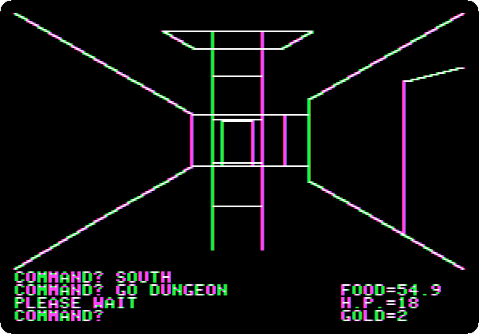

9. **The first level** has a thief and a skeleton, and no rat: a rat is on
   a deeper level. To the ladder down: **Return twice, → twice**, and the
   thief is ahead. **`A` `R` twice**: it steals a portion of food, and the
   skeleton comes from behind and hits. **`/`**, to face it, and **`A`
   `R`**: the skeleton is dead, 2 pieces of gold. **→** and **Return**: a
   chest, 4 pieces of gold and another rapier; **Return five times** more,
   to the ladder down.

   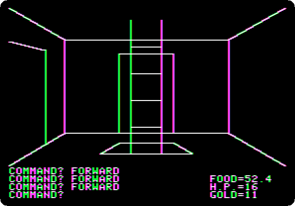

10. **Press `X`**, down to the second level, and **`/`**, **Return twice,
    →, Return**: the giant rat. **`A` `R`**: a miss, and the rat bites, 3
    hit points; **`A` `R`** again: dead, and 5 pieces of gold. At the speed
    of the machine:

    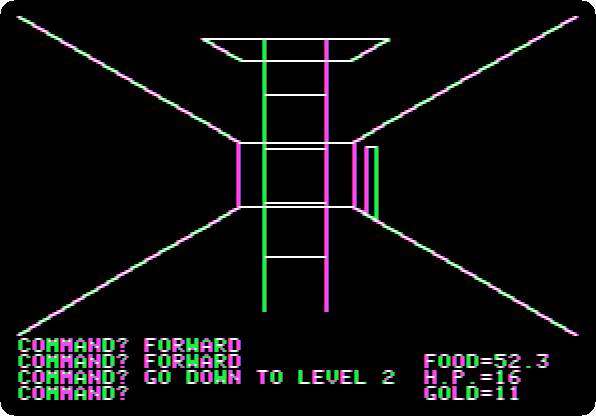

11. **Back up:** **`/`**, **Return, ←, Return twice**, at the ladder up,
    and **`X`**: the first level again, made anew, with the thief and the
    skeleton back. **`/`, Return six times**, a chest on the way with a
    piece of gold and food, **←**: the thief. **`A` `R` twice**, the
    skeleton behind again, **`/`, `A` `R`**, and **`/`, Return twice**, to
    the ladder at the entrance, and **`X`**: out, and 5 hit points more for
    the fights.

    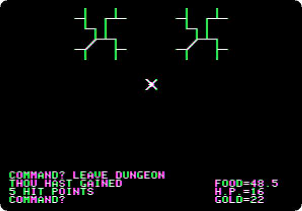

12. **Return three times and ←**, to the castle, and **`X`**: the quest is
    done, though it isn't enough to become a knight. The next quest is an
    orc, the fourth of the ten monsters; quest after quest, the tenth, a
    balrog, makes you Lord ADA.

    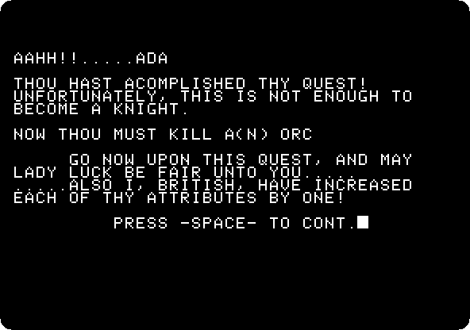

## The program

Akalabeth is the program `AKA6` on the disk, in Applesoft. The lucky number
starts the random numbers, with `RND` of a negative number, and they make
the qualities and then the world, a square at a time, each one mountains,
a tree, a town or a dungeon, by chance:

```text
60010 ZZ = RND ( - ABS (LN))
60050 FOR X = 0 TO 5:C(X) = INT ( SQR ( RND (1)) * 21 + 4): NEXT X
8 ZZ = RND ( - ABS (LN))
40 FOR X = 1 TO 19: FOR Y = 1 TO 19:TE%(X,Y) = INT ( RND (1) ^ 5 * 4.5)
```

A dungeon starts the random numbers again from the lucky number, its place
in the world and its level, so the same dungeon has the same rooms every
time you go in.

## What next

**Next:** [Cranston Manor, from the start to the end](cranston.md).

[Flight Simulator II over Chicago](flight-simulator.md) is another world in
lines, by subLOGIC, and [A game in Applesoft: the snake](applesoft-snake.md)
is a game in the same BASIC, typed in.
