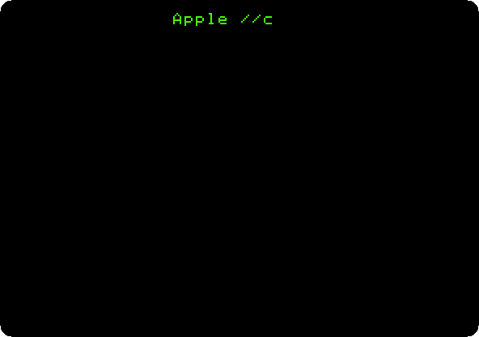
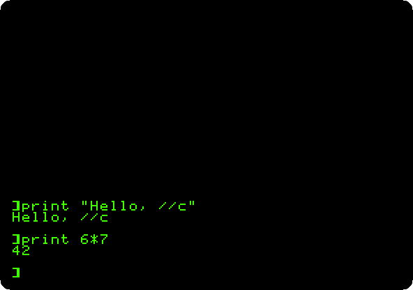
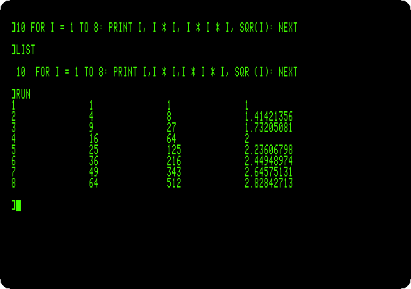

# Switch on an Apple IIc

[Activities](../README.md) › [First steps](../sections/first-steps.md)

Apple showed the **Apple IIc** in April 1984, three months after the first
Macintosh: an Apple II to carry, with a handle that folded under it to
tilt the keyboard. Inside it was a //e, with the 65C02 processor and the
MouseText that the //e had only a year later, and all that an owner of a //e
put in its slots: 128 KB of memory, 80 columns, a disk drive in its side,
two serial ports, for a printer and a modem, and a port for a mouse or a
joystick. It had no slots, and nothing to open.

It came with **Apple Presents the IIc**, an interactive owner's guide: a
book and diskettes that taught the machine on its own screen. This page
switches the IIc on with no disk, gives Applesoft a command, and puts it in
80 columns; the pages after it go through the diskettes of the guide.

## What you need

Only izapple2: the ROM of the IIc comes inside it.

The [Apple IIc Owner's Manual](https://archive.org/details/a2com) and the
book of the guide,
[Apple Presents the Apple IIc: An Interactive Owner's Guide](https://archive.org/details/apple-presents-the-apple-iic-an-interactive-owners-guide),
are on the Internet Archive.

## The machine

The Apple IIc of 1984, with its first ROM, version 255:

- the 65C02 processor at 1 MHz and 128 KB of memory: 64 KB, the top 16 KB
  of it the memory of a language card, which izapple2 puts in slot 0 as for
  the //e, and 64 KB more where the //e has its extended 80 column card;
- its two serial ports, in slots 1 and 2 for the programs, as the cards of
  a //e would be: the printer port and the modem port;
- its 80 columns, in slot 3 for the programs;
- its disk drive, the controller in slot 6.

```bash
izapple2 -model none -board 2c -cpu 65c02 -screen green \
    -rom "<internal>/Apple2c_ROM255.rom" \
    -charrom "<internal>/Apple IIe Video Enhanced.bin" \
    -s0 language \
    -s1 iicserial \
    -s2 iicserial \
    -s6 diskii
```

The model `2c` of izapple2 is this machine, with DOS 3.3 in its drive, which
starts at once instead of waiting:

```bash
izapple2 -model 2c -screen green
```

## Switched on

1. **Start izapple2** with the command above. The IIc says `Apple //c` at
   the top of the screen, and looks for a diskette in its drive, and waits
   for one.

   

2. **Press Control-Reset**, Control-F2 in izapple2, to stop looking. The IIc
   goes to Applesoft BASIC, in its ROM. **Type `print "Hello, //c"`** and
   **`print 6*7`**, each with **Return**.

   

   As on the enhanced //e, Applesoft takes its commands in small letters.

3. **Type `PR#3`** and **Return**: the screen goes to 80 columns, with the
   firmware the IIc has in its ROM for slot 3, where a //e has the card.
   **Type a line of a program,
   `10 FOR I = 1 TO 8: PRINT I, I * I, I * I * I, SQR(I): NEXT`**, and
   **`LIST`** and **`RUN`**.

   

   The commas of `PRINT` go to the next column of 16 characters, and four
   fit in 80 columns.

## Apple Presents the IIc

The diskettes of the guide, a page each:

- [Apple Presents the IIc: An Introduction](iic-introduction.md): the keyboard, a name typed, a diner, the colours and the 80 columns
- [Apple Presents the IIc: The Apple at Work](iic-at-work.md): a survey, a quiz, and a letter changed in the word processor of AppleWorks, imitated
- [Apple Presents the IIc: The Apple at Play](iic-at-play.md): Lemonade Stand, a sonata, a quiz, a hand of Apple 21 and Space Quarks
- [Apple Presents the IIc: The Inside Story](iic-inside-story.md): the detective story of how a computer works, the inside of the IIc, and a turn of its game
- [Apple Presents the IIc: Getting Down to BASIC](iic-basic.md): the lessons of Applesoft, with a name, a number and a sum typed

## What next

**Next:** [Apple Presents the IIc: An Introduction](iic-introduction.md).

[Switch on an Apple //e](apple-iie.md) is the machine inside it, and
[Two Apple IIcs on the line](iic-terminal.md) uses its modem port.
