# The languages of the BBC Micro on a //e: Applecorn

[Back to the activities](../README.md)

The BBC Micro, made by Acorn for the computer literacy project of the BBC in
1981, was the computer of British schools in the eighties. Like the Apple II
it had a 6502, at 2 MHz, but its languages did not talk to the hardware:
they came in ROMs of 16 KB, and asked the *MOS*, the operating system in
another ROM, for everything, a character written, a key read, a line drawn,
a file opened, through a few calls Acorn documented. Acornsoft, Acorn's
publisher, sold languages that way: BBC BASIC was in every machine, and
COMAL, Lisp, Forth, micro-PROLOG, BCPL and ISO-Pascal, and the word
processor View, were among the ROMs to plug in.

Applecorn, written by Bobbi Webber-Manners and others from 2021, is that MOS
for the Apple II: a ProDOS program for the enhanced //e, which loads a ROM
of the BBC into the auxiliary memory, unchanged, and answers its calls with
the screen, the keyboard and the disks of the Apple. This page starts it, and
writes a small program in each of its languages: four roses drawn by BBC
BASIC in the colours of the Apple, and in the others a sequence of numbers,
a puzzle, a family tree, the primes, and Pascal's triangle, compiled where
the language compiles. Then a text in View, and all the languages loaded at
once.

## What you need

**`applecorn-0.54-beta.po`**, the disk of 800 KB of Applecorn 0.54, in the
[`Releases`](https://github.com/bobbimanners/Applecorn/tree/main/Releases)
folder of its repository on GitHub. `./fetch-disks.sh` in this repository
downloads it into `disks/` and checks it. The disk has the ROMs of the
languages, Applecorn itself, and the example programs that came with them.

The manuals of the languages, scanned, are in the
[Applecorn-Manuals](https://github.com/bobbimanners/Applecorn-Manuals)
repository: *BBC Microcomputer User Guide*, for BBC BASIC and the MOS, and
*COMAL on the BBC Microcomputer*, *LISP on the BBC Microcomputer*, *Forth on
the BBC Microcomputer*, the *micro-PROLOG Reference Manual*, *BCPL for the
BBC Microcomputer*, *ISO-Pascal on the BBC Microcomputer and Acorn Electron*
and the *View Guide*. The
[README of Applecorn](https://github.com/bobbimanners/Applecorn) says what
it does of the BBC and how.

## The machine

An enhanced Apple //e with a hard disk interface:

- the 65C02 processor at 1 MHz and 128 KB of memory: 64 KB on the board,
  the top 16 KB of it the memory of a language card, which izapple2 puts in
  slot 0, and 64 KB more on the extended 80 column card, in the auxiliary
  slot; Applecorn needs the 65C02 and the 128 KB;
- a hard disk interface, SmartPort, in slot 7, with the disk of Applecorn.

```bash
izapple2 -model none -board 2e -cpu 65c02 -screen green \
    -rom "<internal>/Apple2e_Enhanced.rom" \
    -charrom "<internal>/Apple IIe Video Enhanced.bin" \
    -s0 language \
    -s7 smartport,image1=disks/applecorn-0.54-beta.po
```

The model `2enh` of izapple2 has this machine, with 8 MB more of memory on a
RAMWorks card, a No-Slot Clock, a VidHD card, a FASTChip accelerator, a
Mockingboard and a Disk II controller more:

```bash
izapple2 -model 2enh -screen green disks/applecorn-0.54-beta.po
```

## Start it

1. **Start izapple2** with the command above. ProDOS starts from the disk and
   runs Applecorn, `APLCORN.SYSTEM`, which asks for a ROM of the BBC.

   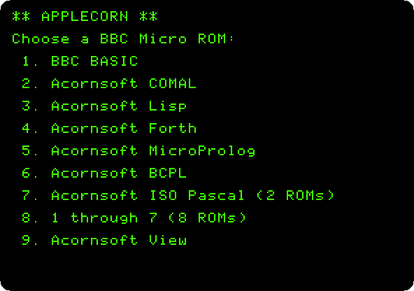

   Seven languages, ISO-Pascal in two ROMs, and View. Choice 8 loads the
   seven at once, as the sockets of a BBC Micro held them; that is the last
   step of the page.

2. **Press `1`.** Applecorn loads the ROM of BBC BASIC from the disk, writes
   its own version, and hands the machine to BASIC, which says its name and
   gives its prompt, `>`.

   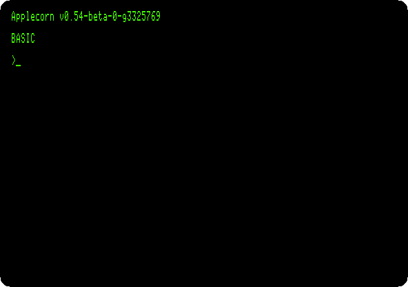

   The text is in 80 columns, Applecorn's `MODE 3`. The languages of the
   BBC want their words in capitals, as the programs here are typed.

## BBC BASIC

3. **Type the program**, each line with Return, and **`LIST`**:

   ```basic
   10 REM Four mystic roses: points on a circle, each joined to every other
   20 MODE 2
   30 PROCrose(320,768,5,1)
   40 PROCrose(960,768,7,2)
   50 PROCrose(320,256,9,4)
   60 PROCrose(960,256,11,5)
   70 END
   80 DEF PROCrose(X%,Y%,N%,C%)
   90 LOCAL I%,J%
   100 GCOL 0,C%
   110 FOR I%=0 TO N%-2
   120   FOR J%=I%+1 TO N%-1
   130     MOVE FNx(I%),FNy(I%)
   140     DRAW FNx(J%),FNy(J%)
   150   NEXT
   160 NEXT
   170 ENDPROC
   180 DEF FNx(K%)=X%+260*SIN(2*PI*K%/N%)
   190 DEF FNy(K%)=Y%+230*COS(2*PI*K%/N%)
   ```

   It is [`rose.bas`](listings/rose.bas) in this repository.

   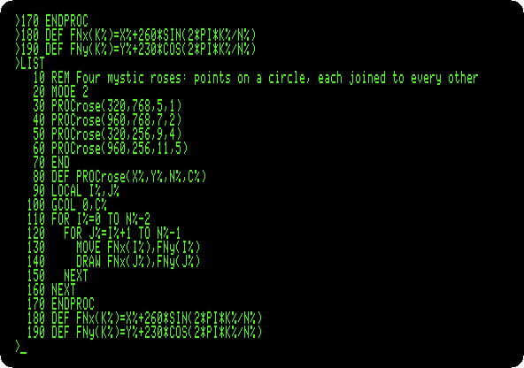

   BBC BASIC had what Applesoft lacked: procedures and functions with names
   and parameters, `PROC` and `FN`, variables `LOCAL` to them, and variables
   of whole numbers, those that end in `%`. A mystic rose is points on a
   circle, every one joined to every other: `PROCrose` draws one, around a
   centre, of `N%` points, in the colour `C%`, and `FNx` and `FNy` give the
   place of a point. The graphics of the BBC are 1280 by 1024, from the
   bottom left, whatever the mode; `MOVE` goes to a point and `DRAW` draws a
   line to the next.

4. **Press F6** in izapple2 until the screen is in colour, and **type
   `RUN`.**

   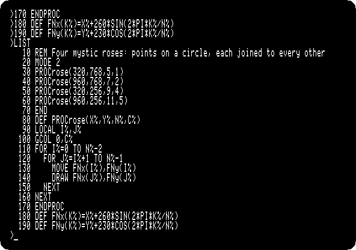

   `MODE 2` on Applecorn is the high resolution graphics of the Apple, 280
   dots by 192, which Applecorn draws with Andy McFadden's FDraw. On the BBC,
   the colours 1, 2, 4 and 5 of `GCOL` are red, green, blue and magenta;
   here they are the nearest of the six colours of the Apple, orange,
   green, blue and violet. A colour in high resolution is every other dot, so
   the lines of a colour are dotted, and where many cross, as in the rose of
   eleven points, the dots run together. The four roses take 32 seconds, as
   long as the recording: BASIC works out the place of each point with `SIN`
   and `COS`, twice for every line.
   `>` comes back at the top left, written in the graphics, as all the text
   of `MODE 2`.

   

5. **Press F6** until the screen is green again, and **type `*QUIT`.** A
   command that starts with `*` is for the MOS, and Applecorn's `*QUIT`
   leaves for ProDOS, which runs its program selector, Bitsy Bye.

   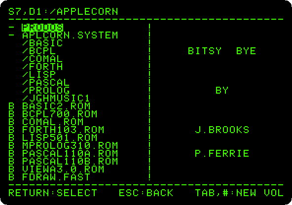

   **Press the down arrow once**, to `APLCORN.SYSTEM`, and **Return**: the
   menu comes back. The pages that follow choose a language from it, and
   leave it the same way, each language with its own way of giving a command
   to the MOS.

## COMAL

6. **Press `2`** for COMAL, **type the program**, each line with Return,
   and **`LIST`** and **`RUN`**:

   ```comal
   10 // How a number comes down to 1
   20 FOR n:=6 TO 9 DO steps(n)
   30 END
   40 PROC steps(n) CLOSED
   50   WHILE n<>1 DO
   60     PRINT STR$(n);" ";
   70     IF n MOD 2=0 THEN
   80       n:=n DIV 2
   90     ELSE
   100       n:=3*n+1
   110     END IF
   120   END WHILE
   130   PRINT "1"
   140 END PROC steps
   ```

   It is [`steps.comal`](listings/steps.comal) in this repository.

   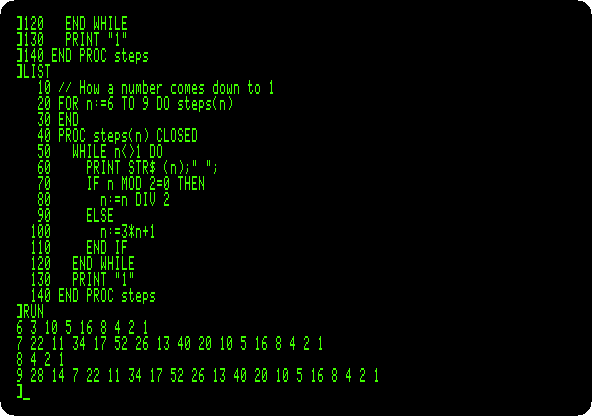

   COMAL, made in Denmark for schools, is BASIC with the structures of
   Pascal: `WHILE`, `IF` with `ELSE`, and procedures with their own
   variables, `CLOSED`, called by their names. The prompt is `]`. `LIST`
   indents the program by its structure itself, whatever the indentation it
   was typed with, and gives the names in small letters. The program takes
   a number down to 1: halved when even, three times and one more when odd.
   Nobody has proved it always gets there.

   **Type `*QUIT`**, and in Bitsy Bye **the down arrow** and **Return**.

## Lisp

7. **Press `3`** for Lisp, and **type the program**, each line with Return:

   ```lisp
   (DEFUN HANOI (N FROM TO SPARE)
     (COND ((ZEROP N) NIL)
           (T (HANOI (SUB1 N) FROM SPARE TO)
              (PRINT (LIST 'MOVE N 'FROM FROM 'TO TO))
              (HANOI (SUB1 N) SPARE TO FROM))))
   (HANOI 3 'LEFT 'RIGHT 'MIDDLE)
   ```

   It is [`hanoi.lisp`](listings/hanoi.lisp) in this repository.

   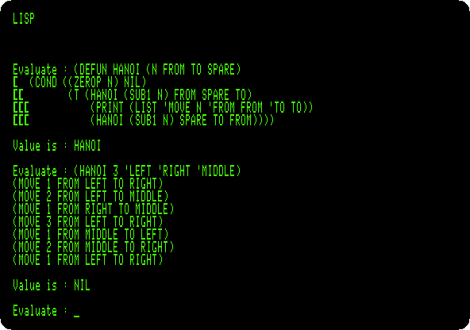

   Lisp asks `Evaluate :`, takes an expression until its brackets close, a
   `[` on each line for each one still open, and says its `Value is`.
   `DEFUN` defines `HANOI`, which moves a tower of discs from one peg to
   another, a disc at a time and never one on a smaller one: the tower but
   its last disc to the spare peg, the last disc to its place, and the tower
   on top of it, by the same function. Three discs take seven moves, printed
   as lists.

   **Type `(* 'QUIT)`**, the function `*` of Lisp with the command for the
   MOS, and in Bitsy Bye **the down arrow** and **Return**.

## Forth

8. **Press `4`** for Forth, and **type the program**, each line with Return:

   ```forth
   ( The first twenty numbers of Fibonacci )
   : FIB  0 1 ROT 0 DO  OVER .  SWAP OVER +  LOOP  DROP DROP ;
   20 FIB
   ```

   It is [`fibonacci.forth`](listings/fibonacci.forth) in this repository.

   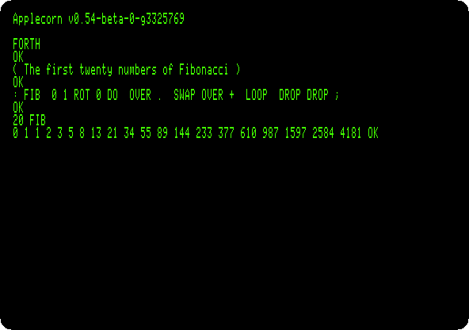

   `FIB` keeps the last two numbers on the stack, prints the first, and puts
   their sum in its place, as many times as the number given, which `ROT`
   brings to the top for `DO`. [Forth in ROM](forth.md) goes into the
   language on an Apple \]\[+.

   **Type `OS' QUIT'`**, the word of Acornsoft Forth for a command to the
   MOS, and in Bitsy Bye **the down arrow** and **Return**.

## micro-PROLOG

9. **Press `5`** for micro-PROLOG, **type the program**, each line with
   Return, and **`LIST ALL`**:

   ```prolog
   ((Parent Anne Bob))
   ((Parent Anne Carol))
   ((Parent Bob Dave))
   ((Parent Bob Emma))
   ((Parent Carol Fred))
   ((Grandparent x z) (Parent x y) (Parent y z))
   ?((Grandparent Anne x) (PP x) FAIL)
   ```

   It is [`family.prolog`](listings/family.prolog) in this repository.

   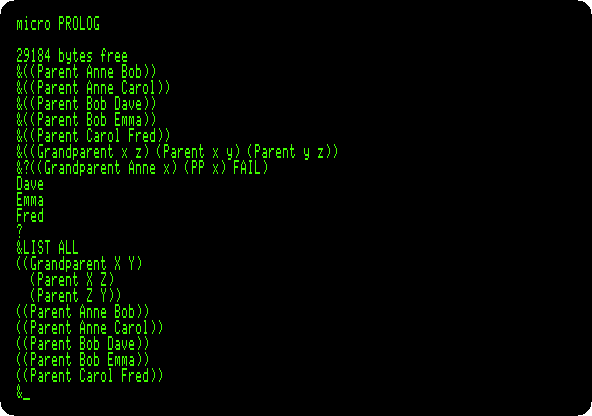

   micro-PROLOG, of Logic Programming Associates in London, writes
   everything as lists. A program is facts and rules, not steps: five facts
   of who is the parent of whom, and a rule, *x is a grandparent of z if x
   is a parent of some y and y a parent of z*; `x`, `y` and `z` are
   variables. The prompt is `&`. `?` asks a question, *a grandchild x of
   Anne*: `PP` prints each answer found, and `FAIL` makes the question fail
   after each, so that micro-PROLOG looks for another, until there is none
   and it says so with `?`. `LIST ALL` shows the program as it keeps it.

   **Type `** QUIT`**, `**` being the command to the MOS of micro-PROLOG,
   and in Bitsy Bye **the down arrow** and **Return**.

## BCPL

10. **Press `6`** for BCPL, and **type these two commands**:

    ```
    *DIR BCPL
    COPY /C TO SIEVE
    ```

    `*DIR` goes into the folder `BCPL` of the disk, which has the compiler
    and the files it needs. BCPL has no editor in its ROM; `COPY` copies from
    the keyboard, `/C`, a line at a time, to the file `SIEVE`. **Type the
    program**, each line with Return, and **press Escape** to end it:

    ```bcpl
    GET "LIBHDR"
    LET START() BE
    $( LET SIEVE = VEC 100
       FOR I = 2 TO 100 DO SIEVE!I := TRUE
       FOR I = 2 TO 100 DO
          IF SIEVE!I DO
          $( LET J = I * I
             WRITEF("%N ", I)
             WHILE J <= 100 DO
             $( SIEVE!J := FALSE
                J := J + I
             $)
          $)
       NEWLINE()
    $)
    ```

    It is [`sieve.bcpl`](listings/sieve.bcpl) in this repository.

    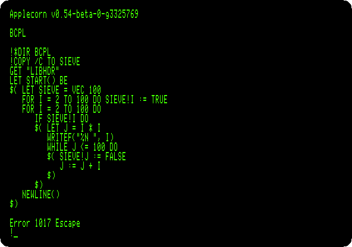

    `Error 1017 Escape` is how `COPY` stops. BCPL, from Cambridge, is the
    language B came from, and then C: no types, everything a word of the
    machine, and `$(` and `$)` where C has braces. `VEC 100` is 101 words on the stack,
    and `SIEVE!I` the word `I` of them. The sieve of Eratosthenes crosses
    out the multiples of each prime, so that what is left are primes. The
    file is written on the disk, in the folder `BCPL`.

11. **Type `BCPL SIEVE SIEVEC`**, to compile `SIEVE` into the program
    `SIEVEC`, and when it is done, **type `SIEVEC`** to run it.

    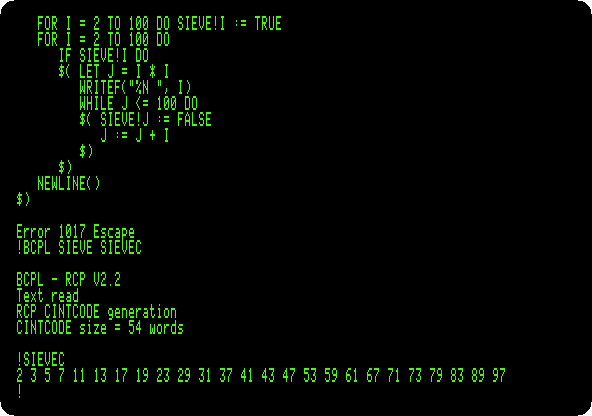

    The compiler takes four minutes and a quarter: it is a program of the
    disk, in *CINTCODE*, the compact code of BCPL that the ROM interprets,
    and it reads its overlays and `LIBHDR`, the declarations of the library,
    from the disk as it goes. The program it makes is 54 words of CINTCODE,
    and prints the 25 primes under 100.

    **Type `*QUIT`**, and in Bitsy Bye **the down arrow** and **Return**.

## ISO-Pascal

12. **Press `7`** for ISO-Pascal, which Applecorn loads in two ROMs, and
    **type `EDIT`.** The editor of Pascal takes the whole screen, its state
    in the last line. **Type the program**:

    ```pascal
    program triangle(output);
    { Pascal's triangle, each row made from the one above }
    var row: array[0..10] of integer;
        n, i: integer;
    begin
      for n := 0 to 10 do
      begin
        row[n] := 1;
        for i := n - 1 downto 1 do
          row[i] := row[i] + row[i - 1];
        write(' ': 2 * (10 - n) + 1);
        for i := 0 to n do
          write(row[i]: 4);
        writeln
      end
    end.
    ```

    It is [`triangle.pas`](listings/triangle.pas) in this repository.

    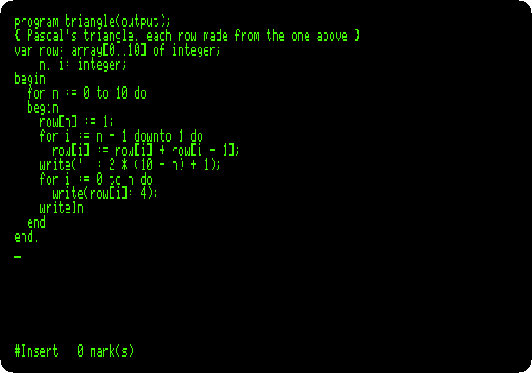

    Each number of the triangle is the sum of the two above it, so a row is
    made from the one before in place, from its end, in one array.

13. **Press Shift-f4** to leave the editor: the function keys of the BBC are
    the number keys with an Apple key held, and with Shift, Closed Apple,
    the right Alt or Option key in izapple2. So **hold Closed Apple and press
    `4`**. At the prompt, `%`, **type `COMPILE`**, and then **`GO`**.

    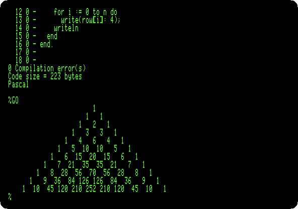

    `COMPILE` compiles from the memory to the memory, the program listed
    line by line as it goes, in 20 seconds: no errors, and 223 bytes of
    code. `GO` runs it.

    **Type `*QUIT`**, and in Bitsy Bye **the down arrow** and **Return**.

## View

14. **Press `9`** for View, the word processor, and **type `NEW`.**

    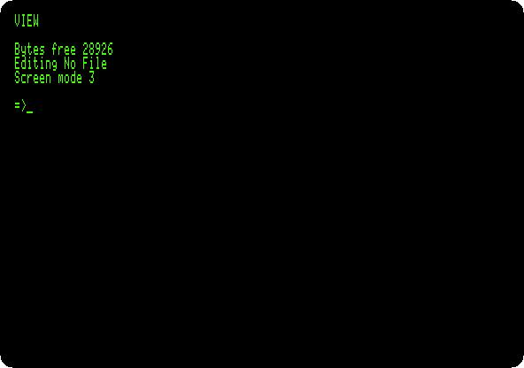

    View starts in its mode of commands, `=>`. **Press Escape** for the
    text, under a ruler: `F` is for *format*, words that do not fit go to
    the next line, and `J` for *justify*, the lines made even. **Press
    Shift-f8**, *edit command*, Closed Apple and `8`, and **type `CE`**, a
    command stored in the left margin to centre the line, then **Return**,
    the title, **Return**, **Return** again, and the paragraph:

    ```
    View on the Apple //e

    View was the word processor of the BBC Micro, in a ROM of 16 KB. Here it runs on an Apple //e, the words that do not fit carried to the next line and the spaces spread to make the lines even.
    ```

    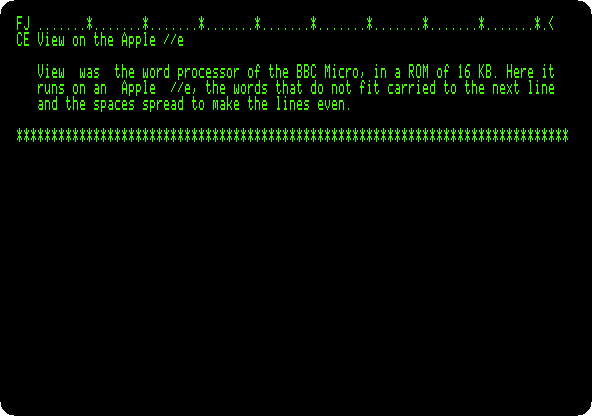

15. **Press Escape** for the commands again, and **type `SCREEN`**, which
    shows the text as it will be printed, without the printer.

    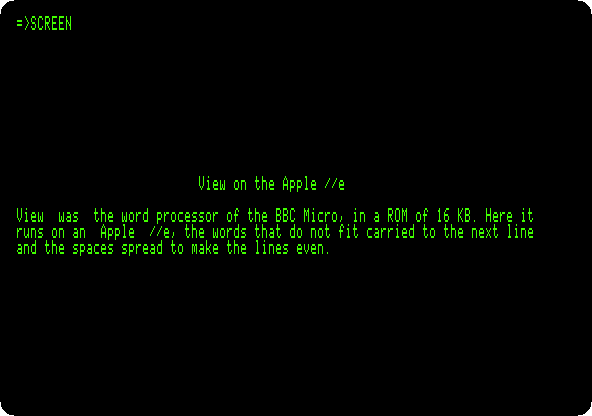

    The title is centred, and the paragraph has no ruler and no margin.
    `SCREEN` shows the whole page, 66 lines, a screen at a time, and waits
    for Shift for the next, which on Applecorn is Open Apple, the left Alt
    or Option key: **hold Open Apple**, twice, to get back to `=>`.

    **Type `*QUIT`**, and in Bitsy Bye **the down arrow** and **Return**.

## All seven at once

16. **Press `8`**, which loads the seven languages, eight ROMs, as the
    sideways ROMs of a BBC Micro, BASIC first. **Type `*HELP`**, which asks
    each ROM to say what it is, then **`*COMAL`** and **`*BASIC`**.

    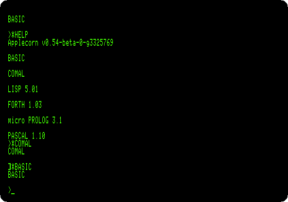

    BCPL does not answer `*HELP`, a fault of its ROM, the README of
    Applecorn says. `*COMAL` passes the machine to COMAL, `]`, and
    `*BASIC` back to BASIC, `>`: Applecorn loads the ROM again from the disk
    each time, where the BBC switched between its sockets at once.

## What next

**Next:** [The Base 64A, an Apple \]\[+ from Taiwan](base64a.md).

[CP/M on the Z80 SoftCard](cpm.md) is another system brought to the Apple
II, with a processor of its own. [Apple Pascal](pascal.md) is the Pascal of
the Apple, and [Forth in ROM](forth.md) its Forth.
