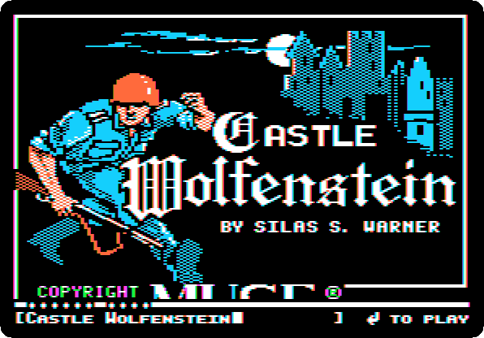
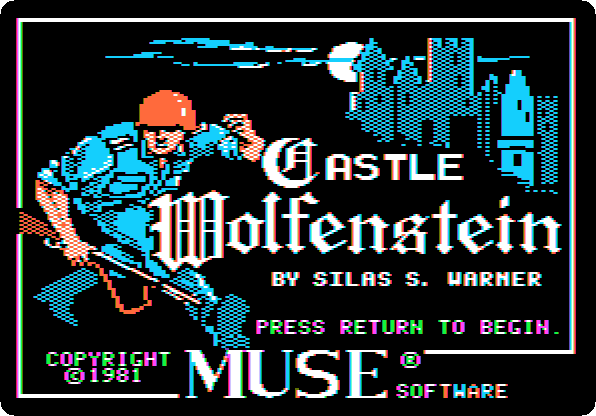
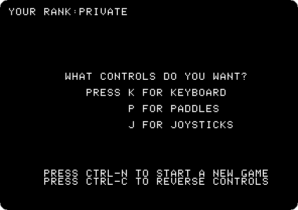
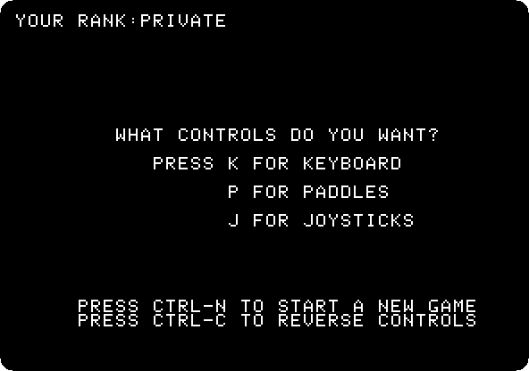
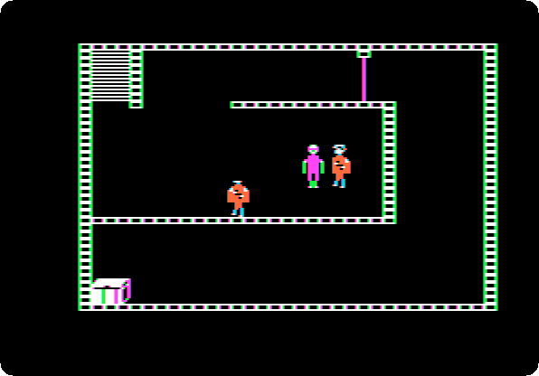
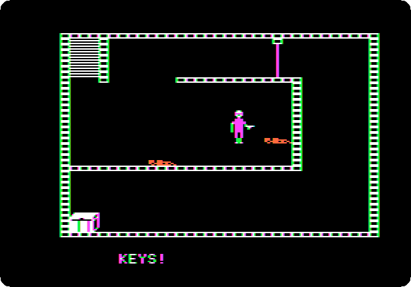
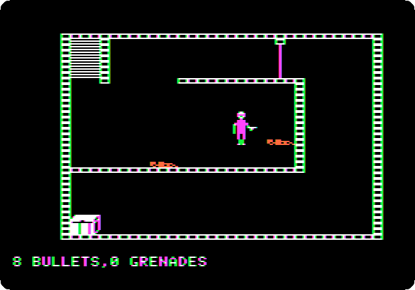
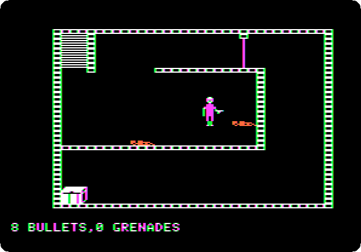
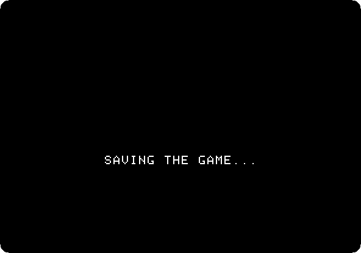

# Castle Wolfenstein

[Activities](../README.md) › [Play](../sections/play.md)

**Castle Wolfenstein** was written by Silas Warner for Muse Software, of
Baltimore, and published in 1981 for the Apple II. You are a prisoner of war
in a castle of the Second World War, with a gun and ten bullets from a dying
cellmate, and you have to find the war plans and get out alive, room by
room, past guards who shout at you in German. The voices are recorded and
played through the speaker of the Apple II, which can only click, one of
the first games to speak. And you need not shoot: a guard can be made to
surrender, a uniform taken from a chest lets you walk past the others, and
the game is remembered as one of the first of stealth. Muse closed in 1987;
in 1992 id Software, whose founders had played it, made **Wolfenstein 3D**
after it, in three dimensions, and the name went on to a series of games.

This page plays it from [Total Replay](total-replay.md), the collection of
games on a hard disk: the story of the cellmate, the first room and its two
guards, shot and searched, the stairs to the next room, and the game saved.
The game runs in real time, as an arcade game: the keys of the page are
pressed at set times, which a person playing would press as the guards
come.

## What you need

**`Total Replay v6.1.hdv`**, Total Replay 6.1, from the
[Internet Archive](https://archive.org/details/TotalReplay), a 32 MB hard
disk image with Castle Wolfenstein among its games. `./fetch-disks.sh` in
this repository downloads it into `disks/`.

The manual of the game,
[castle wolfenstein (1982).pdf](https://mirrors.apple2.org.za/ftp.apple.asimov.net/documentation/games/misc/castle%20wolfenstein%20(1982).pdf),
is on Asimov, with the keys and a dictionary of what the guards say.

The game was sold on a diskette, which it writes as it plays. The copies of
it on DSK, as
[4am's crack](https://archive.org/details/CastleWolfenstein_061984_4amCrack),
start, but in izapple2 a room left brings back the same room (see
[IZAPPLE2.md](../IZAPPLE2.md)); from Total Replay, the game goes from room
to room by the stairs.

## The machine

The machine of [Total Replay](total-replay.md), an enhanced Apple //e:

- the 65C02 processor at 1 MHz and 128 KB of memory: 64 KB on the board,
  the top 16 KB of it the memory of a language card, which izapple2 puts in
  slot 0, and 64 KB more on the extended 80 column card, in the auxiliary
  slot;
- a VidHD card in slot 2, for the box art of the games in the launcher;
- a hard disk interface, SmartPort, in slot 7, with Total Replay.

```bash
izapple2 -model none -board 2e -cpu 65c02 -screen color \
    -rom "<internal>/Apple2e_Enhanced.rom" \
    -charrom "<internal>/Apple IIe Video Enhanced.bin" \
    -s0 language \
    -s2 vidhd \
    -s7 'smartport,image1=disks/Total Replay v6.1.hdv'
```

The enhanced Apple //e izapple2 starts with, its model `2enh`, has this
machine, with 8 MB more of memory on a RAMWorks card, a No-Slot Clock, a
FASTChip accelerator, a Mockingboard and a Disk II controller more:

```bash
izapple2 -screen color "disks/Total Replay v6.1.hdv"
```

## Start it

1. **Start izapple2** with the command above, and when the launcher of
   Total Replay is up, **type `castle wolf`**: it finds the game as you
   type.

   

2. **Press Return.** The title: *Castle Wolfenstein, by
   Silas S. Warner*, copyright 1981 Muse Software.

   

3. **Press Return.** Your rank, private, and the controls: the keyboard,
   paddles or joysticks.

   

4. **Press `K`**, for the keyboard. The cellmate tells the story, a
   character at a time, and dies: *AIIIIEEEEEE....*

   

## The keys

The keys around `S` move you, `S` itself stops you: `W` up, `X` down, `A`
left and `D` right, and, as the manual draws them, `Q`, `E`, `Z` and `C`
the diagonals. A key starts
you walking, and you walk until a wall or `S`. The keys around `L` aim the
gun, `K` to the left and `;` to the right, and **`L` fires**. The space bar
searches a guard, or unlocks a door or a chest you aim at; Return lists
what you carry; Escape saves the game and stops.

## The first room

The first room has stairs, top left, a chest, bottom left, a door, at the
top, and two guards: one beside you, and one walking up and down. A guard
who sees you calls out, and shoots.

5. **Press `;`**, to aim to the right, at the guard beside you, and **`L`**:
   he falls. **Press `K`**, to aim to the left, at the other, coming, and
   **`L`** again.

   

   🔊 [The fight, with the sound](images/castle-wolfenstein/fight.wav): the
   guards calling out, in German, and the shots.

6. **Press `;`** and **the space bar**, to search the guard on the right:
   *SEARCHING...*, and he had keys.

   

   **Press Return**: what you carry. 8 bullets of the 10, and no grenades.

   

## The stairs

7. **Press `A`**, left along the corridor, and **`S`** to stop before the
   doorway of the wall at the end; then **`W`**, up, to the stairs. The next
   room, from its stairs, and two more guards.

   

8. **Press Escape**, before they come: *SAVING THE GAME...*. The game is
   saved in the castle, and starts there next time.

   

   Total Replay comes back, at the game.

   

## What next

**Next:** [The Dark Crystal, from the start to the end](darkcrystal.md).

[Total Replay](total-replay.md) has hundreds of other games of the Apple II,
and [Karateka](karateka.md) is another game of fighting, told like a film.
