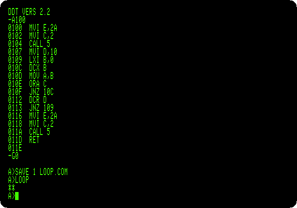

# CP/M on three Z80 cards

[Activities](../README.md) › [Other systems](../sections/other-systems.md)

CP/M ran on the Z80 and the Apple II had a 6502, so to run CP/M an Apple II
owner bought a Z80 on a card. Microsoft made the first, the **Z80 SoftCard**,
in 1980. Its Z80 takes the machine over while the 6502 waits, and uses the
Apple's own memory, so the CP/M it runs has what the Apple has left. Others
followed, and some worked the other way round. On the **PCPI Applicard** and
on Microsoft's own **SoftCard II** of 1984, the Z80 has 64 KB of memory of
its own and runs CP/M there. The 6502 stays in charge of the screen, the
keyboard and the disks, and the two pass bytes to each other through a port.

Each card came with its own CP/M, and the SoftCard went through several
versions, from Microsoft and from others. This page starts every version
found for the three cards izapple2 has, one after the other, and compares
them: what each says when it starts, what came on its disk, how much memory
it leaves to the programs, how much the same Microsoft BASIC finds free, and
how fast its Z80 runs.

## What you need

The disks are in the CP/M folder of the [Asimov
archive](https://mirrors.apple2.org.za/ftp.apple.asimov.net/images/cpm/os/),
and `./fetch-disks.sh` in this repository downloads them all into `disks/`
and checks them. In that folder:

- **`Softcard 16-sector disk (Microsoft 1980).dsk`**: CP/M 2.20 of the
  SoftCard, for 44 KB.
- **`CPM1.PO`**, in `softcard.zip`: CP/M 2.20B of the SoftCard, for 56 KB.
- **`CPM2.23(60k).dsk`**: a CP/M 2.23B of 63 KB, marked as Datasoft's.
- **`CPM60K.DSK`**: CP/M 2.23 of the SoftCard, for 60 KB.
- **`CPM3.1_Disk_1.dsk`**, in `CPM3.1_Z80_Softcard.zip`: CP/M 3.0 for the
  SoftCard.
- **`CPAM40B.dsk`**, **`A.E. CPM Plus card.dsk`** and **`CPAM51A.dsk`**:
  CP/AM 4.0B, 5.1 and 5.1.1, the CP/M of Applied Engineering.
- **`Microsoft Softcard II CPM 2.28B.DSK`**: CP/M 2.28B of the SoftCard II.
- **`pcpiboot.do`**, in the `pcpi` folder: CP/M 2.2 of the Applicard, the
  boot disk of PCPI.

The manuals are on the Internet Archive: the
[SoftCard CP/M Reference Manual](https://archive.org/details/Microsoft_SoftCard_CPM_Reference_Manual)
of Microsoft, the
[SoftCard II Installation and Operations Manual and Programmer's Manual](https://archive.org/details/softcard-ii-installation-and-operations-manual-and-programmers-manual-1),
and the
[Appli-Card 2.0 Installation and User's Manual](https://archive.org/details/appli-card-2.0-installation-and-users-manual)
of PCPI.

## The machines

Four machines, each with two disk drives on a Disk II controller card in
slot 6 and a Z80 card in slot 4:

- an Apple \]\[+, its 6502 at 1 MHz, 48 KB of memory, Applesoft BASIC in its
  ROM and the keyboard that types only capitals, with a 16 KB Language Card
  in slot 0, which makes the memory 64 KB, and the **Microsoft Z80
  SoftCard**;
- an Apple //e, its 6502 at 1 MHz, 128 KB of memory with its extended 80
  column card, with the **SoftCard**;
- the same //e with the **Microsoft SoftCard II**;
- the same //e with the **PCPI Applicard**.

Each version starts with its disk in drive 1, and has the disk of CP/M 2.23,
`CPM60K.DSK`, in drive 2, for the DDT on it; the command of each is in its
step. The SoftCard II and the Applicard need an izapple2 built from its
master, the releases don't have them yet.

## The SoftCard

1. **Start CP/M 2.20** on the \]\[+, the CP/M of the SoftCard of 1980:

   ```bash
   izapple2 -model none -board 2plus -cpu 6502 -screen green \
       -rom "<internal>/Apple2_Plus.rom" \
       -charrom "<internal>/Apple2rev7CharGen.rom" -forceCaps \
       -s0 language \
       -s4 z80softcard \
       -s6 'diskii,disk1=disks/Softcard 16-sector disk (Microsoft 1980).dsk,disk2=disks/CPM60K.DSK'
   ```

   

   *44K*: the Z80 shares the 48 KB of the \]\[+. The Apple keeps the
   bottom of its memory, the text screen among it, and the SoftCard moves the
   Z80's addresses so that CP/M still finds its memory where it wants it.
   This version is for a \]\[+ without the Language Card, and starts on one
   with it too.

2. **Start CP/M 2.20B**, the version that came after, for 56 KB:

   ```bash
   izapple2 -model none -board 2plus -cpu 6502 -screen green \
       -rom "<internal>/Apple2_Plus.rom" \
       -charrom "<internal>/Apple2rev7CharGen.rom" -forceCaps \
       -s0 language \
       -s4 z80softcard \
       -s6 'diskii,disk1=disks/CPM1.PO,disk2=disks/CPM60K.DSK'
   ```

   

   *56K*, for a \]\[+ with the Language Card. [CP/M on the Z80
   SoftCard](cpm.md) uses this disk. In izapple2, 2.20 and 2.20B stop on the //e after the drive, so the
   page starts them on the \]\[+, the machine of their time.

3. **Start the CP/M 2.23B of Datasoft**, also for the \]\[+, which says it
   has 63 KB:

   ```bash
   izapple2 -model none -board 2plus -cpu 6502 -screen green \
       -rom "<internal>/Apple2_Plus.rom" \
       -charrom "<internal>/Apple2rev7CharGen.rom" -forceCaps \
       -s0 language \
       -s4 z80softcard \
       -s6 'diskii,disk1=disks/CPM2.23(60k).dsk,disk2=disks/CPM60K.DSK'
   ```

   

   Its GBASIC is Microsoft's of 2.20B, and leaves as much memory as theirs,
   below.

4. **Start CP/M 2.23** on the //e, Microsoft's version of 1982, for 60 KB:

   ```bash
   izapple2 -model none -board 2e -cpu 6502 -screen green \
       -rom "<internal>/Apple2e.rom" \
       -charrom "<internal>/Apple IIe Video Unenhanced.bin" \
       -s0 language \
       -s4 z80softcard \
       -s6 'diskii,disk1=disks/CPM60K.DSK,disk2=disks/CPM60K.DSK'
   ```

   

   It knows the //e: 80 columns and lower case, with the 80 column card of
   the //e. **Type `DIR`** for the files of its disk:

   

   The tools of Digital Research, `PIP`, `ED`, `ASM`, `DDT`, `STAT`,
   `SUBMIT`, with Microsoft's BASIC-80, `MBASIC` and `GBASIC`, and the
   programs of the SoftCard, `CONFIGIO.BAS`, `APDOS`, `COPY`, `CPM60` and
   others.

5. **Start CP/M 3.0**, a port of Digital Research's CP/M Plus to the
   SoftCard, by Werner Muenchheimer in Germany in 1989:

   ```bash
   izapple2 -model none -board 2e -cpu 6502 -screen green \
       -rom "<internal>/Apple2e.rom" \
       -charrom "<internal>/Apple IIe Video Unenhanced.bin" \
       -s0 language \
       -s4 z80softcard \
       -s6 'diskii,disk1=disks/CPM3.1_Disk_1.dsk,disk2=disks/CPM60K.DSK'
   ```

   

   Its loader lists the parts of the system it loads, the BIOS and the BDOS,
   and where, and leaves *46K TPA*, the memory for the programs. **Type
   `DIR`**: some of the programs of CP/M 3 are new, `DATE`, `SET`,
   `SETDEF` and `SHOW` among them.

   

6. **Start CP/AM 4.0B**, the CP/M of Applied Engineering, of 1985:

   ```bash
   izapple2 -model none -board 2e -cpu 6502 -screen green \
       -rom "<internal>/Apple2e.rom" \
       -charrom "<internal>/Apple IIe Video Unenhanced.bin" \
       -s0 language \
       -s4 z80softcard \
       -s6 'diskii,disk1=disks/CPAM40B.dsk,disk2=disks/CPM60K.DSK'
   ```

   

   Applied Engineering sold a Z80 card of its own, the Z-80 Plus, which
   works as the SoftCard does, and its CP/AM starts on the SoftCard of
   izapple2. On the Applicard and the SoftCard II it says *NO A.E. Z-80 PLUS
   CARD FOUND.*

7. **Start CP/AM 5.1** and **CP/AM 5.1.1**, of 1986, for 60 KB:

   ```bash
   izapple2 -model none -board 2e -cpu 6502 -screen green \
       -rom "<internal>/Apple2e.rom" \
       -charrom "<internal>/Apple IIe Video Unenhanced.bin" \
       -s0 language \
       -s4 z80softcard \
       -s6 'diskii,disk1=disks/A.E. CPM Plus card.dsk,disk2=disks/CPM60K.DSK'
   ```

   

   ```bash
   izapple2 -model none -board 2e -cpu 6502 -screen green \
       -rom "<internal>/Apple2e.rom" \
       -charrom "<internal>/Apple IIe Video Unenhanced.bin" \
       -s0 language \
       -s4 z80softcard \
       -s6 'diskii,disk1=disks/CPAM51A.dsk,disk2=disks/CPM60K.DSK'
   ```

   

   **Type `DIR`** on 5.1.1. Beside the programs of CP/M are Applied
   Engineering's own, `RAMBOOT`, `MEGDRIVE`, `CPAM60F` and `CPAM60S` among
   them. A file named `-10/7/87 R21` looks like the label of someone's own
   copy, not a master.

   

## The SoftCard II

8. **Start CP/M 2.28B** on the //e with the SoftCard II:

   ```bash
   izapple2 -model none -board 2e -cpu 6502 -screen green \
       -rom "<internal>/Apple2e.rom" \
       -charrom "<internal>/Apple IIe Video Unenhanced.bin" \
       -s0 language \
       -s4 z80softcard2 \
       -s6 'diskii,disk1=disks/Microsoft Softcard II CPM 2.28B.DSK,disk2=disks/CPM60K.DSK'
   ```

   

   *64K*: all of the Z80's memory is its own, none of it the Apple's.
   **Type `DIR`**:

   

   The programs of the SoftCard's 2.23, but for `MBASIC`, `CPM60` and
   `DOWNLOAD`: of the two BASICs, Microsoft kept GBASIC, the one with the
   graphics. On the \]\[+ this CP/M prints its
   words in lower case, which the \]\[+ shows as other signs.

## The Applicard

9. **Start CP/M 2.2** on the //e with the Applicard:

   ```bash
   izapple2 -model none -board 2e -cpu 6502 -screen green \
       -rom "<internal>/Apple2e.rom" \
       -charrom "<internal>/Apple IIe Video Unenhanced.bin" \
       -s0 language \
       -s4 applicard \
       -s6 'diskii,disk1=disks/pcpiboot.do,disk2=disks/CPM60K.DSK'
   ```

   

   This is the CP/M of Digital Research as it came, version 2.2, with PCPI's
   part, version 2.0, under it. Licensed to MicroPro, the makers of
   WordStar. The Z80 has its own memory, so the Apple's is free, and PCPI
   uses it as a buffer for the printer: *83.5K* on the //e.

   **Type `DIR`**:

   

   The tools of Digital Research again, and PCPI's own, `DRIVERS`,
   `ADOSXFER`, `COPYFRMT`, `CLRPBUF`, `DOSRDSK` and `NRDRDSK`. No BASIC.

10. **Start it on the \]\[+**, with the Applicard in slot 4:

    ```bash
    izapple2 -model none -board 2plus -cpu 6502 -screen green \
        -rom "<internal>/Apple2_Plus.rom" \
        -charrom "<internal>/Apple2rev7CharGen.rom" -forceCaps \
        -s0 language \
        -s4 applicard \
        -s6 'diskii,disk1=disks/pcpiboot.do,disk2=disks/CPM60K.DSK'
    ```

    ![CP/M 2.2 of the Applicard on the \]\[+](images/cpm-cards/applicard-2.0-plus.png)

    The same CP/M, in capitals and 40 columns, and a buffer of *35.5K*: the
    \]\[+ has 64 KB with its Language Card, the //e has 128 KB with its 80
    column card.

## The same BASIC on each

GBASIC, Microsoft's BASIC-80 with the graphics of the Apple II, is on the
disks of the SoftCard and of the SoftCard II. The number it says when it
starts, the memory free for a program, compares the versions.

11. **Type `GBASIC`** on CP/M 2.20, 2.23 and 2.28B:

    

    

    

    On 2.20B and on Datasoft's 2.23B it says *17393 BYTES FREE*; both have
    the GBASIC of November 1980. The Applicard, CP/AM and CP/M 3 have no
    GBASIC. Type `SYSTEM` to go back to CP/M.

## The memory for the programs

The programs of CP/M run from address 0100, hexadecimal, up to where the BDOS
starts, the part of CP/M they call for the disk and the screen: that memory
is the TPA, the Transient Program Area. A program finds the BDOS by the
jump at address 5, and the address of that jump, at 6 and 7, is the top of
its memory. DDT, the debugger of CP/M, could show it, but under DDT the
jump goes to DDT, which moves itself just under the BDOS. So a program of
three instructions, assembled in DDT, copies the address away, and runs
without DDT.

12. **Start DDT** from drive 2, type its `A` command and the program, an
    empty line to end it, and `G0` to leave DDT:

    ```
    B:DDT
    A100
    LHLD 6
    SHLD 3000
    JMP 0

    G0
    ```

    `LHLD 6` loads the address at 6 and 7, `SHLD 3000` stores it at 3000,
    and `JMP 0` goes back to CP/M. **Type `SAVE 1 TPA.COM`**, which saves
    one page, 256 bytes from 0100, as the program `TPA`, **type `TPA`** to
    run it, then **type `B:DDT`** again and **`D3000,3001`** to show what
    it stored. Here on the SoftCard II:

    

    *06 EB*, low byte first: the jump goes to EB06, the BDOS starts at
    EB00, and the TPA is from 0100 to EAFF, 59,904 bytes. **Type `G0`** to
    go back to CP/M.

    The `SAVE` of CP/M 3 works the other way round: **type `SAVE`** before
    `B:DDT`, and when DDT ends, it asks for the name of the file, `TPA.COM`,
    and the addresses to save, from `100` to `108`.

The same program on each version:

| Card | CP/M | Of | Machine of the page | It says | BDOS at | TPA | GBASIC leaves |
|---|---|---|---|---|---|---|---|
| SoftCard | 2.20 | Microsoft, 1980 | \]\[+ | 44K | 9C00 | 39,680 bytes | 5,105 bytes |
| SoftCard | 2.20B | Microsoft, 1980 | \]\[+ | 56K | CC00 | 51,968 bytes | 17,393 bytes |
| SoftCard | 2.23B | Datasoft, 1982 | \]\[+ | 63K | CC00 | 51,968 bytes | 17,393 bytes |
| SoftCard | 2.23 | Microsoft, 1982 | //e | 60K | DC00 | 56,064 bytes | 21,489 bytes |
| SoftCard | 3.0 | Werner Muenchheimer, 1989 | //e | 46K TPA | BA00 | 47,360 bytes | |
| SoftCard, Z-80 Plus | CP/AM 4.0B | Applied Engineering, 1985 | //e | 44K | 9C00 | 39,680 bytes | |
| SoftCard, Z-80 Plus | CP/AM 5.1 and 5.1.1 | Applied Engineering, 1986 | //e | 60K | CD00 | 52,224 bytes | |
| SoftCard II | 2.28B | Microsoft, 1984 | //e | 64K | EB00 | 59,904 bytes | 32,807 bytes |
| Applicard | 2.2, PCPI 2.0 | Digital Research and PCPI | //e and \]\[+ | | E500 | 58,368 bytes | |

The years and the sizes the systems say are those they show when they start.
The size a CP/M says is not what it leaves to the programs: the "63K" of
Datasoft leaves exactly what the 56K of Microsoft does, and CP/AM's 60K
leaves 3.75 KB less than Microsoft's 60K. The
SoftCard II leaves the most, its Z80 having its 64 KB to itself; the
Applicard 1.5 KB less, with the same 64 KB. CP/M 3 says its TPA itself, 46K,
and it is: 46.25 KB.

## The speed of the Z80

The Z80 of each card runs at its own clock, which their manuals give. The
hardware details of the SoftCard say *the effective Z-80 clock rate is 2.041
MHz*: its Z80 shares the clock and the memory of the Apple. The manual of the
SoftCard II says its Z80B *operates three times as fast as those for previous
SoftCard circuit boards*. The Applicard was sold with a Z80 of 4 MHz or one of
6 MHz, by PCPI's mini manual. A loop of the Z80, the same on each, shows how
izapple2 runs them.

13. **Assemble the loop** in DDT from drive 2, as the program of the step
    before, and save it as `LOOP` (on CP/M 3 with its `SAVE`, from `100` to
    `11D`):

    ```
    B:DDT
    A100
    MVI E,2A
    MVI C,2
    CALL 5
    MVI D,10
    LXI B,0
    DCX B
    MOV A,B
    ORA C
    JNZ 10C
    DCR D
    JNZ 109
    MVI E,2A
    MVI C,2
    CALL 5
    RET

    G0
    SAVE 1 LOOP.COM
    ```

    It prints a star, 2A, with the call 2 of CP/M; counts BC down from 0,
    which is 65,536 times, sixteen times over, as D goes from 10 hexadecimal
    to 0; prints another star, and returns to CP/M. **Type `LOOP`** and time
    from one star to the other. Here on the Applicard:

    

    The inner loop, `DCX B`, `MOV A,B`, `ORA C` and `JNZ`, takes 24 cycles
    of the clock of a Z80, so the loop takes 25,165,824, and the time it
    should take is those cycles over the clock of the card:

| Card | Its Z80, by its manual | The loop, by that clock | In izapple2 |
|---|---|---|---|
| SoftCard | 2.041 MHz | 12.3 seconds | 4.1 seconds |
| SoftCard II | three times as fast as the SoftCard's | about 4.1 seconds | 5.1 seconds |
| Applicard | 4 MHz or 6 MHz | 6.3 or 4.2 seconds | 6.8 seconds |

Each version of a card takes the same time in izapple2: the time is the
card's, not its CP/M's. But izapple2 doesn't time its Z80s by their clocks
yet: it runs a Z80 instruction for each cycle of the 6502 on the SoftCard,
and three or two for each instruction of the 6502 on the SoftCard II and the
Applicard. So the SoftCard runs three times as fast as it did, and the other
two slower than they did, in the opposite order from the real cards, where
the SoftCard was the slowest, by two or three times. The generator checks the times
of izapple2, so that the page changes with it.

On the SoftCard II, GBASIC's `HPLOT` doesn't end in izapple2 yet, so the
page doesn't draw with it; see [CP/M on the Z80 SoftCard](cpm.md) for a
drawing on the SoftCard.

## Other disks found

These were found too, and are not on the page:

- 44 KB versions of 2.20B, the *Original Master* of the [RIAG
  collection](https://archive.org/details/riag_008_049_-_Microsoft_-_Softcard_-_Original_-_Master),
  and of 2.23, `CPMV233.DSK` on Asimov: the same versions, for a \]\[+
  without a Language Card.
- The Applicard's disk as sold with the StarCard, `Starcard - CPM Version 2.2 CP2-681-10107.DSK` on Asimov: the
  same CP/M 2.2 and PCPI 2.0.
- The Premium SoftCard IIe of Microsoft, a Z80 for the auxiliary slot of the
  //e, with CP/M 2.25 and 2.26: izapple2 doesn't have this card.
- The CP/M card of ALS, Advanced Logic Systems: izapple2 doesn't have this
  card either.
- *XEBEC APPLE CP/M V2.20B*, on the [Internet
  Archive](https://archive.org/details/xebec-apple-cpm-v-2.20-b), for the
  SoftCard: in izapple2 it finds the card and then fills the screen with
  `@`.

## What next

**Next:** [CP/M-65: CP/M on the 6502](cpm65.md), CP/M written again for the
6502 itself.

[CP/M on the Z80 SoftCard](cpm.md) does more with CP/M 2.20B: an assembler
source, a program in BASIC-80 saved as a file, and a drawing in GBASIC.
[Turbo Pascal on CP/M](turbo-pascal.md) programs on the SoftCard.
