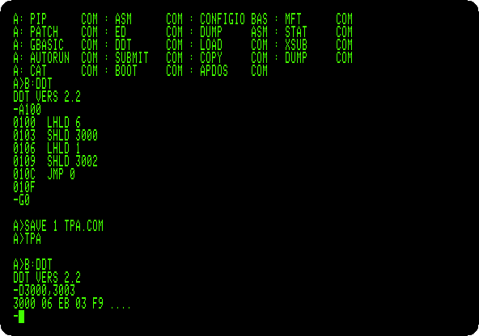
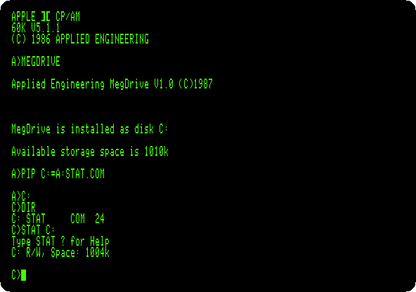

# CP/M on three Z80 cards

[Activities](../README.md) › [Other systems](../sections/other-systems.md)

CP/M ran on the Z80 and the Apple II had a 6502, so to run CP/M an Apple II
owner bought a Z80 on a card. Microsoft made the first, the **Z80 SoftCard**,
in 1980. Its Z80 takes the machine over while the 6502 waits, and uses the
Apple's own memory, so the CP/M it runs has what the Apple has left. Others
followed, and some worked the other way round. On the **PCPI Applicard** and
on Microsoft's own **SoftCard II** of 1984, the Z80 has 64 KB of memory of
its own and runs CP/M there. The 6502 stays in charge of the screen, the
keyboard and the disks, and the two pass bytes to each other through a port.

Each card came with its own CP/M, and the SoftCard went through several
versions, from Microsoft and from others. This page starts every version
found for the three cards izapple2 has, one after the other, and compares
them: what each says when it starts, what came on its disk, how much memory
it leaves to the programs, and how much the same Microsoft BASIC finds free.

## What you need

The disks are in the CP/M folder of the [Asimov
archive](https://mirrors.apple2.org.za/ftp.apple.asimov.net/images/cpm/os/),
and `./fetch-disks.sh` in this repository downloads them all into `disks/`
and checks them. In that folder:

- **`Softcard 16-sector disk (Microsoft 1980).dsk`**: CP/M 2.20 of the
  SoftCard, for 44 KB.
- **`CPM1.PO`**, in `softcard.zip`: CP/M 2.20B of the SoftCard, for 56 KB.
- **`CPM60K.DSK`**: CP/M 2.23 of the SoftCard, for 60 KB.
- **`CPM2.23(60k).dsk`**: a CP/M 2.23B of 63 KB, marked as Datasoft's.
- **`CPM3.1_Disk_1.dsk`**, in `CPM3.1_Z80_Softcard.zip`: CP/M 3.0 for the
  SoftCard.
- **`CPAM40B.dsk`**, **`A.E. CPM Plus card.dsk`** and **`CPAM51A.dsk`**:
  CP/AM 4.0B, 5.1 and 5.1.1, the CP/M of Applied Engineering.
- **`Microsoft Softcard II CPM 2.28B.DSK`**: CP/M 2.28B of the SoftCard II.
- **`pcpiboot.do`**, in the `pcpi` folder: CP/M 2.2 of the Applicard, the
  boot disk of PCPI.

The manuals are on the Internet Archive: the
[SoftCard CP/M Reference Manual](https://archive.org/details/Microsoft_SoftCard_CPM_Reference_Manual)
of Microsoft, the
[SoftCard II Installation and Operations Manual and Programmer's Manual](https://archive.org/details/softcard-ii-installation-and-operations-manual-and-programmers-manual-1),
and the
[Appli-Card 2.0 Installation and User's Manual](https://archive.org/details/appli-card-2.0-installation-and-users-manual)
of PCPI.

## The machines

Two machines, each with two disk drives on a Disk II controller card in
slot 6 and a Z80 card in slot 4, the card of the CP/M started:

- an Apple \]\[+, its 6502 at 1 MHz, 48 KB of memory, Applesoft BASIC in its
  ROM and the keyboard that types only capitals, with a 16 KB Language Card
  in slot 0, which makes the memory 64 KB;
- an Apple //e, its 6502 at 1 MHz, 128 KB of memory with its extended 80
  column card.

The cards are the **Microsoft Z80 SoftCard**, the **Microsoft SoftCard II**
and the **PCPI Applicard**. The last steps add a Videx card to the \]\[+,
and a RamWorks to the //e.

Each version starts with its disk in drive 1, and has the disk of CP/M 2.23,
`CPM60K.DSK`, in drive 2, for the DDT on it; the command of each is in its
step. The SoftCard II and the Applicard need an izapple2 built from its
master, the releases don't have them yet.

## The SoftCard

1. **Start CP/M 2.20** on the \]\[+, the CP/M of the SoftCard of 1980:

   ```bash
   izapple2 -model none -board 2plus -cpu 6502 -screen green \
       -rom "<internal>/Apple2_Plus.rom" \
       -charrom "<internal>/Apple2rev7CharGen.rom" -forceCaps \
       -s0 language \
       -s4 z80softcard \
       -s6 'diskii,disk1=disks/Softcard 16-sector disk (Microsoft 1980).dsk,disk2=disks/CPM60K.DSK'
   ```

   

   *44K*: the Z80 shares the 48 KB of the \]\[+. The Apple keeps the
   bottom of its memory, the text screen among it, and the SoftCard moves the
   Z80's addresses so that CP/M still finds its memory where it wants it.
   This version is for a \]\[+ without the Language Card, and starts on one
   with it too.

2. **Start CP/M 2.20B**, the version that came after, for 56 KB:

   ```bash
   izapple2 -model none -board 2plus -cpu 6502 -screen green \
       -rom "<internal>/Apple2_Plus.rom" \
       -charrom "<internal>/Apple2rev7CharGen.rom" -forceCaps \
       -s0 language \
       -s4 z80softcard \
       -s6 'diskii,disk1=disks/CPM1.PO,disk2=disks/CPM60K.DSK'
   ```

   

   *56K*, for a \]\[+ with the Language Card. [CP/M on the Z80
   SoftCard](cpm.md) uses this disk. In izapple2, 2.20 and 2.20B stop on the //e after the drive, so the
   page starts them on the \]\[+, the machine of their time.

3. **Start CP/M 2.23** on the //e, Microsoft's version of 1982, for 60 KB:

   ```bash
   izapple2 -model none -board 2e -cpu 6502 -screen green \
       -rom "<internal>/Apple2e.rom" \
       -charrom "<internal>/Apple IIe Video Unenhanced.bin" \
       -s0 language \
       -s4 z80softcard \
       -s6 'diskii,disk1=disks/CPM60K.DSK,disk2=disks/CPM60K.DSK'
   ```

   

   It knows the //e: 80 columns and lower case, with the 80 column card of
   the //e. **Type `DIR`** for the files of its disk:

   

   The tools of Digital Research, `PIP`, `ED`, `ASM`, `DDT`, `STAT`,
   `SUBMIT`, with Microsoft's BASIC-80, `MBASIC` and `GBASIC`, and the
   programs of the SoftCard, `CONFIGIO.BAS`, `APDOS`, `COPY`, `CPM60` and
   others.

4. **Start the CP/M 2.23B of Datasoft**, back on the \]\[+, which says it
   has 63 KB:

   ```bash
   izapple2 -model none -board 2plus -cpu 6502 -screen green \
       -rom "<internal>/Apple2_Plus.rom" \
       -charrom "<internal>/Apple2rev7CharGen.rom" -forceCaps \
       -s0 language \
       -s4 z80softcard \
       -s6 'diskii,disk1=disks/CPM2.23(60k).dsk,disk2=disks/CPM60K.DSK'
   ```

   

   Like 2.20 and 2.20B, it stops on the //e after the drive. Its 63K is
   only in what it says: below, its CP/M sits in memory where the 56K of
   2.20B does, and its GBASIC is the one of 2.20B.

5. **Start CP/M 3.0**, a port of Digital Research's CP/M Plus to the
   SoftCard, by Werner Muenchheimer in Germany in 1989:

   ```bash
   izapple2 -model none -board 2e -cpu 6502 -screen green \
       -rom "<internal>/Apple2e.rom" \
       -charrom "<internal>/Apple IIe Video Unenhanced.bin" \
       -s0 language \
       -s4 z80softcard \
       -s6 'diskii,disk1=disks/CPM3.1_Disk_1.dsk,disk2=disks/CPM60K.DSK'
   ```

   

   Its loader lists the parts of the system it loads, the BIOS and the BDOS,
   and where, and leaves *46K TPA*, the memory for the programs. **Type
   `DIR`**: some of the programs of CP/M 3 are new, `DATE`, `SET`,
   `SETDEF` and `SHOW` among them.

   

6. **Start CP/AM 4.0B**, the CP/M of Applied Engineering, of 1985:

   ```bash
   izapple2 -model none -board 2e -cpu 6502 -screen green \
       -rom "<internal>/Apple2e.rom" \
       -charrom "<internal>/Apple IIe Video Unenhanced.bin" \
       -s0 language \
       -s4 z80softcard \
       -s6 'diskii,disk1=disks/CPAM40B.dsk,disk2=disks/CPM60K.DSK'
   ```

   

   CP/AM was made for the Z-80 Plus, the Z80 card Applied Engineering
   sold, a copy of the SoftCard that works as it does. izapple2 has no
   Z-80 Plus, and doesn't need it: CP/AM starts on its SoftCard. On the
   Applicard and the SoftCard II it says *NO A.E. Z-80 PLUS CARD FOUND.*

7. **Start CP/AM 5.1** and **CP/AM 5.1.1**, of 1986, for 60 KB:

   ```bash
   izapple2 -model none -board 2e -cpu 6502 -screen green \
       -rom "<internal>/Apple2e.rom" \
       -charrom "<internal>/Apple IIe Video Unenhanced.bin" \
       -s0 language \
       -s4 z80softcard \
       -s6 'diskii,disk1=disks/A.E. CPM Plus card.dsk,disk2=disks/CPM60K.DSK'
   ```

   

   ```bash
   izapple2 -model none -board 2e -cpu 6502 -screen green \
       -rom "<internal>/Apple2e.rom" \
       -charrom "<internal>/Apple IIe Video Unenhanced.bin" \
       -s0 language \
       -s4 z80softcard \
       -s6 'diskii,disk1=disks/CPAM51A.dsk,disk2=disks/CPM60K.DSK'
   ```

   

   **Type `DIR`** on 5.1.1. Beside the programs of CP/M are Applied
   Engineering's own, `RAMBOOT`, `MEGDRIVE`, `CPAM60F` and `CPAM60S` among
   them, which use the memory of a //e beyond its 64 KB, below. A file named
   `-10/7/87 R21` looks like the label of someone's own copy, not a master.

   

## The SoftCard II

8. **Start CP/M 2.28B** on the //e with the SoftCard II:

   ```bash
   izapple2 -model none -board 2e -cpu 6502 -screen green \
       -rom "<internal>/Apple2e.rom" \
       -charrom "<internal>/Apple IIe Video Unenhanced.bin" \
       -s0 language \
       -s4 z80softcard2 \
       -s6 'diskii,disk1=disks/Microsoft Softcard II CPM 2.28B.DSK,disk2=disks/CPM60K.DSK'
   ```

   

   *64K*: all of the Z80's memory is its own, none of it the Apple's.
   **Type `DIR`**:

   

   The programs of the SoftCard's 2.23, but for `MBASIC`, `CPM60` and
   `DOWNLOAD`: of the two BASICs, Microsoft kept GBASIC, the one with the
   graphics. On the \]\[+ this CP/M prints its
   words in lower case, which the \]\[+ shows as other signs.

## The Applicard

9. **Start CP/M 2.2** on the //e with the Applicard:

   ```bash
   izapple2 -model none -board 2e -cpu 6502 -screen green \
       -rom "<internal>/Apple2e.rom" \
       -charrom "<internal>/Apple IIe Video Unenhanced.bin" \
       -s0 language \
       -s4 applicard \
       -s6 'diskii,disk1=disks/pcpiboot.do,disk2=disks/CPM60K.DSK'
   ```

   

   This is the CP/M of Digital Research as it came, version 2.2, with PCPI's
   part, version 2.0, under it. Licensed to MicroPro, the makers of
   WordStar. The Z80 has its own memory, so the Apple's is free, and PCPI
   uses it as a buffer for the printer: *83.5K* on the //e.

   **Type `DIR`**:

   

   The tools of Digital Research again, and PCPI's own, `DRIVERS`,
   `ADOSXFER`, `COPYFRMT`, `CLRPBUF`, `DOSRDSK` and `NRDRDSK`. No BASIC.

10. **Start it on the \]\[+**, with the Applicard in slot 4:

    ```bash
    izapple2 -model none -board 2plus -cpu 6502 -screen green \
        -rom "<internal>/Apple2_Plus.rom" \
        -charrom "<internal>/Apple2rev7CharGen.rom" -forceCaps \
        -s0 language \
        -s4 applicard \
        -s6 'diskii,disk1=disks/pcpiboot.do,disk2=disks/CPM60K.DSK'
    ```

    ![CP/M 2.2 of the Applicard on the \]\[+](images/cpm-cards/applicard-2.0-plus.png)

    The same CP/M, in capitals and 40 columns, and a buffer of *35.5K*: the
    \]\[+ has 64 KB with its Language Card, the //e has 128 KB with its 80
    column card.

## The same BASIC on each

GBASIC, Microsoft's BASIC-80 with the graphics of the Apple II, is on the
disks of the SoftCard and of the SoftCard II. The number it says when it
starts, the memory free for a program, compares the versions.

11. **Type `GBASIC`** on CP/M 2.20, 2.23 and 2.28B:

    

    

    

    On 2.20B and on Datasoft's 2.23B it says *17393 BYTES FREE*; both have
    the GBASIC of November 1980. The Applicard, CP/AM and CP/M 3 have no
    GBASIC. Type `SYSTEM` to go back to CP/M.

## The memory for the programs

The programs of CP/M run from address 0100, hexadecimal, up to where the BDOS
starts, the part of CP/M they call for the disk and the screen: that memory
is the TPA, the Transient Program Area. A program finds the BDOS by the
jump at address 5, and the address of that jump, at 6 and 7, is the top of
its memory. Above the BDOS is the BIOS, the part written for the machine,
and the jump at address 0 goes into it, to start CP/M again. DDT, the
debugger of CP/M, could show both, but under DDT the jump at 5 goes to DDT,
which moves itself just under the BDOS. So a program of five instructions,
assembled in DDT, copies the two addresses away, and runs without DDT.

12. **Start DDT** from drive 2, type its `A` command and the program, an
    empty line to end it, and `G0` to leave DDT:

    ```
    B:DDT
    A100
    LHLD 6
    SHLD 3000
    LHLD 1
    SHLD 3002
    JMP 0

    G0
    ```

    `LHLD 6` loads the address at 6 and 7, `SHLD 3000` stores it at 3000,
    the next two do the same with the address at 1 and 2, and `JMP 0` goes
    back to CP/M. **Type `SAVE 1 TPA.COM`**, which saves one page, 256 bytes
    from 0100, as the program `TPA`, **type `TPA`** to run it, then **type
    `B:DDT`** again and **`D3000,3003`** to show what it stored. Here on the
    SoftCard II:

    

    *06 EB*, low byte first: the jump goes to EB06, the BDOS starts at
    EB00, and the TPA is from 0100 to EAFF, 59,904 bytes. *03 F9*: the BIOS
    starts at F900. **Type `G0`** to go back to CP/M.

    The `SAVE` of CP/M 3 works the other way round: **type `SAVE`** before
    `B:DDT`, and when DDT ends, it asks for the name of the file, `TPA.COM`,
    and the addresses to save, from `100` to `10E`.

The same program on each version, in the order of the page:

| Card | CP/M | Of | It says | BDOS at | BIOS at | TPA | As a CP/M 2.2 of | GBASIC leaves |
|---|---|---|---|---|---|---|---|---|
| SoftCard | 2.20 | Microsoft, 1980 | 44K | 9C00 | AA00 | 39,680 bytes | 44K | 5,105 bytes |
| SoftCard | 2.20B | Microsoft, 1980 | 56K | CC00 | DA00 | 51,968 bytes | 56K | 17,393 bytes |
| SoftCard | 2.23 | Microsoft, 1982 | 60K | DC00 | FA00 | 56,064 bytes | 60K | 21,489 bytes |
| SoftCard | 2.23B | Datasoft, 1982 | 63K | CC00 | DA00 | 51,968 bytes | 56K | 17,393 bytes |
| SoftCard | 3.0 | Werner Muenchheimer, 1989 | 46K TPA | BA00 | D900 | 47,360 bytes | | |
| SoftCard | CP/AM 4.0B | Applied Engineering, 1985 | 44K | 9C00 | AA00 | 39,680 bytes | 44K | |
| SoftCard | CP/AM 5.1 and 5.1.1 | Applied Engineering, 1986 | 60K | CD00 | DB00 | 52,224 bytes | 56.25K | |
| SoftCard II | 2.28B | Microsoft, 1984 | 64K | EB00 | F900 | 59,904 bytes | 63.75K | 32,807 bytes |
| Applicard | 2.2, PCPI 2.0 | Digital Research and PCPI | | E500 | F300 | 58,368 bytes | 62.25K | |

The years and the sizes the systems say are those they show when they start.
The size a CP/M 2.2 says is the memory it was made for: Digital Research's
[CP/M 2.2 Alteration
Guide](http://www.gaby.de/cpm/manuals/archive/cpm22htm/ch6.htm) puts the BDOS
of a CP/M of 20K at 3C00 and its BIOS at 4A00, and those of a bigger one as
many kilobytes higher as it has more. By that rule the BDOS of each is that of
the size in the next to last column. Microsoft's 44K, 56K and 60K are what
they say; 2.23 keeps its BIOS higher than the rule, at FA00, as its 60K would
put it at EA00. Datasoft's "63K" is Microsoft's 56K, with its BDOS and BIOS
where they are in 2.20B, and leaves exactly what it does. CP/AM's 60K is a
56K and a quarter, and leaves 3.75 KB less than Microsoft's 60K. The
SoftCard II leaves the most, its Z80 having its 64 KB to itself; the
Applicard 1.5 KB less, with the same 64 KB. CP/M 3 is built another way, and
says its TPA itself, 46K, and it is: 46.25 KB.

Each version leaves the same memory on each machine it starts on, below: the
\]\[+ or the //e, with an 80 column card or without.

On the SoftCard II, GBASIC's `HPLOT` doesn't end in izapple2 yet, so the
page doesn't draw with it; see [CP/M on the Z80 SoftCard](cpm.md) for a
drawing on the SoftCard.

## On the \]\[+ and on the //e

Each version, started on six machines: the \]\[+ alone, with 48 KB; with the
Language Card in slot 0; with a Videx Videoterm in slot 3 as well, the 80
column card of the \]\[+; the //e of the page; the same //e with a Videx
Videoterm in slot 3; and the enhanced //e, with its 65C02. The commands are
those of the steps above, with `-s0 language` taken out, or `-s3 videx`
added, or for the enhanced //e `-cpu 65c02`, the ROM
`<internal>/Apple2e_Enhanced.rom` and the characters
`<internal>/Apple IIe Video Enhanced.bin`. It starts in 40 columns, in the 80
of the //e, in the 80 of the Videx, or doesn't start:

| CP/M | \]\[+ | \]\[+, Language Card | \]\[+, Language Card, Videx | //e | //e, Videx | Enhanced //e |
|---|---|---|---|---|---|---|
| 2.20 | 40 | 40 | no | no | no | no |
| 2.20B | no | 40 | no | no | no | no |
| 2.23 | no | 40 | Videx | 80 | 80 | 80 |
| 2.23B of Datasoft | no | 40 | no | no | no | no |
| 3.0 | no | no | Videx | 80 | 80 | 80 |
| CP/AM 4.0B | 40 | 40 | Videx | 80 | 80 | 80 |
| CP/AM 5.1 and 5.1.1 | no | no | Videx | 80 | 80 | 80 |
| 2.28B of the SoftCard II | no | 40, lower case as other signs | Videx | 80 | Videx | 80 |
| 2.2 of the Applicard | 40 | 40 | Videx | 80 | 80 | 80 |

- **The Language Card**: on the SoftCard, the Z80 has the Apple's memory, so
  the versions of 56K and more need the 16 KB of the Language Card, and
  those of 44K start without it. The SoftCard II needs it as well, though
  its Z80 has its own memory. The Applicard starts without it, and its
  buffer for the printer, in the Apple's memory, grows with it: *19.5K* on
  the \]\[+ of 48 KB, *35.5K* with the Language Card.
- **80 columns**: on the //e, every version that starts uses the 80 columns
  of the //e, and only the SoftCard II goes to a Videx card when there is
  one. On the \]\[+ the Videx is used by every version that starts with it,
  and CP/M 3, CP/AM 5.1 and 5.1.1 and the SoftCard II need it: without it,
  CP/M 3 runs the 6502 into an instruction it doesn't have, which stops
  izapple2, CP/AM 5.1 stays at the *APPLE \]\[* of the start, 5.1.1 at an
  empty screen, and the SoftCard II prints its lower case. 2.20, 2.20B and Datasoft's 2.23B are of
  40 columns, and in izapple2 they stay at the *APPLE \]\[* of the start
  when there is a Videx card in slot 3. The enhanced //e changes nothing.
- **The memory of the //e beyond 64 KB**: the Applicard uses it for its
  buffer for the printer, which grows to *83.5K*, and CP/AM makes a disk of
  it, below. A RamWorks of 1 MB in its place doesn't make the Applicard's
  buffer bigger.

13. **Start CP/M 3.0 on the \]\[+**, with the Language Card and the Videx
    card:

    ```bash
    izapple2 -model none -board 2plus -cpu 6502 -screen green \
        -rom "<internal>/Apple2_Plus.rom" \
        -charrom "<internal>/Apple2rev7CharGen.rom" -forceCaps \
        -s0 language \
        -s3 videx \
        -s4 z80softcard \
        -s6 'diskii,disk1=disks/CPM3.1_Disk_1.dsk,disk2=disks/CPM60K.DSK'
    ```

    ![CP/M 3.0 on the \]\[+ with a Videx card](images/cpm-cards/softcard-3.0-videx.png)

    The same CP/M 3, its BIOS and BDOS where they are on the //e, in the
    letters of the Videx.

14. **Start CP/AM 5.1.1 on a //e with a RamWorks**, Applied Engineering's
    card of memory for the auxiliary slot, here of 1 MB, which also gives
    the 80 columns:

    ```bash
    izapple2 -model none -board 2e -cpu 6502 -screen green \
        -rom "<internal>/Apple2e.rom" \
        -charrom "<internal>/Apple IIe Video Unenhanced.bin" \
        -ramworks 1024 \
        -s0 language \
        -s4 z80softcard \
        -s6 'diskii,disk1=disks/CPAM51A.dsk,disk2=disks/CPM60K.DSK'
    ```

    **Type `MEGDRIVE`**, which makes a disk C: of the memory of the card,
    **`PIP C:=A:STAT.COM`** to copy a file to it, **`C:`**, **`DIR`** and
    **`STAT C:`**:

    

    A disk of 1010K, gone when the machine is turned off. On the //e without the RamWorks, MEGDRIVE makes
    it of 54K. CP/AM 4.0B and 5.1 have `RAMDRIVE` instead, which does the
    same.

## Other disks found

These were found too, and are not on the page:

- 44 KB versions of 2.20B, the *Original Master* of the [RIAG
  collection](https://archive.org/details/riag_008_049_-_Microsoft_-_Softcard_-_Original_-_Master),
  and of 2.23, `CPMV233.DSK` on Asimov: the same versions, for a \]\[+
  without a Language Card.
- The Applicard's disk as sold with the StarCard, `Starcard - CPM Version 2.2 CP2-681-10107.DSK` on Asimov: the
  same CP/M 2.2 and PCPI 2.0.
- The Premium SoftCard IIe of Microsoft, a Z80 for the auxiliary slot of the
  //e, with CP/M 2.25 and 2.26: izapple2 doesn't have this card.
- The CP/M card of ALS, Advanced Logic Systems: izapple2 doesn't have this
  card either.
- *XEBEC APPLE CP/M V2.20B*, on the [Internet
  Archive](https://archive.org/details/xebec-apple-cpm-v-2.20-b), for the
  SoftCard: in izapple2 it finds the card and then fills the screen with
  `@`.

## What next

**Next:** [CP/M-65: CP/M on the 6502](cpm65.md), CP/M written again for the
6502 itself.

[CP/M on the Z80 SoftCard](cpm.md) does more with CP/M 2.20B: an assembler
source, a program in BASIC-80 saved as a file, and a drawing in GBASIC.
[Turbo Pascal on CP/M](turbo-pascal.md) programs on the SoftCard.
