# CP/M-65: CP/M on the 6502

[Back to the activities](../README.md)

CP/M, the operating system of Digital Research, was written for the 8080 and
the Z80, and the Apple II only ran it with a Z80 on a card, the
[SoftCard](cpm.md). **CP/M-65** is CP/M written again for the 6502 itself,
by David Given, begun in 2022: the same commands, `DIR`, `ERA`, `TYPE`,
`STAT`, `SUBMIT`, the same files of eight letters and three, and programs
that ask the BDOS for what they need, as on CP/M. It runs on many machines of
the 6502, the BBC Micro, the Commodore 64, the Atari 800, the Oric and the
Apple //e among them, and its programs are relocatable, so that the same
file runs on all of them, loaded wherever each has room.

This page starts CP/M-65 on an enhanced Apple //e, looks at its disk, runs
the demonstration that assembles a program on the machine, writes a program
of its own in the editor QE, assembles it and runs it, and writes a program
in the Atari BASIC it comes with, saved among the files.

## What you need

**`cpm65-apple2e.po`**, the disk of CP/M-65 for the Apple //e that izapple2
has inside for its model `cpm65`, since 2024. It is
[in the repository of izapple2](https://github.com/ivanizag/izapple2/blob/e8a44a8af88d3e12af66a6665264911a0c893565/resources/cpm65.po);
`./fetch-disks.sh` in this repository downloads it into `disks/` and checks
it. The newest disk is `apple2e.po` in the
[development release](https://github.com/davidgiven/cpm65/releases/tag/dev)
of CP/M-65, built again with each change, so its files may differ from the
ones here.

The [README of CP/M-65](https://github.com/davidgiven/cpm65) tells what it
has, and its assembler, its editors and its BASIC are described in the text
files of the disk itself, as `ASM.TXT`, and in the
[manual of Altirra BASIC](https://www.virtualdub.org/downloads/Altirra%20BASIC%20Reference%20Manual.pdf).

The two programs of this page are
[listings/alphabet.asm](listings/alphabet.asm) and
[listings/powers.bas](listings/powers.bas).

## The machine

An enhanced Apple //e:

- the 65C02 processor at 1 MHz and 128 KB of memory: 64 KB on the board,
  the top 16 KB of it the memory of a language card, which izapple2 puts in
  slot 0, and 64 KB more on the extended 80 column card, in the auxiliary
  slot, which gives CP/M-65 its 80 columns;
- a Disk II controller card in slot 6, with CP/M-65 in drive 1.

```bash
izapple2 -model none -board 2e -cpu 65c02 -screen green \
    -rom "<internal>/Apple2e_Enhanced.rom" \
    -charrom "<internal>/Apple IIe Video Enhanced.bin" \
    -s0 language \
    -s6 diskii,disk1=disks/cpm65-apple2e.po
```

The model `cpm65` of izapple2 has this machine, with 8 MB more of memory on
a RAMWorks card, a No-Slot Clock, a VidHD card, a FASTChip accelerator and a
Mockingboard more, and this same disk inside izapple2; named on the command
line, the disk of `disks/` goes in its place:

```bash
izapple2 -model cpm65 -screen green disks/cpm65-apple2e.po
```

## Start it

1. **Start izapple2** with the command above. In a few seconds of the
   drive, the name of the system and its prompt, `A>`: drive A, waiting
   for a command.

   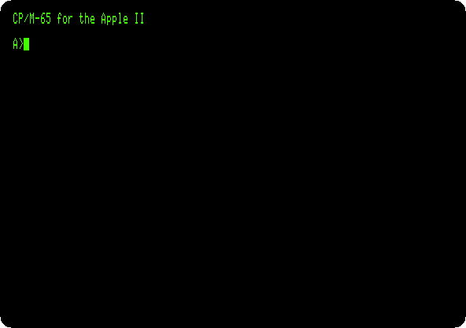

2. **Type `DIR`**, **`STAT`** and **`CPUINFO`**, each with Return. `DIR`
   lists the files of the disk, five to a line: the commands, the files
   `.COM`, and their texts and sources. `STAT` says how much room is left,
   2 KB of 133, and `CPUINFO` which processor it runs on, the 65C02 of the
   enhanced //e.

   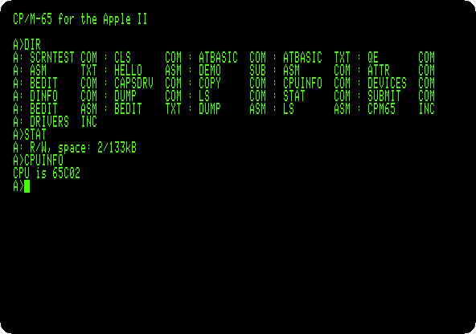

## A program assembled on the machine

3. **Type `CLS`** to clear the screen, and **`SUBMIT DEMO`**. `SUBMIT` runs
   the commands of a file, `DEMO.SUB`, one after the other, as if typed:
   `type hello.asm` shows a program in the assembly language of the 6502,
   `asm hello.asm hello.com` assembles it into a command, and `hello` runs
   it.

   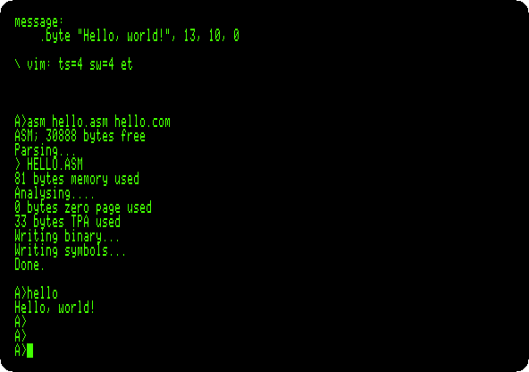

   The program loads the address of its message into A and X, the number
   of a function of the BDOS into Y, 9, which writes a text, and calls the
   BDOS. `jsr start - 3` is that call: CP/M-65 puts a jump to the BDOS just
   before the first instruction of each program it loads, wherever that is.

## A program of your own

The assembler leaves files of its own on the disk, and 2 KB are not
enough for one more program.

4. **Make room: type `ERA BEDIT.ASM`**, which erases the source of the
   editor BEDIT, and **`STAT`**: 29 KB free now.

   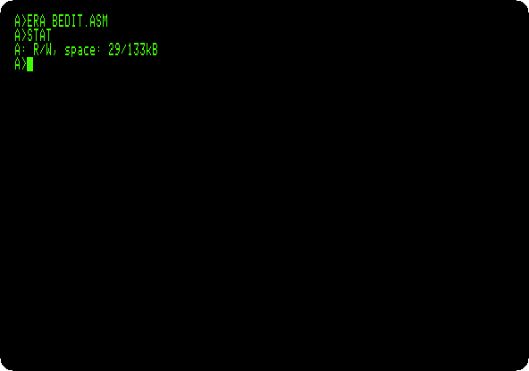

5. **Type `QE ALPHABET.ASM`.** QE is a screen editor in the manner of vi:
   the file is new, and empty, *Could not read file*. **Press `i`** to
   insert, and **type the program**, a line with Return after each, the
   last too:

   ```asm
   \ The alphabet, a letter at a time, by the BDOS
   start:
       lda #'A'
       sta letter
   next:
       lda letter
       ldy #2
       jsr start - 3
       lda letter
       inc letter
       cmp #'Z'
       bne next
       lda #13
       ldy #2
       jsr start - 3
       lda #10
       ldy #2
       jsr start - 3
       rts
   letter:
       .byte 0
   ```

   It writes the letters from A to Z with function 2 of the BDOS, which
   writes the character in A, keeping the letter in a byte of its own, as
   the BDOS changes the registers; then a carriage return, 13, and a line
   feed, 10. The line after `\` is a comment.

   **Press Escape**, to stop inserting.

   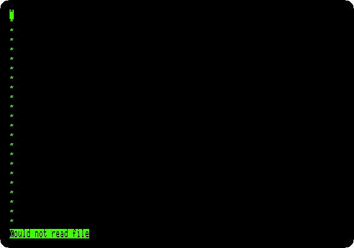

   Then **type `:wq`** and Return: QE writes the file, *Writing
   ALPHABET.ASM*, and quits.

   CP/M-65 has a simpler editor too, BEDIT, a line editor with line numbers
   in the manner of BASIC. Its `SAVE` writes only the first 128 bytes of each
   256 of the file, in this version, so a program longer than 128 bytes saved
   with it is cut; QE writes it whole.

6. **Type `CLS`**, **`ASM ALPHABET.ASM ALPHABET.COM`** and **`ALPHABET`**:
   assembled, and run.

   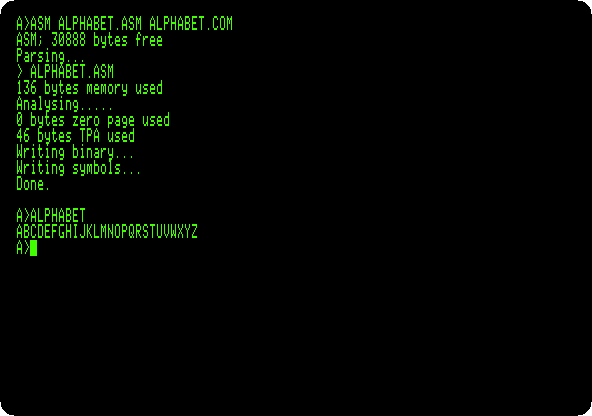

7. **Type `DUMP ALPHABET.COM`**: the file, in hexadecimal. The program is
   at 000007, `A9 41`, `lda #'A'`; before it, four bytes that tell CP/M-65
   how much memory the program needs and where its table of relocation
   starts, 00002E, and `4C 00 00`, the jump to the BDOS, which CP/M-65 fills
   in as it loads the program. From 00002E, after the 39 bytes of the
   program, that table: which bytes to change for the address the program
   is loaded at.

   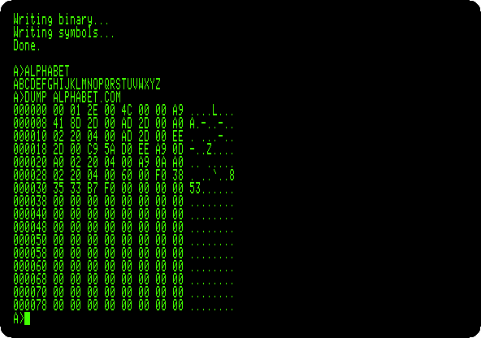

## Atari BASIC

CP/M-65 comes with a BASIC, `ATBASIC`: Altirra BASIC, a recreation of the
BASIC of the Atari 8-bit computers, made to run on CP/M-65 by its author,
without the graphics and the sound of the Atari, and with files of CP/M.

8. **Type `CLS`** and **`ATBASIC`**. It says *Ready*. The disk has an
   example as text, `ATBASIC.TXT`: **type `ENTER "ATBASIC.TXT"`**, which
   reads a program from a text, **`LIST`** and **`RUN`**.

   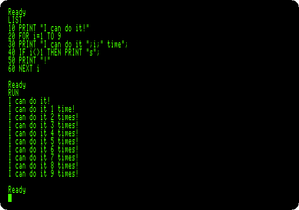

9. **Type `NEW`**, and the program of the page, a line at a time with
   Return:

   ```basic
   10 FOR N=1 TO 12
   20 PRINT N,N*N,2^N
   30 NEXT N
   ```

   and **`RUN`**: a number, its square and two to its power, in columns.
   The powers come out a little off, 3.99999999 for 2 to the 2: they are
   worked out with logarithms, not by multiplying.

   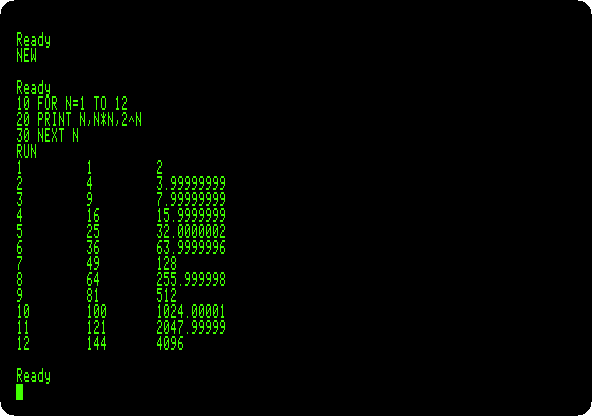

10. **Type `SAVE "POWERS.BAS"`**, **`NEW`**, which empties the memory,
    **`LOAD "POWERS.BAS"`** and **`LIST`**: the program is back, from the
    disk.

    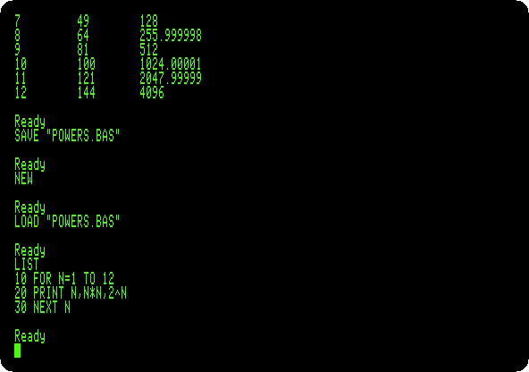

11. **Type `BYE`**, back to CP/M-65, and **`DIR`**: among the files,
    `POWERS.BAS`, and the program of the page, `ALPHABET.ASM`, the command
    `ALPHABET.COM` and the symbols the assembler wrote, `ALPHABET.SYM`.

    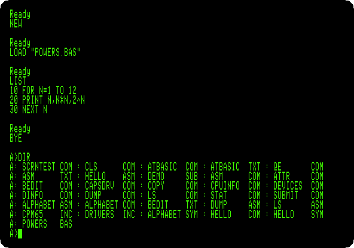

## What next

**Next:** [The languages of the BBC Micro on a //e: Applecorn](applecorn.md).

[CP/M on the Z80 SoftCard](cpm.md) is the CP/M of its day on the Apple II,
on a Z80, and [Assembly language with Merlin](merlin.md) assembles a
program for the 6502 with the assembler of ProDOS days.
