# Dazzle Draw: sixteen colours on the Apple IIc

[Activities](../README.md) › [Making things and work](../sections/making-things-and-work.md)

The //e with its extended 80 column card, and every IIc, have 128 KB of
memory, and with it a mode of graphics the Apple \]\[ didn't have: **double
high resolution**, made as the 80 columns, half of each line in each 64 KB:
560 dots across, twice as many as high resolution, or 140 in sixteen
colours, all the ones of low resolution. **Dazzle Draw**, of David Snider,
published by Broderbund in 1984, was a painting program for it, with the
mouse: menus at the top, the colours and the choices of each tool at the
bottom, and the whole screen to paint on.

This page loads two of the pictures that came with it, and paints one of its
own: a sky, a house, the sun, flowers, and a line of text.

## What you need

**`Dazzle Draw 1.2.dsk`**, the program, its last version, of 1988, and
**`Dazzle Draw Slide Show.DSK`**, a disk of pictures for it, whose volume is
`DD.FLIPSIDE`, the other side of the Dazzle Draw disk by its name. Both are
in the [folder of Dazzle Draw](https://mirrors.apple2.org.za/ftp.apple.asimov.net/images/productivity/graphics/dazzle_draw/)
on Asimov. `./fetch-disks.sh` in this repository downloads them into
`disks/`.

## The machine

The Apple IIc of 1984, on a colour monitor, with its mouse, and a second
disk drive, which plugged into its back:

- the 65C02 processor at 1 MHz and 128 KB of memory: 64 KB, the top 16 KB
  of it the memory of a language card, which izapple2 puts in slot 0 as for
  the //e, and 64 KB more where the //e has its extended 80 column card;
- its two serial ports, in slots 1 and 2 for the programs;
- its port for the mouse, which its ROM gives to the programs as a mouse
  card in slot 4; izapple2's IIc has the mouse in it;
- its disk drive, on the disk port in slot 6, with Dazzle Draw in drive 1 and
  its pictures in drive 2.

```bash
izapple2 -model none -board 2c -cpu 65c02 -screen color \
    -rom "<internal>/Apple2c_ROM255.rom" \
    -charrom "<internal>/Apple IIe Video Enhanced.bin" \
    -s0 language \
    -s1 iicserial \
    -s2 iicserial \
    -s6 "iicdisk,disk1=disks/Dazzle Draw 1.2.dsk,disk2=disks/Dazzle Draw Slide Show.DSK"
```

## Dazzle Draw

1. **Start izapple2** with the command above: ProDOS, and the title of
   Dazzle Draw, in double high resolution.

   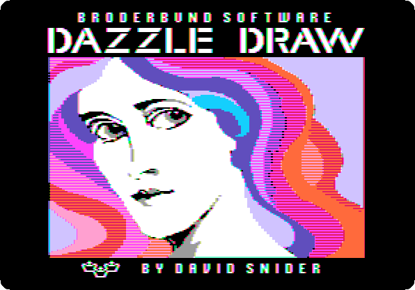

   It finds the mouse by itself.

   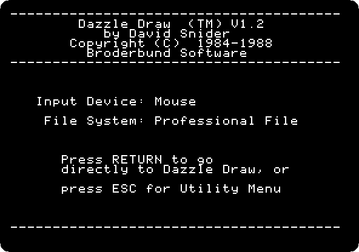

2. **Press Return**, and **move the pointer to the top left corner**: the
   pointer of Dazzle Draw goes by the steps of the mouse, and the one of
   izapple2's window by where it is, and they meet again on an edge. The
   menus, at the top, and the page, empty.

   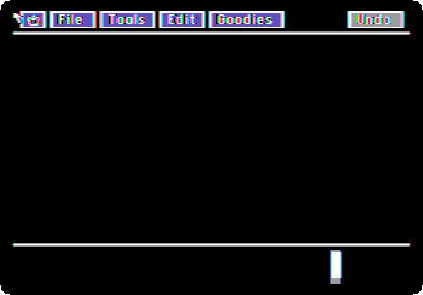

## Its pictures

3. **Hold the button on File, and let it go on *Load***, and **click
   *Picture***.

   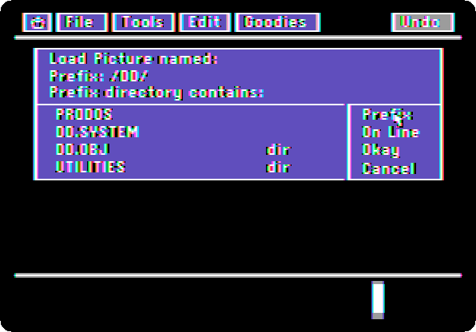

   The pictures are in drive 2: **click *On Line***, which lists the disks
   in the drives, **click *Prefix***, **click `/DD.FLIPSIDE`** and **click
   *Okay***. **Type `MONARCH`**, and **click *Okay***.

   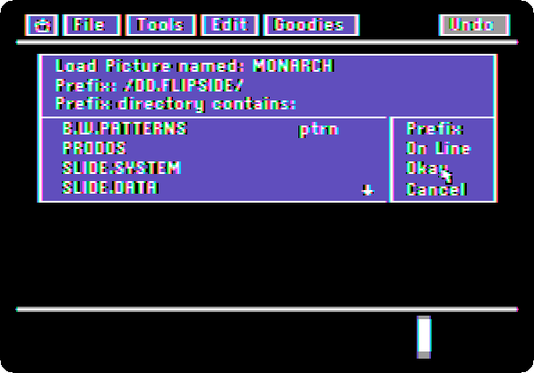

   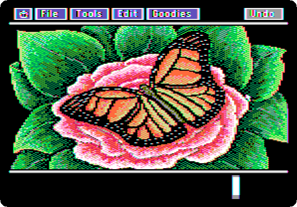

4. **Choose *View Picture* in the Goodies menu**: the whole screen, without
   the menus. **Click** to go back.

   

5. **Load `ROOM`** the same way, *Load*, *Picture*, its name and *Okay*: the
   prefix is kept. **View** it.

   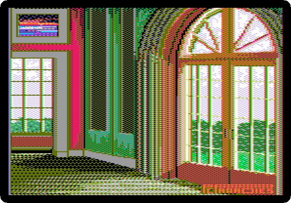

## A picture of its own

6. **Choose *Clear Picture* in the Goodies menu**, and **click *Yes***.

   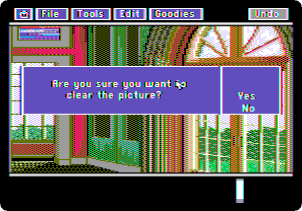

7. **Paint**: a tool in the Tools menu, a colour at the bottom left, and the
   mouse on the page.

   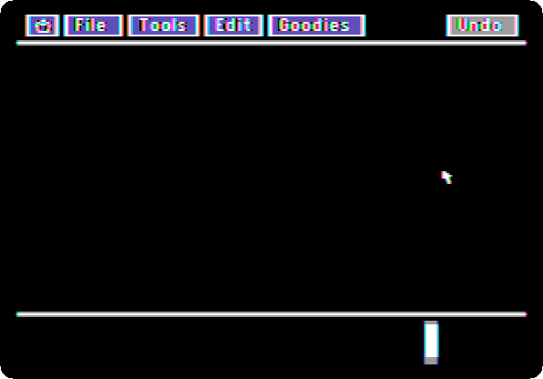

   - The sky: **Flood Fill**, **light blue**, and a click on the black. It
     fills a line at a time.
   - The ground: **Shapes**, **green**, the **filled rectangle** at the
     bottom, and the button held from a corner to the other. The sun: **the
     filled oval**, in **yellow**.
   - The house: **orange** and the filled rectangle for its walls, **olive**
     for the door, **white** for two windows.
   - The roof: **Lines**, **red**, three lines, and **Flood Fill** in it.
   - Flowers: **Spray Paint**, **magenta**, across the ground.
   - A line: **Text**, a click where it goes, and **type `Dazzle Draw,
     1985`**.

   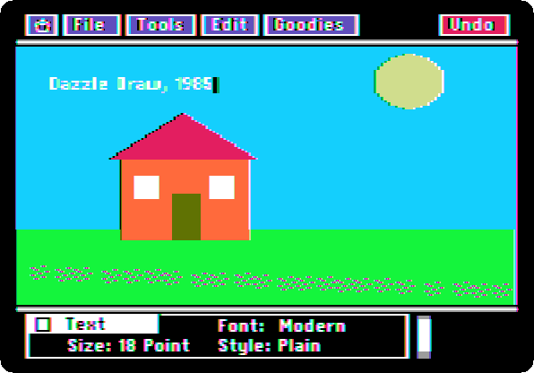

8. **Choose Zoom in the Tools menu**, and **click a window**: the dots of the
   picture, big enough to paint one at a time.

   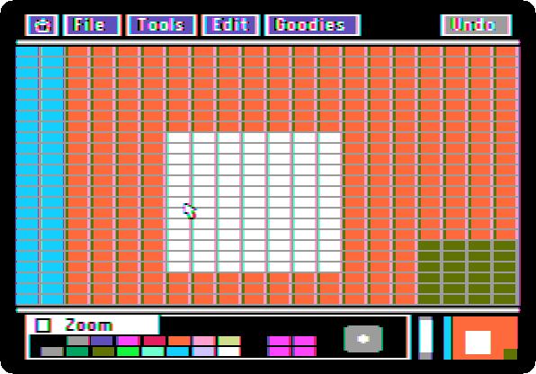

9. **Choose *View Picture* in the Goodies menu**.

   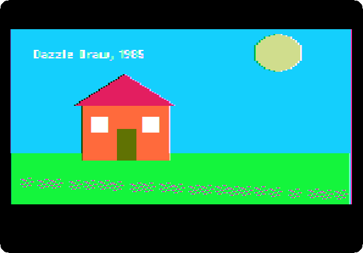

## What next

**Next:** [Printing](printing.md).

[MousePaint on the Apple IIc](mousepaint.md) is Apple's program for the mouse, in
black and white, and [The RGB card and its fourteen video
modes](rgb-card.md) shows double high resolution on the //e.
