# Fantavision: drawings that move

[Activities](../README.md) › [Making things and work](../sections/making-things-and-work.md)

Fantavision was Scott Anderson's animation program, published by Broderbund
in 1985 for the Apple II, and later for the Apple IIgs and the IBM PC. You
draw shapes as points joined by lines, a few of them in each frame of a
movie, and the program draws the frames in between, as many as 64 of them:
a shape moves from where it is in one frame to where it is in the next, and
changes into the shape of the next on the way. Its manual calls the first
*tweening* and the second *transformation*. With a mouse, a joystick or a
graphics tablet, and no programming, anyone could make an animated title, a
greeting card or a show for a class, in the high resolution colours of the
Apple II.

This page watches the Movie Matinee, the show of movies on the back of the
disk, and then makes three movies in Fantavision: a star that turns into a
circle and a square, a title that spins, and a spiral of triangles that
leave their trace. It saves them on a diskette of its own and lists them.

## What you need

**`Fantavision side A - program.woz`** and **`Fantavision side B -
demos.woz`**, the two sides of the Fantavision disk, the program and the
demonstrations, in the
[woz-a-day collection](https://archive.org/details/wozaday_Fantavision) of
the Internet Archive: download *Fantavision (woz-a-day collection).zip* and
take them out of it. They are the original disk, copy protection and all.
`./fetch-disks.sh` in this repository downloads them into `disks/` and
checks them.

**`my-movies.po`**, a diskette of ProDOS for the movies. Fantavision formats
its own with *Format Disk* in its File menu, but in izapple2 that stops with
*Drive Error* (see [IZAPPLE2.md](../IZAPPLE2.md)). Its manual says that any
diskette of ProDOS will do instead, so this page saves on a copy of the
ProDOS 2.4.3 disk, which `./fetch-disks.sh` downloads too and which has 13
KB free, room for the three movies of the page:

```bash
cp disks/ProDOS_2_4_3.po my-movies.po
```

izapple2 writes what Fantavision saves straight into `my-movies.po`.

[The user's manual of Fantavision for the Apple II](https://archive.org/details/FantavisionUsersManualForAppleII8Bit)
is on the Internet Archive.

## The machine

An enhanced Apple //e with a mouse and two disk drives:

- the 65C02 processor at 1 MHz and 128 KB of memory: 64 KB on the board,
  the top 16 KB of it the memory of a language card, which izapple2 puts in
  slot 0, and 64 KB more on the extended 80 column card, in the auxiliary
  slot; Fantavision needs 64 KB;
- a mouse card in slot 4;
- a Disk II controller card in slot 6, with a side of the Fantavision disk
  in drive 1 and `my-movies.po` in drive 2. Fantavision wants a diskette in
  drive 2 when there is one: without it, the Movie Matinee stays on its
  title.

For the Movie Matinee, with the side of the demonstrations:

```bash
izapple2 -model none -board 2e -cpu 65c02 -screen color \
    -rom "<internal>/Apple2e_Enhanced.rom" \
    -charrom "<internal>/Apple IIe Video Enhanced.bin" \
    -s0 language -s4 mouse \
    -s6 'diskii,disk1=disks/Fantavision side B - demos.woz,disk2=my-movies.po'
```

For the program, with the side of the program:

```bash
izapple2 -model none -board 2e -cpu 65c02 -screen color \
    -rom "<internal>/Apple2e_Enhanced.rom" \
    -charrom "<internal>/Apple IIe Video Enhanced.bin" \
    -s0 language -s4 mouse \
    -s6 'diskii,disk1=disks/Fantavision side A - program.woz,disk2=my-movies.po'
```

## The Movie Matinee

1. **Start izapple2** with the first command. The title of the show comes
   up while the movies load.

   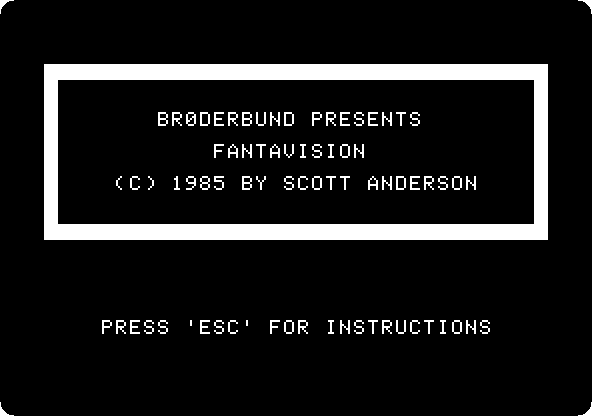

2. **Wait.** After about twenty seconds the movies start, one after the
   other, without a key: fireworks, a title, an apple, a face, words
   written by hand, a fish, shapes, a volcano, a spider, a ship, and more.
   These are five of them, at the speed of the machine.

   The title: *WELCOME TO* turns and shrinks to a dot, and the letter F
   grows out of the bottom, a stack of rings, and then the rest of the
   word.

   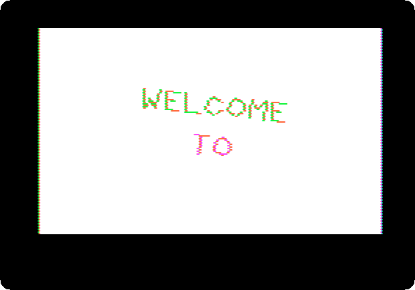

   The apple, drawn a line at a time and filled with colours, and the face,
   one shape that changes from frame to frame, the frames in between drawn
   by the program.

   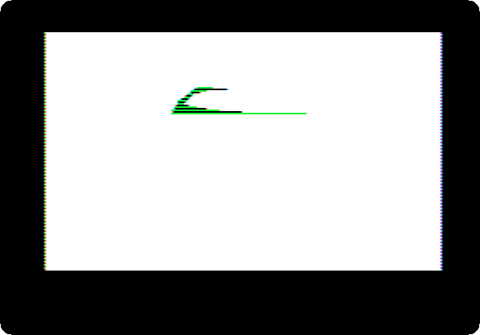

   The fish, whose mouth opens and shuts.

   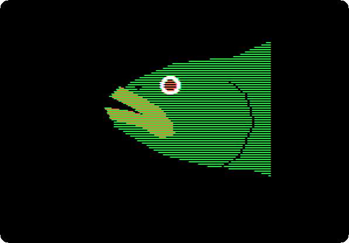

   The ship: the sea, the hull and the sails, each brought in by a shape that
   grows into it.

   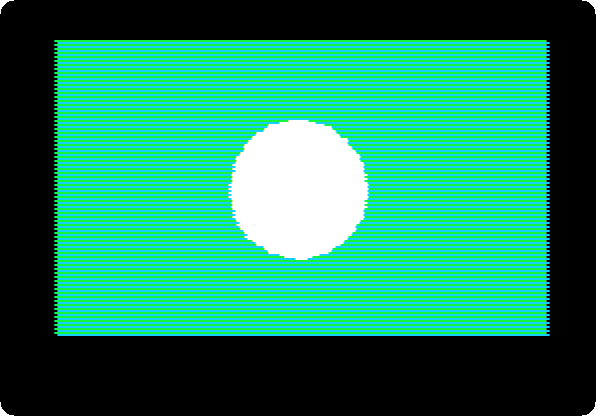

   The eye: lines that turn and leave behind them all the places they pass
   through.

   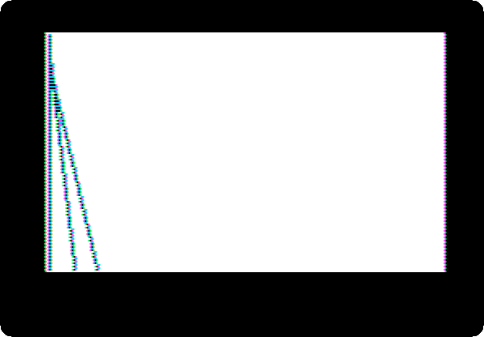

## Start Fantavision

3. **Start izapple2** with the second command. The title says which drawing
   tool Fantavision found: the mouse. The Space bar would choose another.

   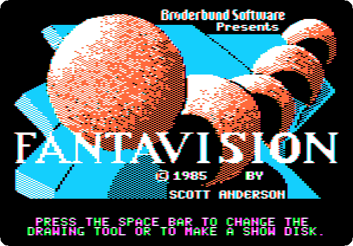

   The mouse is the mouse of your computer: wherever the pointer is on the
   izapple2 window, it is on the Apple II screen. Clicking is pressing its
   button.

4. **Wait.** The screen to draw on comes up, the pointer a pencil.

   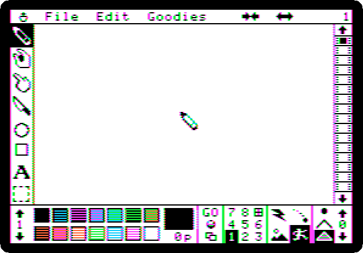

   Around the white page, the tools down the left: draw, grab a point,
   insert a point, delete a point, circle, rectangle, text `A` and the
   capture box. Along the bottom: the arrows of the palette, its number
   between them, and its fourteen colours; the colour of the object and its
   number of points; *GO*; the object counter, 1 to 8, with the French window, the square at
   the right of 8, for the background; the animation box, of four modes; and
   the dimension box, a dot, a line or a solid shape. Down the right, the
   film strip, the frame number above it. A frame holds up to eight
   objects, of up to 32 points each.

## A star that turns into a circle and a square

5. **Set the colours**: click the down arrow under the palette number,
   at the bottom left, twice, for palette 3, of orange and blue; click the
   French window, then black, the first colour, for a black background;
   then click **1** in the object counter, to draw object 1.

6. **Click orange**, the sixth colour of the top row, then the pencil, and
   **click the points of a star** on the page, one after the other, the
   last on the first, which closes the shape and fills it.

   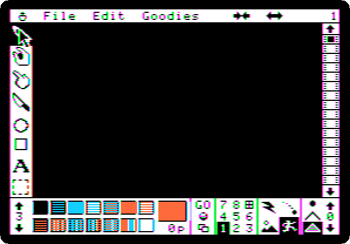

7. **Click the down arrow at the bottom of the film strip**, for frame 2:
   the number at the top right says 2, and the page is empty. Click the
   circle, **press the button in the middle of the page and drag** out to
   the size of the circle, and click blue, the third colour of the top row.

   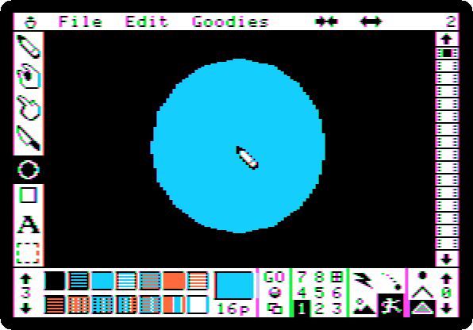

8. **Frame 3 the same way**: the down arrow of the film strip, the
   rectangle, a drag from one corner to the other, and white, the last
   colour of the bottom row.

   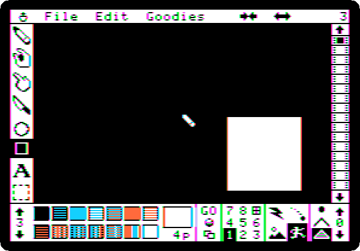

9. **Click the first square of the film strip**, for frame 1, and **click
   GO**. The movie plays in a loop: the star goes to the middle and turns
   into the circle, the circle into the square, and the square back into
   the star. Each object of a frame turns into the object of the same
   number in the next, and its colour changes on the way.

   

   The keys 1 to 7 set the speed, 1 the fastest. **Click** to stop.

10. **Save it**: in the File menu, *Save Movie*, type `SHAPES,2` and press
    Return. The `,2` saves it on the diskette in drive 2, `my-movies.po`.
    Then *Clear Movie*, in the same menu, and *Yes*, for an empty one.

## A title that spins

11. **Palette 4**, of magenta and green: the down arrow under the palette
    number once more. Black for the background again, with the French
    window, and object 1.

12. **Click `A`**, then the page, a little left of the middle, and **type
    `APPLE`**. The text tool puts four letters in each object, `APPL` in
    object 1 and `E` in object 2. **Press the right arrow**, which ends
    the object, **type `II`**, which goes in object 3, and **press Return**.
    Then **colour them**: click 1 in the object counter, then magenta, the
    third colour of the top row; 2, magenta; and 3, green, the sixth.

    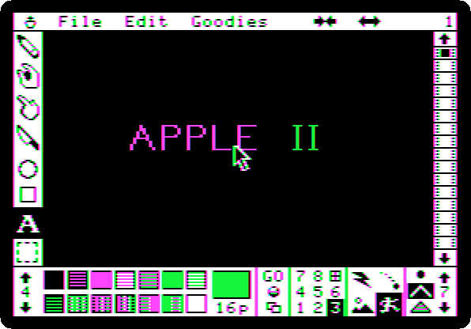

13. **Three more frames**, each made from the last:
    - in the Edit menu, *Clone*, which copies the frame to the end of the
      movie, frame 2;
    - in the Goodies menu, *Turn*, and click four times the arrow at the
      right of the two that appear in the menu bar: each turns everything a
      sixteenth of a turn around the middle of the page, so four make a
      quarter;
    - in the Goodies menu, *Zoom*, and once the arrow at the right, which
      makes everything bigger; in frame 3, the one at the left, which
      makes it smaller again.

    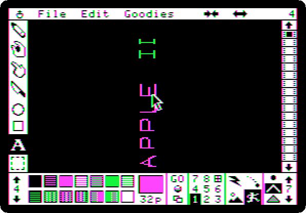

14. **The first square of the film strip and GO.** The title spins, larger
    and smaller.

    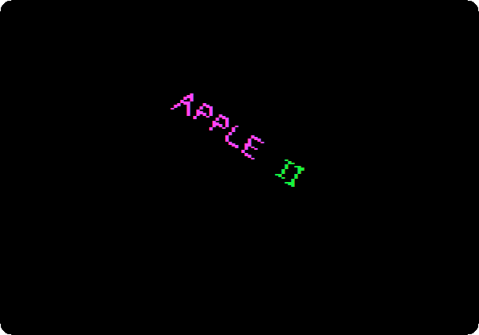

    **Click** to stop, save it as `SPIN,2`, and clear the movie.

## A spiral in trace mode

15. **Black for the background** and object 1 again, palette 4 still. In
    the dimension box, at the bottom right, **click the line**, the middle
    of the three, for an object of lines and not a solid shape; in the
    animation box at its left, **click trace**, the top right of the four,
    in which an object leaves behind it every frame it is drawn in. Then
    green, the pencil, and **a small triangle** in the middle of the page,
    closed on its first point.

16. **Eleven more frames**, each a *Clone* of the last, turned once, a
    sixteenth, made bigger once with the zoom, and coloured, magenta and
    green in turn.

17. **The first square of the film strip, GO, and press 2**, for speed 2.
    The slower the speed, the more frames in between and the smoother the
    movie, the manual says; in trace mode each of them stays on the page,
    and at speed 2 they are few enough for the spiral to show.

    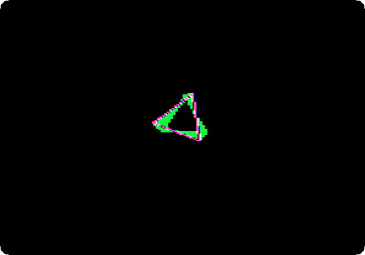

    **Click** to stop, and save it as `TRACE,2`. A movie keeps the speed
    it is saved with.

## The movies on the diskette

18. **In the File menu, *Load Movie***. It lists the movies of drive 1
    first, the ones on the program disk, and its fonts. **Click 2**, after
    *Drive*, for the ones of drive 2: the three of this page.

    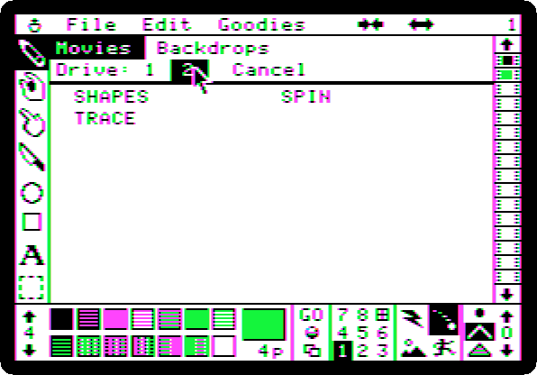

    The three are files of ProDOS on `my-movies.po`, each named after the
    movie with `M.` before.

## What next

**Next:** [Printing](printing.md).

[Logo and its turtle](logo.md) draws with a program; Fantavision with the
mouse. [Apple II DeskTop](desktop.md) is another program for the mouse of
the //e.
