# Flight Simulator II over Chicago

[Activities](../README.md) › [Play](../sections/play.md)

Bruce Artwick wrote his first flight simulator for the Apple II in 1979,
lines on a black screen, and his company, subLOGIC, of Champaign in
Illinois, followed it with Flight Simulator II, for the Apple II in 1983
and then for the Commodore 64, the Atari and others. It flies a Piper
Cherokee Archer II, a light plane of one engine, with the instruments of a
real cockpit, over the United States, in colour: the view out of the
windshield in solid shapes, ground, water and sky, eighty airports, the
time of day, clouds and wind. Large parts of it came, its handbook says,
from subLOGIC's earlier programs, among them the flight driver also used in
Microsoft's Flight Simulator for the IBM PC.

This page starts version 2.0 of 1984 from its original disk: the
demonstration that flies itself, then a flight of one's own from Meigs
Field, the small airport on a peninsula of Lake Michigan by the towers of
Chicago. The views out of the cockpit and the radar on the ground, the
editor that sets up the flight, the take-off and a turn past the towers,
a dive into the lake, and the same runway at night.

## What you need

**`Flight Simulator II v2.0.woz`**, Flight Simulator II in the
[woz-a-day collection](https://archive.org/details/wozaday_Flight_Simulator_II)
of the Internet Archive: download *Flight Simulator II v2.0 (woz-a-day
collection).zip* and take it out of it. It is the original disk, copy
protection and all. `./fetch-disks.sh` in this repository downloads it into
`disks/` and checks it.

The *Pilot's Operating Handbook and Airplane Flight Manual* of the
Commodore 64 version, and its other papers, are in
[a scan of the box](https://archive.org/details/flight-simulator-ii-box-insert-registration-card-tapes-disk-sublogic-corp)
on the Internet Archive; the handbook of the Apple II version could not be
found. The simulator is the same, and most of its keys too, but not all:
on the Apple the editor is Escape, not `E`, and the throttle is the arrow
keys, which the Apple \]\[+ has where the Commodore had the keys `[` and
`]`. These two were found in the program itself, in its table of the keys.

## The machine

An Apple \]\[+ with 64 KB and one disk drive:

- the 6502 processor at 1 MHz, 48 KB of memory, and Applesoft BASIC in its ROM;
- the keyboard of the \]\[+, which types only capitals;
- a 16 KB Language Card in slot 0: Flight Simulator II runs in 48 KB, but
  without the card the crash of step 12 showed a band of scrambled dots at
  the top of the view where, with it, the simulator writes `CRASH`, and the
  messages are in the memory of the card;
- a Disk II controller card in slot 6, with the disk of Flight Simulator II
  in drive 1.

```bash
izapple2 -model none -board 2plus -cpu 6502 -screen color \
    -rom "<internal>/Apple2_Plus.rom" \
    -charrom "<internal>/Apple2rev7CharGen.rom" -forceCaps \
    -s0 language \
    -s6 "diskii,disk1=disks/Flight Simulator II v2.0.woz"
```

The model `2plus` of izapple2 has this machine, with a Videx Videoterm 80
column card more:

```bash
izapple2 -model 2plus -screen color "disks/Flight Simulator II v2.0.woz"
```

## Start it

1. **Start izapple2** with the command above. The disk loads the program,
   drawing the panel of instruments as it goes, and asks for the display.

   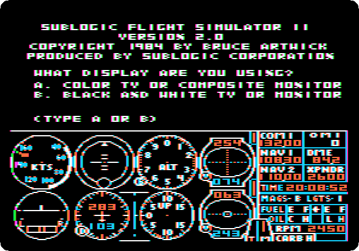

2. **Press `A`**, for a colour television or monitor: the colours of the
   scenery are chosen for it. The simulator asks for the mode.

   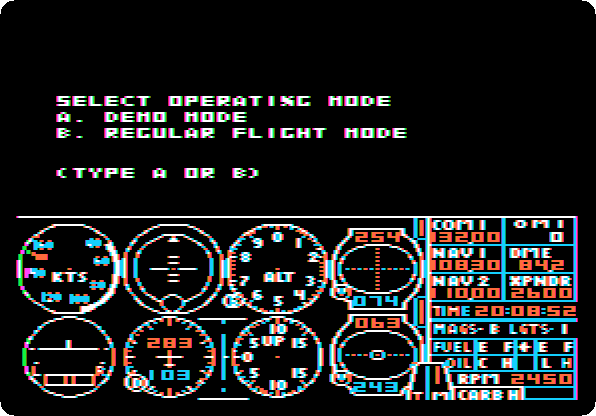

## The demonstration

3. **Press `A`**, for the demonstration. The simulator says how to leave
   it, and waits.

   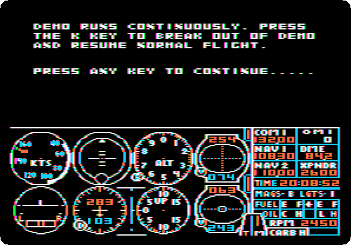

4. **Press Space.** The plane takes off from Meigs Field and flies by
   itself, past the towers and out over Lake Michigan, violet on this
   monitor, and banks into a turn. The recording is four times faster than
   the machine, two minutes and a half of it.

   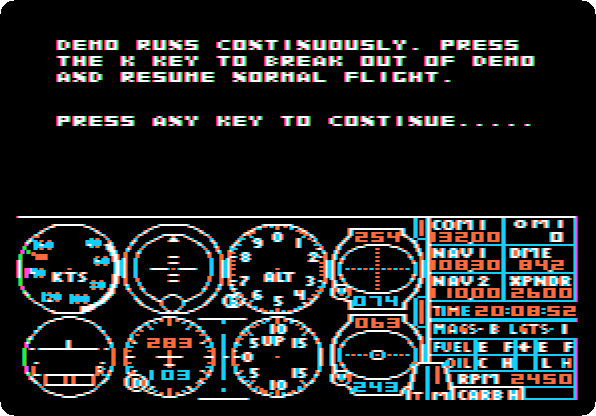

   `K` would leave the demonstration and give the controls to the pilot
   wherever the plane is. To start a flight on the ground, **start izapple2
   again** with the same command, and **press `A`** for the display.

## On the runway at Meigs

5. **Press `B`**, for regular flight mode. The plane is at the start of
   runway 36 of Meigs Field, facing north, the engine running. The towers of
   Chicago are ahead; the handbook names the John Hancock Building among
   them.

   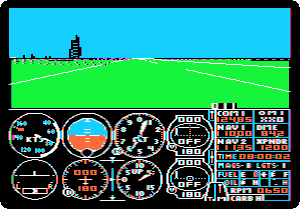

   The upper half is the view out of the windshield; the lower half is the
   panel. In its first row the airspeed in knots, the artificial horizon,
   the altimeter and the first navigation radio; in its second the turn
   coordinator, the heading, the vertical speed and the second navigation
   radio. At
   the right the radios, the clock, the fuel and oil, and the engine at
   650 revolutions a minute, idling.

6. **Look around:** `5` and then a key of the diamond of keys around `G`,
   `T` for the front, `F` for the left, `H` for the right, `B` for the back.
   **Press `5` `F`**, then **`5` `B`**, and **`5` `T`** to look ahead again.
   Each view takes the simulator a second or two to draw.

   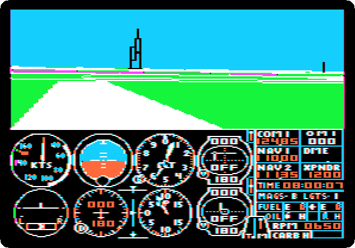

   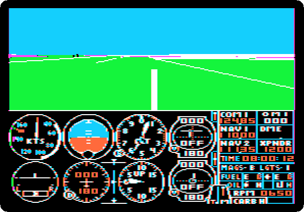

7. **Press `4`** for the radar, which is more a map seen from above, the
   plane in its middle: the runways of Meigs on their peninsula, the shore
   and the lake. **Press `.` twice** to zoom in, the key that on the
   Commodore was `>`; `,` zooms out. **Press `5` `T`** to go back to the view.

   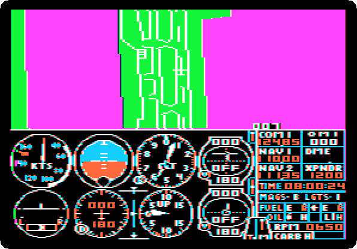

   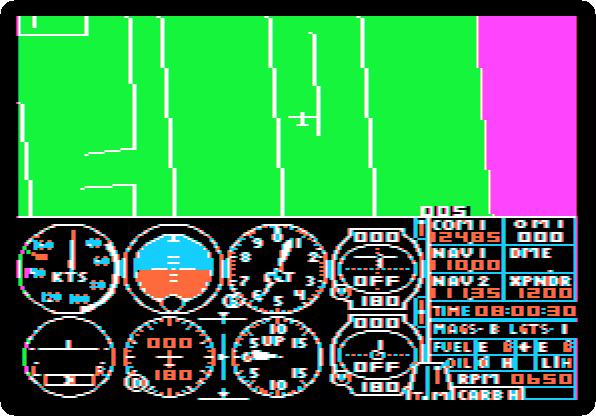

## The editor

8. **Press Escape.** The flight stops, and the drive loads the editor, a
   page of text of all that sets up a flight: the modes of the simulator,
   and where the plane is, how high, which way it heads, how fast, and its
   controls. Return goes down a line; a number and Return change the line.
   **Press Return, `1` and Return**, to turn on the sound.

   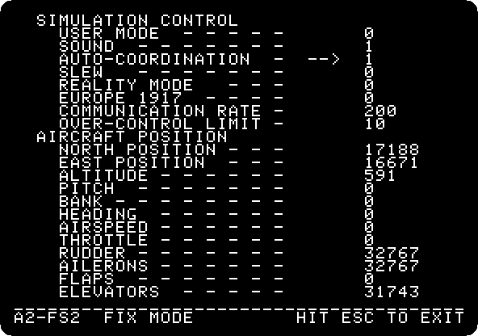

   `EUROPE 1917` turns the simulator into the war game the handbook calls
   *WW I Ace*, with bombs and machine-guns against enemy planes, on a
   battlefield of its own.

9. **Press Return until the second page**, the environment: the time of
   day and the season, two layers of cloud, and the wind at three heights.

   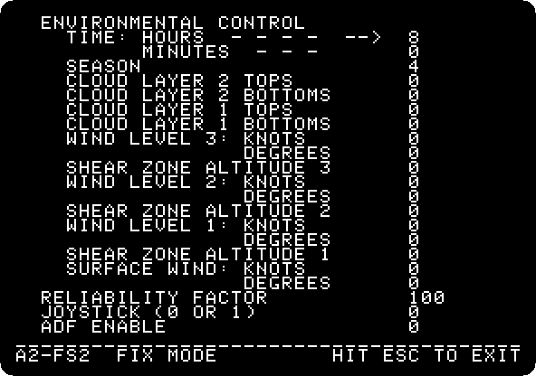

   **Press Escape** to fly again.

## Take-off

10. **Press `B` three times**, quickly, which raises the elevator three
    notches, and **the right arrow sixteen times**, which opens the
    throttle in sixteen notches, to full. After half a minute, **press `T`
    twice**, to take two notches of elevator back.

    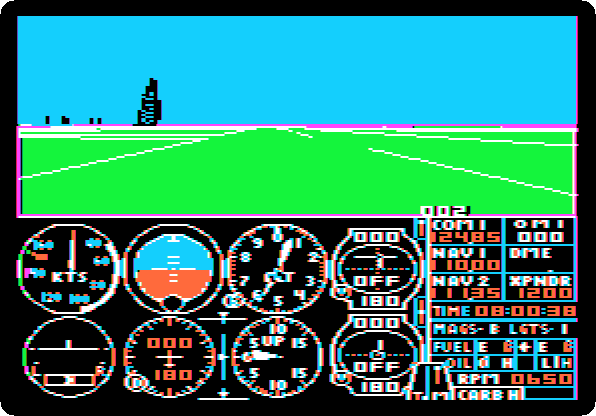

    The engine goes to 2,450 revolutions a minute, the plane rolls down the
    runway and gathers speed, and with the elevator up it takes off by
    itself. Out of the windshield, the end of the peninsula passes and the
    lake comes under the plane; the towers stay at the left. The recording
    is at the speed of the machine, 40 seconds.

11. **Press `F`**, the ailerons a notch to the left, which banks the plane,
    and a second later **`G`**, which centres them and keeps the bank, and
    **`B`**, a notch of elevator, to hold the nose up in the turn.

    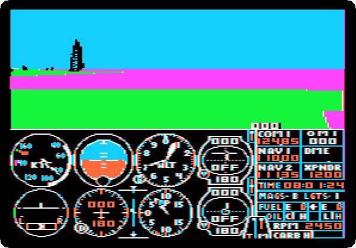

    The plane turns slowly to the left, a few degrees in half a minute, and
    the tallest tower comes nearer, along the shore. The recording is at the
    speed of the machine.

## Into the lake

12. **Press `F` three times and `T` four times**: a steep bank, and the
    nose down.

    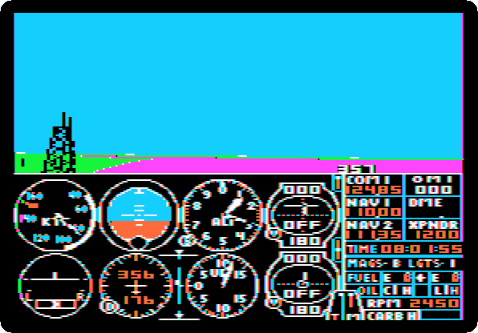

    The plane rolls over and dives into the lake, which fills the view, and
    the simulator writes `CRASH`. The drive loads the editor for a moment,
    and the plane is back at the start of the runway, the clock at noon.

    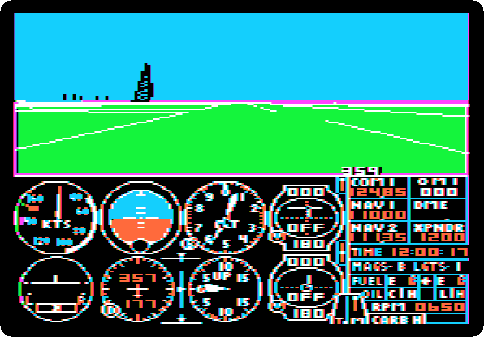

## At night

13. **Press Escape**, and on the first page **put back the position** the
    plane had at first: Return down to `NORTH POSITION`, and `17188`,
    Return, `16671`, Return, `591` for the altitude, Return, and `0` and
    Return for the pitch, the bank and the heading. Then **Return down to
    `TIME: HOURS`** on the second page, **`21`** and Return, for nine in the
    evening, and **Escape**.

    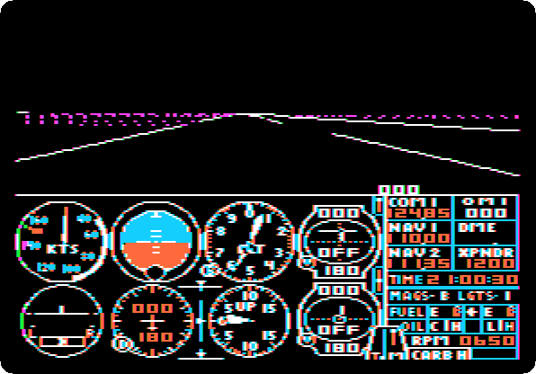

    At night the sky and the ground are black, and the runway is its
    lines and its lights, the city a row of dots on the horizon.

14. **Press `4`** for the radar at night: the same map, in lines and
    lights.

    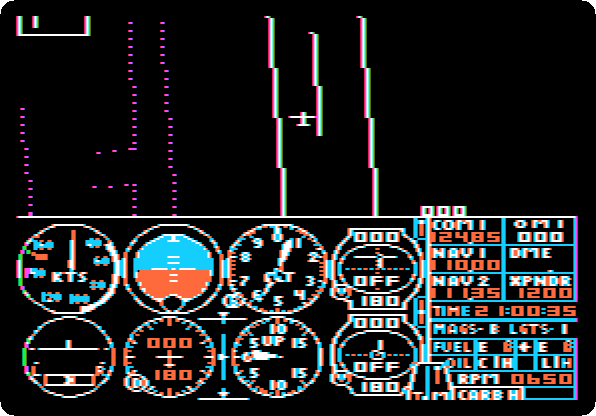

## What next

**Next:** [Karateka](karateka.md).

[Robot Odyssey](robotodyssey-sewer.md) is another simulation of 1984 on
these pages, of digital logic rather than flight.
