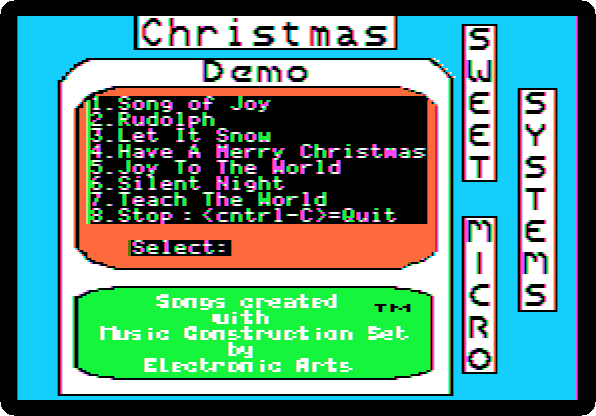
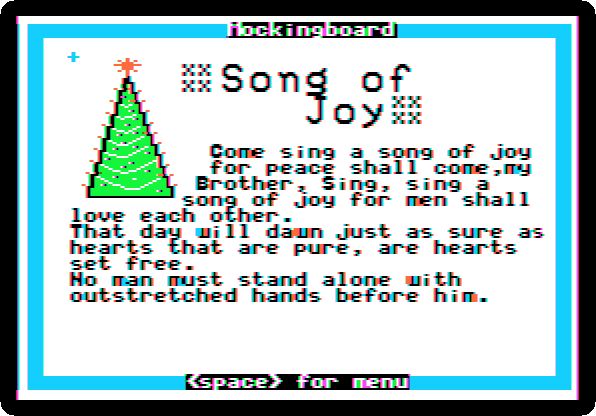

# Christmas songs on the Mockingboard

[Activities](../README.md) › [Cards](../sections/cards.md)

The [Mockingboard](mockingboard.md) played tones and noise on chips of its
own, three voices on each, while the Apple went on with something else, and
so it could play music in parts, as the speaker of the Apple II, a click at
a time, could not. For Christmas of 1983 Sweet Micro Systems gave its
owners a disk of songs: **Mockingboard presents Holiday Music**, seven
Christmas songs, each with its words on the screen, made with Electronic
Arts' *Music Construction Set*.

This page starts it, plays its first song, *Song of Joy*, and records it.

## What you need

**`Sweet Micro Systems Mockingboard presents Holiday Music.dsk`**, the disk
of 1983, from the
[Internet Archive](https://archive.org/details/sweet-micro-systems-mockingboard-presents-holiday-music).
`./fetch-disks.sh` in this repository downloads it into `disks/`.

## The machine

The Apple \]\[+ of [The Mockingboard](mockingboard.md):

- the 6502 processor at 1 MHz, 48 KB of memory, and Applesoft BASIC in its ROM;
- the keyboard of the \]\[+, which types only capitals;
- a Mockingboard in slot 4, with two sound generators of three voices each;
- a Disk II controller card in slot 6, with the disk of songs in drive 1.

```bash
izapple2 -model none -board 2plus -cpu 6502 -screen color \
    -rom "<internal>/Apple2_Plus.rom" \
    -charrom "<internal>/Apple2rev7CharGen.rom" -forceCaps \
    -s4 mockingboard \
    -s6 "diskii,disk1=disks/Sweet Micro Systems Mockingboard presents Holiday Music.dsk"
```

The model `2plus` of izapple2 has this machine, with a Language Card and a
Videx Videoterm 80 column card more:

```bash
izapple2 -model 2plus -screen color -s4 mockingboard "disks/Sweet Micro Systems Mockingboard presents Holiday Music.dsk"
```

## The songs

1. **Start izapple2** with the command above. The disk starts, and draws its
   menu: seven songs, and 8 to stop.

   

2. **Press 1**, alone, with no Return: *Song of Joy*. After a few seconds
   on the disk, its page, with its words, and the song.

   

   🔊 [Listen to it](images/holiday-music/song-of-joy.wav), as izapple2
   played it: the whole song, fifty seconds, before it starts again.

   The song goes on, again and again, until a key: **Space** goes back to
   the menu, for another song.

## What next

**Next:** [160 columns: the Videx Ultraterm](ultraterm.md).

[The Mockingboard](mockingboard.md) has the sound effects of its own
demonstration disk.
