# Apple Presents the IIc: The Apple at Play

[Activities](../README.md) › [First steps](../sections/first-steps.md) › [Switch on an Apple IIc](apple-iic.md)

*The Apple at Play* is the diskette of **Apple Presents the IIc**, the
owner's guide of the IIc, for fun: *a collection of games and activities
that test your quickness, luck, and learning*, as its introduction says.
Some are programs that others had sold for the Apple II: *Apple 21*, a
blackjack of Artsci of 1980, and *Space Quarks*, of Broderbund of 1981.
And a *Quick Quiz* on what the other diskettes taught.

This page plays a few days of Lemonade Stand, listens to the Music Recital,
answers a question of the quiz, plays a hand of Apple 21, and watches
Space Quarks play itself.

## What you need

**`Apple Presents The IIc - The Apple At Play 691-0016-A (Apple-1984).dsk`**,
from the folder of the masters of each model on
[Asimov](https://mirrors.apple2.org.za/ftp.apple.asimov.net/images/masters/model_specific/).
`./fetch-disks.sh` in this repository downloads it into `disks/`.

## The machine

The Apple IIc of [Switch on an Apple IIc](apple-iic.md), on a colour
monitor, with the diskette in its drive:

```bash
izapple2 -model none -board 2c -cpu 65c02 -screen color \
    -rom "<internal>/Apple2c_ROM255.rom" \
    -charrom "<internal>/Apple IIe Video Enhanced.bin" \
    -s0 language \
    -s1 iicserial \
    -s2 iicserial \
    -s6 "diskii,disk1=disks/Apple Presents The IIc - The Apple At Play 691-0016-A (Apple-1984).dsk"
```

## The menu

1. **Start izapple2** with the command above: ProDOS starts, and the menu.

   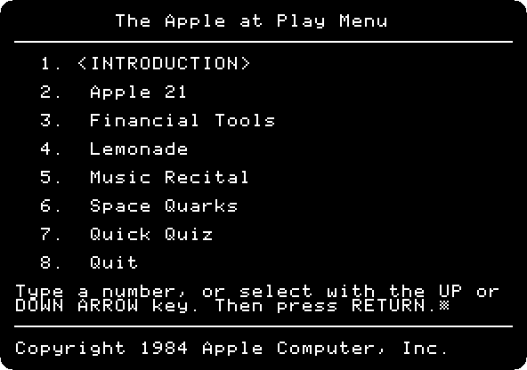

   **Type a number** and **Return** for each program. The introduction
   warns that each has its own way out, and that some have none: then
   **hold Open Apple**, the left Alt or Option key, **and press
   Control-Reset**, Control-F2 in izapple2, which starts the diskette and
   its menu again.

## Lemonade Stand

2. **Type `4`** and **Return**: *Lemonade*, a Lemonade Stand of Apple, of
   1984: a stand to run, a day at a time.

   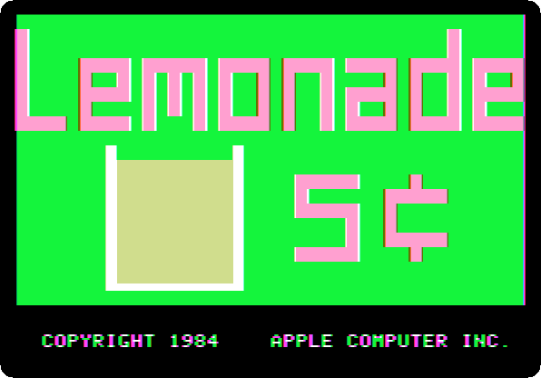

   **Type `Y`** and **Return** for a new game, **`1`** and **Return** for one
   stand, and **Return** through its instructions. Each day starts with the
   weather.

   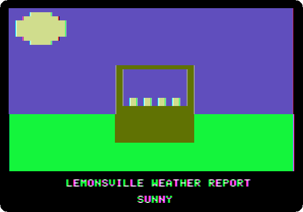

3. **Answer its three questions**, each with **Return**: 30 glasses of
   lemonade, at two cents each, 3 signs, at fifteen, and a price of 10
   cents a glass. **Type `N`** and **Return**, nothing to change.

   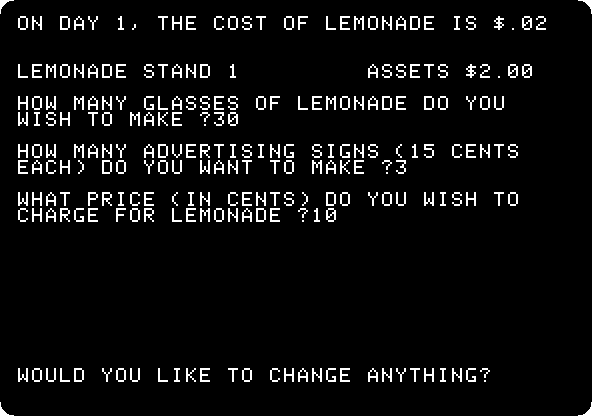

   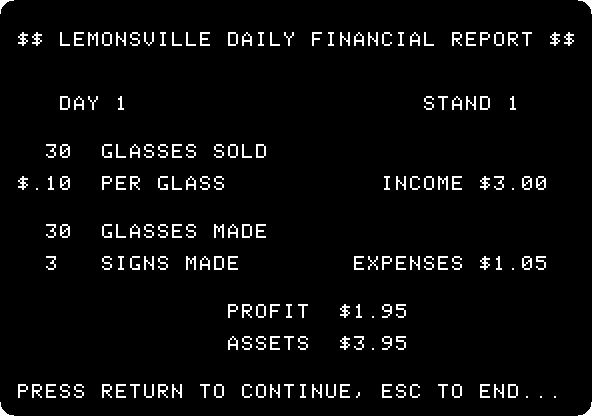

   **Press Return** for the next day: 40 glasses, 5 signs, 15 cents.

   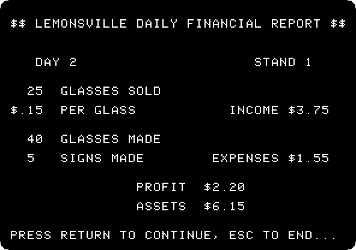

   **Open Apple-Control-Reset** goes back to the menu.

## The Music Recital

4. **Type `5`** and **Return**: the IIc plays a sonata on its speaker, until
   **Escape**.

   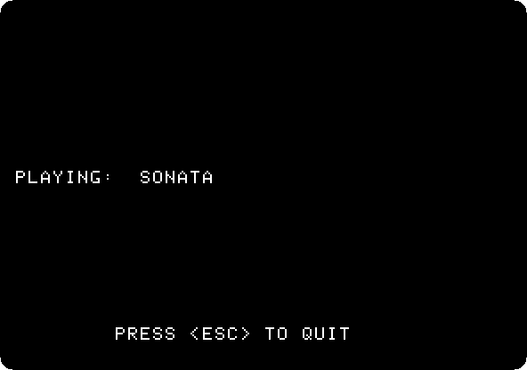

   🔊 [Fifteen seconds of the sonata](images/iic-at-play/sonata.wav)

## The Quick Quiz

5. **Type `7`** and **Return**: a quiz on the diskettes of the guide.

   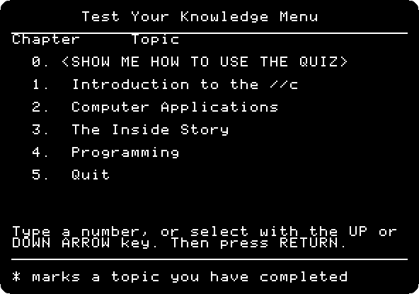

   **Type `1`** and **Return**, *Introduction to the //c*, the questions of
   the first diskette.

   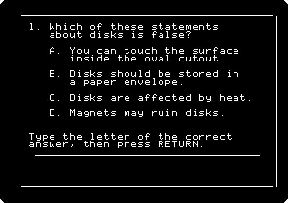

   **Type `A`** and **Return**: the right one, and why.

   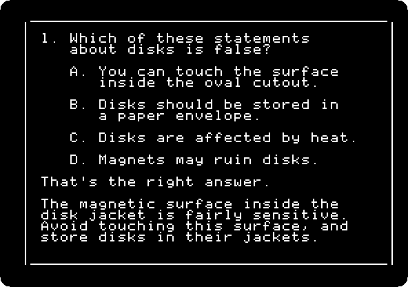

   **Open Apple-Control-Reset** goes back to the menu.

## Apple 21

6. **Type `2`** and **Return**: *Apple 21*, Bill Depew's blackjack.

   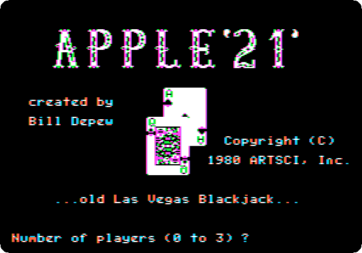

   **Type `1`**, one player, and **`5`** and **Return**, the table of $5. It
   offers to add a player with A: **type `5`** and **Return** instead, and
   it asks how much to buy, **`10`** and **Return**, $10 of chips. **Type
   `5`** and **Return** to wager $5: the cards are dealt, and **`1`** to
   **`4`** and **Return** hits, stands, doubles or splits.

   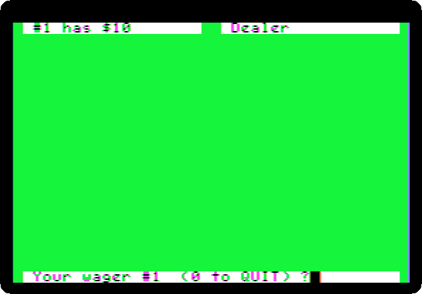

   A 10 and a 3 against a jack of the dealer. This page doubles, **`3`**:
   one card more, face down until the end, a 5. 18 against the dealer's 17,
   and $10 won.

   The cards depend on when the keys are pressed: another hand comes out for
   each reader. **Open Apple-Control-Reset** goes back to the
   menu.

## Space Quarks

7. **Type `6`** and **Return**: *Space Quarks*, by Chris Jochumson, of
   Broderbund. It asks for **Caps Lock** down: **press Return**.

   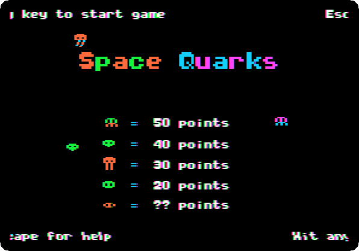

   Its title shows the quarks and their points, and then it plays itself,
   until a key starts a game.

   

## What next

**Next:** [Life with DOS 3.3](dos33.md).

[Lode Runner](lode-runner.md) is another game of Broderbund, and
[A game in Applesoft: the snake](applesoft-snake.md) a game typed in.
