# Apple Presents the IIc: The Apple at Work

[Activities](../README.md) › [First steps](../sections/first-steps.md) › [Switch on an Apple IIc](apple-iic.md)

*The Apple at Work* is the diskette of **Apple Presents the IIc**, the
owner's guide of the IIc, on the programs of work: the word processor, the
data base and the spreadsheet, the three of AppleWorks, Apple's program of
1984 that had them all, and what puts them together. It does not run
AppleWorks: it imitates it, a screen at a time, and asks for the keys a
person would press.

This page goes through its introduction, a survey and a quiz, and the lesson
of the word processor, as far as a letter changed for other friends.

## What you need

**`Apple Presents The IIc - The Apple At Work Side 2 40-Col 691-0014-A (Apple-1984).dsk`**,
from the folder of the masters of each model on
[Asimov](https://mirrors.apple2.org.za/ftp.apple.asimov.net/images/masters/model_specific/).
`./fetch-disks.sh` in this repository downloads it into `disks/`.

The diskette had two sides: side 1 for 80 columns, for a monitor, and side
2 for 40 columns, for a television. izapple2's IIc has its switch of 80 and
40 columns always down, at 40, and side 1 shows its menu scrambled: this
page uses side 2.

## The machine

The Apple IIc of [Switch on an Apple IIc](apple-iic.md), on a colour
monitor, with the diskette in its drive:

```bash
izapple2 -model none -board 2c -cpu 65c02 -screen color \
    -rom "<internal>/Apple2c_ROM255.rom" \
    -charrom "<internal>/Apple IIe Video Enhanced.bin" \
    -s0 language \
    -s1 iicserial \
    -s2 iicserial \
    -s6 "diskii,disk1=disks/Apple Presents The IIc - The Apple At Work Side 2 40-Col 691-0014-A (Apple-1984).dsk"
```

## The introduction

1. **Start izapple2** with the command above: the title, *writing, figuring,
   filing*, and then the menu.

   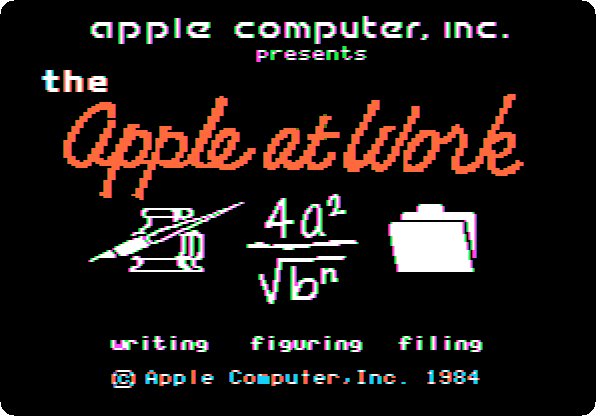

   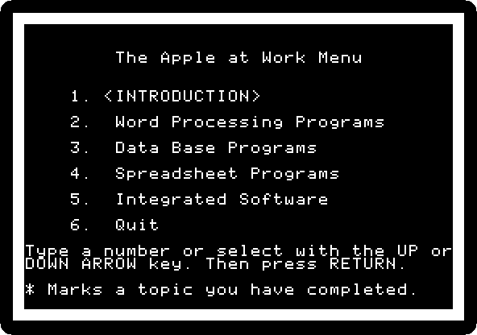

2. **Press Return**, for the introduction, *or what's an application
   program, anyway?*, and **Return** at each page: a desk in a mess, and
   then in order, with the Apple on it.

   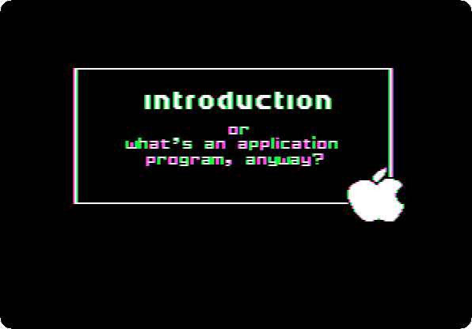

   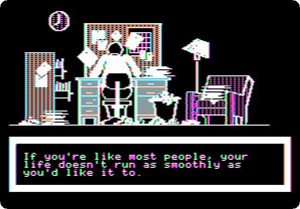

   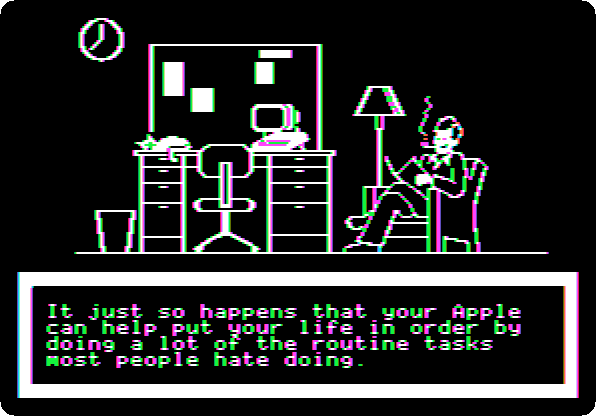

3. Before going on, the guide asks to complete the *Ziegfeld Organizational
   Assessment Profile*.

   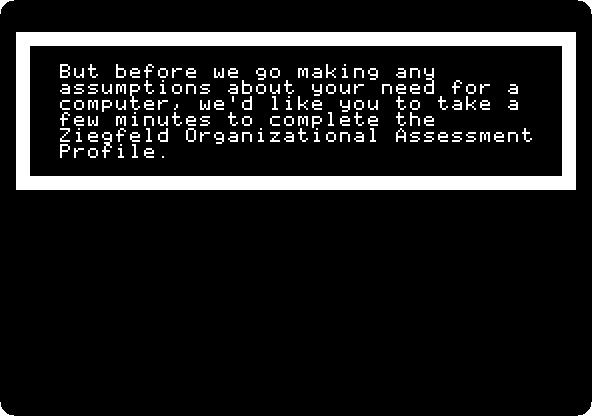

   **Press Return** twice, and answer its five questions: **type the
   letter** and **Return**. This page answers `B` to all.

   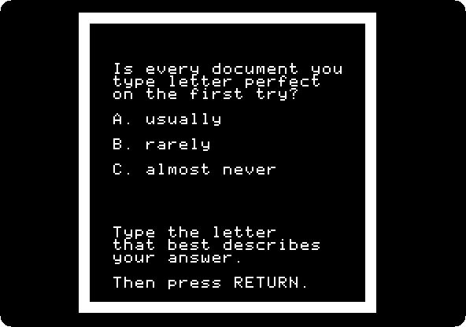

   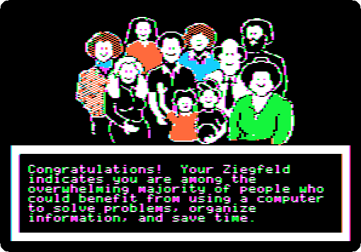

4. **Press Return** four times: a quiz on the three kinds of programs. The
   answers are `B`, a word processor, `A`, a data base program, and `A`, a
   spreadsheet.

   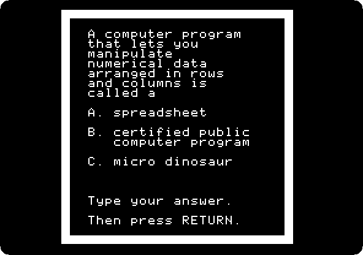

5. **Press Return** through the pages after it. Harry and Nan Walker will
   show the programs, which the guide shows as they are in AppleWorks.

   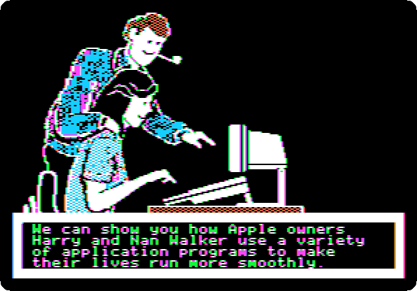

   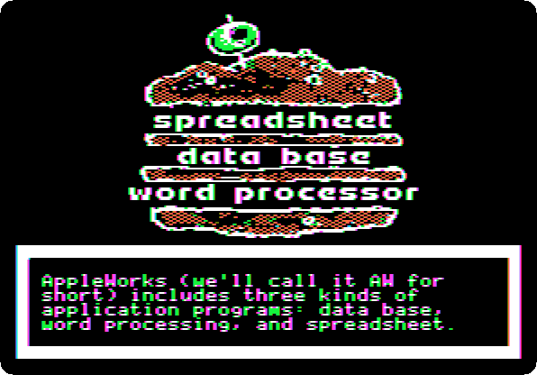

## The word processor

6. **Press Return** through the pages, to the letter Harry wrote to Pat and
   Dick Peterson in the word processor.

   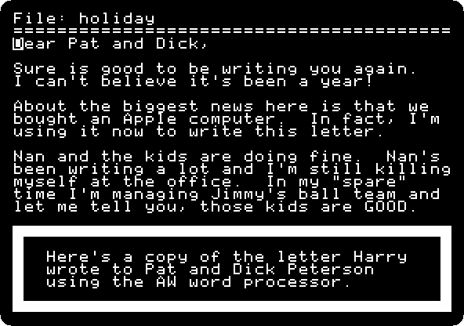

7. **Press Return**, and do what the guide asks: **the down arrow** to the
   end of the letter, **Return** twice, **Open Apple-1** back to its
   beginning, **the right arrow five times** to the names, and **type
   `Frank and Leslie,`** over them.

   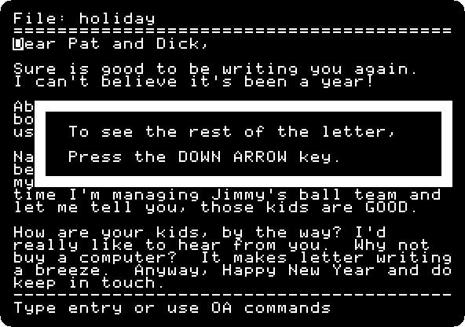

   The letter is for Frank and Leslie Burns now. They have no kids, and
   the lesson goes on, to change the line about them.

   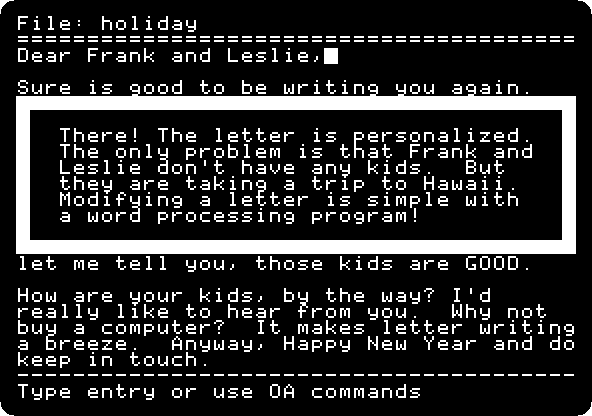

8. **Hold Open Apple and press Escape**, which goes back to the menu from
   anywhere in the guide. The menu marks the topic done.

   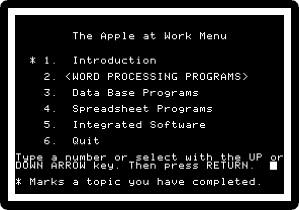

   The other topics are the data base, the spreadsheet and the integrated
   software. **Type `6`** and **Return** to quit: the guide
   asks for the next diskette.

## What next

**Next:** [Life with DOS 3.3](dos33.md).

[AppleWorks](appleworks.md) is the program itself, on a //e, with a
spreadsheet, a letter and a list of friends.
