# Apple Presents the IIc: Getting Down to BASIC

[Activities](../README.md) › [First steps](../sections/first-steps.md) › [Switch on an Apple IIc](apple-iic.md)

*Getting Down to BASIC* is the diskette of **Apple Presents the IIc**, the
owner's guide of the IIc, that teaches Applesoft BASIC: six sections, an
introduction and five lessons, from printing numbers to variables, each
with the statements to type and the computer that answers. The lessons
check what is typed, and say when it is not what they asked for.

This page goes through all of it, from the introduction to the last
lesson, as the guide asks: a GIF of each lesson, a page at each Return, and
what is typed. The guide types its pages a letter at a time; the GIFs hold
each page two seconds.

## What you need

**`Apple Presents The IIc - Getting Down To BASIC 680-3065-A (Apple-1984).dsk`**,
from the folder of the masters of each model on
[Asimov](https://mirrors.apple2.org.za/ftp.apple.asimov.net/images/masters/model_specific/).
`./fetch-disks.sh` in this repository downloads it into `disks/`.

## The machine

The Apple IIc of [Switch on an Apple IIc](apple-iic.md), on a colour
monitor, with the diskette in its drive:

```bash
izapple2 -model none -board 2c -cpu 65c02 -screen color \
    -rom "<internal>/Apple2c_ROM255.rom" \
    -charrom "<internal>/Apple IIe Video Enhanced.bin" \
    -s0 language \
    -s1 iicserial \
    -s2 iicserial \
    -s6 "diskii,disk1=disks/Apple Presents The IIc - Getting Down To BASIC 680-3065-A (Apple-1984).dsk"
```

## The introduction

1. **Start izapple2** with the command above: the title, its border of
   colours always moving.

   

   **Press Return**: the menu of the lessons.

   

2. **Press Return**, for the introduction, and **Return** at each page: what
   BASIC is, that the IIc speaks the dialect called Applesoft, and how to
   correct a mistake, the left arrow. Then it asks for a name: **type
   `ADA`** and **Return**, and **`Y`** and **Return** when it asks if it is
   right.

   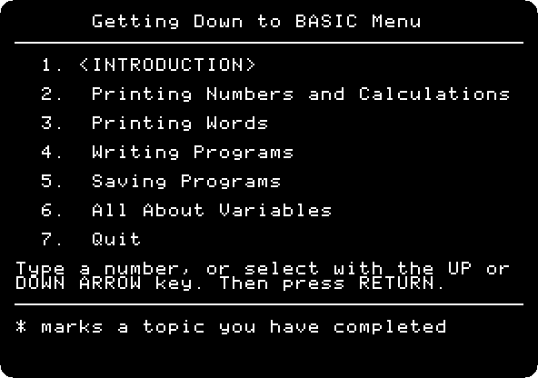

   

   The lessons are best in order, and Escape goes back to the menu at any
   time. Each lesson, at its end, goes on to the next with Return.

## Printing Numbers and Calculations

3. **Press Return** at each page. The guide types `PRINT 28` itself, and
   then it is your turn: **type `PRINT 1984`** and **Return**.

   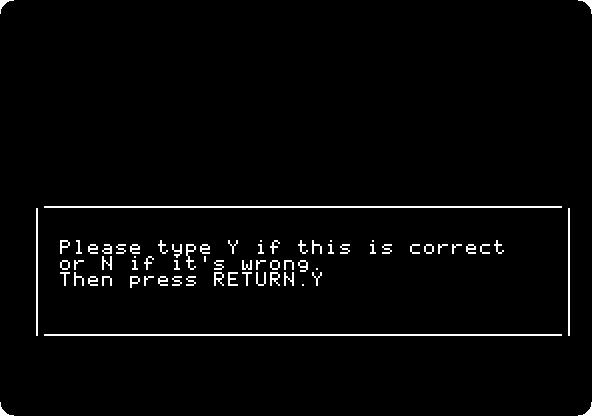

   The guide checks it, and answers with the name.

   

4. **Type `N`** and **Return**, no more practice, and **Return** at each
   page: the guide adds 345 and 439. Then an addition of your own: **type
   `PRINT 1977 + 7`** and **Return**: 1984, and the signs of the other
   operations.

   

   **Type `Y`** and **Return** to practise another, **`PRINT 4 * 12`** and
   **Return**, and **`N`** and **Return**.

## Printing Words

5. **Press Return** at each page: words go between quotation marks, as
   `PRINT "HOT FUDGE SUNDAE"`, *a literal quote*. Your turn: **type `PRINT
   "HELLO, ADA"`** and **Return**, and **`N`** and **Return**.

   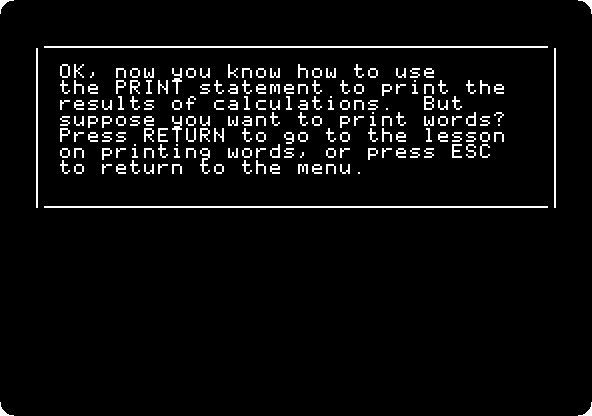

6. The guide checks everything typed, but BASIC itself is not so kind: it
   asks for a mistake, `PRUNT 50`. **Type it** and **Return**: a beep and
   `?SYNTAX ERROR`.

   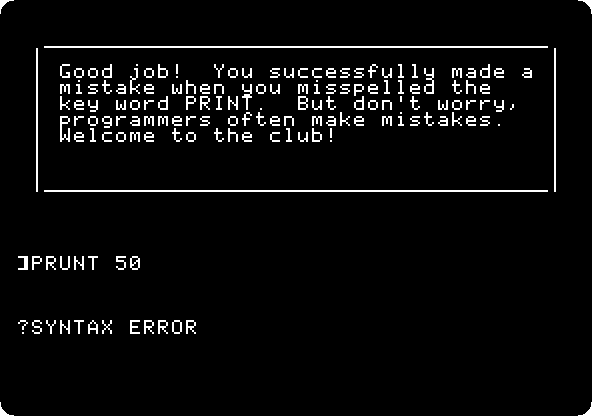

## Writing Programs

7. **Press Return** at each page: a statement typed runs at once, *immediate
   execution*; with a number in front it is kept for later, *deferred
   execution*, a line of a program. The guide types `10 PRINT "ROSES ARE
   RED"` and `30 PRINT "I LOVE MY APPLE"`; **type `RUN`** and **Return**.
   Then it adds line 20, `VIOLETS ARE BLUE`, between them: **`RUN`** again.

   

8. The verse needs a last line: **type `40 PRINT "AND SO DO YOU"`** and
   **Return**. The guide adds `50 END`: **type `RUN`** and **Return**.

   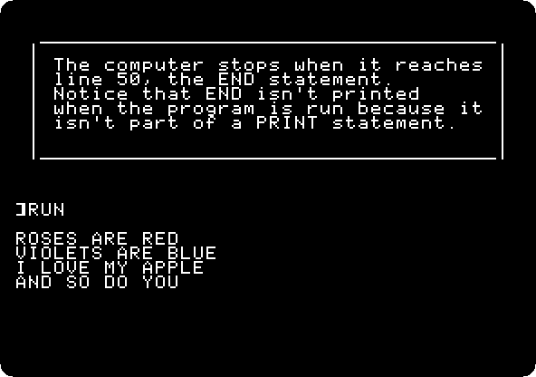

9. Then the lines are changed and deleted: **type `40 PRINT "AND IT LOVES
   ME TOO"`**, **`LIST`** to see it changed, **`RUN`**, **`30`** to delete
   line 30, and **`LIST`** again, each with **Return**. The guide types line
   30 back.

## Saving Programs

10. **Press Return** at each page, and **type `LIST`**: the poem. A program
    in memory is lost when the computer goes off; **type `SAVE POEM`** and
    **Return** to keep it on a disk, and **`CAT`** and **Return**, the
    catalog of the disk.

    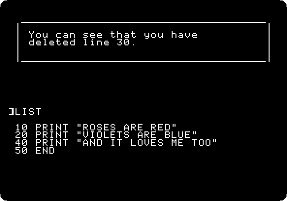

    The disk is a simulation, named after you, `/ADA`; the guide draws a
    IIc and its drive to show where the program goes.

    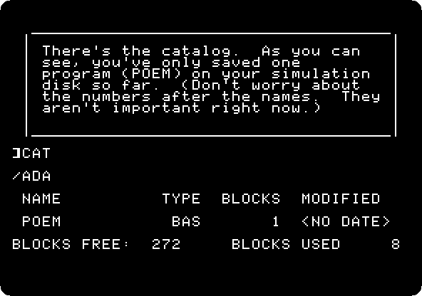

11. **Type `NEW`**, which erases the program from memory, **`RUN`**, which
    runs nothing now, **`LOAD POEM`**, which brings it back from the disk,
    and **`LIST`**, each with **Return**. Change a line, **`30 PRINT "SUGAR
    IS SWEET"`**, save it with another name, **`SAVE SWEET`**, and **`CAT`**:
    both poems.

    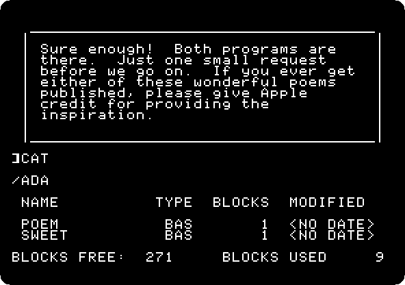

## All About Variables

12. **Press Return** at each page: memory is like mailboxes, each with a
    name, a *variable*. The guide types `10 LET A = 33`; **type `20 PRINT
    A`**, **`30 END`** and **`RUN`**, each with **Return**: 33.

    

    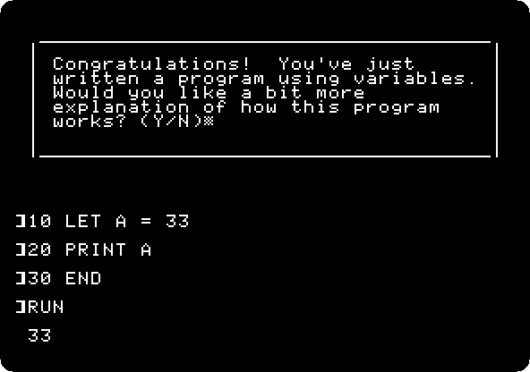

13. **Type `Y`** for an explanation, and **`10 LET A = 1984`** and **`RUN`**:
    a variable keeps one thing at a time. Then **`NEW`**, and **`LOAD
    NUMBER`**, a program of the guide, and **Return**, and **`RUN`**: it asks
    for a number with `INPUT`. **Type `7`**, and when the guide goes through
    it again, **`42`**, and **`N`**.

    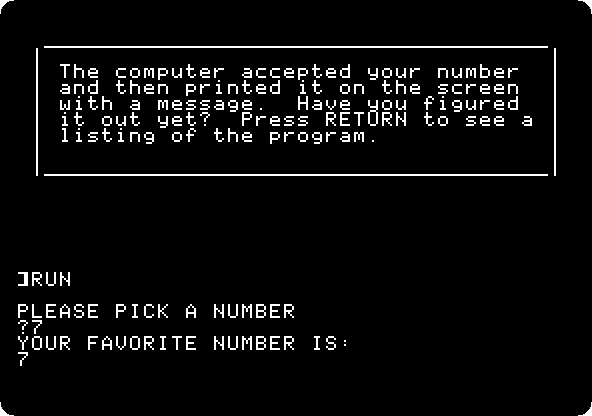

14. Words go in *string* variables, with a `$`: the secret of how the guide
    remembers your name. **Type `Y`** to see it run, and **`GRACE`**.

    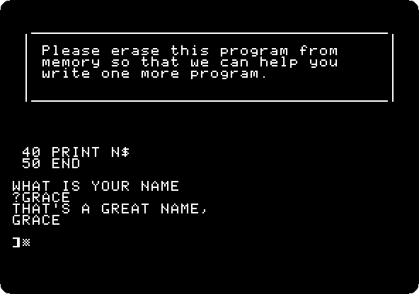

15. The last program: **type `NEW`**, and the guide types a program on ice
    cream, with no line 20. **Type `20 INPUT I$`**, **`LIST`**, **`RUN`**,
    and a flavour, **`PISTACHIO`**, each with **Return**.

    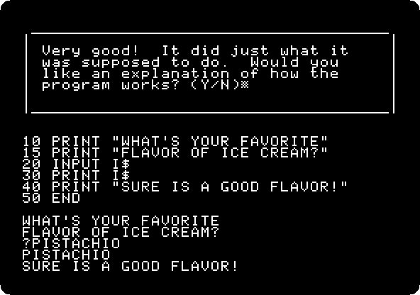

16. **Type `N`** and **Return**, and **Return** at each page: back at the
    menu, every lesson marked as done and Quit chosen, and **Return** again:
    the guide says goodbye, and leaves you in Applesoft, to write your own
    programs.

    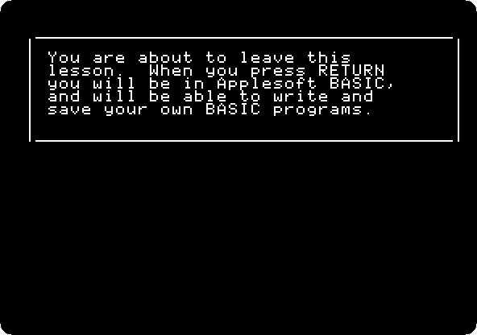

## What next

**Next:** [Life with DOS 3.3](dos33.md).

[Switch on an Apple IIc](apple-iic.md) has Applesoft on the IIc without the
guide, and [A game in Applesoft: the snake](applesoft-snake.md) a whole
program typed in.
