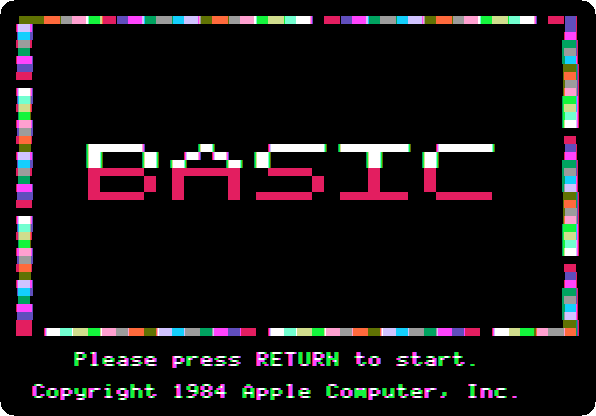
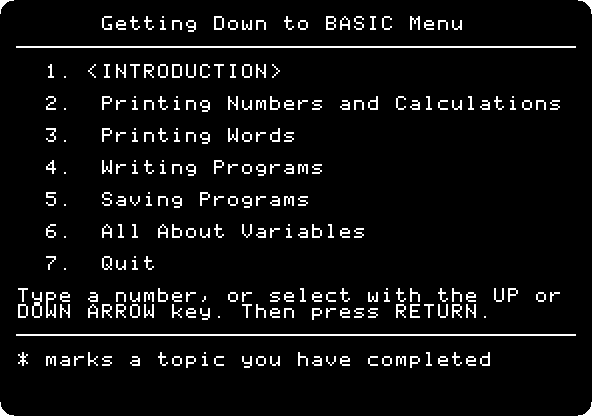
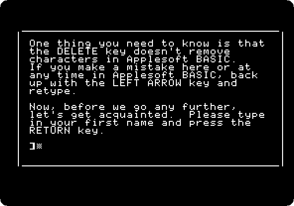
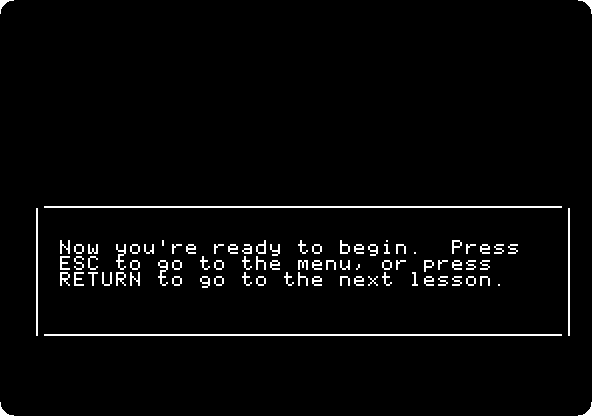
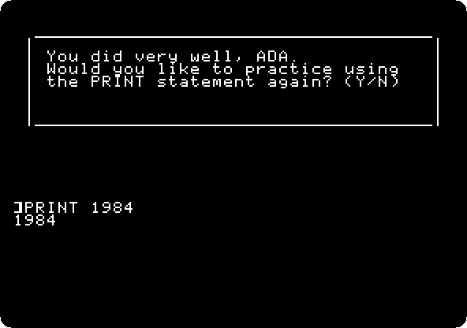
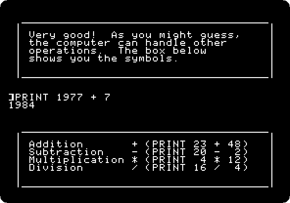

# Apple Presents the IIc: Getting Down to BASIC

[Activities](../README.md) › [First steps](../sections/first-steps.md) › [Switch on an Apple IIc](apple-iic.md)

*Getting Down to BASIC* is the diskette of **Apple Presents the IIc**, the
owner's guide of the IIc, that teaches Applesoft BASIC: six sections, an
introduction and five lessons, from printing numbers to variables, each
with the statements to type and the computer that answers. The lessons
check what is typed, and say when it is not what they asked for.

This page goes through its introduction, which asks for a name, and the
first part of its lesson on `PRINT`: a number, and a sum.

## What you need

**`Apple Presents The IIc - Getting Down To BASIC 680-3065-A (Apple-1984).dsk`**,
from the folder of the masters of each model on
[Asimov](https://mirrors.apple2.org.za/ftp.apple.asimov.net/images/masters/model_specific/).
`./fetch-disks.sh` in this repository downloads it into `disks/`.

## The machine

The Apple IIc of [Switch on an Apple IIc](apple-iic.md), on a colour
monitor, with the diskette in its drive:

```bash
izapple2 -model none -board 2c -cpu 65c02 -screen color \
    -rom "<internal>/Apple2c_ROM255.rom" \
    -charrom "<internal>/Apple IIe Video Enhanced.bin" \
    -s0 language \
    -s1 iicserial \
    -s2 iicserial \
    -s6 "diskii,disk1=disks/Apple Presents The IIc - Getting Down To BASIC 680-3065-A (Apple-1984).dsk"
```

## The introduction

1. **Start izapple2** with the command above: the title, its border of
   colours always moving.

   

   **Press Return**: the menu of the lessons.

   

2. **Press Return**, for the introduction, and **Return** at each page: what
   BASIC is, that the IIc speaks the dialect called Applesoft, and how to
   correct a mistake, the left arrow. Then it asks for a name.

   

   **Type `ADA`** and **Return**, and **`Y`** and **Return** when it asks if
   it is right. **Press Return** three times: the lessons are best in order,
   and Escape goes back to the menu at any time.

   

## Printing numbers

3. **Press Return**, for the first lesson, *Printing Numbers and
   Calculations*, and **Return** at each page. The guide types `PRINT 28`
   itself, and then it is your turn: **type `PRINT 1984`** and **Return**.

   

   The guide checks it, and answers with the name.

   

4. **Type `N`** and **Return**, no more practice, and **Return** at each
   page: the guide adds 345 and 439. Then an addition of your own: **type
   `PRINT 1977 + 7`** and **Return**. The guide shows the signs of the other
   operations.

   

   The other lessons are on printing words, writing programs, saving them,
   and variables.

## What next

**Next:** [Life with DOS 3.3](dos33.md).

[Switch on an Apple IIc](apple-iic.md) has Applesoft on the IIc without the
guide, and [A game in Applesoft: the snake](applesoft-snake.md) a whole
program typed in.
