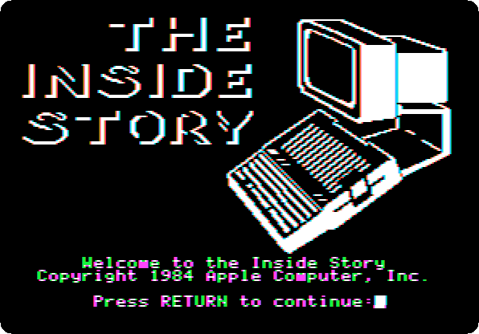
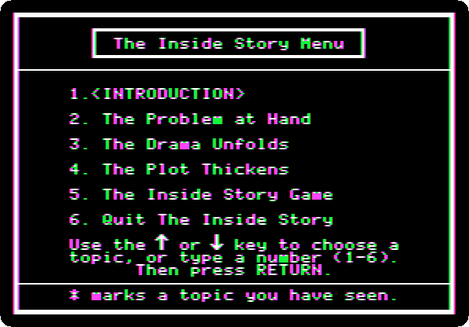
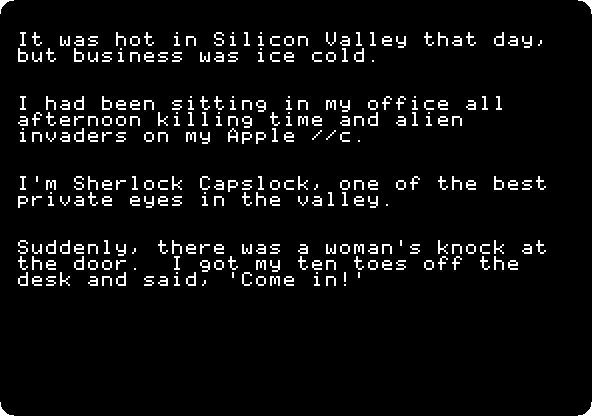
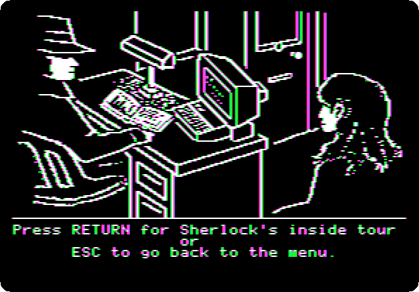
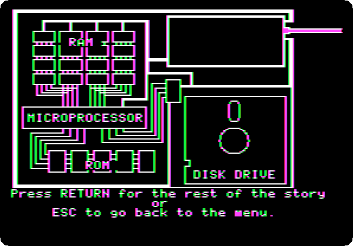
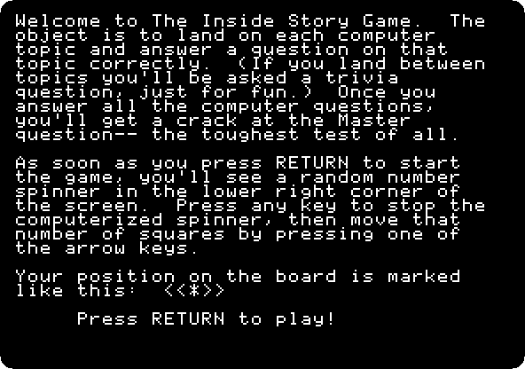
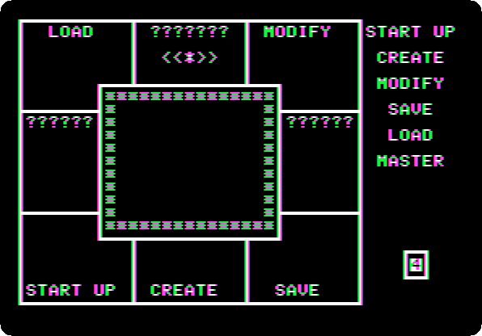
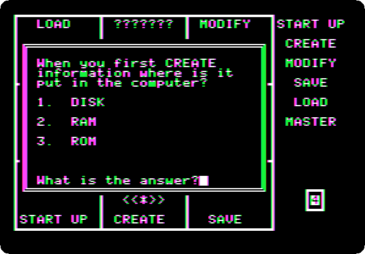
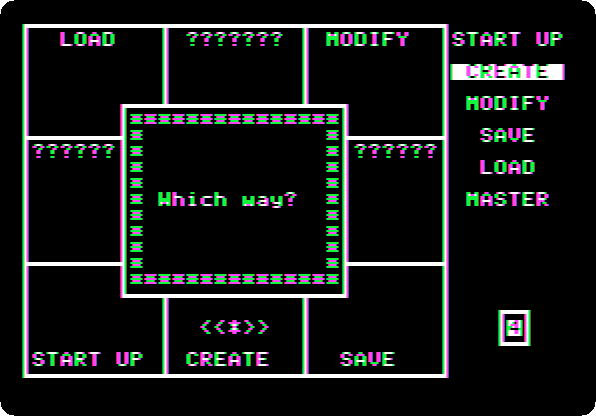

# Apple Presents the IIc: The Inside Story

[Activities](../README.md) › [First steps](../sections/first-steps.md) › [Switch on an Apple IIc](apple-iic.md)

*The Inside Story* is the diskette of **Apple Presents the IIc**, the
owner's guide of the IIc, on how a computer works, told as a detective
story: Sherlock Capslock, private eye in Silicon Valley, and Nancy Novice,
who lost what she typed when the power went off. It has three parts, and a
game at the end on what they taught.

This page reads the start of the case, the tour of the inside of the IIc
that Sherlock gives Nancy, and plays a turn of the game.

## What you need

**`Apple Presents The IIc - The Inside Story 691-0020-A (Apple-1984).dsk`**,
from the folder of the masters of each model on
[Asimov](https://mirrors.apple2.org.za/ftp.apple.asimov.net/images/masters/model_specific/).
`./fetch-disks.sh` in this repository downloads it into `disks/`.

## The machine

The Apple IIc of [Switch on an Apple IIc](apple-iic.md), on a colour
monitor, with the diskette in its drive:

```bash
izapple2 -model none -board 2c -cpu 65c02 -screen color \
    -rom "<internal>/Apple2c_ROM255.rom" \
    -charrom "<internal>/Apple IIe Video Enhanced.bin" \
    -s0 language \
    -s1 iicserial \
    -s2 iicserial \
    -s6 "iicdisk,disk1=disks/Apple Presents The IIc - The Inside Story 691-0020-A (Apple-1984).dsk"
```

## The case

1. **Start izapple2** with the command above: ProDOS starts, and the title.

   

   **Press Return**: the menu, the introduction, the three parts and the
   game.

   

2. **Type `2`** and **Return**, *The Problem at Hand*, and **Return** at
   each page.

   

   The guide waits for Return at each page; here each stays three seconds.
   Nancy Novice was typing when the power went off, and heard a strange
   laughter.

   

## The inside tour

3. **Press Return** for Sherlock's inside tour of the IIc, and **Return**
   at each page: the logic board, seen through a IIc with a top that one
   sees through, its disk drive, its microprocessor, its ROM and its RAM,
   and what happens to what is in RAM when the power goes off.

   

   

   The rest of the part names the culprit, Blacky Powerout, *a master
   criminal who preys on computer novices*, and follows the IIc as it
   starts: the microprocessor takes its first instructions from ROM, and
   puts the operating system of the diskette into RAM, and a program after
   it. The other two parts, The Drama Unfolds and The Plot Thickens, go on
   with the case.

## The game

4. **Press Escape**, back to the menu, and **type `5`** and **Return**,
   *The Inside Story Game*.

   

   **Press Return**: the board, with a topic of the story, or question
   marks, in each square, and a spinner of numbers at the bottom right.

   

5. **Press a key** to stop the spinner, and **an arrow** for the way to
   go, here the right one: the marker moves as many squares as the spinner
   said. A question on the topic of the square: here CREATE, where what is
   created goes first.

   

   **Type `2`**, RAM: the topic is marked in the list on the right.

   

   The spinner stops on a number that depends on when the key is pressed:
   another square, and another question, for each reader.

## What next

**Next:** [Apple Presents the IIc: Getting Down to BASIC](iic-basic.md).

[Switch on an Apple IIc](apple-iic.md) is the machine of the story, and
[The Apple //e, original and enhanced](apple-iie-models.md) shows its ROM.
