# Apple Presents the IIc: An Introduction

[Activities](../README.md) › [First steps](../sections/first-steps.md) › [Switch on an Apple IIc](apple-iic.md)

*An Introduction* is the first diskette of **Apple Presents the IIc**, the
interactive owner's guide that came with the IIc in 1984, on the screen of
the computer itself. It teaches the keyboard a key
at a time, and then has a menu of twelve topics, each a short lesson with
questions to answer: the menus themselves, the Shift key, colour and black
and white, the cursors, Escape and Reset.

This page watches its opening, goes to its menu, and takes four of its
topics: a name typed, a restaurant, the colours and the columns, and the
end.

## What you need

**`Apple Presents the IIc - An Introduction.dsk`**, from the folder of the
masters of each model on
[Asimov](https://mirrors.apple2.org.za/ftp.apple.asimov.net/images/masters/model_specific/).
`./fetch-disks.sh` in this repository downloads it into `disks/`.

The book of the guide,
[Apple Presents the Apple IIc: An Interactive Owner's Guide](https://archive.org/details/apple-presents-the-apple-iic-an-interactive-owners-guide),
is on the Internet Archive.

## The machine

The Apple IIc of [Switch on an Apple IIc](apple-iic.md), on a colour
monitor, with the diskette in its drive:

```bash
izapple2 -model none -board 2c -cpu 65c02 -screen color \
    -rom "<internal>/Apple2c_ROM255.rom" \
    -charrom "<internal>/Apple IIe Video Enhanced.bin" \
    -s0 language \
    -s1 iicserial \
    -s2 iicserial \
    -s6 "diskii,disk1=disks/Apple Presents the IIc - An Introduction.dsk"
```

The pictures are in colour, as on a colour television; **F6** changes to
the green monitor.

## The opening

1. **Start izapple2** with the command above. The IIc starts the diskette.

   

   *Apple presents…*, typed on a keyboard drawn on the screen, as the keys go
   down, then the apple of the time in its six colours, and a man who walks
   from his office to his house. It takes a little over two minutes, here
   three times faster.

2. The keyboard goes up to the top of the screen, and the guide asks for the
   key marked `return`. **Press Return** to follow its lessons on the
   keyboard; this page **presses Escape** instead, the key the guide gives
   to those who have used it before, and goes to its menu.

   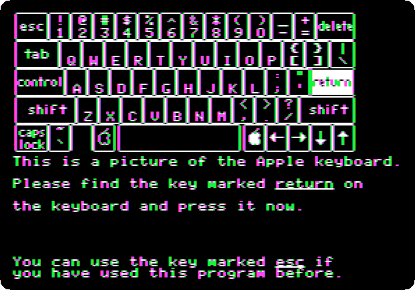

   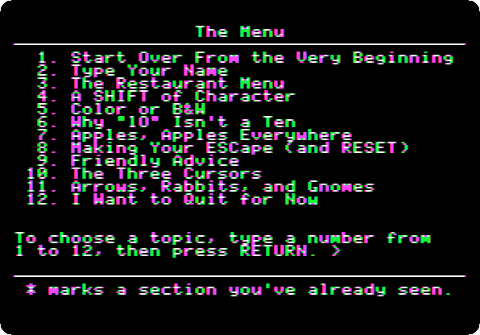

## A name, and a diner

3. **Type `2`** and **Return**, *Type Your Name*. **Type `Ada`** and
   **Return**: the guide asks if that is right.

   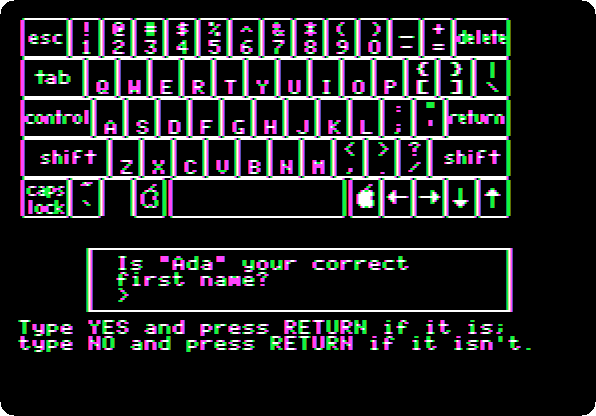

   **Type `YES`** and **Return**, and **Return** again. The menu is Ada's
   now, and marks with a star the topic seen.

   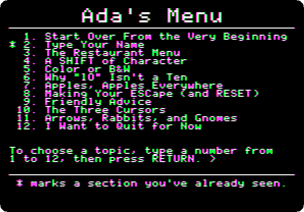

4. **Type `3`** and **Return**, *The Restaurant Menu*: a menu to choose
   from, as the ones of the programs, in a diner with the name typed, and a
   dish of it at the end.

   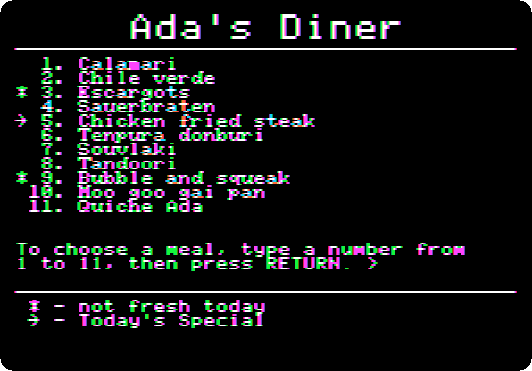

   **Type `11`** and **Return**, *Quiche Ada*.

   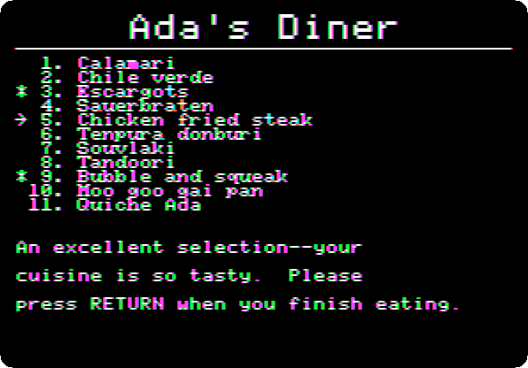

   **Press Return**, back to the menu.

## Colours and columns

5. **Type `5`** and **Return**, *Color or B&W*: a butterfly, and the names
   of four colours, each in its colour.

   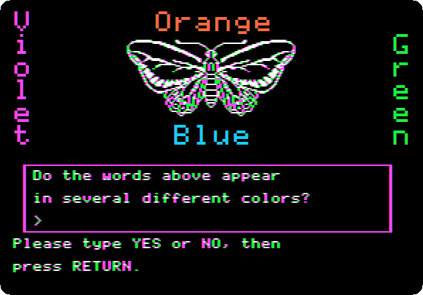

   **Type `YES`** and **Return**, and **Return** again: the guide explains
   the coloured edges of its letters, as Apple did.

   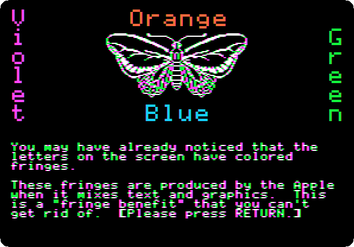

   The pages of the guide are not text but drawings of high resolution,
   letters included, and a colour television made colours out of the dots
   of a drawing, at the edges of the letters too. The guide calls them a
   *fringe benefit*. **F6** shows the same on the green monitor, sharp.

6. **Press Return** twice: the screen of text in 40 columns, the one a
   television could show.

   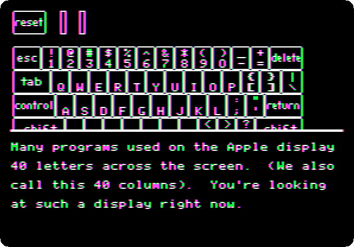

   **Press Return** twice more: a page in 80 columns.

   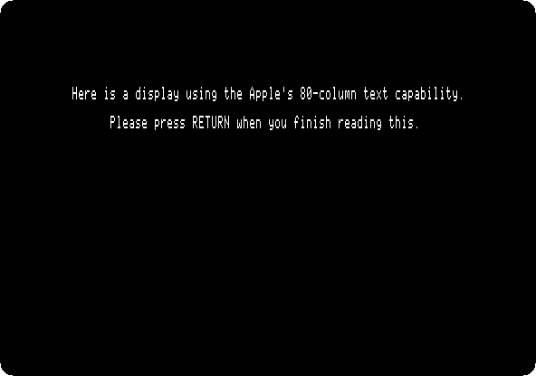

   **Press Return** three times. A television blurred the 80 columns, and the
   IIc had a switch for them, over its keyboard, to choose before it was
   switched on: up for 80 columns, on a monitor; down for 40, on a
   television.

   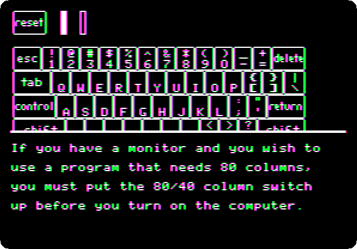

   izapple2 has no switch: its IIc has it always down, and the guide shows
   its 80 columns all the same.

## The end

7. **Press Return** three times, back to the menu, and **type `12`** and
   **Return**, *I Want to Quit for Now*. The guide lists the topics not
   seen yet, for next time.

   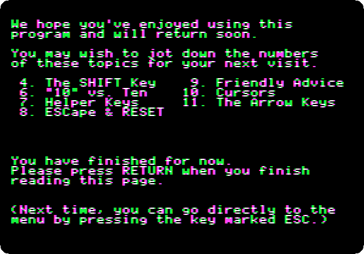

   **Press Return**. The guide asks for the next diskette, and Open
   Apple-Control-Reset to start it.

   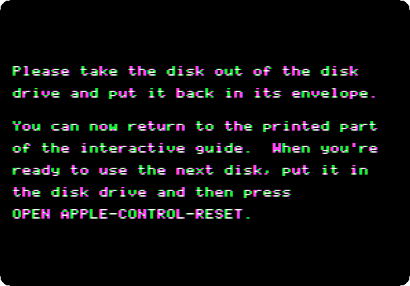

   In izapple2, after the guide, the first Control-Reset leaves the screen
   in grey stripes (see [IZAPPLE2.md](../IZAPPLE2.md)): press **Open
   Apple-Control-Reset**, the left Alt or Option key with Control-F2, a
   second time.

## What next

**Next:** [Apple Presents the IIc: The Apple at Work](iic-at-work.md).

[Switch on an Apple IIc](apple-iic.md) is the machine, with Applesoft and
its own 80 columns.
