# Apple Presents the IIc: Exploring Apple Logo

[Activities](../README.md) › [First steps](../sections/first-steps.md) › [Switch on an Apple IIc](apple-iic.md)

*Exploring Apple Logo* is the diskette of **Apple Presents the IIc**, the
owner's guide of the IIc, on Logo, the language of the turtle: *a guided
tour of the Logo language for the Apple computer*, as it says, and not Apple
Logo itself, which was sold apart. It tells the story of Logo, of Seymour
Papert at MIT, and teaches the turtle to draw, with a guide who types for
you when you don't, and Leo Logolover, *the world's most enthusiastic Logo
programmer*.

This page goes through all of it, from the introduction to the last
topic, as the guide asks: a GIF of each part, a page at each Return, and
what is typed. The GIFs hold each page two seconds.

## What you need

**`Apple Presents The IIc - Exploring Apple Logo 691-0015-A (Apple-1984).DSK`**,
from the folder of the masters of each model on
[Asimov](https://mirrors.apple2.org.za/ftp.apple.asimov.net/images/masters/model_specific/).
`./fetch-disks.sh` in this repository downloads it into `disks/`.

## The machine

The Apple IIc of [Switch on an Apple IIc](apple-iic.md), on a colour
monitor, with the diskette in its drive:

```bash
izapple2 -model none -board 2c -cpu 65c02 -screen color \
    -rom "<internal>/Apple2c_ROM255.rom" \
    -charrom "<internal>/Apple IIe Video Enhanced.bin" \
    -s0 language \
    -s1 iicserial \
    -s2 iicserial \
    -s6 "iicdisk,disk1=disks/Apple Presents The IIc - Exploring Apple Logo 691-0015-A (Apple-1984).DSK"
```

## The title, and the menu

1. **Start izapple2** with the command above: the turtle writes the title,
   and walks a border around it.

   

   **Press Return**: the menu of the six topics.

   

## Introduction, and The Logo Story

2. **Type `1`** and **Return**, the introduction, and **Return** at each
   page: a design drawn by a program of three lines, Logo easy for the
   beginner and powerful enough for research, and Leo Logolover, who will
   help out once in a while.

   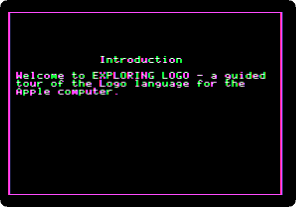

3. **Press Return**, at the end of a topic, for the next one, *The Logo
   Story*, and **Return** at each page: Seymour Papert at MIT in the late
   1960s, who had studied with Jean Piaget, the tortoise he saw in England,
   *an upside-down mixing bowl on wheels with a pen in the center*, and the
   turtle of the screen that took its place.

   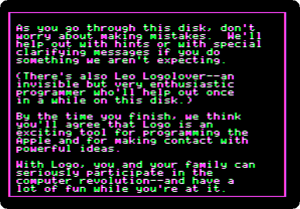

## Using Logo for Pictures

4. **Press Return** at each page, until the guide asks for the first
   command, at the `?` of Logo.

   

5. **Type `FORWARD 30`** and **Return**: the turtle draws a side. **Press
   Return**, and **type `RIGHT 90`** and **Return**: it turns. **Press
   Return** at the pages after it, and **type the rest of the square**, a
   command and Return at a time: `FORWARD 30`, `RIGHT 90`, `FORWARD 30`,
   `RIGHT 90`, `FORWARD 30`.

   

   

   A command not typed brings *Oh, don't be shy*, or a hint, and then the
   guide types it itself.

6. **Press Return** twice: the guide hears Leo Logolover coming, and he is
   very happy with the square.

   

## Teaching the Turtle

7. **Press Return** at each page: the next topic, and Leo shows a short cut,
   `REPEAT`.

   

   **Press Return** at each page, and **type `REPEAT 4 [FD 30 RT 90]`** and
   **Return**, with the short names of `FORWARD` and `RIGHT`: the same
   square, in one command.

   

8. **Type `CS`** and **Return**, short for `CLEARSCREEN`, and **Return** at
   each page. **Type `SQUARE`** and **Return**: the turtle doesn't know it.
   **Press Return** at each page, until the guide asks for `TO SQUARE`:
   **type it** and **Return**. Logo's prompt is `>` now: it listens, and
   learns. Leo types the rest of the procedure, `REPEAT 4 [FD 30 RT 90]` and
   `END`. **Press Return** at each page, and **type `SQUARE`** and
   **Return**.

   

   

9. A new word can use another: **type `CS`** and **Return**, and **Return**
   at each page, until the guide asks for a name, *your own name if you'd
   like or make up something crazy*: **type `ADA`** and **Return**. Leo
   types its procedure, `REPEAT 18 [SQUARE RT 20]`, eighteen squares, each
   turned twenty degrees. **Press Return** at each page, and **type `ADA`**
   and **Return**.

   

   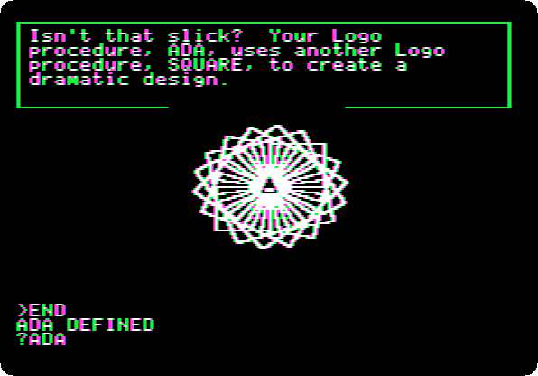

## Some Sample Turtle Programs

10. **Press Return** at each page, and **type `HOUSE`** and **Return**: a
    house, its turtle hidden. Then **Return** at each page: the guide goes
    through the program, a line at a time, as the turtle draws it again:
    `SQUARE`, the turtle turned to the top left corner, `ROOF`, a triangle
    of `REPEAT 3 [FD 30 RT 120]`, and `DOOR`.

    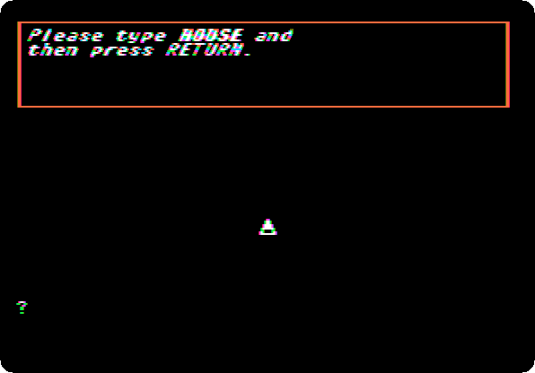

    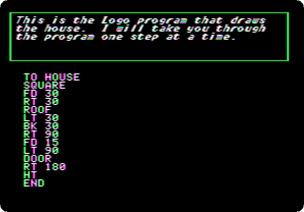

11. **Press Return** at each page: the gallery of Leo, `SETPC` for the
    colour of the pen, `ROOF` and `SQUARE` turned six times, a `REPEAT`
    inside another, the design of the introduction, and `ROOF` and `DOOR`.

    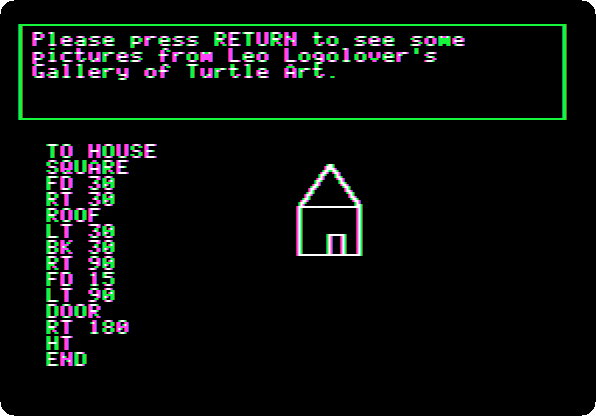

## Using Logo With Numbers and Words

12. **Press Return** at each page: the guide adds, subtracts, multiplies,
    with `*`, and divides. Then Leo's program of money: $500 in the bank
    at 6% a year, and it asks for a number of years: **type `12`** and
    **Return**, $1006.10.

    

    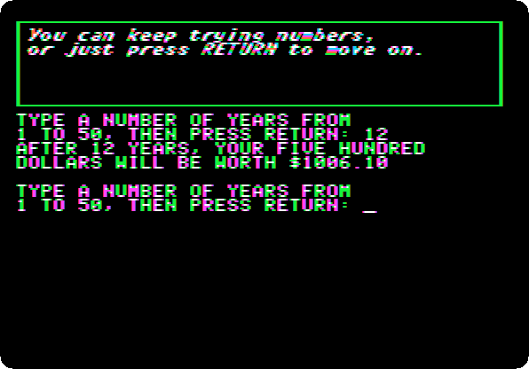

13. **Press Return** at each page, and **type `PRINT [HI KIDS]`** and
    **Return**: words in square brackets, a list.

    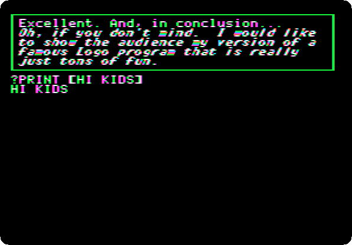

14. **Press Return** at each page, and **type `POSTCARD`** and **Return**:
    Leo's program picks a name, a phrase and a closing from three lists, at
    random. **Return** for another card, three times, and **`.`** to stop.
    Then the guide types `LEARN.NEW.PHRASE`, and asks for a phrase: **type
    `THE TURTLE SAYS HELLO`** and **Return**, and the list has it. **Press
    Return** at each page, **type `POSTCARD`** and **Return**, and
    **Return** for more cards: the phrase comes up.

    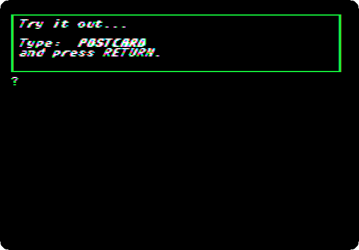

    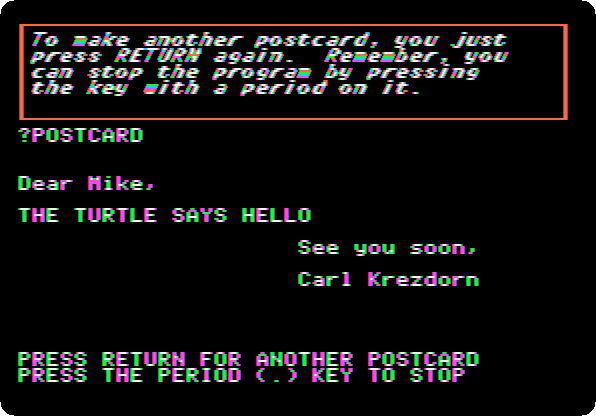

15. **Type `.`**, and **Return** at each page: Leo and the guide say
    goodbye, and the menu has every topic marked as done.

    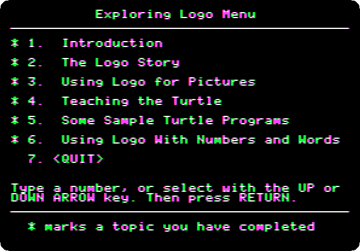

## What next

**Next:** [Life with DOS 3.3](dos33.md).

[Logo and its turtle](logo.md) is Apple Logo itself, on a //e.
