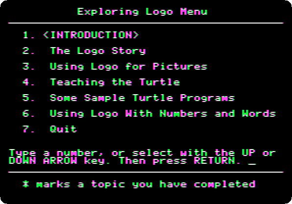
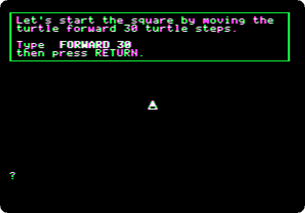
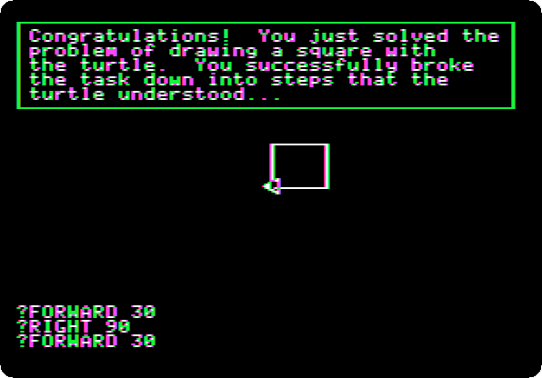
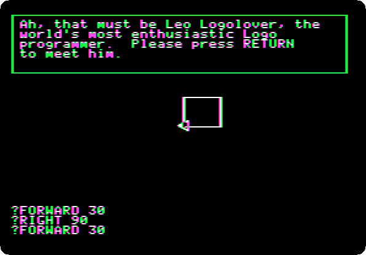
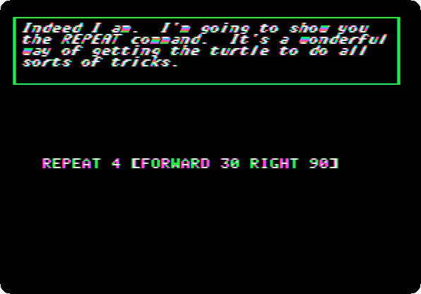
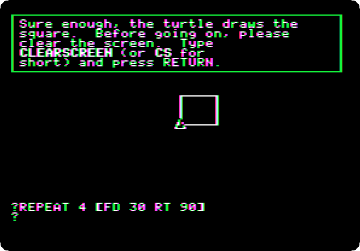
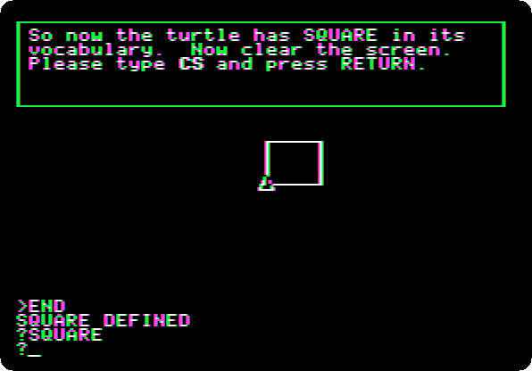

# Apple Presents the IIc: Exploring Apple Logo

[Activities](../README.md) › [First steps](../sections/first-steps.md) › [Switch on an Apple IIc](apple-iic.md)

*Exploring Apple Logo* is the diskette of **Apple Presents the IIc**, the
owner's guide of the IIc, on Logo, the language of the turtle: *a guided
tour of the Logo language for the Apple computer*, as it says, and not Apple
Logo itself, which was sold apart. It tells the story of Logo, of Seymour
Papert at MIT, and teaches the turtle to draw, with a guide who types for
you when you don't, and Leo Logolover, *the world's most enthusiastic Logo
programmer*.

This page watches the turtle write its title, and goes through its lesson
on pictures: a square a command at a time, then with `REPEAT`, and then a
new word for the turtle, `SQUARE`.

## What you need

**`Apple Presents The IIc - Exploring Apple Logo 691-0015-A (Apple-1984).DSK`**,
from the folder of the masters of each model on
[Asimov](https://mirrors.apple2.org.za/ftp.apple.asimov.net/images/masters/model_specific/).
`./fetch-disks.sh` in this repository downloads it into `disks/`.

## The machine

The Apple IIc of [Switch on an Apple IIc](apple-iic.md), on a colour
monitor, with the diskette in its drive:

```bash
izapple2 -model none -board 2c -cpu 65c02 -screen color \
    -rom "<internal>/Apple2c_ROM255.rom" \
    -charrom "<internal>/Apple IIe Video Enhanced.bin" \
    -s0 language \
    -s1 iicserial \
    -s2 iicserial \
    -s6 "diskii,disk1=disks/Apple Presents The IIc - Exploring Apple Logo 691-0015-A (Apple-1984).DSK"
```

## The title, and the menu

1. **Start izapple2** with the command above: the turtle writes the title,
   and walks a border around it.

   

   **Press Return**: the menu. The introduction and *The Logo Story* tell
   what Logo is and where it comes from, and the other topics teach it.

   

## A square

2. **Type `3`** and **Return**, *Using Logo for Pictures*, and **Return** at
   each page, until the guide asks for the first command, at the `?` of
   Logo.

   

3. **Type `FORWARD 30`** and **Return**: the turtle draws a side. **Press
   Return**, and **type `RIGHT 90`** and **Return**: it turns. **Press
   Return** at the pages after it, and **type the rest of the square**, a
   command and Return at a time: `FORWARD 30`, `RIGHT 90`, `FORWARD 30`,
   `RIGHT 90`, `FORWARD 30`.

   

   

   A command not typed in time brings *Oh, don't be shy*, and then the guide
   types it itself.

## Leo Logolover

4. **Press Return** twice: Leo Logolover arrives, very happy with the
   square.

   

   **Press Return** at each page. The next topic, *Teaching the Turtle New
   Words*, follows, and Leo shows a short cut: `REPEAT`.

   

5. **Press Return** at each page, and **type `REPEAT 4 [FD 30 RT 90]`** and
   **Return**, with the short names of `FORWARD` and `RIGHT`: the same square,
   in one command.

   

## A new word

6. **Press Return**, **type `CS`** and **Return**, short for `CLEARSCREEN`,
   and **Return** at each page. **Type `SQUARE`** and **Return**: the turtle
   doesn't know it. **Press Return** at each page, until the guide asks for
   `TO SQUARE`: **type it** and **Return**. Logo's prompt is `>` now: it
   listens, and learns. Leo types the rest of the procedure, `REPEAT 4 [FD
   30 RT 90]` and `END`. **Press Return** at each page, and **type
   `SQUARE`** and **Return**.

   

   

   The turtle has `SQUARE` among its words now. The topics after it are
   sample programs of the turtle, and Logo with numbers and words.

## What next

**Next:** [Life with DOS 3.3](dos33.md).

[Logo and its turtle](logo.md) is Apple Logo itself, on a //e.
