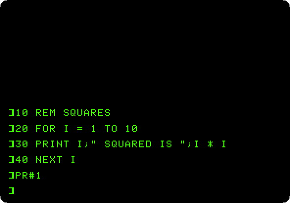
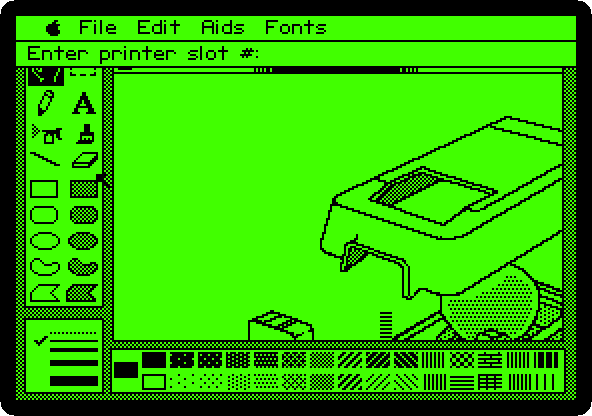
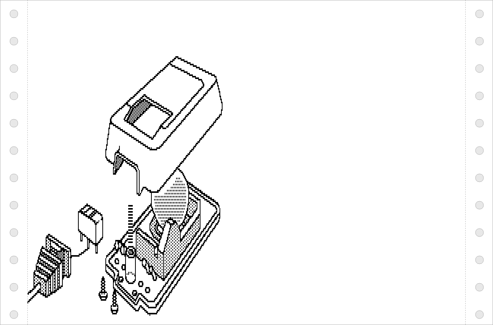

# Printing on the Apple IIc

[Activities](../README.md) › [Making things and work](../sections/making-things-and-work.md)

The Apple IIc had no slots for a printer card: its printer port was built
in, at the back, a serial port for Apple's **ImageWriter**, the dot matrix
printer Apple sold from 1983. For the programs it is a card in slot 1, as on
the //e: BASIC sends its output to it with `PR#1`, and back to the screen
with `PR#0`.

This page prints from Applesoft a program and what it prints when it runs,
and then a picture from MousePaint, dot by dot. izapple2 writes what the
port sends to a file, and
[imagewriter2](https://github.com/ivanizag/imagewriter2) draws the picture on
paper, as the ImageWriter would.

## What you need

**`077_MousePaint_Drawing_Program_68C-3005-A_1984.dsk`**, the diskette of
MousePaint, from the
[Internet Archive](https://archive.org/details/077_MousePaint_Drawing_Program_68C-3005-A_1984).
`./fetch-disks.sh` in this repository downloads it into `disks/`.

**imagewriter2**, to see the picture printed, a program in Go that reads
the codes of the ImageWriter and draws the paper as a GIF picture. It draws
the graphics, not the letters, which are in the file as text.

The [Apple IIc Owner's Manual](https://archive.org/details/a2com) is on the
Internet Archive.

## The machine

The Apple IIc of 1984, with a printer that is a file:

- the 65C02 processor at 1 MHz and 128 KB of memory: 64 KB, the top 16 KB
  of it the memory of a language card, which izapple2 puts in slot 0 as for
  the //e, and 64 KB more where the //e has its extended 80 column card;
- its two serial ports, in slots 1 and 2 for the programs: the printer port,
  with a printer that is a file, `printer.out`, in the folder izapple2 runs
  in, and the modem port;
- its port for the mouse, at the back, which its ROM gives to the programs
  as a mouse card in slot 4;
- its disk drive, the controller in slot 6, empty to start.

```bash
izapple2 -model none -board 2c -cpu 65c02 -screen green \
    -rom "<internal>/Apple2c_ROM255.rom" \
    -charrom "<internal>/Apple IIe Video Enhanced.bin" \
    -s0 language \
    -s1 iicserial,device=file,file=printer.out \
    -s2 iicserial \
    -s6 diskii
```

The model `2c` of izapple2 is this machine, with DOS 3.3 in its drive:

```bash
izapple2 -model 2c -screen green -s1 iicserial,device=file,file=printer.out
```

## From Applesoft

1. **Start izapple2** with the command above. The IIc says `Apple //c` and
   waits for a diskette. **Press Control-Reset**, Control-F2 in izapple2,
   for Applesoft.

2. **Type the program**, a line at a time. It is in
   [listings/squares.bas](listings/squares.bas) too.

   ```basic
   10 REM SQUARES
   20 FOR I = 1 TO 10
   30 PRINT I;" SQUARED IS ";I * I
   40 NEXT I
   ```

   **Type `PR#1`, `LIST`, `RUN` and `PR#0`**, each with Return. The screen
   shows none of it after `PR#1`: the printer port of the IIc sends the
   output to the printer only, until `PR#0`.

   

   The port takes commands of its own, as Control-I and a letter.
   **Control-I** and **`I`** after `PR#1` shows the output on the
   screen as well, and Applesoft answers `?SYNTAX ERROR` to the line, as it
   is not BASIC.

   On the paper, what the IIc sent, as it came out of `printer.out`:

   ```text
   ]LIST

    10  REM  SQUARES
    20  FOR I = 1 TO 10
    30  PRINT I;" SQUARED IS ";I * I
    40  NEXT I

   ]RUN
   1 SQUARED IS 1
   2 SQUARED IS 4
   3 SQUARED IS 9
   4 SQUARED IS 16
   5 SQUARED IS 25
   6 SQUARED IS 36
   7 SQUARED IS 49
   8 SQUARED IS 64
   9 SQUARED IS 81
   10 SQUARED IS 100

   ]PR#0
   ```

   The Apple sends its characters with the top bit set, as it keeps them in
   memory, and ends each line with a carriage return and a line feed. This
   turns `printer.out` into plain text on a Mac or on Linux:

   ```bash
   LC_ALL=C tr '\200-\377' '\000-\177' < printer.out | tr -d '\r'
   ```

## From MousePaint

3. **Drop `077_MousePaint_Drawing_Program_68C-3005-A_1984.dsk` on the area
   of drive 1** of the window of izapple2, and **hold Open Apple**, the left
   Alt or Option key, **and press Control-Reset**: the IIc starts MousePaint.
   **Click the mouse** for MousePaint itself, and **move the pointer to the
   top left corner**, where the pointer of MousePaint and the one of
   izapple2 meet.

4. **Choose *Get picture…* in the File menu**, **type `MOUSE.PIC`** and
   **Return**: the picture of the AppleMouse on the diskette. **Choose
   *Print Picture* in the File menu**. MousePaint asks for the slot of the
   printer: **type `1`** and **Return**.

   

   MousePaint sends the picture as graphics of the ImageWriter, a row of 8
   dots high at a time, the whole page, 280 dots across at 72 an inch,
   almost four inches. imagewriter2 draws it:

   

   MousePaint sends the codes of the ImageWriter with the top bit set too,
   `ESC` as $9B, and imagewriter2 reads them only without it. To draw
   `printer.out`, the generator of this page,
   [iicprinting_test.go](../activities/iicprinting_test.go), takes the top
   bit off the codes, and leaves the dots of the graphics as they are.

## What next

**Next:** [The Print Shop: cards, signs and banners](print-shop.md).

[Printing](printing.md) is the same on an Apple \]\[+ with a parallel
card, [MousePaint on the Apple IIc](mousepaint.md) draws a picture to
print, and [Two Apple IIcs on the line](iic-terminal.md) uses the other
port.
