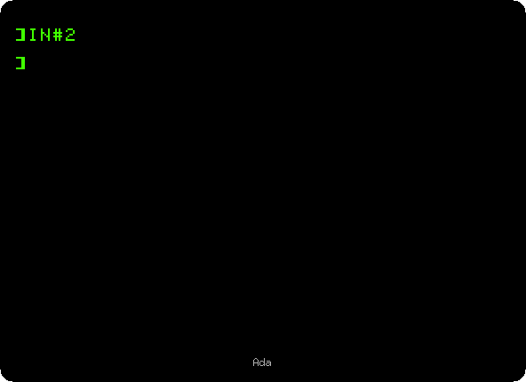
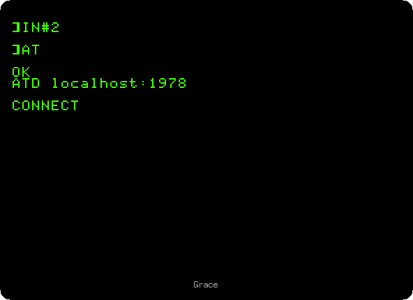
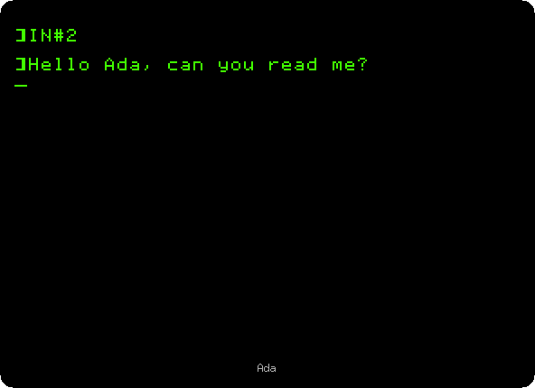
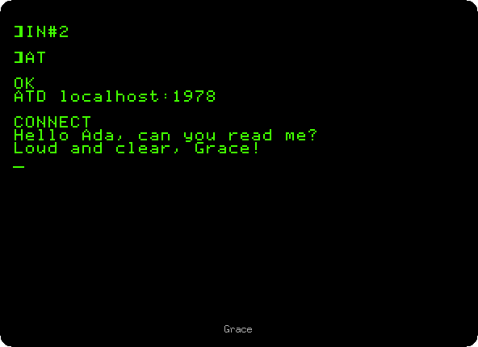

# Two Apple IIcs on the line

[Activities](../README.md) › [Cards](../sections/cards.md)

The Apple IIc of 1984 had no slots, and what a //e had on cards it had
built in, among them two serial ports at the back: one for a printer, one
for a modem. The firmware of the modem port has a **terminal mode**: with
it the IIc is a terminal, what is typed goes out of the port and what comes
in shows on the screen, with no program at all.

This page has two IIcs, Ada's and Grace's, talk through their modem ports.
Ada's waits for a call; Grace's modem dials it. They write to each other,
and Grace hangs up. Ada's screen is on the left of the page, and Grace's on
the right.

## What you need

Nothing more than izapple2, run twice on the same computer, in two
windows: the two IIcs talk through the network of the computer.

The [Apple IIc Technical Reference Manual](https://archive.org/details/Apple_IIc_Technical_Reference_Manual),
on the Internet Archive, has the commands of the ports in its chapter 8.

## The machines

Two Apple IIcs, each:

- the 65C02 processor at 1 MHz and 128 KB of memory, the top 16 KB of the
  first 64 KB the memory of a language card, which izapple2 puts in slot 0;
- the printer port, which izapple2 puts in slot 1, and the modem port, in
  slot 2;
- the disk drive built in, which izapple2 puts in slot 6, with no disk.

On Ada's, the modem port waits for a call on port 1978 of the computer,
as if a modem that answers were on its cable:

```bash
izapple2 -model none -board 2c -cpu 65c02 -screen green \
    -rom "<internal>/Apple2c_ROM255.rom" \
    -charrom "<internal>/Apple IIe Video Enhanced.bin" \
    -s0 language \
    -s1 iicserial \
    -s2 iicserial,device=tcp \
    -s6 iicdisk
```

On Grace's, a modem of izapple2 is on the cable, one that dials a host and
a port of the network instead of a telephone number:

```bash
izapple2 -model none -board 2c -cpu 65c02 -screen green \
    -rom "<internal>/Apple2c_ROM255.rom" \
    -charrom "<internal>/Apple IIe Video Enhanced.bin" \
    -s0 language \
    -s1 iicserial \
    -s2 iicserial,device=netmodem \
    -s6 iicdisk
```

## Ada's IIc

1. **Start Ada's IIc** with the first command. With no disk in its drive,
   the IIc waits for one: **press Control-F2**, Reset, for Applesoft BASIC,
   and **type `HOME`** and **Return** to clear the screen.

2. **Type `IN#2`** and **Return**: the keyboard and the modem port are both
   the input of the IIc now. Then **press Control-A** and **T**: the
   terminal mode. And **Control-A** and **I**: the IIc shows on its screen
   what is typed on it too, and not only what comes in.

   

   Control-A is the command character of the modem port: the letter after
   it is a command to the port and not a key to send. The `]` is the prompt
   of BASIC, left there before the terminal mode: what comes now goes after
   it.

## Grace's IIc calls

3. **Start Grace's IIc** with the second command, in another window, and do
   the same: **Control-F2**, **`HOME`**, **`IN#2`**, and **Control-A T**,
   but not Control-A I yet.

4. **Type `AT`** and **Return**: the modem answers `OK`. Then **type
   `ATD localhost:1978`** and **Return**: the modem dials port 1978 of this
   same computer, where Ada's IIc waits, and answers `CONNECT`. Then
   **Control-A I**.

   <p align="right"></p>

   The modem shows the commands typed to it, until it is connected: with
   Control-A I before, each letter would show twice, once from the IIc and
   once from the modem.

## Writing to each other

5. On Grace's IIc, **type `Hello Ada, can you read me?`** and **Return**.

   <p align="right"></p>

6. The line shows on Ada's screen. On Ada's IIc, **type `Loud and clear,
   Grace!`** and **Return**.

   

   And it shows on Grace's.

   <p align="right"></p>

   The ports go at 300 baud, about 30 characters a second, the speed of the
   modems of 1984: faster than anyone types.

## Hanging up

7. On Grace's IIc, **press Control-A**, **type `40N`**: no echo on the
   screen, and lines of 40 columns. **Wait a second**, **type `+++`**, and
   **wait another**: the modem answers `OK`, back to its commands with the
   call still open. **Type `ATH`** and **Return**: it hangs up.

   <p align="right"></p>

   The `+++` is not shown on Grace's screen, as the echo is off, but it is
   on Ada's: the modem sends on the pluses before it knows, by the second
   of silence after them, that they were for it. **Control-A Q** leaves the
   terminal mode, on each IIc, back to BASIC.

## What next

**Next:** [Forth in ROM](forth.md).

[Calling a BBS with ProTERM](proterm-bbs.md) calls a BBS on the internet
with the same modem, from a //e with a Super Serial Card.
