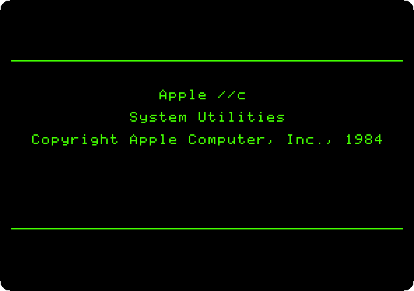
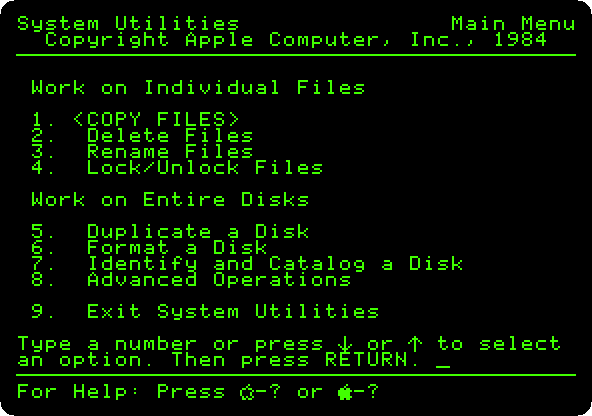
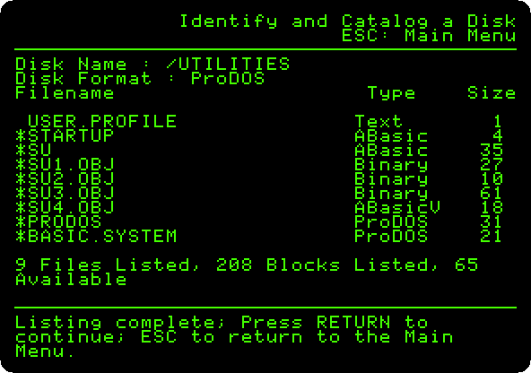
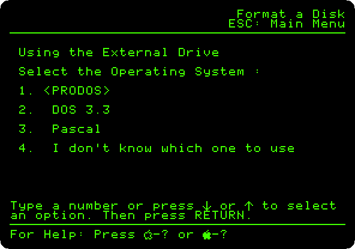
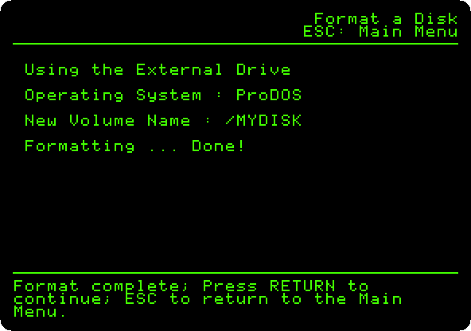
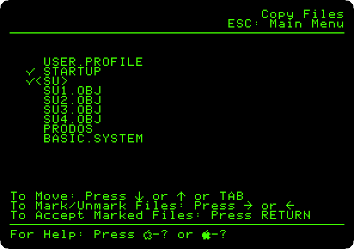
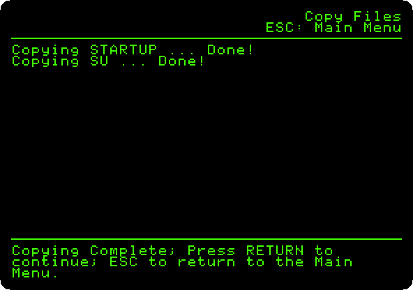
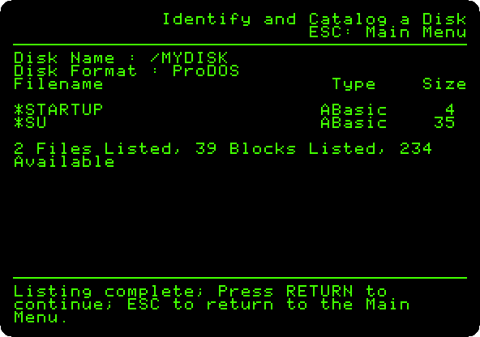
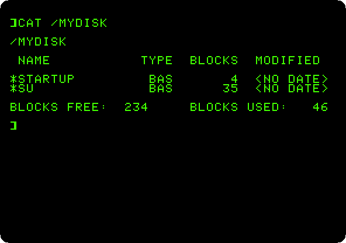

# The System Utilities of the Apple IIc

[Activities](../README.md) › [First steps](../sections/first-steps.md)

The Apple IIc came with a disk for the work on disks and files, **System
Utilities**: a menu of ProDOS, the newer system of disks of Apple, to copy
files, delete, rename and lock them, duplicate and format whole disks, and
list what is on them. It knew the three systems of the Apple II of the time,
ProDOS, DOS 3.3 and Pascal, and the two drives of a IIc, the one in its
side and the one that plugged into its back.

This page lists the files of the disk of the utilities, formats a diskette
never used in the external drive, copies two files to it, lists them, and
reads the new disk from BASIC.

## What you need

**`System Utilities for the IIc - 680-3066-A (Apple-1984).dsk`**, from the
folder of the masters of each model on
[Asimov](https://mirrors.apple2.org.za/ftp.apple.asimov.net/images/masters/model_specific/).
`./fetch-disks.sh` in this repository downloads it into `disks/`.

**`my-disk.woz`**, a diskette never formatted, for the external drive: a
copy of `blank.woz`, which `./fetch-disks.sh` makes.

```bash
cp disks/blank.woz my-disk.woz
```

## The machine

The Apple IIc of 1984, with its external drive:

- the 65C02 processor at 1 MHz and 128 KB of memory: 64 KB, the top 16 KB
  of it the memory of a language card, which izapple2 puts in slot 0 as for
  the //e, and 64 KB more where the //e has its extended 80 column card;
- its two serial ports, in slots 1 and 2 for the programs;
- its disk drive, the controller in slot 6, with the System Utilities in
  it, and a second drive, the external one, with `my-disk.woz`.

```bash
izapple2 -model none -board 2c -cpu 65c02 -screen green \
    -rom "<internal>/Apple2c_ROM255.rom" \
    -charrom "<internal>/Apple IIe Video Enhanced.bin" \
    -s0 language \
    -s1 iicserial \
    -s2 iicserial \
    -s6 "diskii,disk1=disks/System Utilities for the IIc - 680-3066-A (Apple-1984).dsk,disk2=my-disk.woz"
```

## The utilities

1. **Start izapple2** with the command above: ProDOS, and the title.

   

   The menu comes by itself: the files, at the top, and whole disks, under
   them. A number and **Return** choose.

   

2. **Type `7`** and **Return**, *Identify and Catalog a Disk*, **`1`** and
   **Return**, the built-in drive, and **`D`** and **Return**, on the
   display.

   

   The utilities themselves, `SU` and its parts, and ProDOS with its BASIC.
   **Press Escape**, back to the menu.

## A disk of your own

3. **Type `6`** and **Return**, *Format a Disk*, and **`2`** and **Return**,
   the external drive. It asks for the system of the new disk.

   

   **Type `1`** and **Return**, ProDOS, and **type `MYDISK`** and
   **Return**, its name. **Press Return**: the diskette is in the drive.

   

   **Press Escape**.

4. **Type `1`** and **Return**, *Copy Files*: **`1`** and **Return**, from
   the built-in drive, **`2`** and **Return**, to the external one, and
   **`S`** and **Return**, some of the files. **Mark them**: the down arrow
   goes to a file, and the right arrow marks it. This page marks `STARTUP`
   and `SU`.

   

   **Press Return**.

   

   **Press Escape**.

5. **Type `7`** and **Return**, and **`2`** and **Return** this time, and
   **`D`** and **Return**: the new disk, and the two files on it.

   

## BASIC

6. **Press Escape**, **type `9`** and **Return**, *Exit System Utilities*,
   and **`Y`** and **Return**: Applesoft, with ProDOS. **Type `CAT
   /MYDISK`** and **Return**.

   

   The two files, of BASIC, and no dates: the IIc has no clock of its own.

## What next

**Next:** [Apple II DeskTop](desktop.md), which runs on ProDOS, from a hard
disk.

[ProDOS](prodos.md) is the system on the //e, with its program selector and a
RAM disk.
