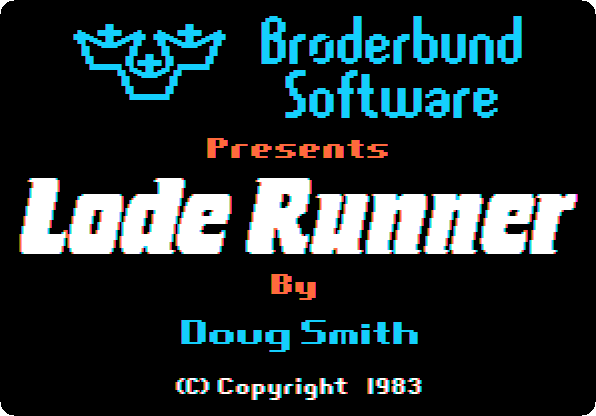
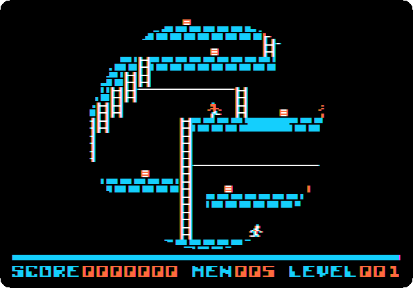
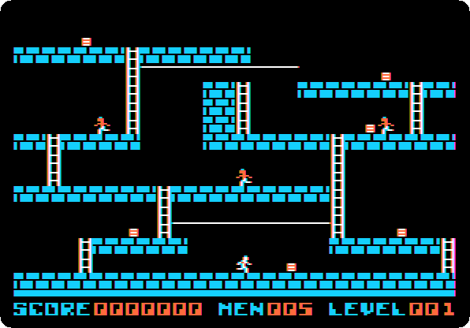
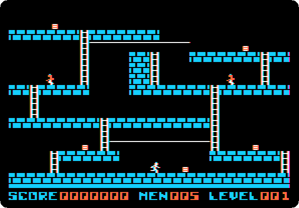
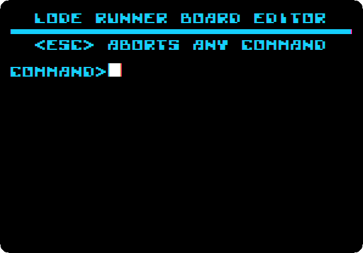
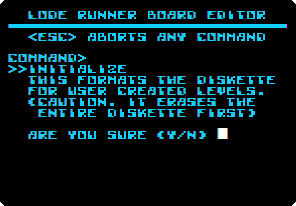
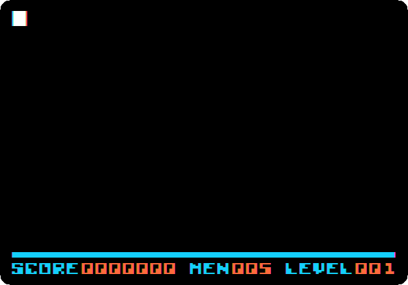
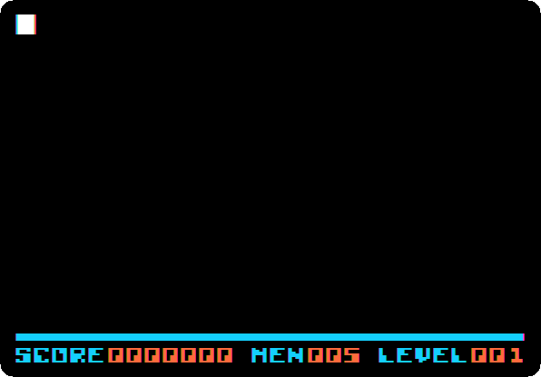
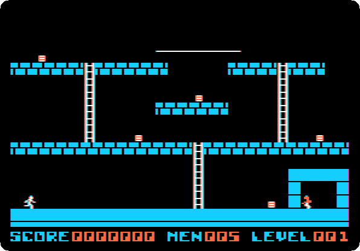

# Lode Runner

[Back to the activities](../README.md)

Lode Runner was Doug Smith's game, published by Broderbund in 1983 for the
Apple II before any other computer. A runner collects the gold of a level of
bricks, ladders and ropes while guards chase him; he can't jump or fight, only
dig a hole in the bricks for a guard to fall into, and the hole fills again
after a while. It came with 150 levels and an editor to make more, and it
went on to most computers and consoles of the eighties.

This page starts Lode Runner from a copy of its original disk, watches the
demonstration that plays itself, and plays the start of a game from the
keyboard. Then it makes a level of its own with the board editor, saves it
on a diskette, and plays it to the end.

## What you need

**`Lode Runner.woz`**, a copy of the original Lode Runner disk, from the
[woz-a-day collection](https://archive.org/details/wozaday_Lode_Runner) of
the Internet Archive: download *Lode Runner (woz-a-day collection).zip* and
take it out of it. `./fetch-disks.sh` in this repository downloads it into
`disks/`.

A WOZ file records a diskette bit by bit, its copy protection included, so
it is the disk Broderbund sold, as it was, and not a copy with the protection
taken out.

**`my-disk.dsk`**, a blank diskette, for the levels you make: the game
doesn't let you save them on its own disk. `./fetch-disks.sh` makes
`disks/blank.dsk`, a file of 143,360 zero bytes; copy it, and keep
`blank.dsk` blank:

```bash
cp disks/blank.dsk my-disk.dsk
```

izapple2 writes what the game saves straight into `my-disk.dsk`.

[Broderbund's manual of Lode Runner](https://archive.org/details/stx_Broderbund_Lode_Runner_manual)
is on the Internet Archive.

## The machine

An Apple \]\[+ with one disk drive:

- the 6502 processor at 1 MHz, 48 KB of memory, and Applesoft BASIC in its ROM;
- the keyboard of the \]\[+, which types only capitals;
- a Disk II controller card in slot 6, with the Lode Runner disk in drive 1.

```bash
izapple2 -model none -board 2plus -cpu 6502 -screen color \
    -rom "<internal>/Apple2_Plus.rom" \
    -charrom "<internal>/Apple2rev7CharGen.rom" -forceCaps \
    -s6 'diskii,disk1=disks/Lode Runner.woz'
```

The model `2plus` of izapple2 has this machine, with a Language Card and a
Videx Videoterm 80 column card more:

```bash
izapple2 -model 2plus -screen color "disks/Lode Runner.woz"
```

## Start it

1. **Start izapple2** with the command above. After a few seconds of the
   drive, the title comes up.

   

## The demonstration

2. **Wait.** The game shows its first level, opening from the middle, and
   plays it by itself: the runner in white, the guards in orange, the gold
   in the small boxes.

   

   The runner goes for the gold and away from the guards, and digs holes in
   front of them. When all the gold is taken, a ladder appears to the top of
   the screen, the way out to the next level.

## Play

3. **Press Space** to play. The first level comes up, with five runners,
   `MEN 005` at the bottom.

   

   Lode Runner is played with a joystick, or with the keyboard. Without a
   joystick connected, izapple2 makes the mouse of your computer the
   joystick of the Apple II.

4. **Press Control-K** to play with the keyboard, then **L** to run right,
   **I**, when he is at the ladder, to climb, and **J** to run left. One key
   sets the runner going, and he goes on until the next key or a wall.

   

   He takes the gold at his right, 250 points, climbs the ladder, and takes
   the next piece on the way left, but a guard is there, and catches him.
   The screen closes in a circle, and the level starts again, with one
   runner less, `MEN 004`, and the score kept. The guards are not fooled for
   long: the way past them is to dig a hole in the bricks they walk on, and
   go on while they climb out.

## Make a level of your own

The board editor makes new levels, a shape at a time, and saves them on a
diskette of your own, the data disk. Go to it with the game just started,
not at the end of a game: when a game ends with a score, the game asks for
your initials and writes the high scores on its own disk, and izapple2 stops
with an error, `Write not implemented on woz disk`, as it can't write a WOZ
file yet.

5. **Start izapple2 again**, and when the title comes up, **press
   Control-E**. The board editor waits for a command, a letter: `E` to edit
   a level, `P` to play one, `I` to initialize a data disk, `C` to clear a
   level, `M` to move one to another number, and `S` to clear the high
   scores.

   

6. **Press I** to initialize a data disk. The editor asks if you are sure,
   since it erases the diskette.

   

   **Change the disk**: drop `my-disk.dsk` on the area of drive 1 of the
   window of izapple2. Then **press Y**. The drive formats it, a few seconds,
   and the editor waits for the next command.

7. **Press E**, then type the number of the level, **001**, all three
   digits, and **press Return**. Level 1 of the new disk comes up empty, with
   the cursor, a white square, at the top left.

   

8. **Draw the level.** A level is 28 squares across and 16 down. **I**,
   **J**, **K** and **M** move the cursor up, left, right and down, and a
   digit puts a shape where it is:

   | Key | Shape |
   |---|---|
   | `0` | nothing, to rub out |
   | `1` | brick, that the runner can dig |
   | `2` | stone, that he can't |
   | `3` | ladder |
   | `4` | rope, to go across hand over hand |
   | `5` | trap door: it looks like a brick, and anyone on it falls through |
   | `6` | the ladder that appears when all the gold is taken |
   | `7` | gold |
   | `8` | guard |
   | `9` | the runner |

   A level has one runner, and from one to five guards. This is the level of
   the page, a row of the screen a line, the digit of each shape in its
   place and a dot where there is nothing: for each row, from the left,
   type the digit of each shape, and **K** to go to the next square; at the
   end of the row, **M** goes down, and **J** 27 times back to the left.

   ```txt
   ......................6.....
   ......................6.....
   ......................6.....
   ..7.........4444444...6.....
   1111113111111.....11113111..
   ......3...............3.....
   ......3........7......3.....
   ......3.....111511....3.....
   ......3...............3.....
   ......3...7...........3..7..
   1111111111111113111111111111
   ...............3............
   ...............3.......22222
   ...............3.......2.8.2
   .9.............3.....7.2...2
   2222222222222222222222222222
   ```

   

   The runner starts at the bottom left. Five pieces of gold: one at the
   bottom, two on the middle floor, one on the left of the top floor, and one
   on a small floor in the middle, over a trap door. The guard is shut in a
   room of stone, at the bottom right, so that this level is easy to win.
   The ladder at the top right is hidden until all the gold is taken.

9. **Press Control-S** to save the level on the data disk, and
   **Control-Q** to go back to the editor. A level not saved is lost.

10. **Press P**, type **001** and **press Return** to play it, and
    **Control-K** for the keyboard, as before:

    - **L** to the gold at the right, **J** back to the ladder, and **I** up
      it;
    - **J** to the left, through the gold, to the next ladder, **I** up it,
      and **J** to the gold;
    - **L** back, along the rope, and **K** in the middle of it: he lets go,
      falls to the small floor, takes the gold, and falls through the trap
      door, to the middle floor;
    - **L** to the last gold, at the right, **J** back to the ladder, and
      **I** up it to the top.

    

    With the last piece of gold the hidden ladder appears, and up it the
    level is won: 250 points for each piece of gold and 1,500 for the level,
    2,750.

The data disk keeps the level. Another day, start Lode Runner, press
Control-E, put `my-disk.dsk` in drive 1, and press P to play it, or E to
change it.

## What next

**Next:** [Mission: Asteroid, from the start to the end](missionasteroid.md).

[A game in Applesoft](paddle-game.md) is a game you write yourself, in
BASIC, for the same machine.
