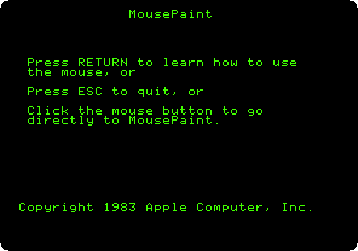
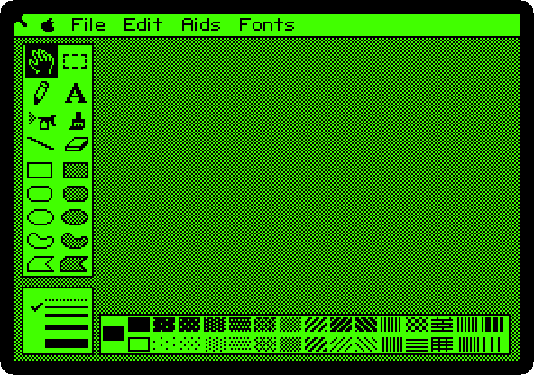
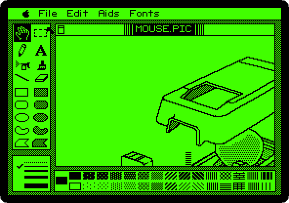
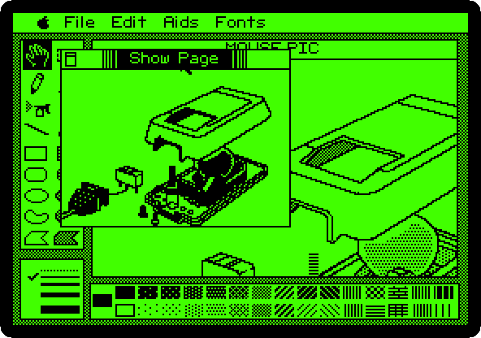
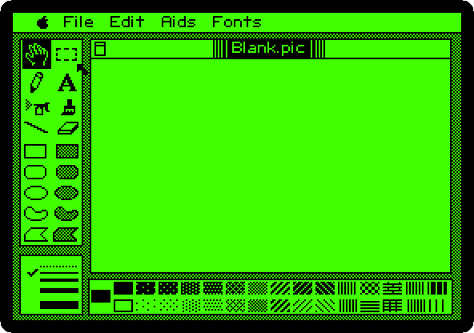
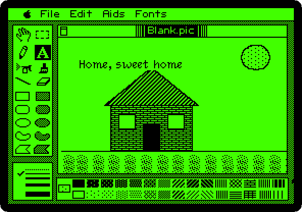
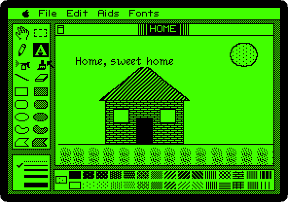

# MousePaint on the Apple IIc

[Activities](../README.md) › [Making things and work](../sections/making-things-and-work.md)

In 1984 the Macintosh came out with a mouse and MacPaint, and Apple brought
both to the Apple II the same year: the **AppleMouse**, which plugged into the
back of the Apple IIc, or into a card in a slot of the //e and the \]\[+, and
**MousePaint**, on the diskette in its box. MousePaint looks like MacPaint:
a menu bar, tools in a column at the left, patterns at the bottom, and a
window with the picture, in black and white, on the high resolution screen
of the Apple II.

This page starts MousePaint on a IIc, opens the picture on its diskette,
draws a house with its tools and patterns, writes a line in one of its
fonts, and saves the picture on the diskette.

## What you need

**`077_MousePaint_Drawing_Program_68C-3005-A_1984.dsk`**, the diskette of
MousePaint of 1984, from the
[Internet Archive](https://archive.org/details/077_MousePaint_Drawing_Program_68C-3005-A_1984).
`./fetch-disks.sh` in this repository downloads it into `disks/` and checks
it. MousePaint saves its pictures on its own diskette, and izapple2 writes
them into this file, as a drive would; `./fetch-disks.sh` sees the file
changed, and downloads it again.

The manual of the mouse of the IIc, the
[Apple Mouse IIc Manual](https://archive.org/details/Apple_Mouse_IIc_Manual),
is on the Internet Archive.

## The machine

The Apple IIc of 1984, with a mouse:

- the 65C02 processor at 1 MHz and 128 KB of memory: 64 KB, the top 16 KB
  of it the memory of a language card, which izapple2 puts in slot 0 as for
  the //e, and 64 KB more where the //e has its extended 80 column card;
- its two serial ports, in slots 1 and 2 for the programs;
- its port for the mouse, at the back, which its ROM gives to the programs
  as a mouse card in slot 4; izapple2's IIc has the mouse in it, the one of
  the computer it runs on;
- its disk drive, the controller in slot 6, with MousePaint in it.

```bash
izapple2 -model none -board 2c -cpu 65c02 -screen green \
    -rom "<internal>/Apple2c_ROM255.rom" \
    -charrom "<internal>/Apple IIe Video Enhanced.bin" \
    -s0 language \
    -s1 iicserial \
    -s2 iicserial \
    -s6 diskii,disk1=disks/077_MousePaint_Drawing_Program_68C-3005-A_1984.dsk
```

The model `2c` of izapple2 is this machine; the diskette goes after the
options:

```bash
izapple2 -model 2c -screen green disks/077_MousePaint_Drawing_Program_68C-3005-A_1984.dsk
```

## MousePaint

1. **Start izapple2** with the command above. The diskette starts ProDOS,
   and MousePaint offers a lesson on the mouse first, with Return.

   

2. **Click the mouse** for MousePaint itself. **Move the pointer to the top
   left corner**: the pointer of MousePaint goes by the steps of the mouse,
   and the one of izapple2's window by where it is, and they meet again on
   an edge.

   

   The tools: the hand that moves the picture in its window and the
   rectangle that selects a part of it; the pencil and the letters; the
   spray can and the brush; the line and the eraser; and the shapes, empty
   on the left and filled with the pattern on the right. Under them, the
   thickness of the lines, and at the bottom, the patterns.

3. **Hold the button on File, and let it go on *Get picture…***. **Type
   `MOUSE.PIC`** and **Return**: a picture of the AppleMouse, on the
   diskette.

   

   The window shows a part of the picture. **Choose *Show Page* in the Aids
   menu**: the whole of it, smaller.

   

   **Click in it** to close it.

## A house

4. **Choose *Blank HiRes Screen* in the File menu**. MousePaint asks
   whether to save MOUSE.PIC: **type `N`** and **Return**. A page to draw
   on.

   

5. **Draw**: a tool, a pattern, and the button held from a corner to the
   other.

   

   - The ground: **the line**, across the page.
   - The walls: **the bricks**, the thirteenth pattern of the top row,
     and **the filled rectangle**. Then **white**, the first pattern of the
     bottom row, for two windows, and **black**, the first of the top row,
     for the door.
   - The roof: **the diagonal lines**, the eighth of the top row, and **the
     filled polygon**: a **click at each corner**, and a **double click**
     at the last one, the same as the first.
   - The sun: **the dots**, the second of the bottom row, and **the filled
     oval**.
   - The grass: **the spray can**, held as it goes three times across under
     the ground.

6. **The letters**, and **Venice in the Fonts menu**. Give it a few
   seconds: what is typed before does not show. **Click** where the line
   goes, and **type `Home, sweet home`**.

   

   Its fonts have the names of cities, as the ones of the Macintosh: New
   York, Athens, Toronto and Venice, each a file on the diskette.

7. **Choose *Put a copy in…* in the File menu**, **type `HOME`** and
   **Return**: the picture is saved on the diskette, and the window takes
   its name.

   

## What next

**Next:** [Dazzle Draw: sixteen colours on the Apple IIc](dazzle-draw.md).

[Apple II DeskTop](desktop.md) is the mouse on the //e, with windows and
icons, and [Switch on an Apple IIc](apple-iic.md) the machine.
