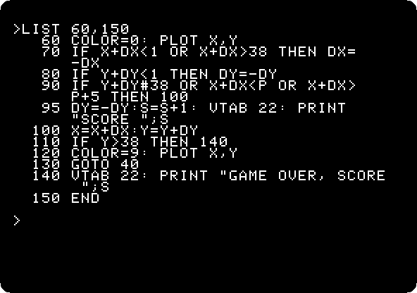
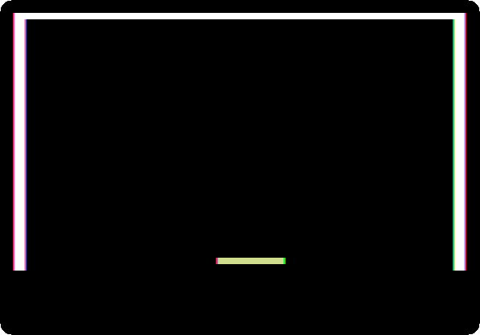
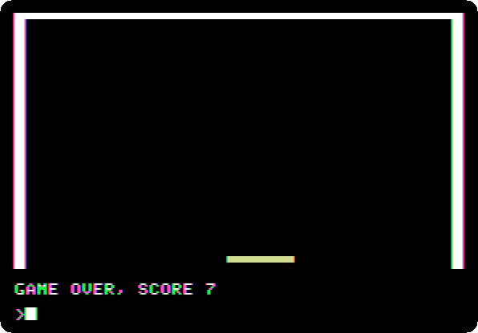

# A game in Integer BASIC

[Activities](../README.md) › [Languages and programming](../sections/languages-and-programming.md)

The Apple II was made to play games, and to write them. It had colour graphics
and a speaker, and a game port on the main board for paddles, a knob and a
button each, all within reach of a line of BASIC: `GR` switches to
graphics, `COLOR=` and `PLOT` draw, `PDL` reads where a paddle is turned to.
The first Apple \]\[ came with Integer BASIC in its ROM, which Wozniak wrote
himself and gave these words to write games with: Breakout, the game he had
designed in hardware for Atari, he wrote again in it. Magazines and books printed the
listings of games, and their readers typed them in.

This page writes one of those, a bat and a ball in the low resolution
graphics of the first Apple \]\[, types it in, and plays it.

## What you need

Only izapple2, as in [The Apple \]\[ of 1977](apple-ii.md): nothing to
download.

The [Apple II BASIC Programming Manual](https://archive.org/details/Apple_II_Basic_Programming_Manual_1978_Apple),
Apple's manual of Integer BASIC, of 1978, is on the Internet Archive.

## The machine

The first Apple \]\[, with no disk drive:

- the 6502 processor at 1 MHz and 48 KB of memory;
- the ROM with Integer BASIC, the Monitor and the Mini-Assembler;
- the board of the first Apple \]\[s, and a keyboard of capitals only;
- a pair of paddles in its game port;
- no cards in its slots.

```bash
izapple2 -model none -board 2plus -cpu 6502 -screen color \
    -rom "<internal>/341-000x_integer.rom" \
    -charrom "<internal>/Apple2rev7CharGen.rom" -forceCaps \
    -mods four-colors
```

The model `2` of izapple2 is this same machine:

```bash
izapple2 -model 2 -screen color
```

## Type the game

1. **Start izapple2** with the command above. The machine starts in the
   Monitor, with its prompt, `*`. **Press Control-B and Return**: Integer
   BASIC, with its prompt, `>`. The screen is in colour, as on the colour
   television many Apple IIs were plugged into: the game is in colour.

2. **Type the program**, each line ended with Return:

   ```basic
   10 GR:CALL -936
   20 X=20:Y=5:DX=1:DY=1:S=0:Q=-1
   30 COLOR=15:HLIN 0,39 AT 0:VLIN 0,39 AT 0:VLIN 0,39 AT 39
   40 P=PDL(0)*32/255+1
   50 IF P=Q THEN 60
   55 COLOR=0:HLIN 1,38 AT 38:COLOR=13:HLIN P,P+5 AT 38:Q=P
   60 COLOR=0:PLOT X,Y
   70 IF X+DX<1 OR X+DX>38 THEN DX=-DX
   80 IF Y+DY<1 THEN DY=-DY
   90 IF Y+DY#38 OR X+DX<P OR X+DX>P+5 THEN 100
   95 DY=-DY:S=S+1:VTAB 22:PRINT "SCORE ";S
   100 X=X+DX:Y=Y+DY
   110 IF Y>38 THEN 140
   120 COLOR=9:PLOT X,Y
   130 GOTO 40
   140 VTAB 22:PRINT "GAME OVER, SCORE ";S
   150 END
   ```

   In izapple2 you can paste it instead, with Command-V on a Mac or
   Shift-Insert elsewhere: izapple2 types what you paste, slowly enough for
   the machine to keep up. A line longer than the screen goes on on the next
   one as you type it; it is still one line until Return.

   - `GR` switches to the low resolution graphics: 40 by 40 blocks in 16
     colours, with four lines of text under them. `CALL -936` clears those
     lines: Integer BASIC has no `HOME`, and calls the routine of the
     Monitor that does it, at the address -936.
   - Line 30 draws the walls in white, colour 15, with horizontal and vertical
     lines, `HLIN` and `VLIN`.
   - Line 40 reads the paddle, from 0 to 255, and turns it into where the bat
     starts, from 1 to 33: Integer BASIC has only whole numbers, from -32767
     to 32767, and drops what is left of a division. Lines 50 and 55 draw
     the bat, six blocks of yellow, colour 13, when it has moved, after
     clearing its row with black, colour 0.
   - Lines 60 to 150 are the ball: rubbed out, bounced off the walls and the
     bat, moved, and drawn again in orange, colour 9. `#` is "not equal",
     as `<>` is.
   - An `IF` of Integer BASIC does only the one command after its `THEN`:
     what follows a `:` on the same line is done anyway. So where more than
     one thing depends on it, as the bounce off the bat in line 95, the `IF`
     jumps over them with the number of a line, `THEN 100`.

3. **Type `CALL -936` and `LIST 60,150`** to see the end of it the way
   Integer BASIC keeps it, with its own spaces.

   

## Play it

4. **Type `RUN`, and move the mouse left and right** over the izapple2
   window. Without a joystick connected, izapple2 turns the mouse into one:
   the position of the pointer across the window is paddle 0, from 0 a
   hundred and twenty eight dots left of the middle of the window to 255 as
   far right of it.

   

   This is the speed of the machine. Integer BASIC counts in whole numbers,
   which the 6502 adds in a few instructions, and the ball goes from its
   start to the bottom of the screen in 1.3 seconds; the same game in
   Applesoft, which counts in floating point, takes 2.2. The ball blinks
   because it is rubbed out before it is drawn again. Control-C stops the
   game, as it stops any program of Integer BASIC.

   The walls are white with a fringe of colour at their edges: on a
   television, the Apple II makes its colours out of the timing of its
   white dots, and the dots at the edge of a white line are coloured.

5. **Miss the ball.** The program ends, with the score.

   

   `RUN` plays again. `TEXT` gives back the whole screen to text.

## What next

**Next:** [A game in Applesoft: the snake](applesoft-snake.md).

[The Apple \]\[ and its cassettes](apple-ii-cassettes.md) loads programs
from tape into this same machine, Breakout among them; `SAVE` keeps a program
of Integer BASIC on a cassette the same way, and `LOAD` brings it back.
