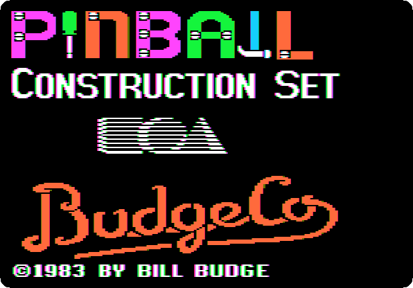
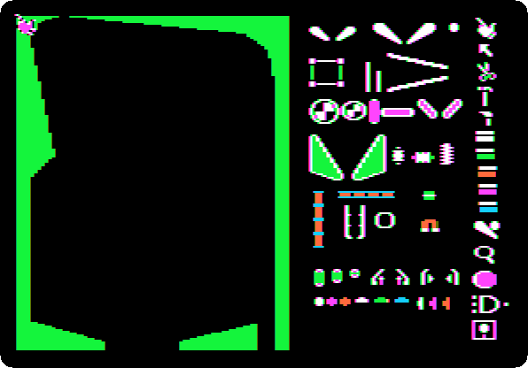
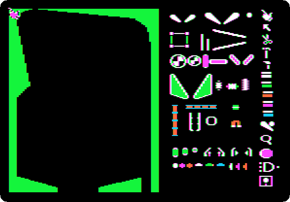
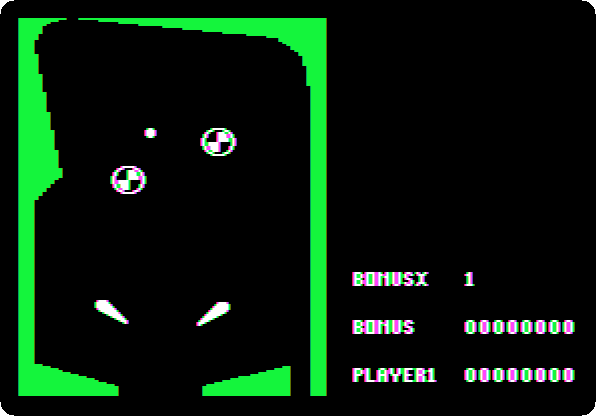
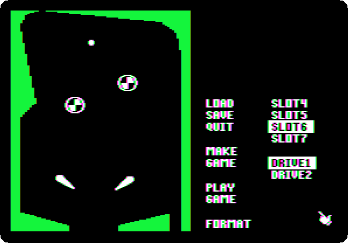
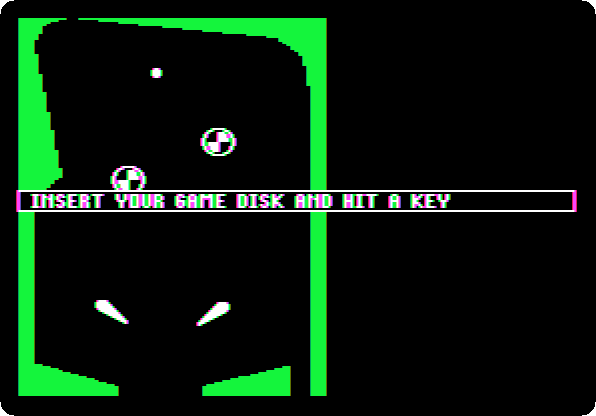
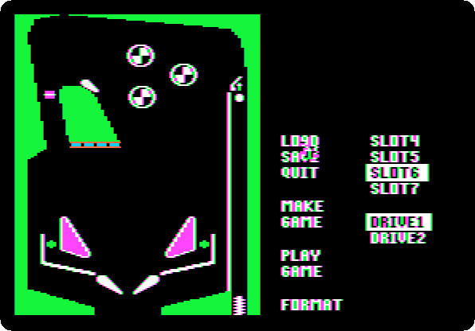
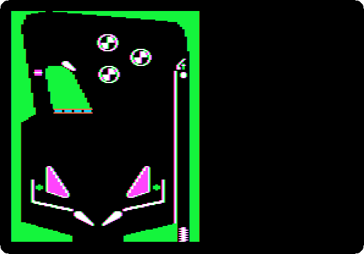
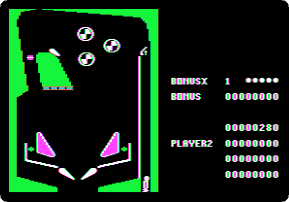

# Pinball Construction Set

[Activities](../README.md) › [Making things and work](../sections/making-things-and-work.md)

Bill Budge wrote pinball games for the Apple II: Raster Blaster, sold by his
own BudgeCo in 1981, had a table that played like a real one, with a ball
that bounced off what it hit as it would. **Pinball Construction Set** gave
that to everyone: an empty table, a box of parts, flippers, bumpers,
targets, walls and the ball, and a hand, moved with the joystick, to take
them from the box and put them on the table. Then PLAY, and the table is a
game, with its score. Budge's manual calls it *the first software toy*.
Electronic Arts published it in 1983, one of its first games, and showed
Budge on the box like a musician on a record; the tables made with it can
be saved, and made into games of their own to give to friends who don't
have the program.

This page builds a small table, two flippers, two bumpers and a ball, and
plays it, then loads DEMO1, one of the tables on the disk, and plays a game
of it, the spring, the flippers and the score.

## What you need

**`Pinball Construction Set (4am and san inc crack).dsk`**, in
[Pinball Construction Set (4am and san inc crack)](https://archive.org/details/PinballConstructionSet4amCrack)
of the Internet Archive: download *Pinball Construction Set (4am and san
inc crack).zip* and take the disk out of it. `./fetch-disks.sh` in this
repository downloads it into `disks/` and checks it. The other disk of the
zip, the *work disk*, has the tools of the crack, and is not needed.

The manual,
[Budge Co - Pinball Construction Set manual.pdf](https://mirrors.apple2.org.za/ftp.apple.asimov.net/documentation/games/misc/Budge%20Co%20-%20Pinball%20Construction%20Set%20manual.pdf),
and the
[command summary card](https://mirrors.apple2.org.za/ftp.apple.asimov.net/documentation/games/misc/Pinball%20Construction%20Set%20Command%20Summary%20Card.pdf)
are on Asimov.

## The machine

An Apple \]\[+ with a joystick:

- the 6502 processor at 1 MHz and 48 KB of memory;
- the keyboard of the \]\[+, which types only capitals;
- a joystick on the game port, with its two buttons: the hand of the
  program, the spring of the table and the two flippers;
- a Disk II controller card in slot 6, with Pinball Construction Set in
  drive 1.

```bash
izapple2 -model none -board 2plus -cpu 6502 -screen color \
    -rom "<internal>/Apple2_Plus.rom" \
    -charrom "<internal>/Apple2rev7CharGen.rom" -forceCaps \
    -s6 'diskii,disk1=disks/Pinball Construction Set (4am and san inc crack).dsk'
```

The joystick of izapple2 is the mouse of the host, or a joystick or a game
controller plugged into it; its buttons are the buttons of the mouse, or of
the controller.

## The construction set

1. **Start izapple2** with the command above. The title: Pinball
   Construction Set, Electronic Arts, BudgeCo, 1983 by Bill Budge.

   

2. **Wait.** The construction set: the empty table on the left, with its
   walls, and on the right the parts box, flippers, bumpers, slingshots,
   targets, a ball and more, and a column of icons, PLAY among them, the
   ball and the flipper, and DISK at the bottom, the square of a diskette.
   The hand is on the screen, top left.

   

   The joystick moves the hand: the further from the middle, the faster,
   and in the middle it stops. Its finger touches what is just above it.

## A table of its own

3. **Drag the parts to the table**: move the hand to a part of the box,
   hold the button down, move the hand to the table, and let the button go.
   A left flipper and a right flipper, the large ones of the first row, at
   the bottom, as near the middle as the walls let them; two bumpers, the
   round ones, in the middle of the table; and the ball, the dot at the end
   of the first row, at the top. The parts box gives as many of each as are
   taken. At the speed of the machine:

   

4. **Move the hand to PLAY, and press the button.** The parts box gives way
   to the score, and the ball falls: off a bumper, 60 points, and down
   between the flippers, which these two, far apart, can't reach.

   

   **Press Escape**, back to the parts box.

## DEMO1

5. **Select DISK**, the last icon. Its menu: LOAD and SAVE a table, MAKE
   GAME, a game on a diskette of its own for those without the program,
   PLAY GAME, and the slot and the drive of the diskette.

   

6. **Select LOAD, type `DEMO1` and Return.** *Insert your game disk and hit
   a key*: the tables of the program are on its own disk, already in the
   drive.

   

   **Press the space bar.** DEMO1: three bumpers at the top, a ramp,
   slingshots over the flippers, and the lane of the ball on the right,
   with its spring at the bottom.

   

## A game

7. **Select PLAY GAME**, a whole game, with its score. **Press the
   space bar**, for the players, and **the button**; then **pull the
   joystick down**, the spring, **push it up**, and **press the button**:
   the ball goes up the lane and into the table. **The buttons are the
   flippers**, one each. At the speed of the machine:

   

   The bumpers and the targets score, and the flippers, held as the ball
   comes down to them, send it back up: 280 points for the first ball,
   and then the second player's turn, the space bar having made a game of
   two.

   

## What next

**Next:** [The Mockingboard](mockingboard.md).

[The Print Shop](print-shop.md) is another program for making things, and
[Lode Runner](lode-runner.md) has a board editor of its own, a game of 1983
too.
