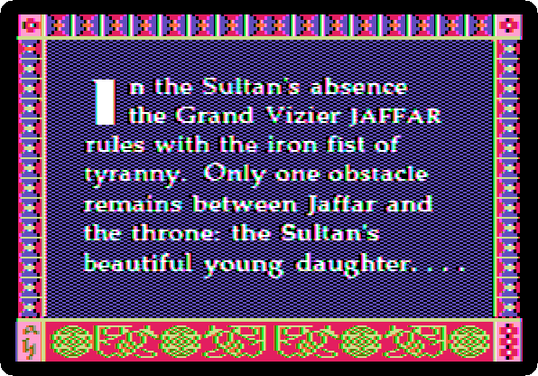
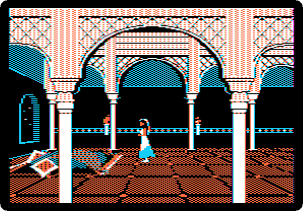
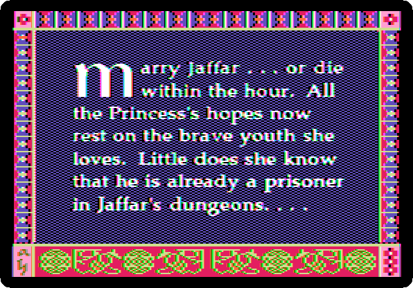
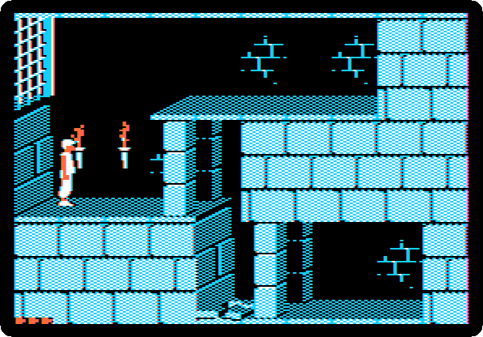
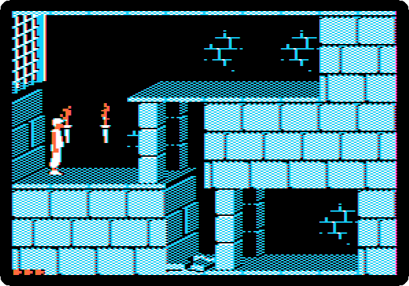
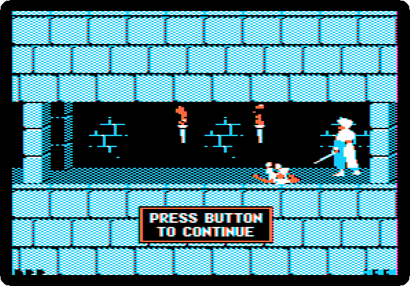

# Prince of Persia

[Activities](../README.md) › [Play](../sections/play.md)

**Prince of Persia** is Jordan Mechner's second game, after
[Karateka](karateka.md), published by Broderbund in 1989, on the Apple II
first. A prince, prisoner in the dungeons of the Grand Vizier Jaffar, has
one hour to escape and save the princess, who must marry Jaffar or die: an
hour of the game, counted by the hourglass of the story. The prince runs,
jumps, climbs, hangs from ledges, falls, and fights with the sword, and he
moves as a person does, because Mechner drew him from film of his younger
brother David running and jumping. It was one of the last great games of
the Apple II, and went on to nearly every computer and console; the Apple
II source code, found again in 2012, is now public.

This page lets it play by itself first, as it does when no one touches the
keyboard: the titles, the story, the princess and Jaffar, and the game
playing a part of itself, a run and a fight. Then a game, with the
keyboard: the prince runs from where he starts, falls to a lower floor,
and meets a guard, without a sword.

## What you need

**`prince of persia side a (san inc crack).dsk`**, in
[the Prince of Persia folder of Asimov](https://mirrors.apple2.org.za/ftp.apple.asimov.net/images/games/action/prince_of_persia/):
side A of a crack of the two sides of the game, which the note beside it
calls *100% version, fully playable, with save/load support*. Side A is
enough for this page; the later levels are on side B, in the same folder.
`./fetch-disks.sh` in this repository downloads side A into `disks/` and
checks it.

## The machine

An enhanced Apple //e, as the game needs 128 KB:

- the 65C02 processor at 1 MHz and 128 KB of memory: 64 KB on the board,
  the top 16 KB of it the memory of a language card, which izapple2 puts in
  slot 0, and 64 KB more on the extended 80 column card, in the auxiliary
  slot;
- a Disk II controller card in slot 6, with side A in drive 1.

```bash
izapple2 -model none -board 2e -cpu 65c02 -screen color \
    -rom "<internal>/Apple2e_Enhanced.rom" \
    -charrom "<internal>/Apple IIe Video Enhanced.bin" \
    -s0 language \
    -s6 'diskii,disk1=disks/prince of persia side a (san inc crack).dsk'
```

## By itself

1. **Start izapple2** with the command above, and wait. *Broderbund
   Software presents*, *a game by Jordan Mechner*, and the title, on the
   picture of a palace.

   

   Then the story: *In the Sultan's absence the Grand Vizier JAFFAR rules
   with the iron fist of tyranny...*

   

2. **The princess**, in her room, walking. Jaffar comes in, and turns an
   hourglass over: she has an hour. At the speed of the machine:

   

   *Marry Jaffar... or die within the hour.*

   

3. **The game, playing itself**: the prince runs, jumps a pit, climbs,
   runs past the spikes, and fights a guard with the sword, until one of
   them falls. At the speed of the machine:

   

## A game

4. **Press Return.** The game starts on level 1: the prince in the
   dungeon, a gate behind him, and his health at the bottom left, the
   small red triangles.

   

5. **Press `L` again and again**, about three times a second: the prince
   runs to the right. The game wants the key held down; izapple2 has no
   key held, only pressed, and a key pressed often enough keeps him
   running. He runs off the edge and falls to the floor below, and the
   screen flashes red: he is hurt by the fall. **Go on pressing
   `L`**: the next room, and a guard, with a sword. The prince has none
   yet, and the guard runs him through.

   

   *Press button to continue*. The sword is somewhere else in the level,
   to be found before any guard.

   

## What next

**Next:** [Lode Runner](lode-runner.md).

[Karateka](karateka.md) is Mechner's first game, of 1984, a fight told like
a film, and the source code of Prince of Persia for the Apple II is on
[Asimov](https://mirrors.apple2.org.za/ftp.apple.asimov.net/images/programming/assembler/).
