# The Print Shop: cards, signs and banners

[Back to the activities](../README.md)

The Print Shop was David Balsam and Martin Kahn's program for making things to
print, published by Broderbund in 1984 for the Apple II and soon for most
home computers. With a few menus and no drawing at all, anyone could make a
greeting card, a sign, a letterhead or a banner many feet long, from its
borders, its pictures and its eight fonts, and print it on the dot matrix
printer of the house. It was one of the best selling programs of the time,
and for many families the reason a computer and a printer were worth having:
the birthday cards, the signs of the school fair and the banners of the
parties of the eighties came out of it.

This page sets The Print Shop up for an ImageWriter, makes a birthday card of
its own design, a sign and a banner, and plays with Screen Magic, printing
each. izapple2 writes what goes to the printer to a file, and
[imagewriter2](https://github.com/ivanizag/imagewriter2) draws it on paper,
dot by dot, as the ImageWriter would.

## What you need

**`The Print Shop (4am crack) side A.dsk`**, the program, in
[The Print Shop (4am crack)](https://archive.org/details/ThePrintShop4amCrack)
of the Internet Archive: download *The Print Shop (4am crack).zip* and take
it out of it. It is a copy without its protection, which The Print Shop needs
here, as it saves its setup on its own disk and izapple2 does not write the
WOZ images of the original disks yet (see [IZAPPLE2.md](../IZAPPLE2.md)).
`./fetch-disks.sh` in this repository downloads it into `disks/` and checks
it. izapple2 writes the setup into this file.

**imagewriter2**, to see what was printed, a program in Go that reads the
codes of the ImageWriter and draws the paper as a GIF picture. With
[Go](https://go.dev/) installed, this draws all that was printed in
`printer.out`, one printout after the other on a continuous paper, as it came
out of the printer:

```text
go run github.com/ivanizag/imagewriter2@latest -gif paper.gif < printer.out
```

The manual of a later version, the
[Broderbund Print Shop Manual 1989](https://archive.org/details/apple2_broderbund_print_shop_manual_1989)
for the Apple II, is on the Internet Archive, with the reference card of its
graphics.

## The machine

An Apple \]\[+ with a printer and a disk drive:

- the 6502 processor at 1 MHz and 48 KB of memory, what The Print Shop
  needs;
- the keyboard of the \]\[+, which types only capitals;
- an Apple Parallel Interface Card in slot 1, with a printer that is a file:
  what the card prints goes to `printer.out`, in the folder izapple2 runs in;
- a Disk II controller card in slot 6, with The Print Shop in drive 1.

```bash
izapple2 -model none -board 2plus -cpu 6502 -screen color \
    -rom "<internal>/Apple2_Plus.rom" \
    -charrom "<internal>/Apple2rev7CharGen.rom" -forceCaps \
    -s1 parallel,file=printer.out \
    -s6 'diskii,disk1=disks/The Print Shop (4am crack) side A.dsk'
```

The Print Shop is used with the keyboard: the arrow keys ← and → move the
bar of a menu, up and down, Return chooses, and Escape goes back to the
menu before. It shows how each choice looks as the bar moves.

## Start The Print Shop

1. **Start izapple2** with the command above. After a few seconds of the
   drive, the title: Broderbund presents The Print Shop, by David Balsam and
   Martin Kahn, copyright 1984 Pixellite Software.

   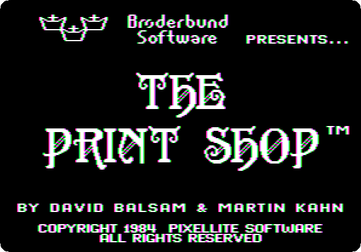

2. **Press →** to go down the main menu. The picture at its right shows what each choice makes: a greeting card, a sign, a
   letterhead, a banner, the patterns of Screen Magic, the editor of its
   pictures, and the setup of the printer.

   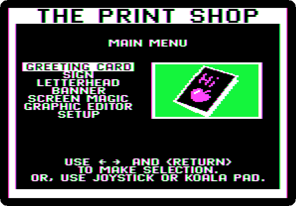

## The printer

The Print Shop drives each printer of its time with codes of its own, and
needs to know which, and on what card, before it prints.

3. **Choose Setup**, the last of the main menu, with Return. The printer: the
   bar is on *Apple DMP, ImageWriter, Scribe*, Apple's printers, already;
   **press Return**.

   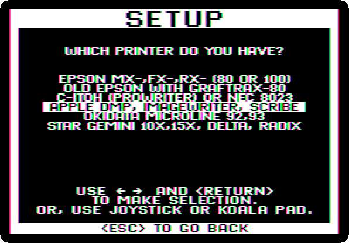

4. **The card: press → to *Apple II Parallel Interface*** and Return, the
   card of slot 1; the bar starts on the card the disk was set up for, the
   *Apple Super Serial*, and once the setup is saved, on this one.

   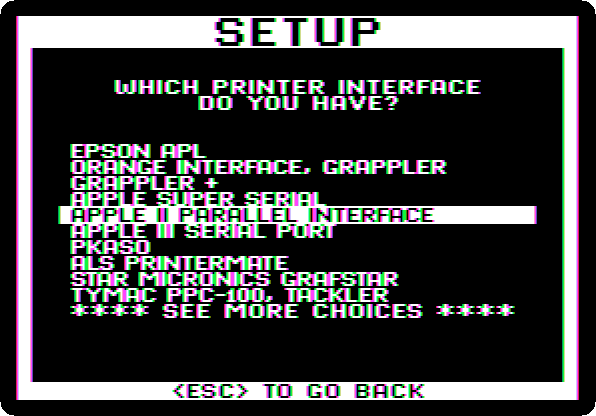

   Then **Return for slot 1**, **← and Return for one disk drive**, and
   **Return to test the printer**. It prints a line:

   

   A welcome printed means the setup is right, and the program offers to
   save it on its disk. **Press Return**: it saves it, in the file of the
   disk, and goes back to the main menu. The Print Shop remembers it from
   now on, every time it starts.

   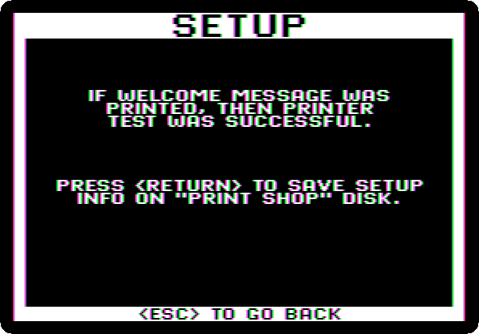

## A greeting card

5. **Choose Greeting Card**, the first of the main menu, and Return for
   *Design Your Own*, not one of the cards it has ready. A card is folded
   from one sheet: a front, an inside, and a line on the back.

6. **The border of the front: press → six times**, to *Stars*, and Return.
   The menu shows each border as the bar passes it.

   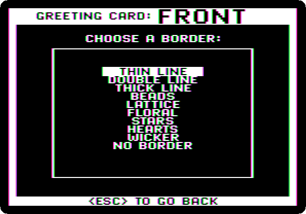

7. **The picture: Return for *By Picture***, then **→ three times, to
   *Gift Box***, and Return. Each picture shows at the right as the bar
   passes it, in the colours of the screen; the printer prints them in
   black.

   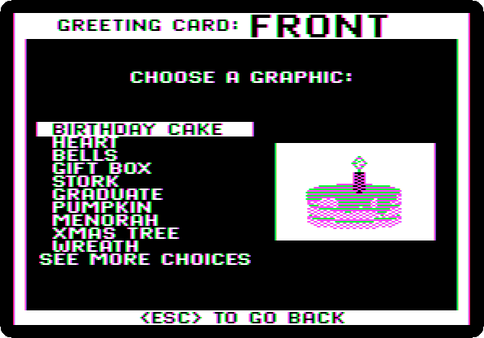

   Then its size: **→ twice, to *Large***, one picture that fills the middle
   of the card, and Return.

8. **The font: → four times, to *Party***, and Return. Each font shows its
   name in it.

   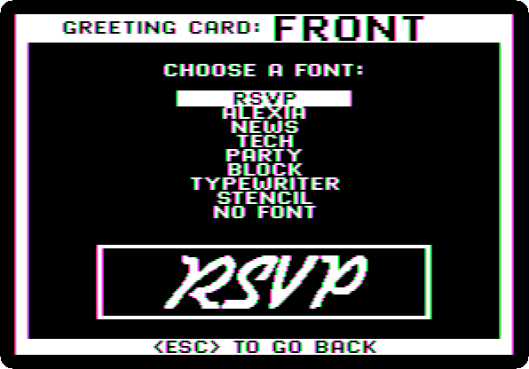

9. **Type the message**: `HAPPY`, then **Control-F twice** and Return,
   `BIRTHDAY` and **Control-F twice** again. A message has a few lines,
   centred, the C at the right of each; Control-F changes the form of the
   line it is on, solid, outline or in three dimensions, the *3D* at its
   left; Control-S its size, Control-P its place, left, centre or right, and
   Control-E erases it. Control-I shows all of them. The editor shows the
   text in its own letters, not in the font.

   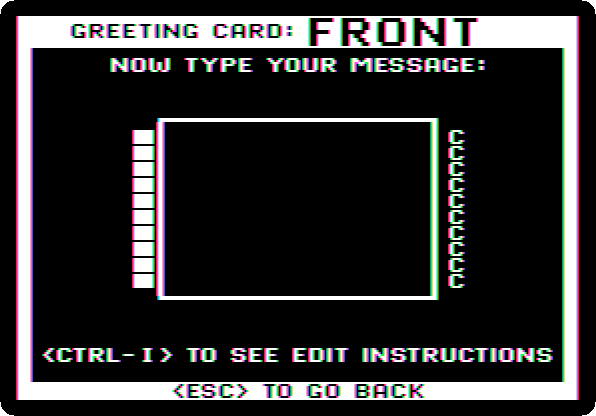

   **Press Return down to the last line.** It asks if the text goes in the
   middle of the card, top to bottom: **→ to *No*** and Return, to keep it
   at the top, over the picture.

   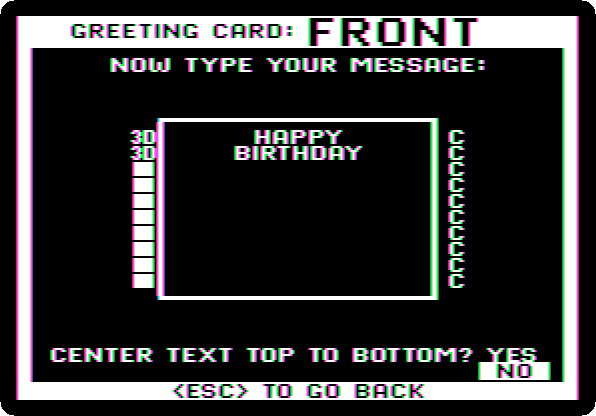

10. **The inside**, the same way: Return for the *Thin Line* border, Return
    for *By Picture* and Return for the *Birthday Cake*, the first, and
    Return for *Small*. A small picture can be put in more than one place:
    **→ twice, to *Custom Layout***, and Return. The page has thirteen
    places; **Return puts a cake where the cursor is**, and → moves on.
    Three at the top, 1 to 3, and three at the bottom, 11 to 13, leave the
    middle for the text; → to *DONE* and Return.

    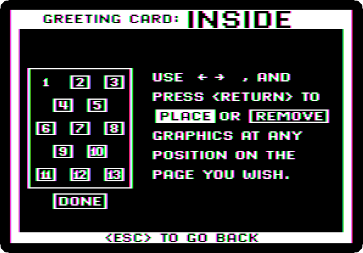

11. **→ once, to *Alexia*** and Return, and **type `MANY HAPPY`**, Return,
    **`RETURNS`**, Return, **`ADA`**. Return down to the last line, and
    **Return for *Yes***, in the middle this time.

    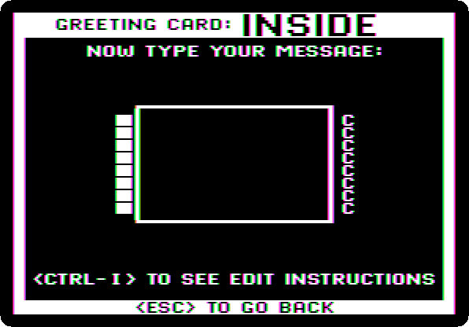

12. **The menu of printing.** **Return for *Give Yourself Credit*** and type
    a line for the back of the card, **`MADE ON AN APPLE II`**, and Return.

    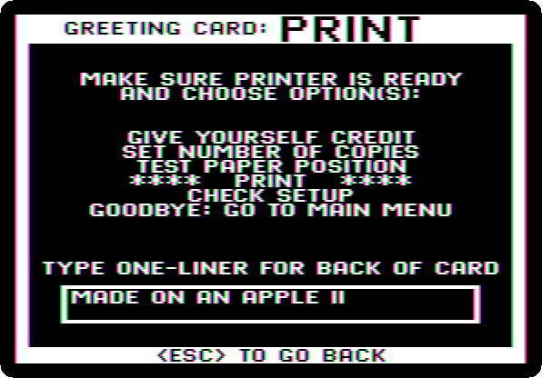

    **→ twice, to *Print***, and Return.

    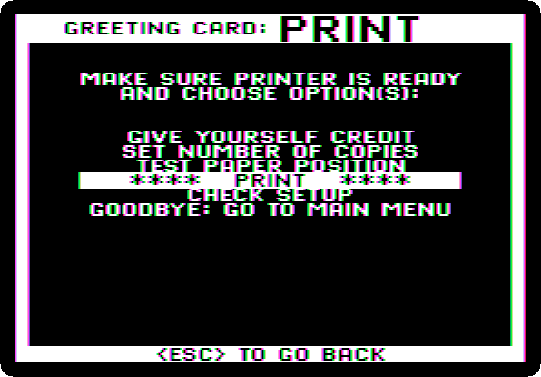

13. **Wait.** The Print Shop works out each part of the card before it
    prints it, a few seconds each, with the colours of *THINKING* on the
    screen. The card takes almost two minutes, with a printer that takes
    all at once; an ImageWriter took longer, printing.

    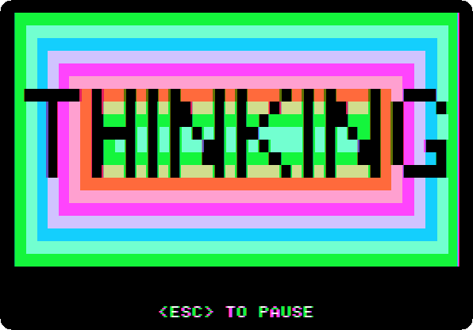

    It is printed on one sheet, to be folded in four: the front at the
    bottom right, the inside upside down at the top left, which turns the
    right way up when the sheet is folded, and the line of credit at the
    bottom left, on the back.

    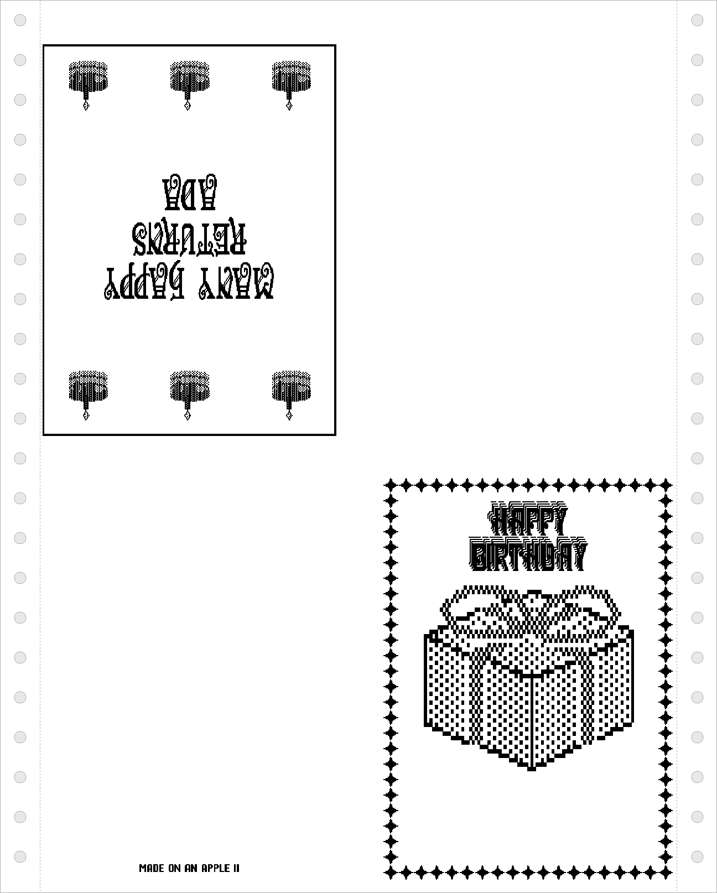

    When it is done, **→ twice, to *Goodbye: Go To Main Menu***, Return,
    and Return again to say yes.

## A sign

14. **Choose Sign**, a page with large letters, and **→ twice and Return**
    for the *Thick Line* border. **Return for *By Picture***, and **→ ten
    times, to *See More Choices***, and Return: the second page of pictures.
    **→ twice, to *Apple***, and Return; **→ twice and Return** for
    *Large*.

    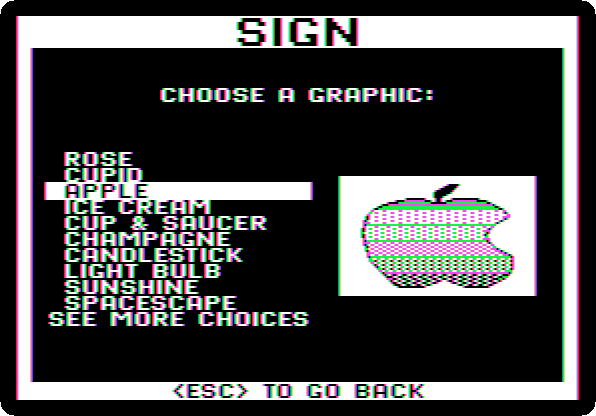

15. **→ seven times, to *Stencil***, and Return. **Type `APPLE II CLUB`**,
    **press Return twelve times**, down near the bottom, and **type
    `MEETS TONIGHT`**: the text above the apple and under it. Return to the
    end, and **→ to *No*** and Return, not in the middle.

    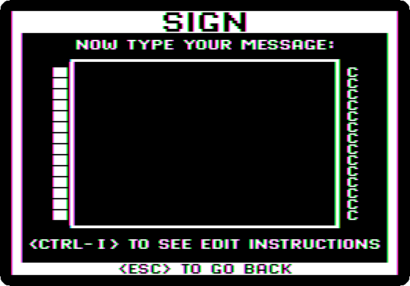

16. **→ twice, to *Print***, and Return. A minute later:

    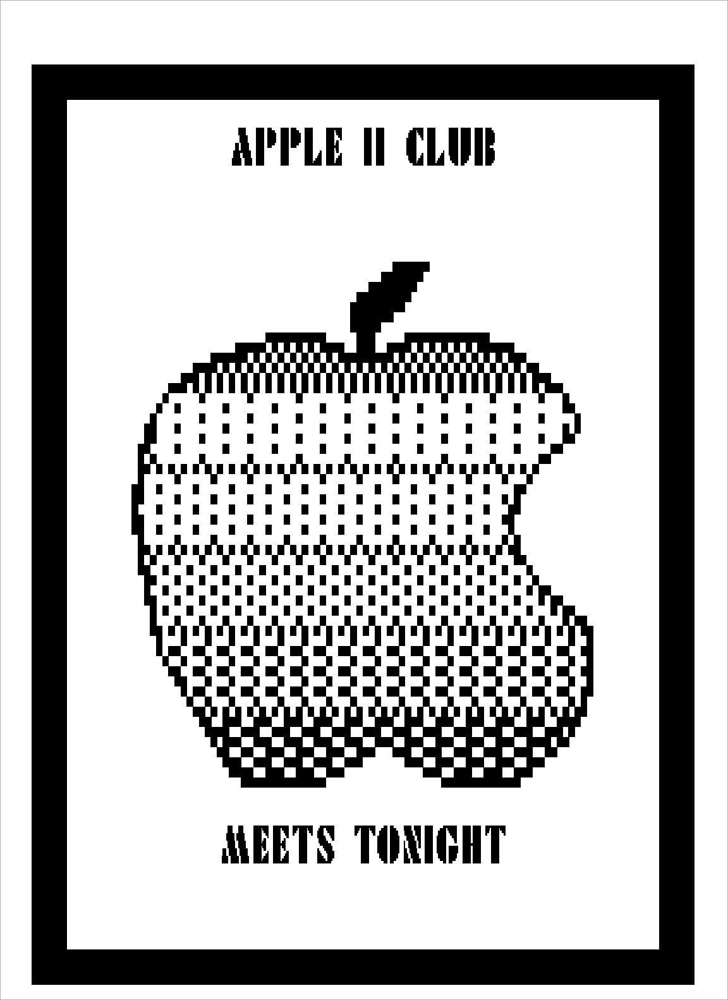

    **→ twice, Return and Return** back to the main menu.

## A banner

17. **Choose Banner**, a message in letters as tall as the paper is wide,
    printed along a continuous paper. **→ four times, to *Party***, and
    Return, and **Return for *Solid*** letters, not outlined. **Type
    `HAPPY BIRTHDAY ADA`** and Return.

    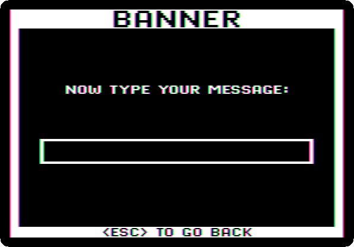

18. **Return for *By Picture***, **Return for the *Birthday Cake***, and
    **→ twice, to *Both Before & After***: a cake at each end. Return.

    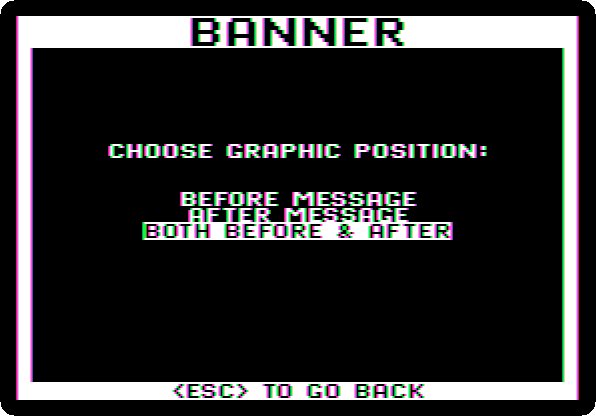

19. **→ to *Print*** and Return. More than two minutes later, the banner,
    about 70 inches of paper, a little less than two metres. It is printed
    down the paper; the picture is turned to be read as it hangs.

    

    **→ twice, Return and Return** back to the main menu.

## Screen Magic

20. **Choose Screen Magic**: kaleidoscopes, text on the screen, and a screen
    saved, loaded or printed. **Return for *See Kaleidoscopes***, **Return
    for *Kaleidoscope 1***, eleven patterns that pulse, and any key to
    start. Return changes the pattern. At the speed of the machine:

    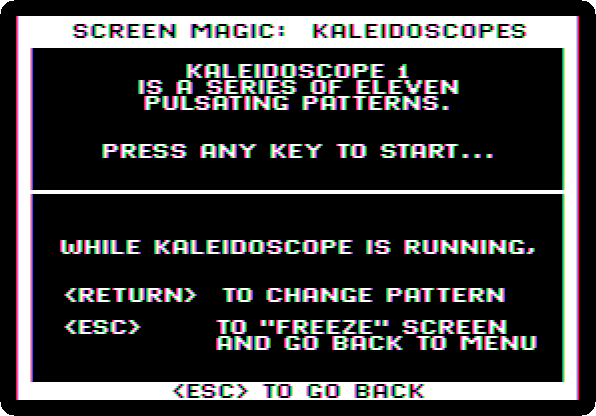

21. **Press Escape**: the pattern freezes, and the program goes back to its
    menu, the screen kept. **→ four times, to *Print Screen***, and Return,
    Return to go on, and **Return for *Normal***, the dots that are lit
    printed in ink. **Return for *Yes***, a frame around it.

    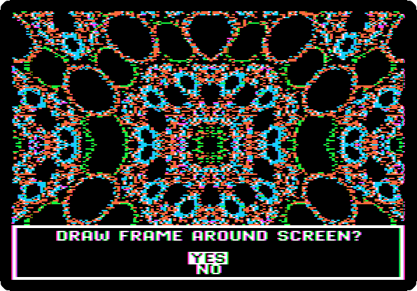

22. **→ twice, to *Print On Top Half Of Paper***, and Return. The screen,
    printed, its colours a pattern of dots in black:

    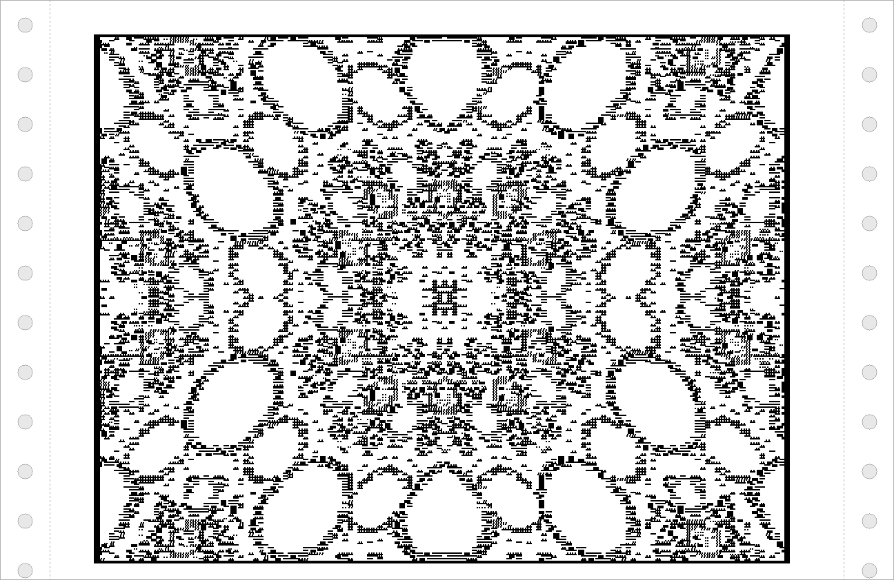

## What next

**Next:** [VisiCalc](visicalc.md).

[Printing](printing.md) prints from BASIC, on the same card; [Fantavision:
drawings that move](fantavision.md) is another program of Broderbund's for
pictures, of 1985.
