# Calling a BBS with ProTERM

[Activities](../README.md) › [Cards](../sections/cards.md)

Before the web, a computer with a modem called other computers on the
telephone line. A **BBS**, a bulletin board system, was a computer waiting
for those calls, often in someone's home, with one line and one caller at a
time: messages, files to download, games to play a turn a day. Greg
Schaefer wrote **GBBS Pro**, the software of many BBSes run on an Apple II,
and then **ProTERM**, the terminal program to call them with. Version 3.1,
of 1993, was the last for the Apple II.

**Dura-Europos** is one of those BBSes: a GBBS Pro on an Apple //e, online
from 1986 to 1993, brought back from its backup disks in 2016 and on the
internet since. Its games and menus are drawn for ProTERM, with MouseText,
the characters of the //e that draw windows and shapes.

This page sets up ProTERM on an Apple //e with a Super Serial Card and a
modem, calls Dura-Europos, looks around as a guest, plays a game of
Concentration+ and says goodbye.

The pictures were taken on 1 November 2026. Dura-Europos is someone's
computer on the internet, and changes, or may be gone, when you call.

## What you need

**`ProTERM_3_Greg_Schaefer_Intrec_Software_1993_PT3120925_Side_1.dsk`** and
**`..._Side_2.dsk`**, the two sides of the ProTERM 3.1 disk, on the Internet
Archive: [side 1](https://archive.org/details/mb_ProTERM_3_Greg_Schaefer_Intrec_Software_1993_PT3120925_Side_1)
and [side 2](https://archive.org/details/mb_ProTERM_3_Greg_Schaefer_Intrec_Software_1993_PT3120925_Side_2).
`./fetch-disks.sh` in this repository downloads them into `disks/`. Side 1
sets ProTERM up, side 2 is the program.

**`proterm.dsk`**, a copy of side 1, for ProTERM to write its setup and its
dialing directory to, and keep the downloaded one as it is:

```bash
cp disks/ProTERM_3_Greg_Schaefer_Intrec_Software_1993_PT3120925_Side_1.dsk proterm.dsk
```

**A connection to the internet**: the modem of izapple2 dials a host and a
port of the internet instead of a telephone number.

The [ProTERM 3.1 manual](https://archive.org/details/PROTerm_A2_v3.1) is
on the Internet Archive.

## The machine

An enhanced Apple //e with a modem and one disk drive:

- the 65C02 processor at 1 MHz and 128 KB of memory: 64 KB on the board,
  the top 16 KB of it the memory of a language card, which izapple2 puts in
  slot 0, and 64 KB more on the extended 80 column card, in the auxiliary
  slot;
- a Super Serial Card in slot 2, with a modem on its cable: a modem of
  izapple2 that dials the internet, as the WiFi modems that people plug
  into their Apple IIs today;
- a Disk II controller card in slot 6, with `proterm.dsk` in drive 1.

```bash
izapple2 -model none -board 2e -cpu 65c02 -screen green \
    -rom "<internal>/Apple2e_Enhanced.rom" \
    -charrom "<internal>/Apple IIe Video Enhanced.bin" \
    -s0 language \
    -s2 ssc,device=netmodem \
    -s6 diskii,disk1=proterm.dsk
```

The modem takes the commands of a Hayes modem, `AT` and the rest: `ATDT`
and a host and port dials, as `ATDT` and a telephone number did.

## Set up ProTERM

1. **Start izapple2** with the command above. ProTERM starts, and, the first
   time, asks for the modem.

   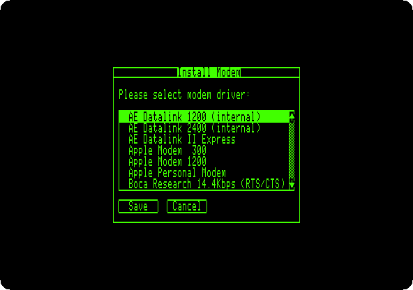

   ProTERM knows dozens of modems, and talks to the one chosen for you:
   it sends it the commands to dial and waits for the connection. With a
   BBS like Dura-Europos that is too slow. ProTERM waits three seconds and
   a half after the connection before it answers anything, and the BBS asks
   who is calling before that. The modem here is left to you instead, as
   with a WiFi modem.

2. **Press the down arrow 24 times**, to *Null Modem Driver*, **Return** to
   tick it and **Return** to save. Then the port of the modem: **down 5
   times** to *Apple Super Serial Card*, **Return** and **Return**; type
   **2**, its slot, and **Return** twice. Then the printer: **down 16 times**
   to *No Printer in System*, **Return** and **Return**.

   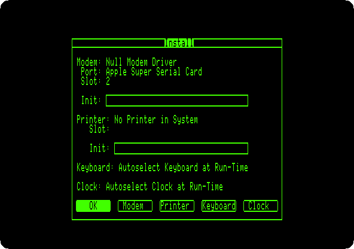

3. **Press Return** to accept it all. ProTERM writes it to `proterm.dsk`,
   and asks for the program disk: **drop side 2 of the disk on the area of
   drive 1** of the window of izapple2, and **press Return**.

   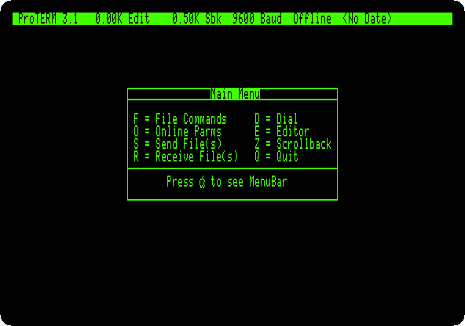

   The main menu: a letter for each, and **A** for the bar of menus at the
   top.

## Dura-Europos in the dialing directory

4. **Press D**, for the Dial menu, and **Return**, for *Create System*.
   **Type `Dura-Europos`**, the name, and **Tab** four times, past the
   number, the speed and the time to connect, to *Save System As*: **type
   `DURA`** and **press Return** twice.

5. ProTERM opens the parameters of the system. **Press Tab nine times**, to
   *Emulate*, and **the right arrow nine times**, to *ProTERM Special*.

   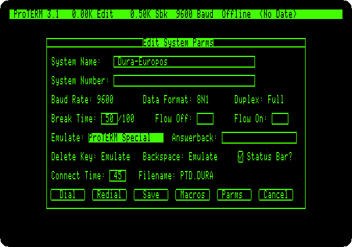

   The emulation is how ProTERM shows what comes from the BBS. *ProTERM
   Special* is ProTERM's own: the BBS sends it codes to move the cursor and
   to show MouseText.

## The call

6. **Hold Open Apple and press Return**, *Dial*, the default button. With no
   number to dial, ProTERM goes online at once, *Online* in the status bar,
   and what you type goes to the modem.

7. **Type `ATDTdura-bbs.net:6359`** and **Return**: the modem dials the BBS.

   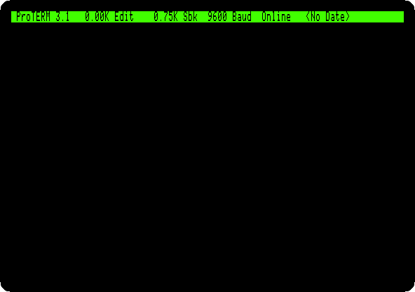

   The modem answers `CONNECT`, and the BBS checks what terminal calls it:
   it asks for ANSI, and then sends a Control-E, which ProTERM Special
   answers with a code of its own. *Detected display: ProTERM Special
   version*. Then its title in MouseText, drawn in a way that changes from
   one call to the next.

   The BBS is quick in its check, and over the internet it fails now and
   then: it asks *Are you using ANSI?* instead. **Type Q** and **Return** to
   hang up, and dial again.

## As a guest

8. **Type `GUEST`** and **Return**. The news of the system first, here of a
   game added to the menu, Concentration+, drawn with MouseText for
   ProTERM.

   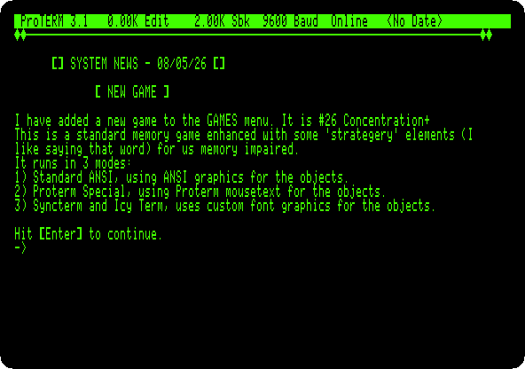

   **Press Return**. The BBS welcomes the guest, in letters drawn with
   MouseText.

   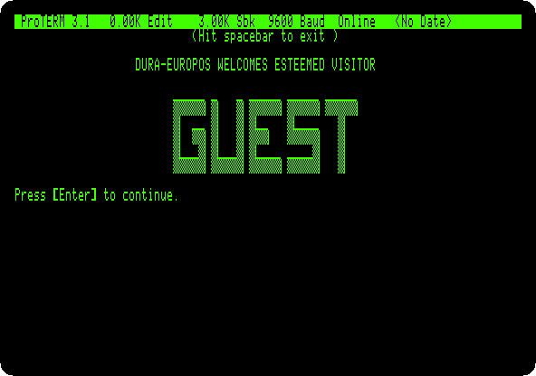

   **Press Return** for the main prompt, `[MAIN] (?=Help):`.

9. **Type `?`** and **Return**: the areas of the BBS, the messages, the
   system, the programs. **Type `P`** and **Return**, the programs.

   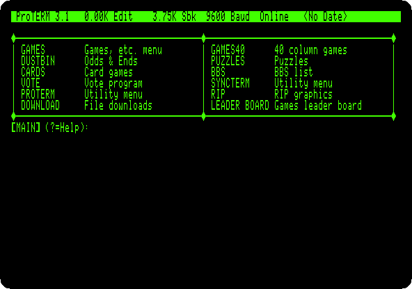

10. **Type `GAMES`** and **Return**.

    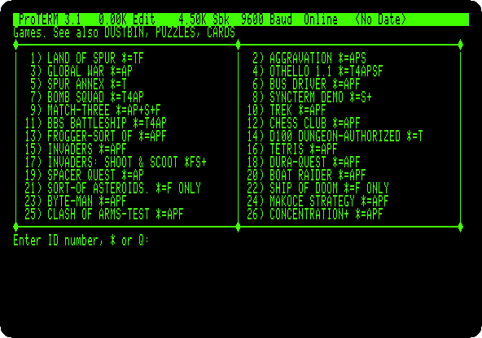

    The letters after each are the terminals it draws for, as the news said
    of Concentration+: `A` for ANSI, `P` for ProTERM Special.

## Concentration+

11. **Type `26`** and **Return**. Concentration+ deals 28 objects face down,
    in fourteen pairs, and the rules on the right.

    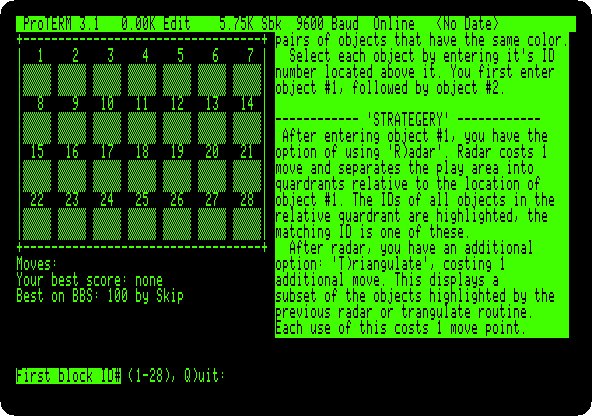

12. **Type the number of an object** and **Return**, then the number of
    another and **Return**. A pair stays turned over; two that don't match
    are turned back. Remember where each was.

    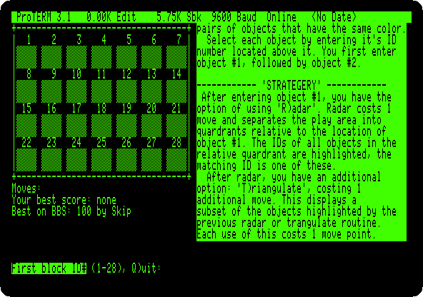

    The game is played in colours on an ANSI terminal; in MouseText, on the
    green screen of the //e, some pairs have the same pattern, and only
    turning them over tells them apart. This game took 25 moves and a little
    over three minutes, here four times faster.

    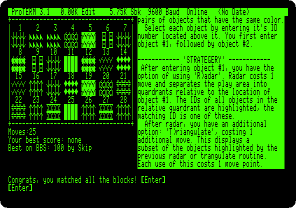

## Goodbye

13. **Press Return**, back to the games, and **type `Q`** and **Return**,
    back to the main prompt. **Type `BYE`** and **Return**, and **`Y`** and
    **Return**: the BBS thanks you, says how long you were on, and hangs up.

    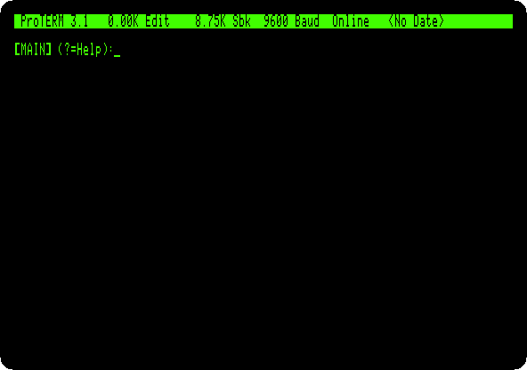

    The modem says `NO CARRIER`: the line is free for the next caller.

## What next

**Next:** [Forth in ROM](forth.md).

[The SwyftCard](swyftcard.md) is another program of the //e that takes
over the screen, and [The Apple //e](apple-iie.md) the machine.
