# Robot Odyssey, level 3: the Streets

[Back to the activities](../README.md)

The third level of [Robot Odyssey](robotodyssey-sewer.md) is the Streets of
Robotropolis. A crossroads leads to a maze of magnetic storms, an elevator to
a vending machine, and the city's end. There a sentry, a room the player may
not enter and an Official Gatekeeper stand between you and the fourth level.
Each of them is a puzzle for the robots, rewired with the Solderpen.

This page plays the level from the transporter of
[the Subway](robotodyssey-subway.md) to the Master Computer Center, the fourth
level, and takes the three robots there. The Sewer and the Subway are played
first, as their pages show.

## What you need

The same as for [the Sewer](robotodyssey-sewer.md#what-you-need): side A of
**Robot Odyssey v1.1 (4am crack)**, which `./fetch-disks.sh` downloads into
`disks/`. The way through follows the
[walkthrough of ASchultz on GameFAQs](https://gamefaqs.gamespot.com/appleii/566255-robot-odyssey/faqs/57379),
with its own wiring where the robots here needed another.

The [manual of the edition for the Tandy Color Computer](https://archive.org/details/Robot_Odyssey_1_1986_Learning_Company)
explains the Solderpen and the parts of a robot.

## The machine

The same Apple \]\[+ with a Language Card as the Sewer:

```bash
izapple2 -model none -board 2plus -cpu 6502 -screen color \
    -rom "<internal>/Apple2_Plus.rom" \
    -charrom "<internal>/Apple2rev7CharGen.rom" -forceCaps \
    -s0 language \
    -s6 "diskii,disk1=disks/Robot Odyssey v1.1 (4am crack) side A.dsk"
```

## Playing it

The keys of [the Sewer](robotodyssey-sewer.md#playing-it) and the Solderpen
of [the Subway](robotodyssey-subway.md#playing-it).

The robots of this level need their batteries. A battery runs down while its
robot runs, about a step every minute and a half, and an energy crystal fills
it, but only when it is empty. The Subway left the white robot empty and the
orange one nearly so, and the blue one, at 9 of 15, does most of the work.
**R** and **Space** stop all the robots, and stopped they spend nothing.

New parts on the robots here:
- a sensor of the directions of an object, with four outputs, one for each
  side where it sees the object;
- the key sensor, on while a key is in the robot's room;
- an AND gate, on when both its inputs are;
- and the storm shield.

## The Streets

- [1. The coin of the storms](#1-the-coin-of-the-storms)
- [2. The elevator](#2-the-elevator)
- [3. The crystal](#3-the-crystal)
- [4. The vending machine](#4-the-vending-machine)
- [5. The sentry](#5-the-sentry)
- [6. The final room](#6-the-final-room)
- [7. The gatekeeper](#7-the-gatekeeper)
- [The map of the Streets](#the-map-of-the-streets)

### 1. The coin of the storms

The transporter leaves you at a crossroads, with the blue robot, the others
inside it. The Sensor Editor, at its left, has a Magnetic Storm Shield (For
Robots Only).

Below the crossroads, a maze of seven rooms goes round, and three magnetic
storms follow you through it. A storm that touches a robot takes two steps of
its battery, unless the robot has the shield, and the shield is on. In the
last room of the maze is a coin, a subway token, and *I never could hang onto
money...*: the coin jumps away from the player who comes near it.

**Put the shield into the blue robot and wire it.**
- The spare NOT gate goes to the shield, always on.
- The sensor of the directions of the token drives the thruster on the other
  side: left to the thruster at the right, up to the one at the bottom, and
  so on.
- The other NOT gate goes to the grabber, always on.

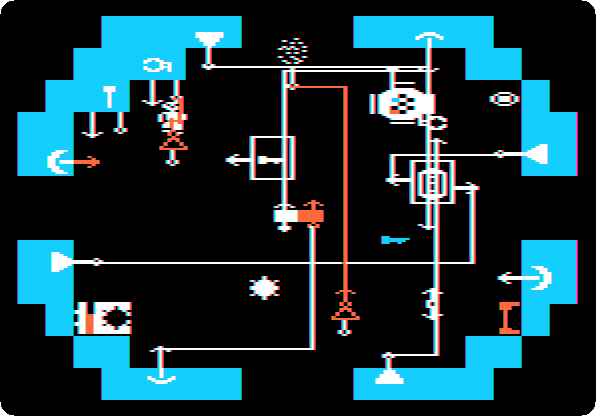

**Turn the robots on with the remote control, carry the robot to the room of
the coin, put it down and go to the next room.** The coin does not run from a
robot. When you come back, the robot holds it.

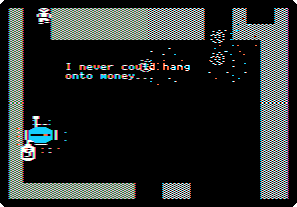

### 2. The elevator

Up from the maze and right, *The things robots throw away...*: a pile of junk
that comes and goes, and an elevator behind a wall.

**Stop the robots, put the blue one down, and take the elevator key out of
the junk.** It jumps around in it, but the player can take it.

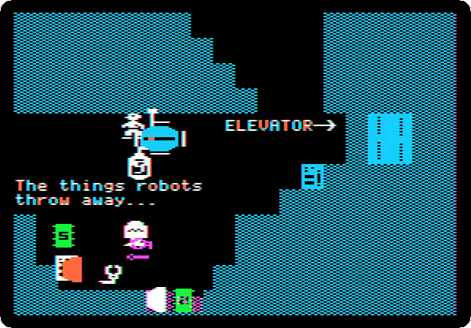

**Push the key into the slot in the wall**, the blue box under *ELEVATOR→*:
the wall in front of the elevator opens, and stays open.

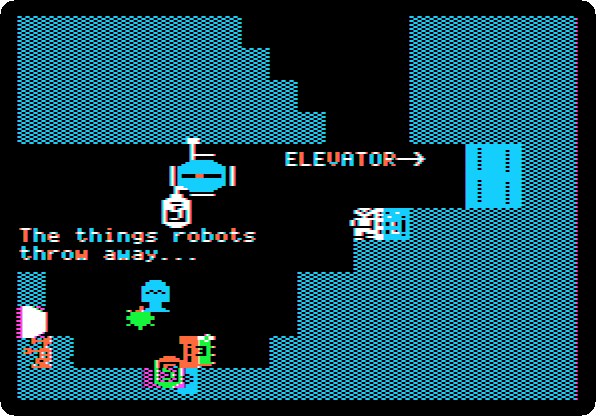

**Carry the robot into the elevator, step on the knob at its left and off it
again, and go out at the left when the arrow turns.** On the knob, the
elevator goes back and forth; one step on it takes it to the other floor. The
recording is at the speed of the machine:

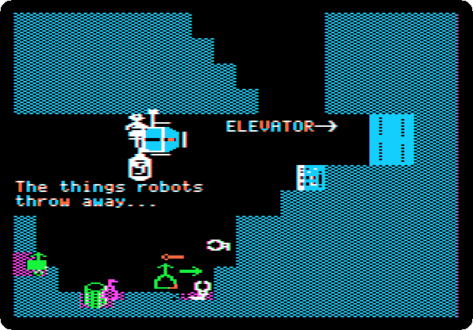

### 3. The crystal

When you first leave the crossroads, the game puts six items in six rooms of
the level, in an order that turns with the time. Here the energy crystal is
at the top of the elevator.

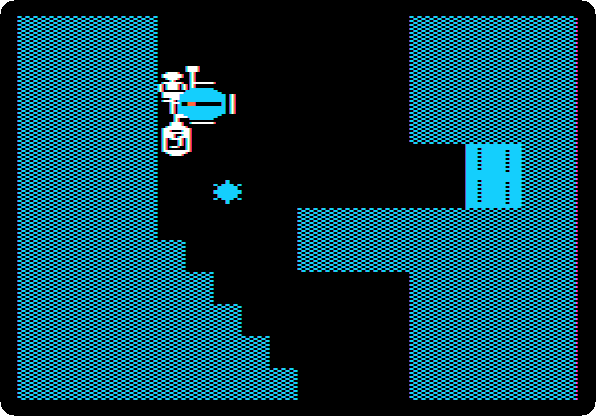

**Take the crystal into the white robot, inside the blue one, and pass it
over its battery.** The white robot comes back to life, full.

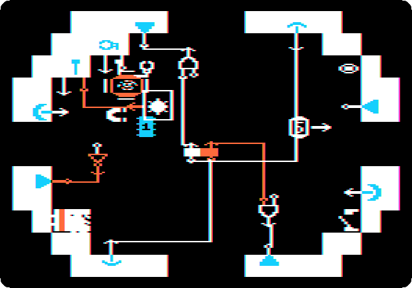

### 4. The vending machine

Up from the elevator is a vending machine: *1) Insert Token*, under its
shelf, and *2) Pull*, a knob at its end. A dotted line keeps the player in
the lower part of the room.

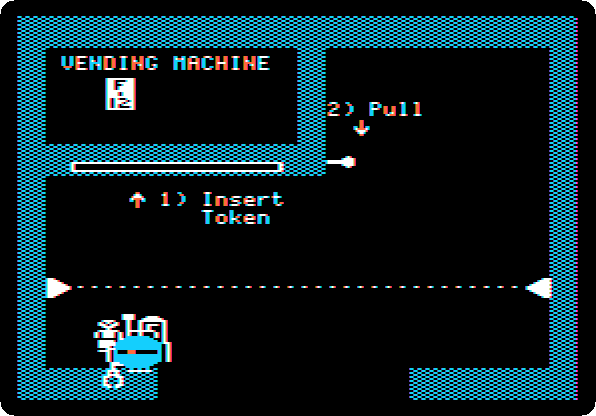

**Rewire the white robot** to go up and down, its flip-flop between its
bumpers, and to grab what it meets.

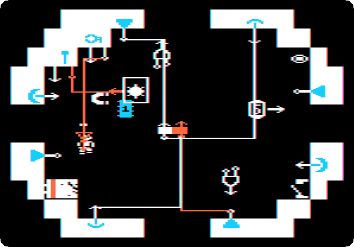

**Take the orange robot out, and the key out of the blue robot, and rewire
the blue one:**
- the bumper at its bottom turns on the half of the flip-flop that sends it
  up;
- the key sensor, through the node, turns on the other half, which sends it
  down, and turns off the grabber.

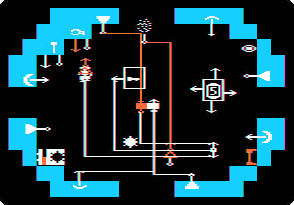

The slot takes the coin only when the coin is free and up under the left of
the shelf, and the robot holds it hanging under itself. **Make the robot let
go of the coin**, the wire of its grabber's input taken away and the remote
control off and on, **wire the grabber again, and put the coin on the floor of
the vending room, the robot just under it.** It takes the coin from below and
pushes it up against the shelf:

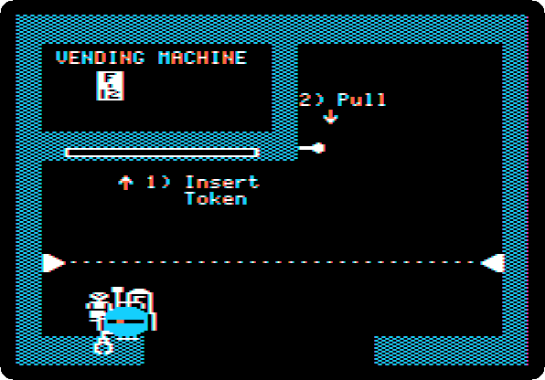

**Put the key down in the room.** The key sensor makes the robot let go:
the slot takes the coin, and the robot comes down.

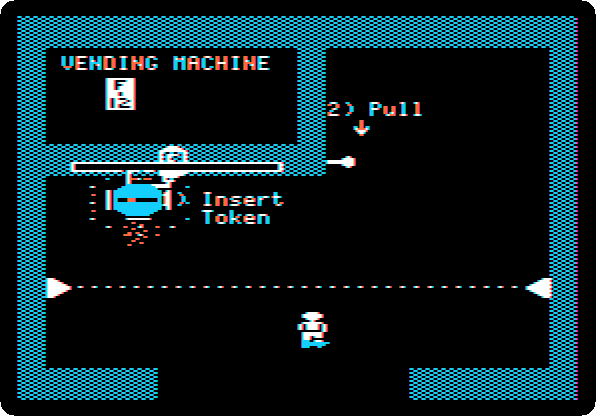

The knob is free now, for a robot to pull. **Hide the key in the orange
robot, and wire the output of the blue robot's grabber to its left
thruster:** holding something, it goes right. **Put it under the knob and the
white robot at the left, switched on, and turn the remote control on.**

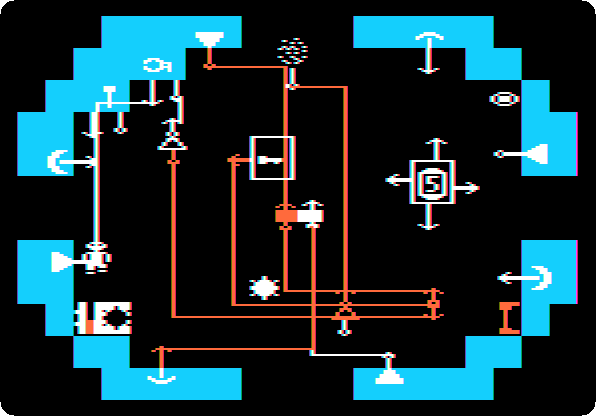

The blue robot takes the knob and pulls it to the right. The shelf slides
with it, and leaves a gap under the form, where the white robot goes up and
takes it:

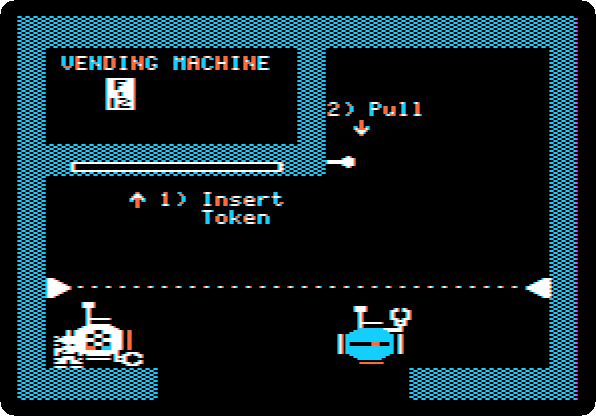

**Stop the robots when the white one is down and take it back; then put the
key in the room again**, and the blue robot lets go of the knob and comes
down. **Put them all into the blue robot, its thrusters unwired, and go down
the elevator and through the storms**, the remote control on for the shield,
to the end of the level, at the right of the maze.

### 5. The sentry

*Two buttons a day keep the sentry away.* The sentry sends the player back
from its room, and the rooms behind it are reached only through it. A robot
pressed against each button, at the top and at the bottom, right of the wall
in front of it, sends the sentry away. A button stays pressed once a robot has
been on it.

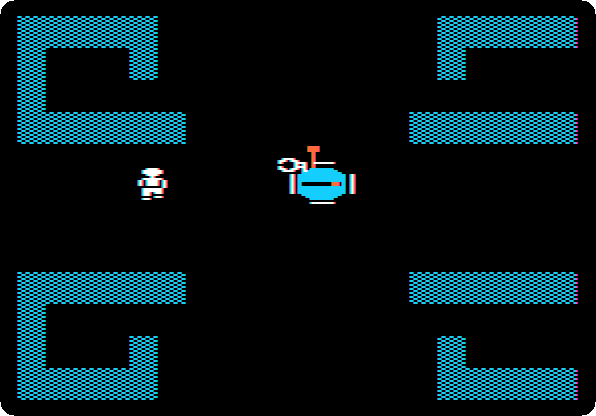

**Wire the blue robot for the top button:**
- its flip-flop starts it right;
- the bumper at its right turns on the other half, which sends it up;
- the bumper at its top drives the thruster at the right, so that at the
  ceiling it goes left, until the wall in front of the button stops it.

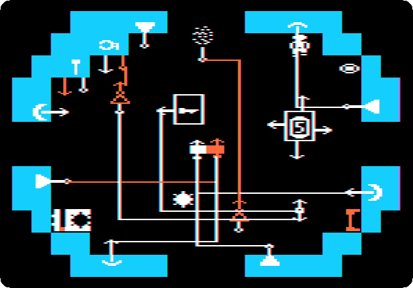

**Wire the white robot the same, down instead of up, the bumper at its bottom
to the thruster at the right.**

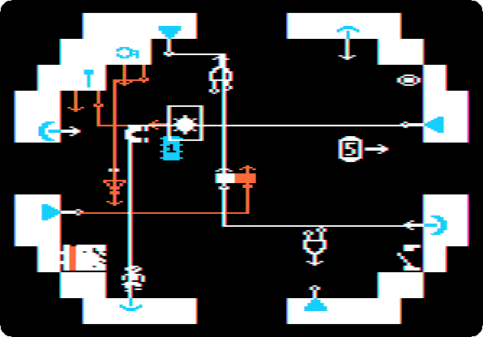

**Put the blue robot through the doorway of the sentry's room and turn the
remote control on; then, stopped again, the white one.** Two times faster:

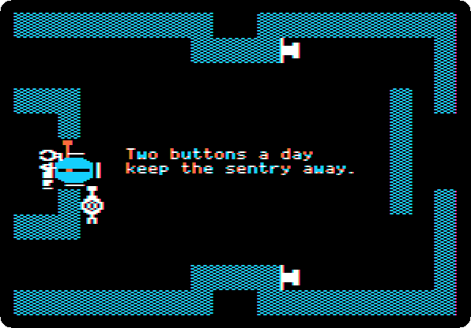

### 6. The final room

Behind the sentry is a practice room, *Look into the next room*, with an eye
in its corner. Its right side goes into the final room, which the player
cannot enter: the game holds back the player, and the robot the player is
inside. In the final room, in a box open at its top, is a button.

The sensor of the directions of the button is, this time, in the
gatekeeper's room.
**Fetch it, take the node and the second NOT gate out of the blue robot, and
put them in the white one.** The form comes out of the white robot, the
player carries it to the practice room, and the robot is wired to find the
button:
- its flip-flop starts it right, through the door, and stops it when the
  button is to its left and below, both at once: for a moment, as the robot
  crosses the door, the outputs of its gates are not yet right, and one
  condition alone would stop it there;
- stopped, it goes left;
- the bumper at its right, through the node, sends it up, along a wall;
- through the NOT gate and an AND gate it goes down, when the button is not
  above it and no wall is at its right.

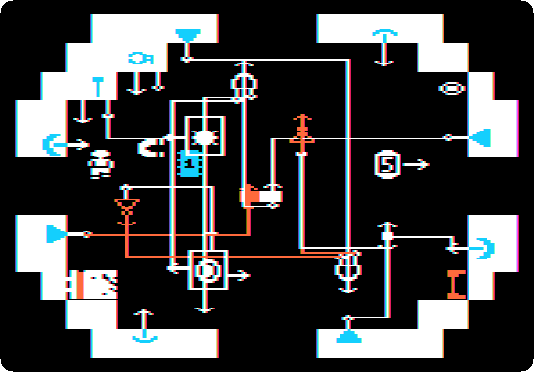

**Put the robot at the right of the practice room and turn the remote control
on.** It goes into the final room and finds its way into the box and onto the
button, which opens the door. **Step on the
eye**, and the screen shows the final room, the button gone:

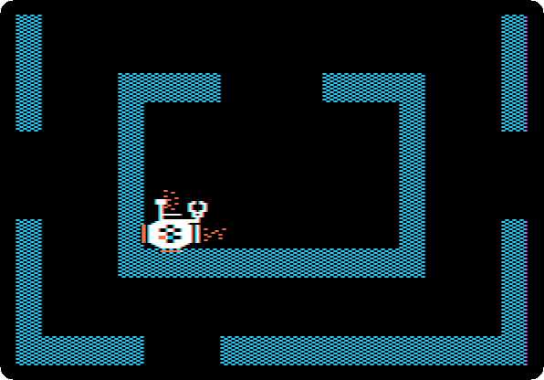

### 7. The gatekeeper

The door of the final room is open now, to the player too. **Take the robots,
the others in the white one, into the gatekeeper's room. Then bring the form,
and put it down against the hand of the gatekeeper.** *Submit a Form-12,
please.*

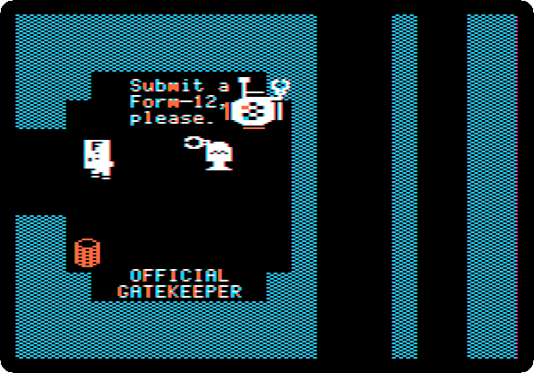

The gatekeeper takes the form, throws it in the bin at the left, and a
transporter appears in the middle of the room:

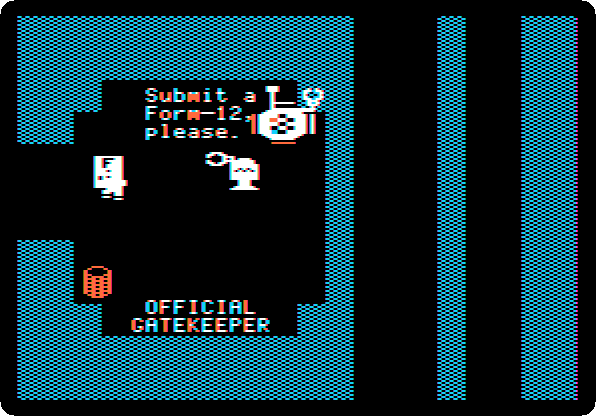

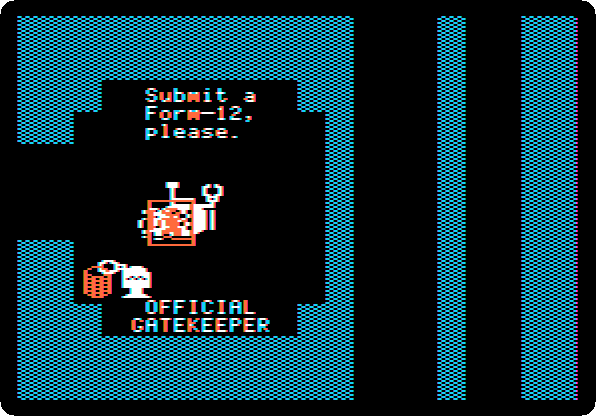

**Step onto it with the white robot.** The game asks for its disk, and
**Escape** takes you to the Master Computer Center.

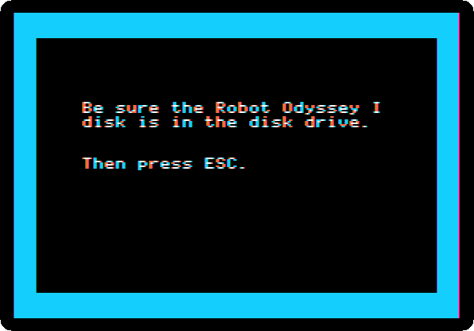

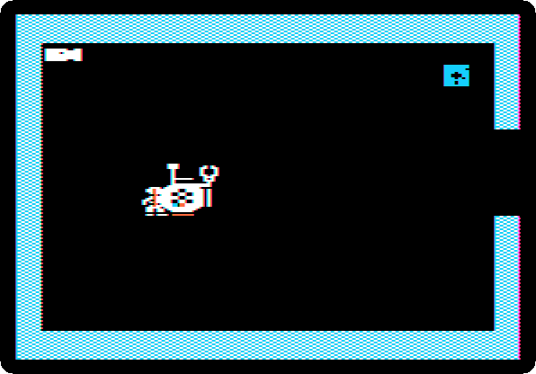

## The map of the Streets

The rooms of the Streets as the game shows them, each the first time you are
in it, put together where they are. The crossroads at the left goes round
itself; the Sensor Editor is at its left and the maze of the storms at its
right. The coin is at the bottom of the maze, and the elevator and the vending
machine are at its top right. The end of the level, three rows of five rooms,
is at the bottom right. The rooms in grey were not passed this time.

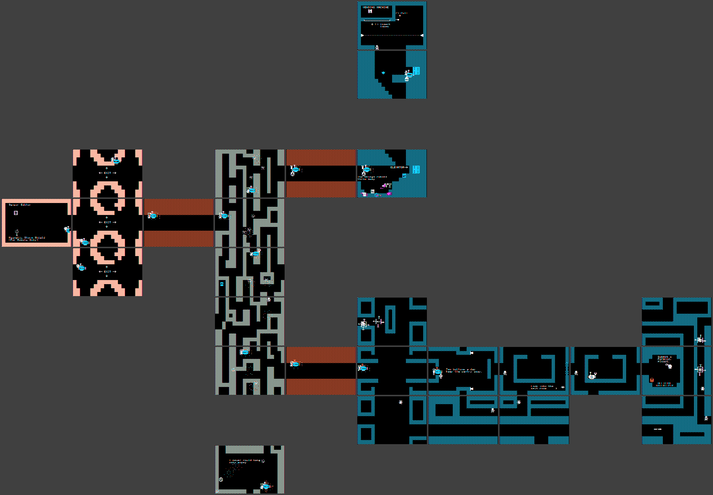

## What next

[The Sewer](robotodyssey-sewer.md) and [the Subway](robotodyssey-subway.md),
the first two levels, if you came here first.
