# Robot Odyssey, level 2: the Subway

[Back to the activities](../README.md)

The second level of [Robot Odyssey](robotodyssey-sewer.md) is the Subway of
Robotropolis: a grid of tunnels round a line of eight stations, a train that
goes round them, a turnstile that wants a token, and an exit that wants a
ticket. Here the robots are no longer wired for the job: the level is solved
by opening them and rewiring them with the Solderpen.

This page plays it from the transporter of the Sewer to the Streets, the third
level, with the three robots and all that the first level gave. The blue
robot does all of it, rewired three times: for the token of the subway, for
the exit ticket, and for the token again. The Sewer is played first, as its
page shows.

## What you need

The same as for [the Sewer](robotodyssey-sewer.md#what-you-need): side A of
**Robot Odyssey v1.1 (4am crack)**, which `./fetch-disks.sh` downloads into
`disks/`. The way through follows the
[walkthrough of ASchultz on GameFAQs](https://gamefaqs.gamespot.com/appleii/566255-robot-odyssey/faqs/57379),
with its own wiring where the robots here needed another.

The [manual of the edition for the Tandy Color Computer](https://archive.org/details/Robot_Odyssey_1_1986_Learning_Company)
explains the Solderpen and the parts of a robot.

## The machine

The same Apple \]\[+ with a Language Card as the Sewer:

```bash
izapple2 -model none -board 2plus -cpu 6502 -screen color \
    -rom "<internal>/Apple2_Plus.rom" \
    -charrom "<internal>/Apple2rev7CharGen.rom" -forceCaps \
    -s0 language \
    -s6 "diskii,disk1=disks/Robot Odyssey v1.1 (4am crack) side A.dsk"
```

## Playing it

The keys of [the Sewer](robotodyssey-sewer.md#playing-it), and the
Solderpen:

- **S** makes you the Solderpen; its tip glows orange over an input or an
  output. **Space** there starts a wire, and Space on the other end ends it.
  Space on a pin that has a wire takes the wire away, and so does ending a
  wire on an output that has one already.
- **C** makes you the cursor again.
- **R** and **Space** stop all the robots, or let them go on; a stopped robot
  can be picked up and carried, as one that is switched off.

Inside a robot, the parts this page wires are its four thrusters, the
triangles at the sides; its four bumpers, the half circles; its flip-flop,
the box of two halves, one of them on, that an input to a half turns on; a
NOT gate, on when its input is off; the grabber at the upper left, its input
to grab and its output on while it holds something; and a node, which sends
its input to two outputs.

## The Subway

- [1. The blue robot made ready](#1-the-blue-robot-made-ready)
- [2. The token of the subway](#2-the-token-of-the-subway)
- [3. The turnstile](#3-the-turnstile)
- [4. The train](#4-the-train)
- [5. The exit ticket](#5-the-exit-ticket)
- [6. The token again](#6-the-token-again)
- [7. Jack in the 'Bot and the exit](#7-jack-in-the-bot-and-the-exit)
- [The map of the Subway](#the-map-of-the-subway)

### 1. The blue robot made ready

The transporter leaves you in the Subway with the white robot, the others
inside it.

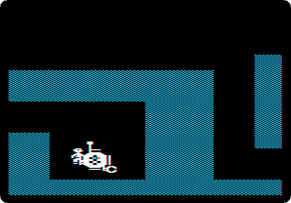

**Put the white robot down and take the blue one out of it.** The blue robot
needs more parts than it has: **take the node out of the white robot and the
NOT gate out of the orange one**, inside the white one, **and put them in the
blue robot**, with the sensor of the directions of the token.

The battery of the blue robot, at its lower left, is dead after the Sewer:
the orange line of its level is at the bottom.

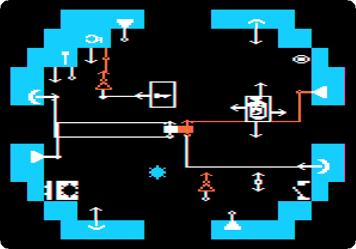

**Pick up the energy crystal**, in the blue robot since the Sewer, **and
pass it over the crystal shape in the battery.** A battery takes it only
when dead: the level goes up to the top, and the crystal turns white, spent.

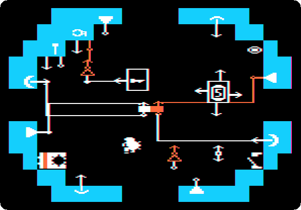

### 2. The token of the subway

The token is in the middle of a walled room, two rooms up from the start,
with a corridor down its right side; in the wall of the corridor is a
keyhole. The robot has to get it: **rewire it with the Solderpen** to go up
and down the corridor, the bumper at the bottom turning on the half of the
flip-flop that drives the thruster at the bottom, and the one at the top the
other half and the other thruster; to go left when the sensor of directions
finds the token to its left, its output for left to the thruster at the
right; and to come back right once it holds the token, the output of the
grabber to the thruster at the left. The recording is six times faster than
the machine.

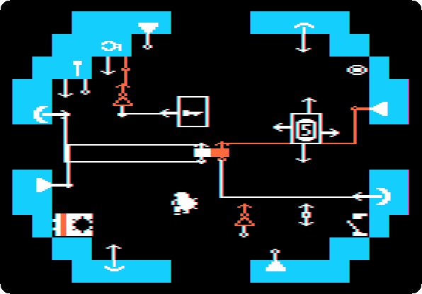

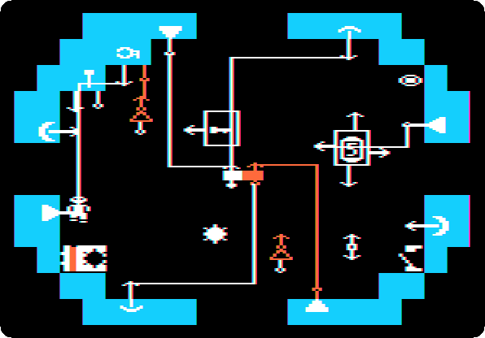

**Put the key down out of the way** in the room under the token, for the
grabber of the robot takes whatever it touches. **Put the robot at the bottom
of the corridor and turn it on**, take the key, hold it above your head, and
**put it into the keyhole when the robot is high in the corridor**: a guard
sends you back down if you go up the corridor yourself. The wall of the
token opens while the key is in. The robot goes in, takes the token, comes
out, and down the corridor it takes you in. Two times faster:

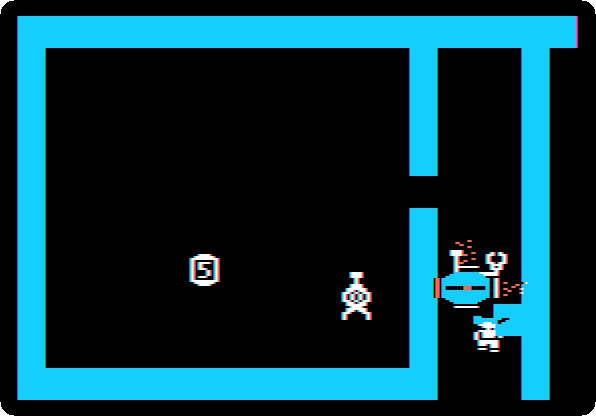

Inside it, **turn it off, take away the wire of its grabber's input, and
turn the remote control off and on**: the grabber lets go of the token.

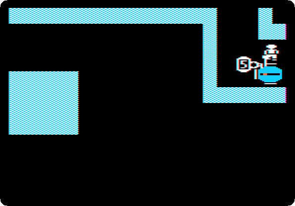

### 3. The turnstile

*Bay Area Robot Transport*, up and to the left: **put the token into the
slot**, *Insert token, please*. The cross of walls of the turnstile turns for
about seven seconds, a + and an X by turns, and you go through it with the
robot, picked up on the way: a step left when it is an X, another when it is
a + again. The token falls to a room under the turnstile.

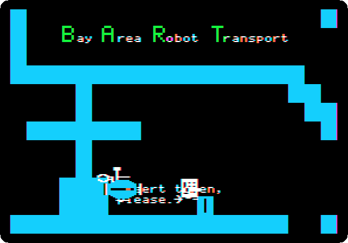

### 4. The train

Left and up from the turnstile is the *Subway Depot*: *Push this button to
call train*, in a box with no way in, and a handle, *Pull here*.

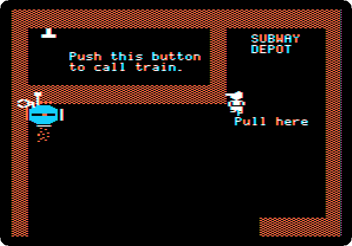

**Turn the robot on and put it at the left, under the box**, where it goes up
and down; **take the handle and pull it to the right**: the floor of the box
slides along and opens at the left. The robot goes up into the box, pushes
the button, and the train comes. Two times faster:


**Stop the robot with the remote control, carry it onto the train, and
press Space.** The train goes round the eight stations of the line, the
Depot, Robotoplatz, Cobble 'Bot Square, Picadilly Circuit, Seer's and Robot,
Jack in the 'Bot, Musé Robotique and the Laundrobot; **a step gets you off**.
Three times faster, to the Laundrobot:

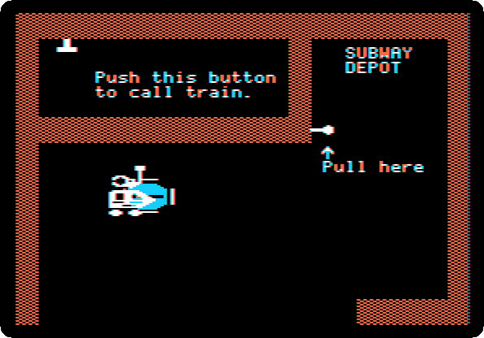

### 5. The exit ticket

The exit ticket is in the room under the Laundrobot station, in a pocket
behind a low wall, and a guard there sends you back from all but the corner
at the left. **Rewire the robot** to keep going up and down, and to go right
until it holds something, and then left: the NOT gate, its input free and so
always on, to the input of the grabber; the output of the grabber to the
node; the node to the thruster at the right, and to the other NOT gate, and
that one to the thruster at the left. Six times faster:

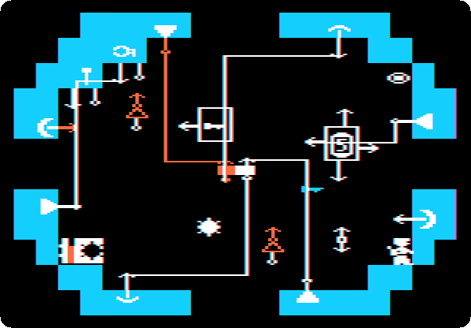

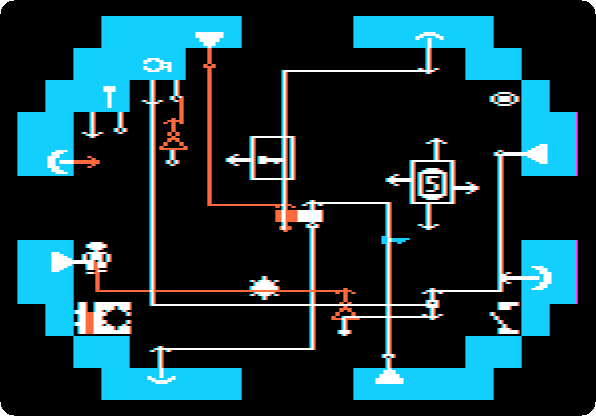

**Put it down in the corner at the left and let it go**: going up and down,
it gets under the low wall, takes the ticket and comes back. Two times
faster:

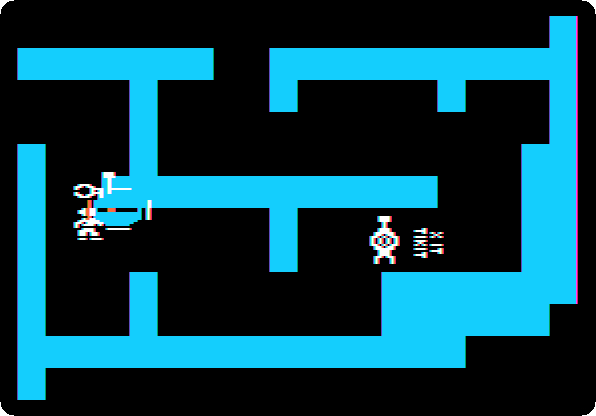

**Stop it, carry it back to the turnstile, on foot, make it let go of the
ticket as of the token, and put the ticket inside it.**

### 6. The token again

The turnstile kept the token in a pocket of the room under it, which a guard
watches. **Rewire the robot** to go up and down, and left whenever it can,
grabbing what it meets: the free NOT gate to the grabber, and the other one to
the thruster at the right.

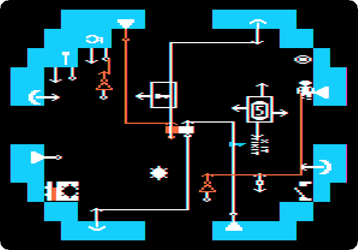

**Put it down at the left of the room right of that one, and let it go.**
It goes into the room of the token, takes it on its way, and out at the
left. Three times faster:

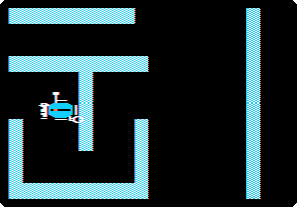

**Stop it, and go round to it** the long way that the guards do not see,
by the start and round the rooms at the right; carry it back to the white
robot, and take the token from it.

### 7. Jack in the 'Bot and the exit

**Put the white robot inside the blue one**: all of it now travels in the
blue robot.

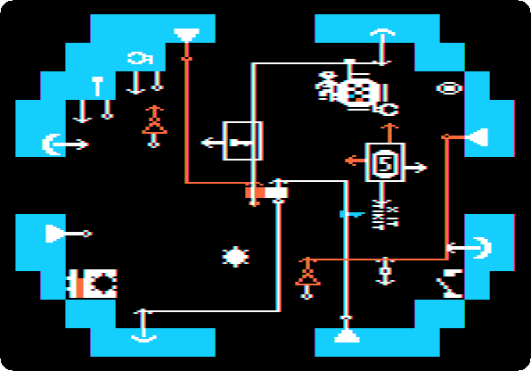

**Through the turnstile with the token again, call the train at the Depot
the same way, and get off at Jack in the 'Bot.**

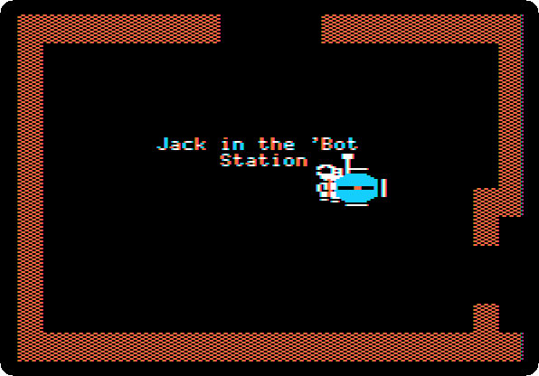

**Take the ticket out of the robot, go up, and put the ticket into the
slot**, *Insert ← Exit Ticket*, at your left. The steps of the escalator
start to come and go.

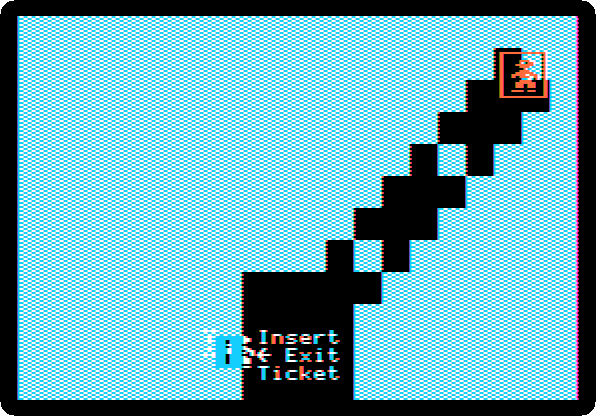

**Go back down for the robot and climb the escalator with it**, a step right
or up whenever the step is there. Two times faster:

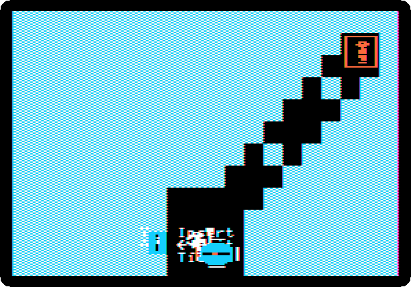

At the top is the transporter.

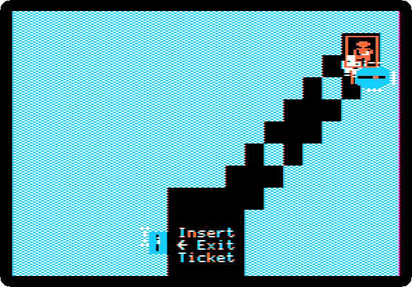

**Step onto it with the robot**, the last of it with Control. The game asks
for its disk, and **Escape** takes you to the Streets.

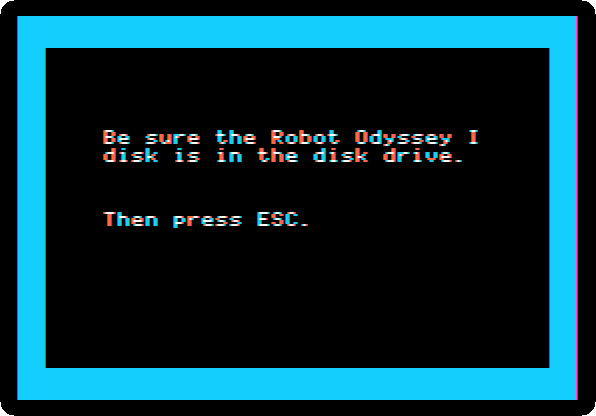

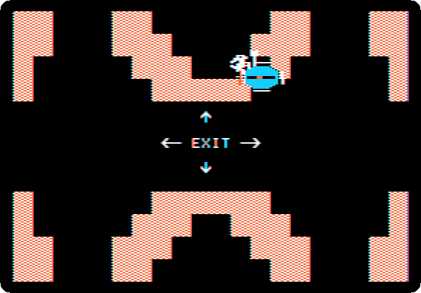

## The map of the Subway

The rooms of the Subway as the game shows them, each the first time you are
in it, put together where they are. The grid goes round: off one edge is the
other. Its bottom row is the line of the train, with the Depot at the right,
and the room of the exit, up from Jack in the 'Bot, is under it. The rooms in
grey were not passed this time.

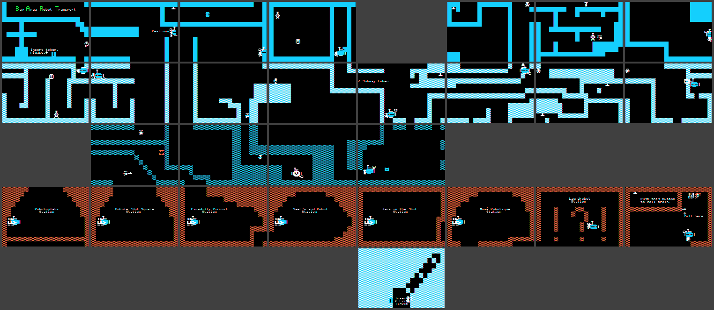

## What next

[The Streets](robotodyssey-streets.md), the third level, or
[the Sewer](robotodyssey-sewer.md), the first, if you came here first.
