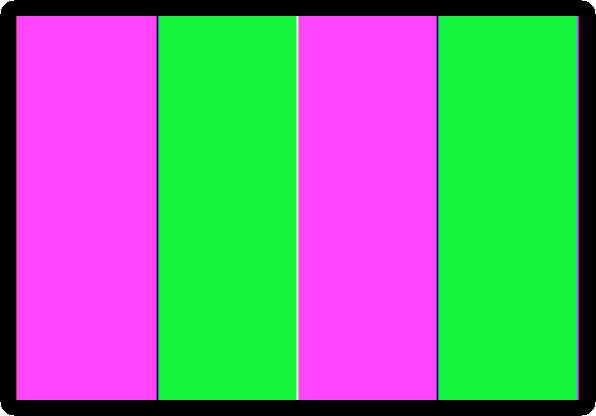
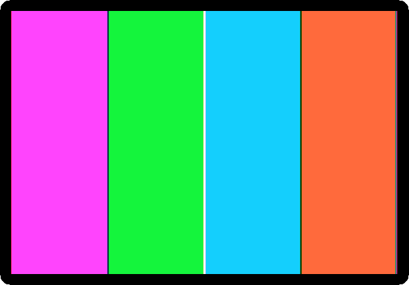
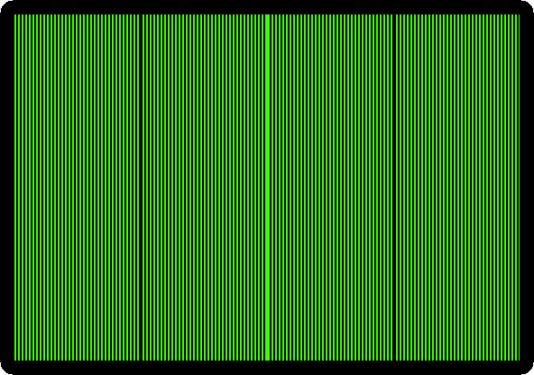

# From four colours to six

[Back to the activities](../README.md)

The colours of the first Apple \]\[s were not all there yet. The first
boards, *Revision 0*, the first 6,000 machines, showed four colours in the
high resolution graphics: black, white, violet and green. In June 1979 Byte
published *More Colors for Your Apple*, by Allen Watson III, on how the
controls of the television, its tint, gave other colours to the high
resolution graphics. Wozniak added a note to it. Only seven bits of each byte
of the high resolution graphics made dots; the eighth did nothing. "A simple
modification allows the high order bit of each to specify one of two color
sets by generating a 90 degree phase shift of displayed information", and
the note went on with the steps, from taking the board out of its case. The
later boards have it: with the eighth bit set, violet and green are blue and
orange.

This page paints the high resolution graphics in bands, with the eighth bit
and without it, on a first Apple \]\[ and on one of a later board, and looks
at the dots of the later one on a green monitor, where the colours are gone
and the shift is left.

## What you need

Nothing but izapple2: the program of the page is typed in.

Wozniak's note is in the
[Byte of June 1979](https://archive.org/details/byte-magazine-1979-06), on the
Internet Archive, after Allen Watson's article, from page 60.

## The machine

The first Apple \]\[, as it came:

- the 6502 processor at 1 MHz and 48 KB of memory;
- the ROM with Integer BASIC and the Monitor;
- the board of Revision 0, with four colours in the high resolution graphics,
  and a keyboard of capitals only;
- no cards in its slots.

```bash
izapple2 -model none -board 2plus -cpu 6502 -screen color \
    -rom "<internal>/341-000x_integer.rom" \
    -charrom "<internal>/Apple2rev7CharGen.rom" -forceCaps \
    -mods four-colors
```

And an Apple \]\[ of a later board, with six colours:

```bash
izapple2 -model none -board 2plus -cpu 6502 -screen color \
    -rom "<internal>/341-000x_integer.rom" \
    -charrom "<internal>/Apple2rev7CharGen.rom" -forceCaps
```

## Four colours

1. **Start izapple2** with the first command. The Apple \]\[ starts in the
   Monitor, with its prompt, `*`. **Press Control-B and Return** for Integer
   BASIC, with its prompt, `>`.

2. **Type this program**, which paints the high resolution graphics in four
   bands, the last two with the eighth bit set:

   ```basic
   10 POKE -16304,0: POKE -16297,0: POKE -16302,0
   20 FOR C=0 TO 119
   30 B=C MOD 40/10:V=85: IF B MOD 2#C MOD 2 THEN V=42
   40 IF B>1 THEN V=V+128
   50 FOR A=8192+C TO 16383 STEP 128: POKE A,V: NEXT A
   60 NEXT C
   70 END
   ```

   The `POKE`s of line 10 switch the screen to the high resolution graphics,
   all of it, with no lines of text. The screen is 8 KB of memory from 8192,
   in blocks of 128 bytes, each with three lines of 40 bytes. `C` goes
   through the 120 bytes of a block and `B` is its band, of 10 bytes. `85`
   and `42` alternate the dots so that the band is of a colour, and `128`
   is the eighth bit. Line 50 puts the byte in its place in each of the 64
   blocks. It is also in this repository,
   [listings/colours.bas](listings/colours.bas).

3. **Type `RUN`.** In about half a minute the bands are painted:

   

   Violet, green, violet and green: the eighth bit changes nothing.

## Six colours

4. **Quit izapple2 and start it with the second command**, an Apple \]\[ of
   a later board. Control-B, Return, the same program, and `RUN`:

   

   Violet, green, blue and orange, and black and white: the six colours of
   the high resolution graphics of every Apple \]\[ since.

5. **Press F6** for the green monitor, which shows the dots and not their
   colours:

   

   The four bands are alike, every other dot lit; from violet to green they
   move by one dot. What the eighth bit does is to show the seven dots of
   its byte half a dot later.
   The television sees a colour in where the dots fall against its colour
   signal, which turns once in every two dots: half a dot later is a quarter
   of a turn, the "90 degree phase shift" of Wozniak's note, and two other
   colours. Where the third band starts, the last dot of the second, lit,
   runs on into the half dot until the first of the third, in a line wider
   than the rest.

## What next

[The Apple \]\[ and its cassettes](apple-ii-cassettes.md) loads the
demonstrations of the high resolution graphics from their tape into a first
Apple \]\[, and [The Apple \]\[ of 1977](apple-ii.md) goes through the
Monitor, the Mini-Assembler and Integer BASIC of the same machine.
