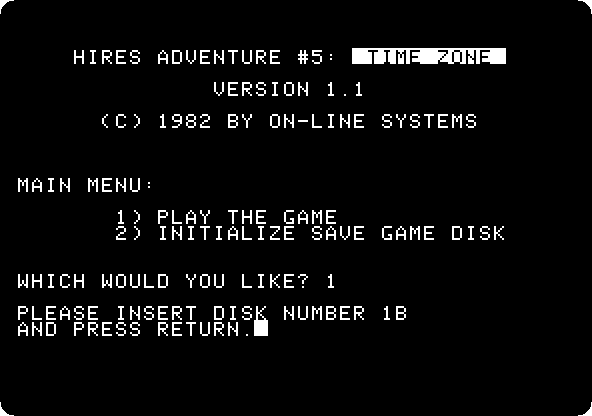
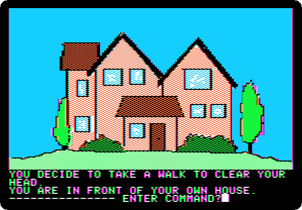
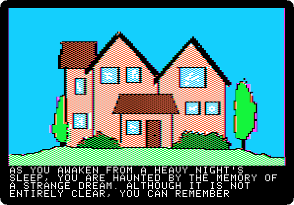
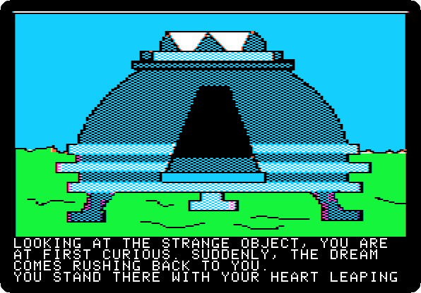
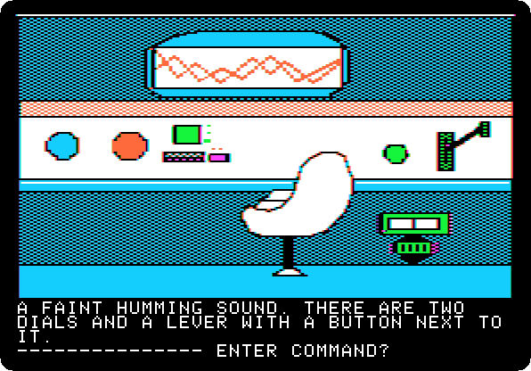
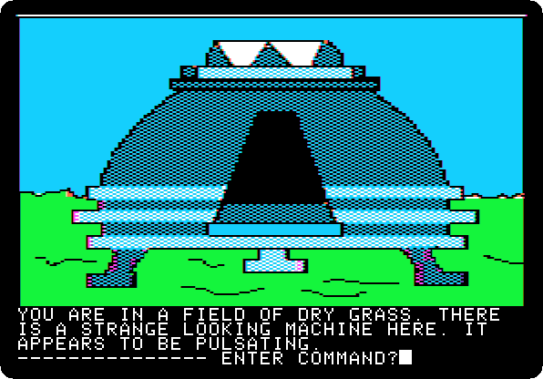
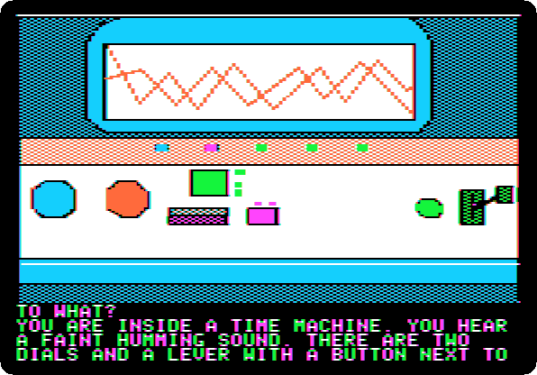
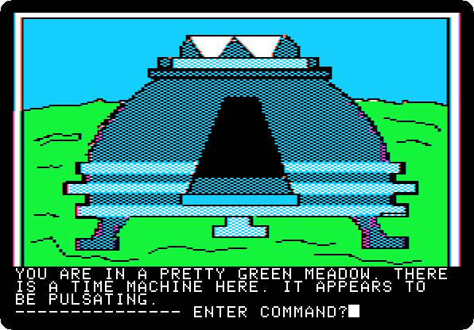

# Time Zone: 1. Home, 1982

[Activities](../README.md) › [Play](../sections/play.md) › [Time Zone, from the start to the end](timezone.md)

 

*Side 1B: drop `Time Zone (4am and san inc crack) disk B.dsk` on drive 1, and press Return.*

**Type `NORTH`**

 
 
 
 

**Type `NORTH`**

**Type `GO MACHINE`**

 
 
 

**Type `GO MACHINE`**

 

**Type `GET MASK`**

 

**Type `EXIT MACHINE`**

**Type `DROP MASK`**

**Type `GO MACHINE`**

 

**Type `SIT`**

 

**Type `SET ORANGE`**

 

**Type `400MILBC`**

 

**Type `SET BLUE`**

 

**Type `EUROPE`**

 

**Type `PULL LEVER`**

 
 
 

**Type `EXIT MACHINE`**

## What next

**Next:** [Time Zone: 2. Europe, 400 million BC](timezone-02.md).

[Time Zone, from the start to the end](timezone.md) has the list of all the parts.
