# Time Zone: 2. Europe, 400 million BC

[Activities](../README.md) › [Play](../sections/play.md) › [Time Zone, from the start to the end](timezone.md)

**Type `WEST`**

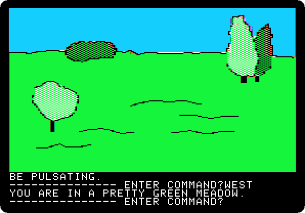

**Type `SOUTH`**

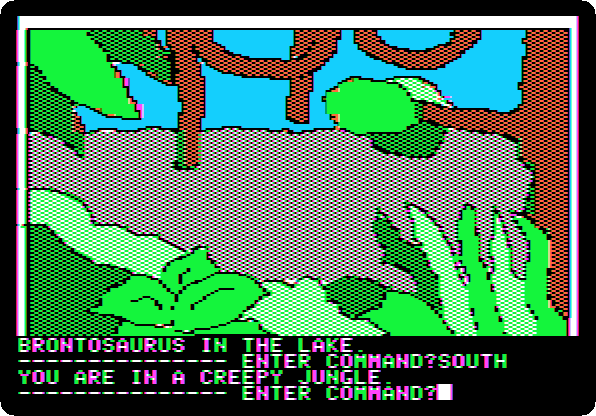

**Type `SOUTH`**

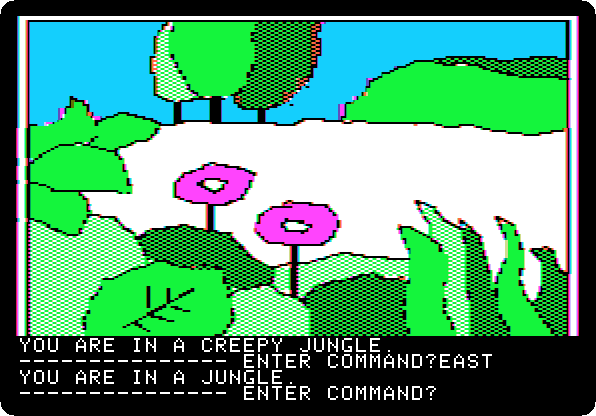

**Type `EAST`**

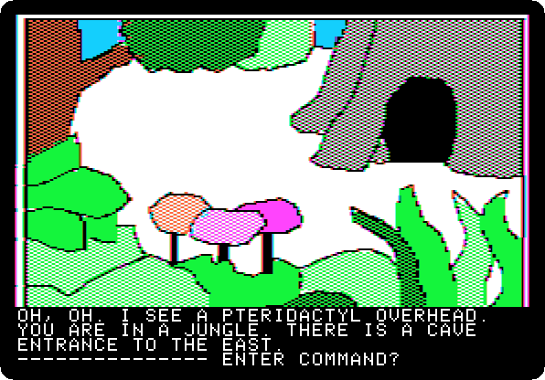

**Type `EAST`**

**Type `GO CAVE`**

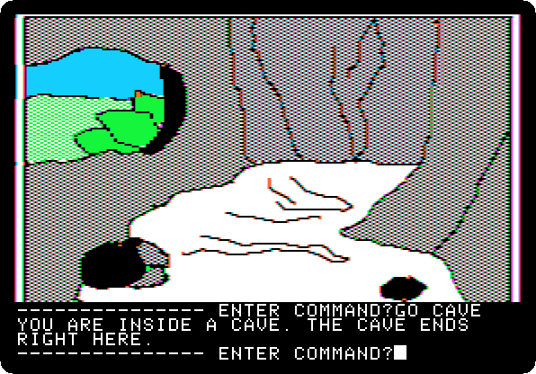

**Type `EXIT CAVE`**

**Type `SOUTH`**

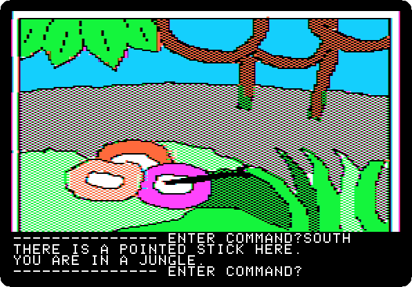

**Type `GET STICK`**

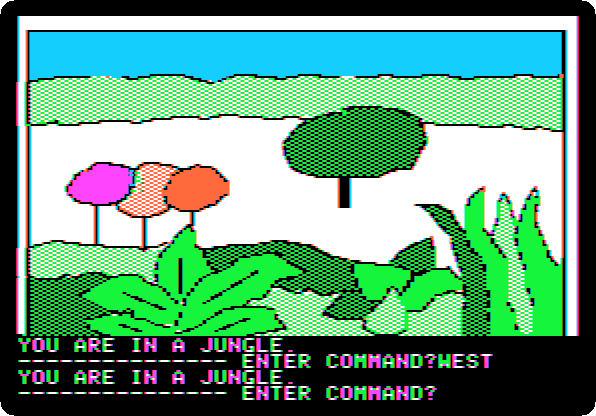

**Type `WEST`**

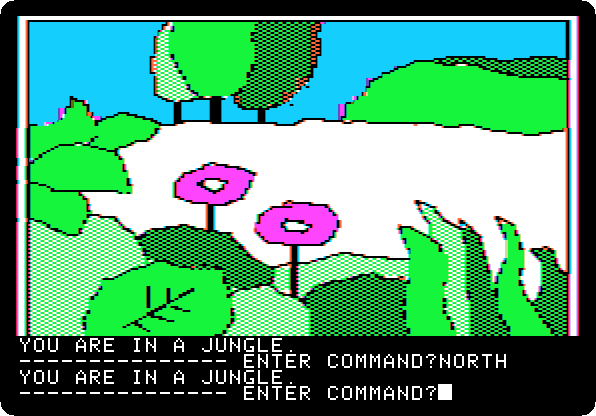

**Type `NORTH`**

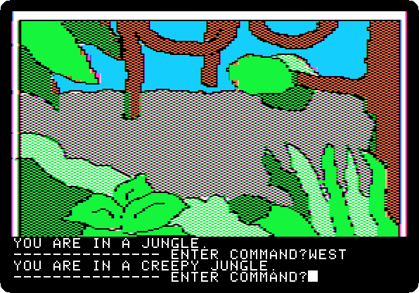

**Type `WEST`**

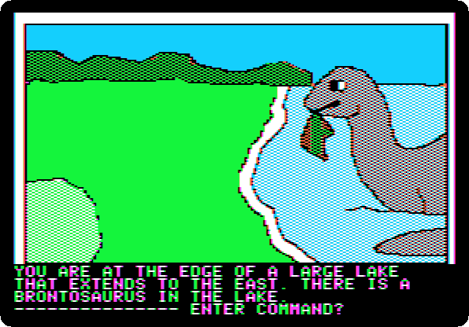

**Type `NORTH`**

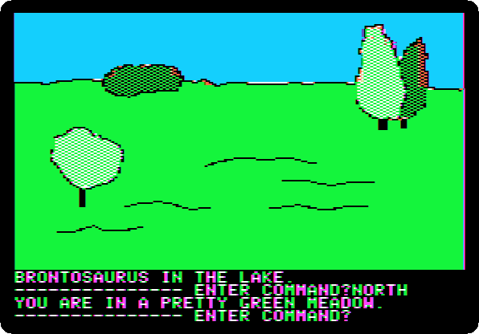

**Type `NORTH`**

**Type `EAST`**

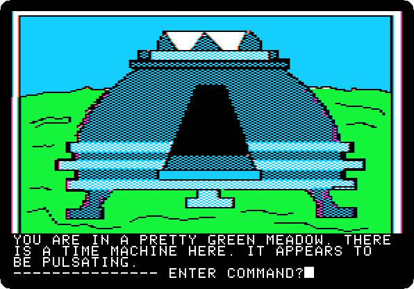

**Type `GO MACHINE`**

 

**Type `SIT`**

 

**Type `10000 BC`**

 

**Type `PULL LEVER`**

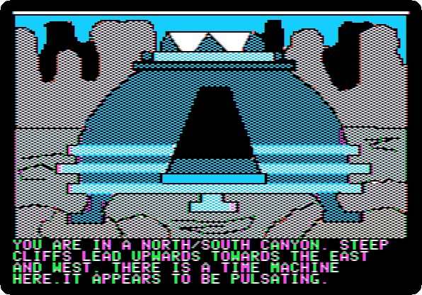 
 
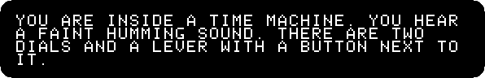 

**Type `EXIT MACHINE`**

## What next

**Next:** [Time Zone: 3. Europe, 10,000 BC](timezone-03.md).

[Time Zone, from the start to the end](timezone.md) has the list of all the parts.
