# Time Zone: 3. Europe, 10,000 BC

[Activities](../README.md) › [Play](../sections/play.md) › [Time Zone, from the start to the end](timezone.md)

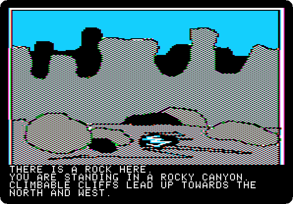 

**Type `NORTH`**

 

**Type `GET ROCK`**

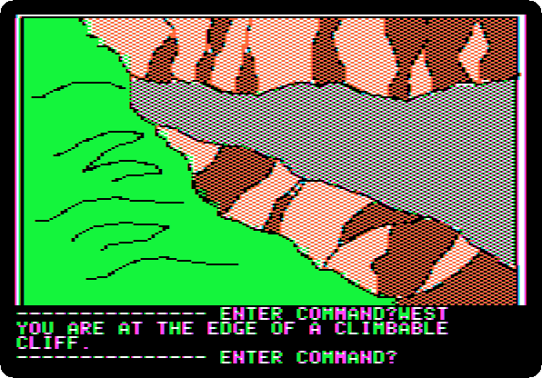

**Type `WEST`**

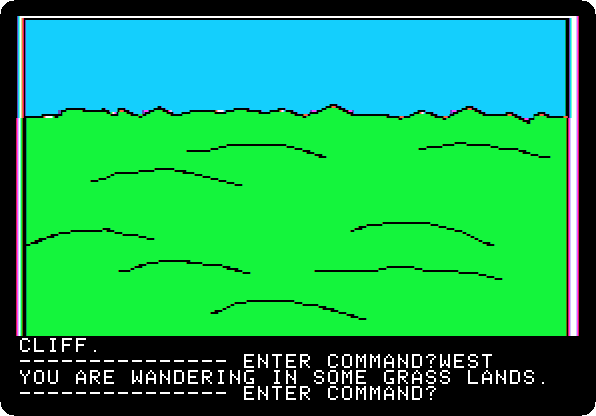

**Type `WEST`**

**Type `NORTH`**

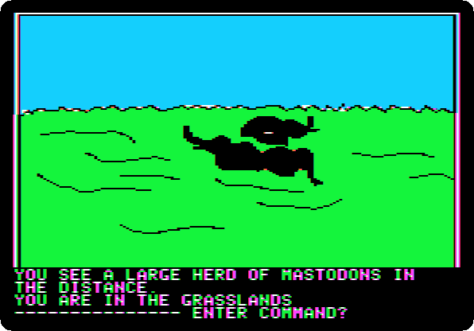

**Type `NORTH`**

**Type `NORTH`**

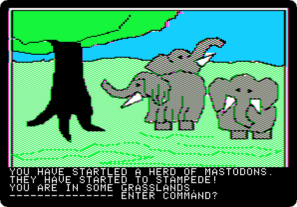

**Type `CLIMB TREE`**

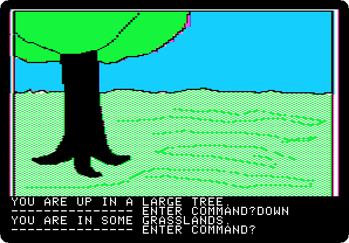

**Type `DOWN`**

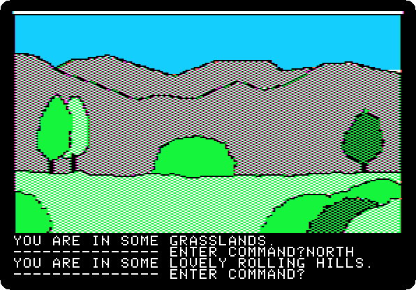

**Type `NORTH`**

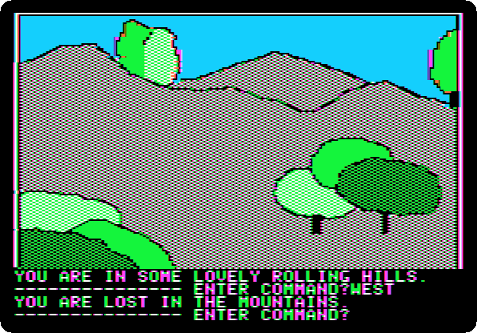

**Type `WEST`**

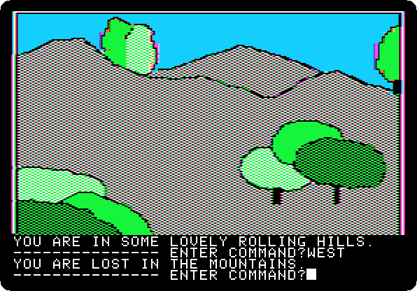

**Type `NORTH`**

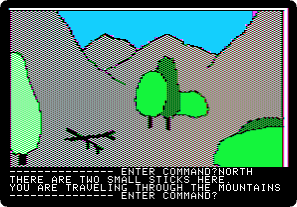

**Type `GET STICKS`**

**Type `SOUTH`**

**Type `EAST`**

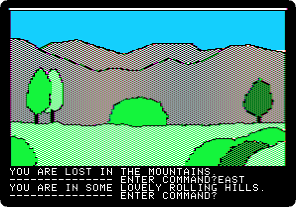

**Type `NORTH`**

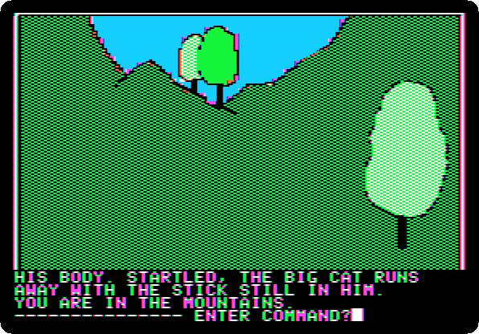

**Type `THROW STICK`**

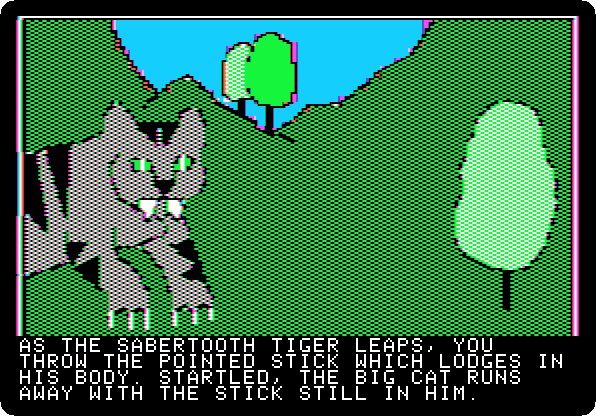 
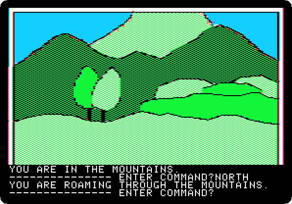

**Type `NORTH`**

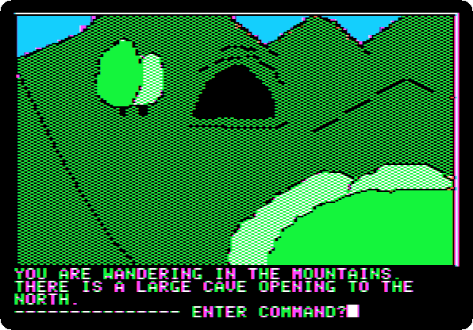

**Type `EAST`**

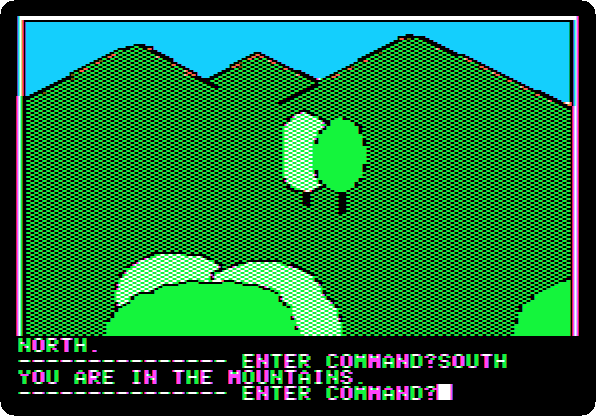

**Type `SOUTH`**

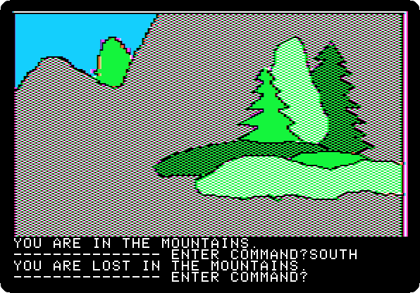

**Type `SOUTH`**

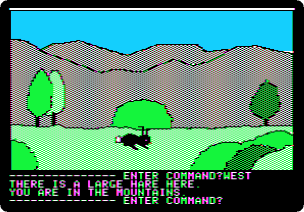

**Type `WEST`**

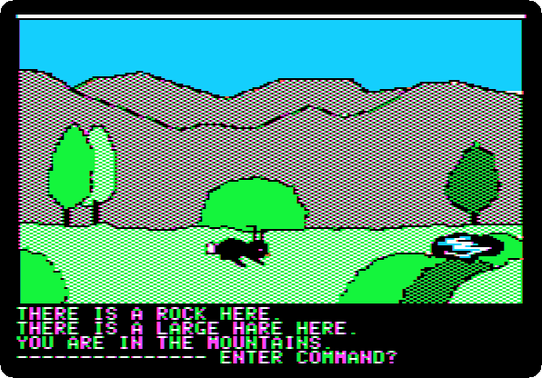

**Type `THROW ROCK`**

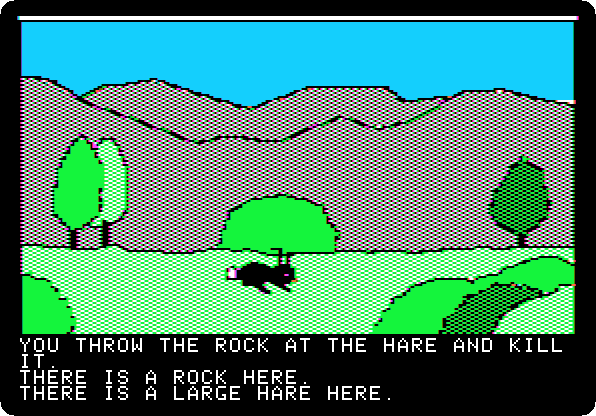 

**Type `GET HARE`**

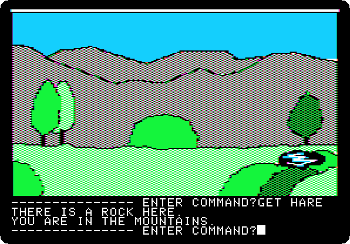

**Type `EAST`**

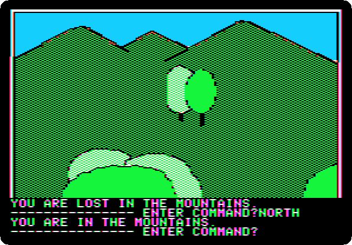

**Type `NORTH`**

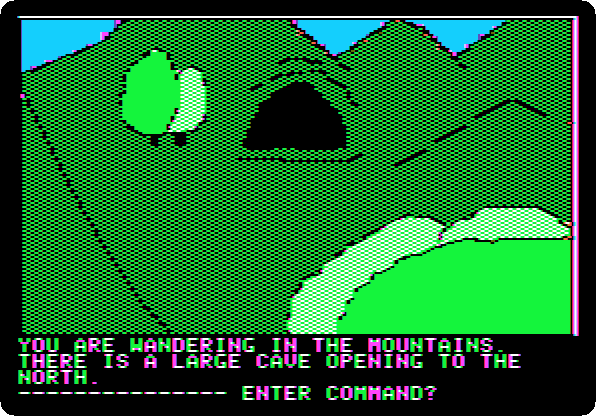

**Type `NORTH`**

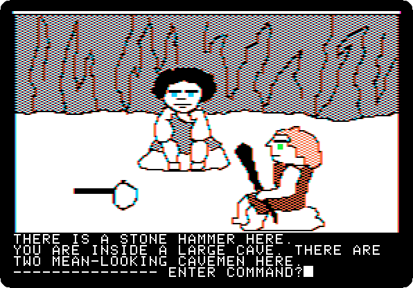

**Type `GO CAVE`**

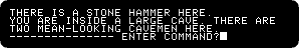

**Type `MAKE FIRE`**

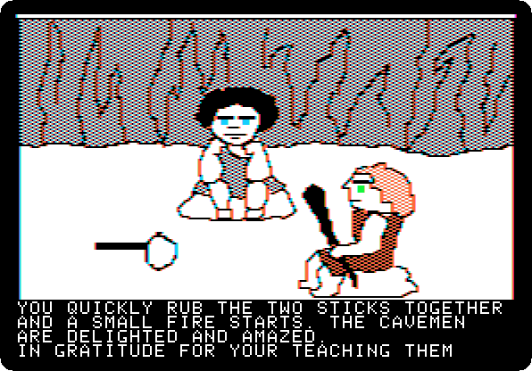 
 

**Type `GIVE HARE`**

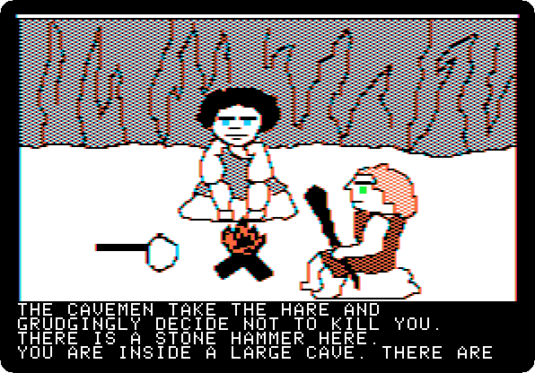 
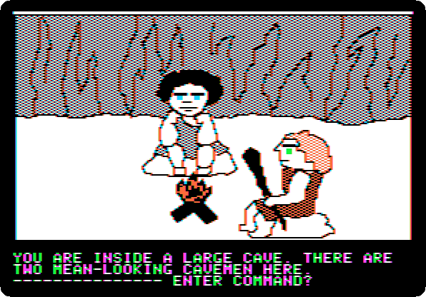

**Type `GET HAMMER`**

**Type `SOUTH`**

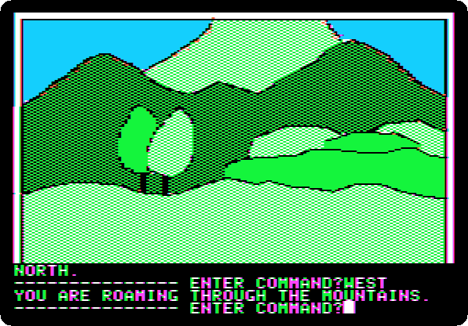

**Type `WEST`**

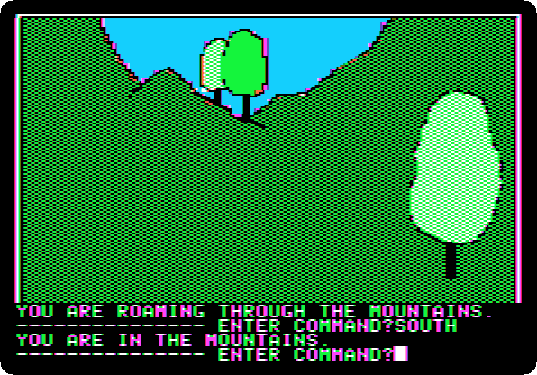

**Type `SOUTH`**

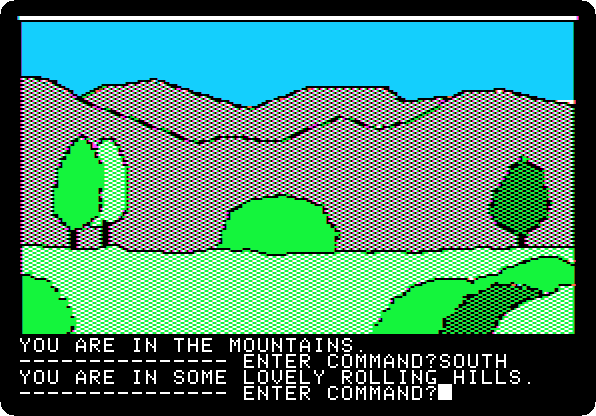

**Type `SOUTH`**

**Type `SOUTH`**

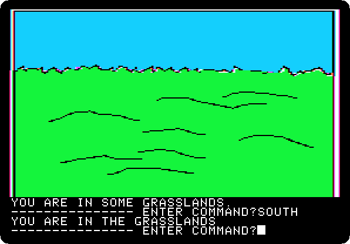

**Type `SOUTH`**

**Type `SOUTH`**

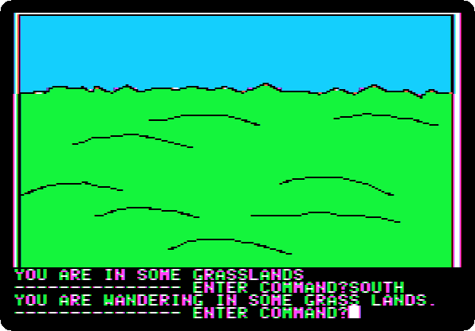

**Type `SOUTH`**

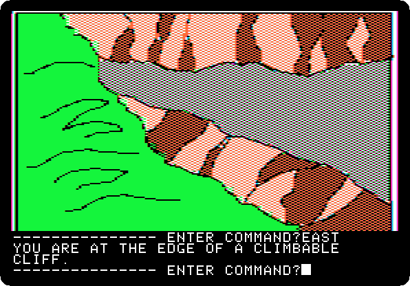

**Type `EAST`**

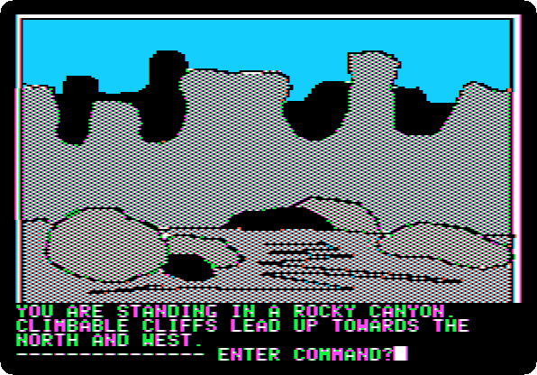

**Type `DOWN`**

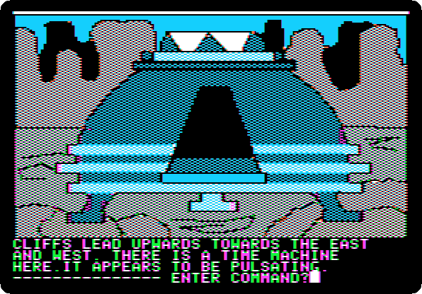

**Type `SOUTH`**

 

**Type `GO MACHINE`**

 

**Type `SIT`**

 

**Type `SA`**

 

**Type `1000AD`**

 

**Type `PULL LEVER`**

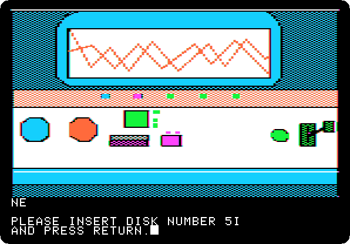 
 
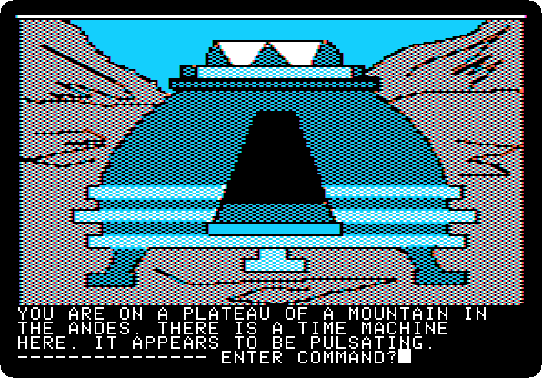

**Type `EXIT MACHINE`**

## What next

**Next:** [Time Zone: 4. South America, 1000 AD](timezone-04.md).

[Time Zone, from the start to the end](timezone.md) has the list of all the parts.
