# Time Zone: 4. South America, 1000 AD

[Activities](../README.md) › [Play](../sections/play.md) › [Time Zone, from the start to the end](timezone.md)

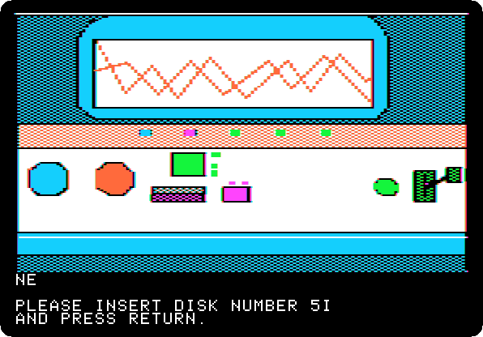 

*Side 5I: drop `Time Zone (4am and san inc crack) disk I.dsk` on drive 1, and press Return.*

**Type `SOUTH`**

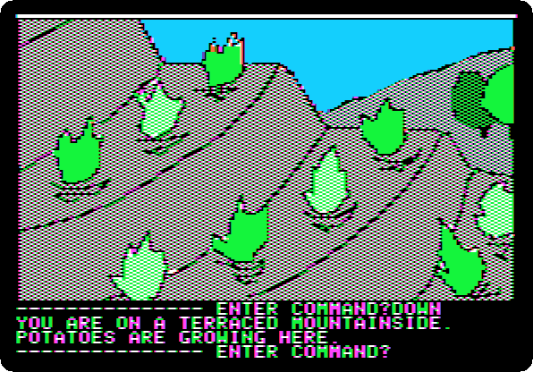

**Type `DOWN`**

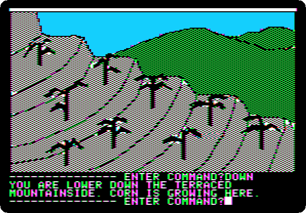

**Type `DOWN`**

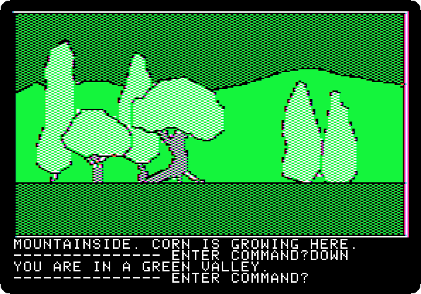

**Type `DOWN`**

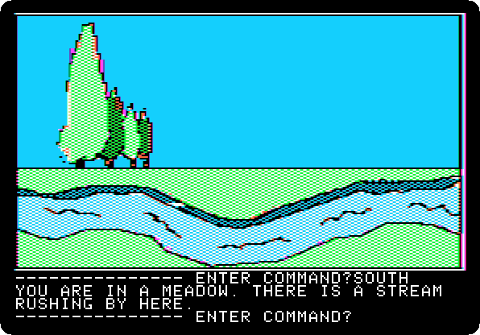

**Type `SOUTH`**

**Type `SOUTH`**

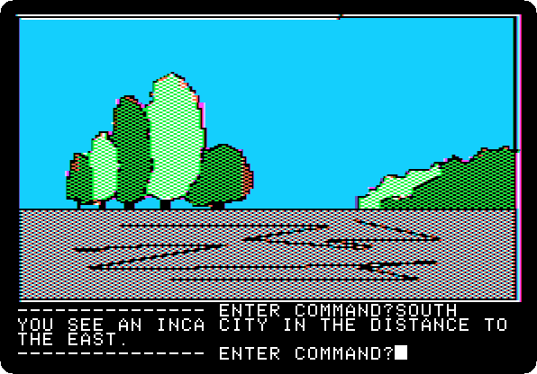

**Type `SOUTH`**

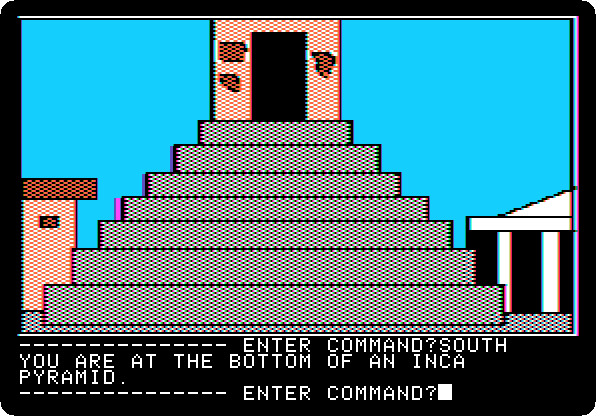

**Type `DROP HAMMER`**

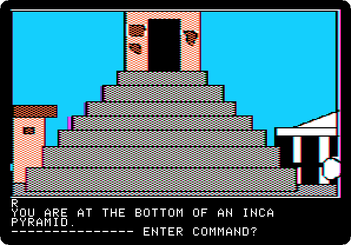

**Type `UP`**

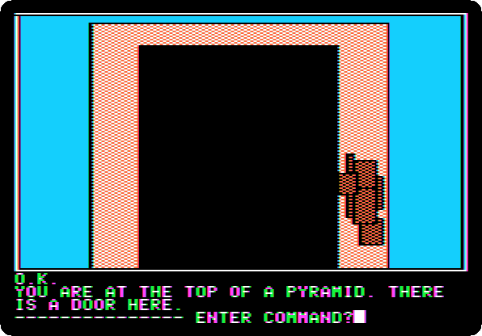

**Type `OPEN DOOR`**

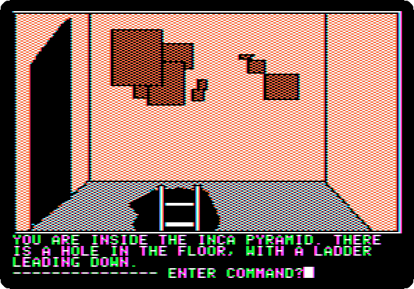

**Type `GO DOOR`**

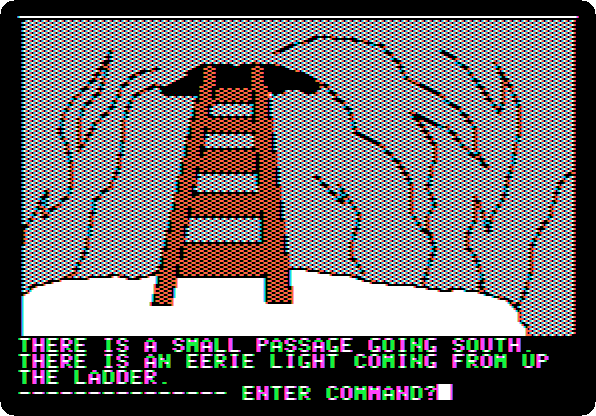

**Type `DOWN`**

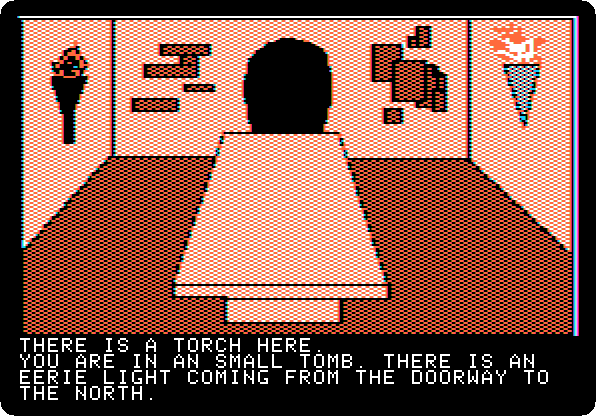 

**Type `SOUTH`**

 

**Type `GET TORCH`**

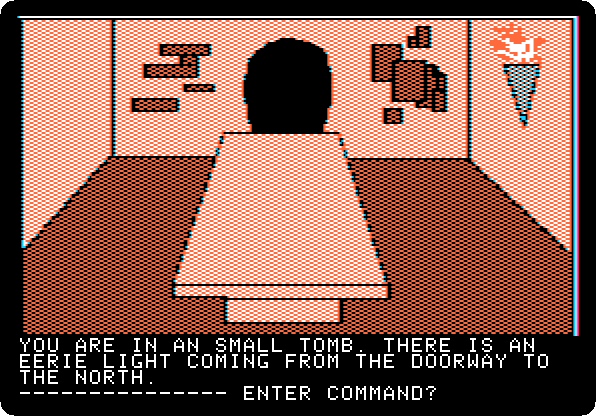

**Type `NORTH`**

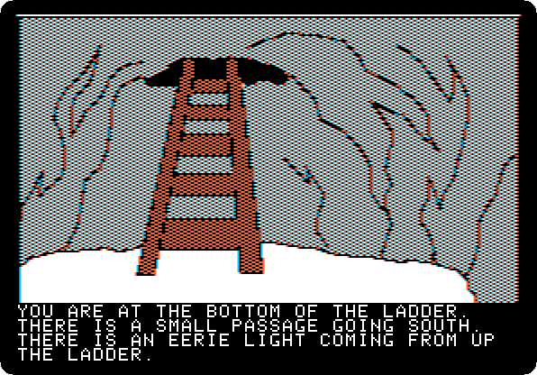 

**Type `UP`**

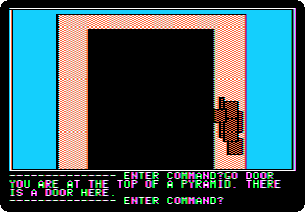

**Type `GO DOOR`**

**Type `THROW TORCH`**

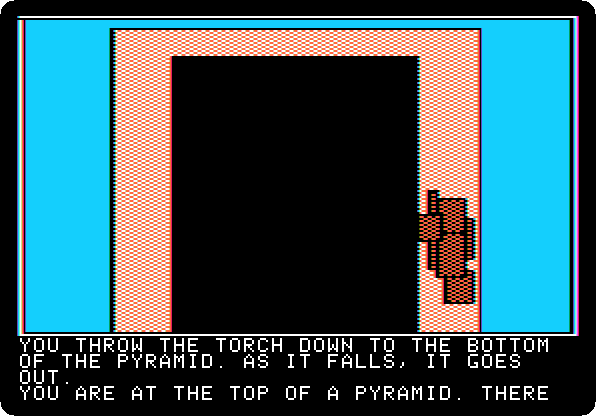 
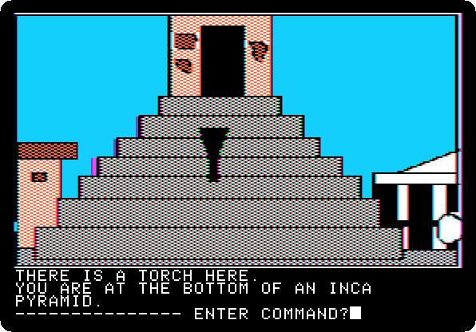

**Type `DOWN`**

**Type `GET TORCH`**

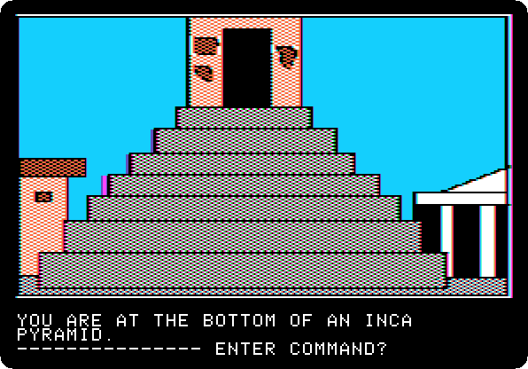

**Type `GET HAMMER`**

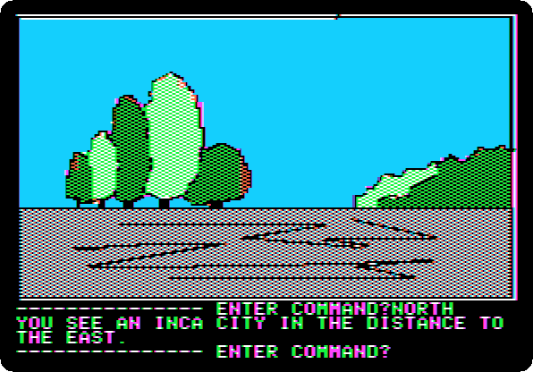

**Type `NORTH`**

**Type `NORTH`**

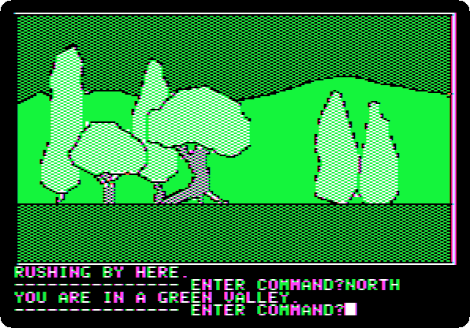

**Type `NORTH`**

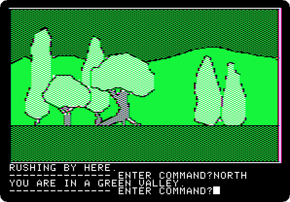

**Type `UP`**

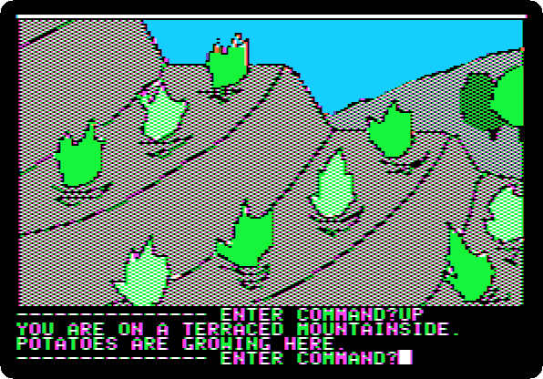

**Type `UP`**

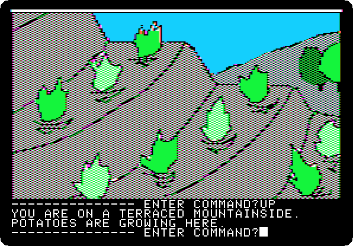

**Type `UP`**

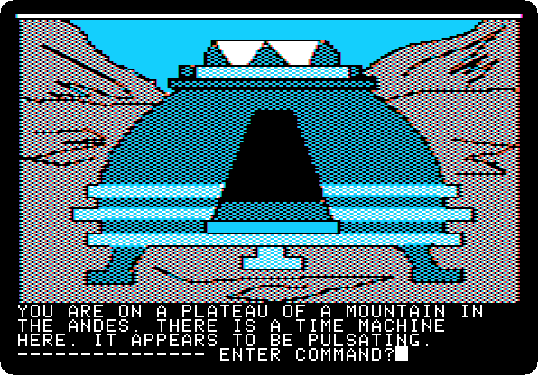

**Type `NORTH`**

**Type `GO MACHINE`**

 
 

*Side 1B: drop `Time Zone (4am and san inc crack) disk B.dsk` on drive 1, and press Return.*

**Type `SIT`**

 

**Type `ASIA`**

 

**Type `50BC`**

 

**Type `PULL LEVER`**

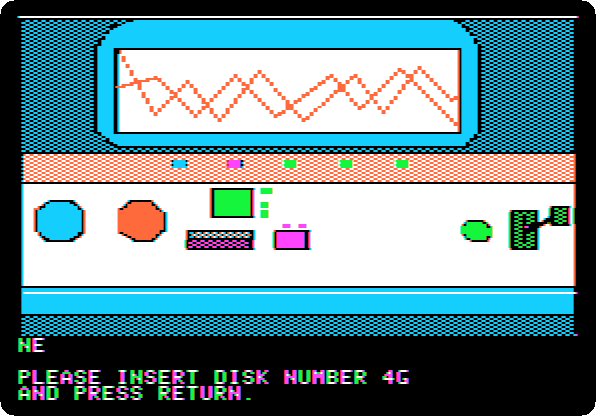 
 
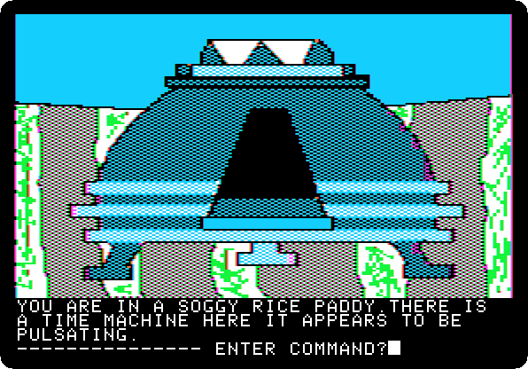

**Type `EXIT MACHINE`**

## What next

**Next:** [Time Zone: 5. Asia, 50 BC](timezone-05.md).

[Time Zone, from the start to the end](timezone.md) has the list of all the parts.
