# Time Zone: 5. Asia, 50 BC

[Activities](../README.md) › [Play](../sections/play.md) › [Time Zone, from the start to the end](timezone.md)

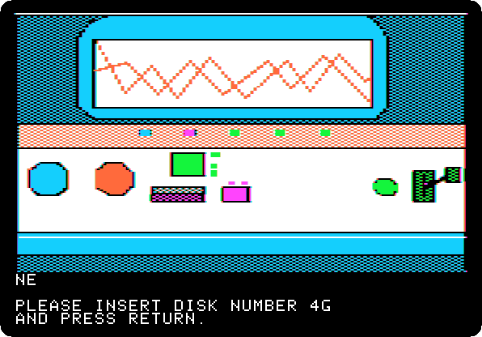 
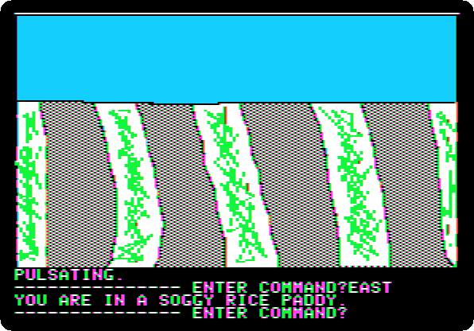

*Side 4G: drop `Time Zone (4am and san inc crack) disk G.dsk` on drive 1, and press Return.*

**Type `EAST`**

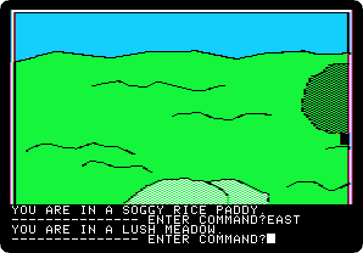

**Type `EAST`**

**Type `EAST`**

**Type `NORTH`**

**Type `NORTH`**

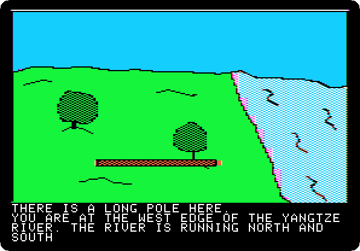 
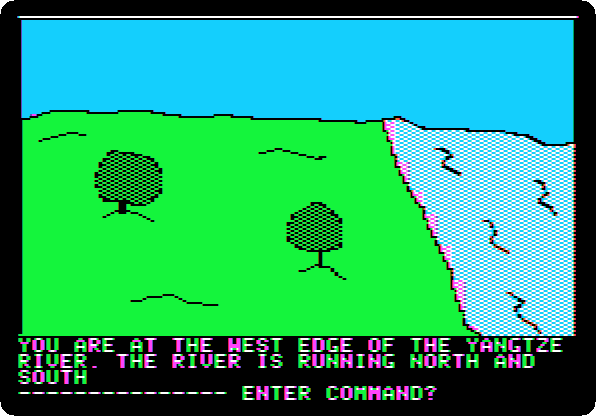

**Type `GET POLE`**

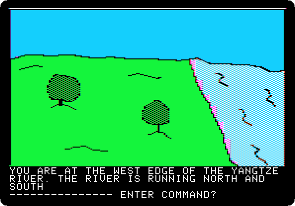

**Type `SOUTH`**

**Type `SOUTH`**

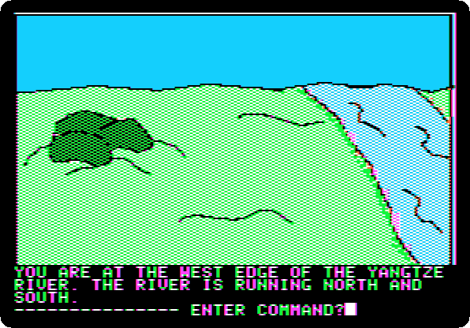

**Type `SOUTH`**

**Type `SOUTH`**

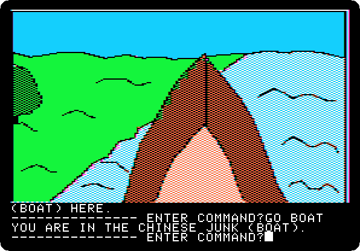

**Type `GO BOAT`**

**Type `EAST`**

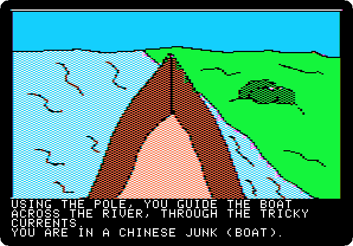 

**Type `EXIT BOAT`**

**Type `NORTH`**

**Type `NORTH`**

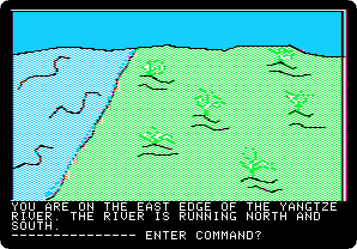

**Type `NORTH`**

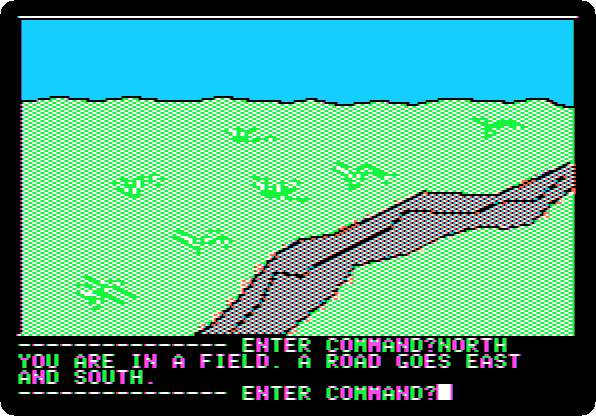

**Type `NORTH`**

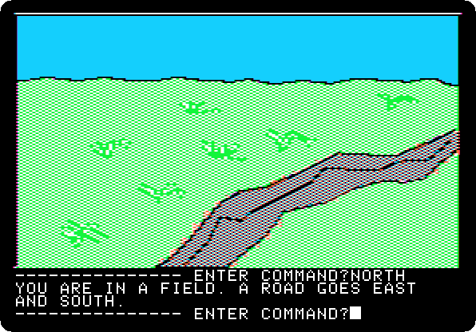

**Type `EAST`**

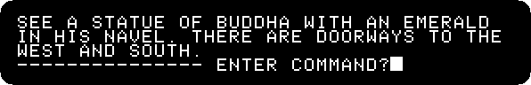

**Type `NORTH`**

 
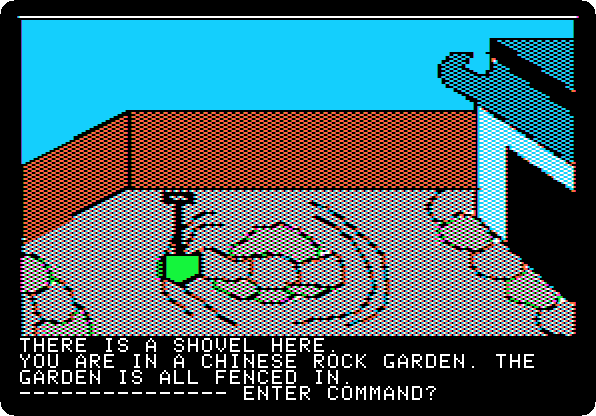

**Type `WEST`**

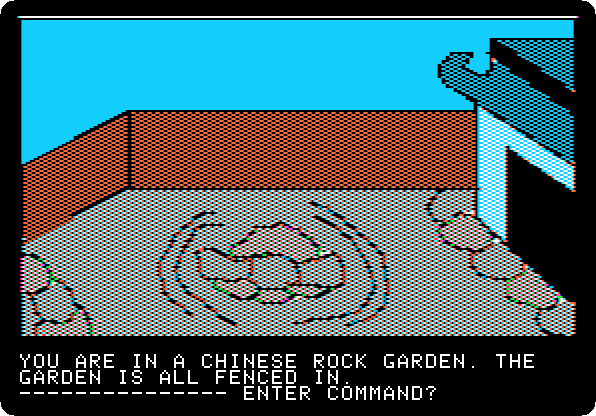

**Type `GET SHOVEL`**

**Type `DIG`**

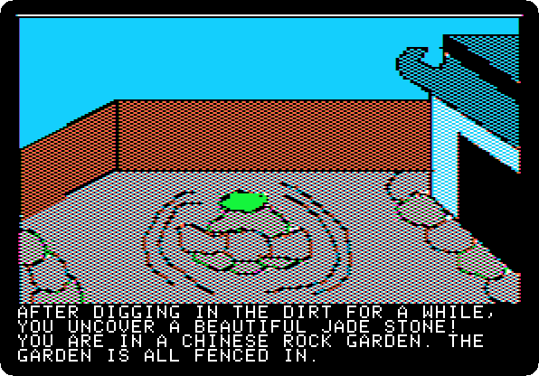 

**Type `GET JADE`**

**Type `DIG`**

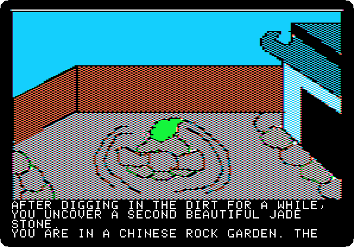 

**Type `GET JADE`**

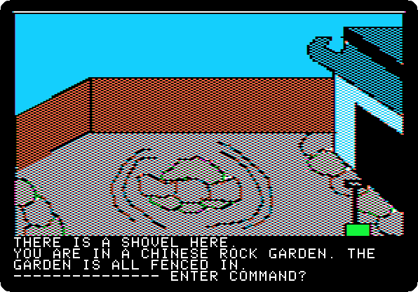

**Type `DROP SHOVEL`**

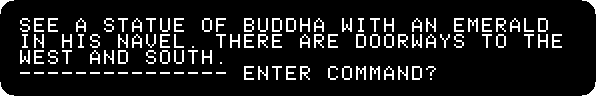

**Type `EAST`**

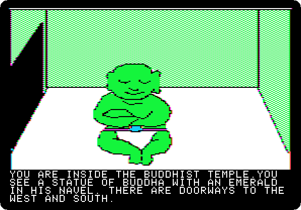 

**Type `SOUTH`**

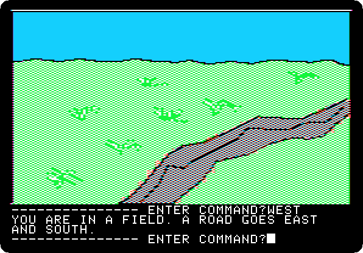

**Type `WEST`**

**Type `SOUTH`**

**Type `SOUTH`**

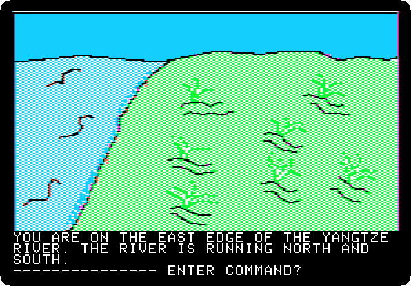

**Type `SOUTH`**

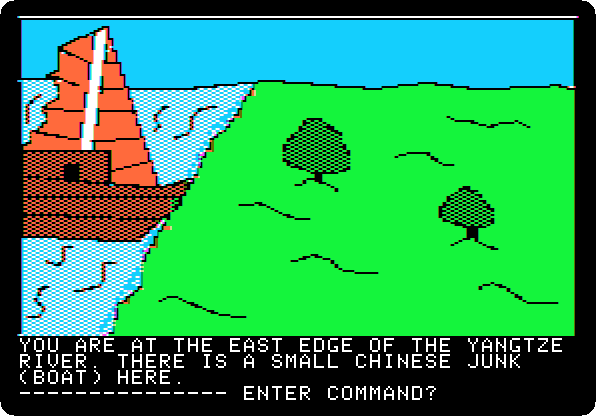

**Type `SOUTH`**

**Type `SOUTH`**

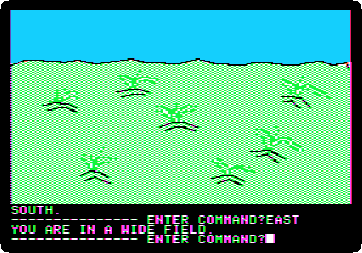

**Type `EAST`**

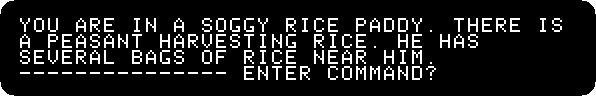

**Type `EAST`**

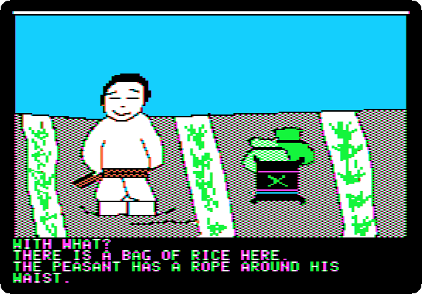 

**Type `BUY ROPE`**

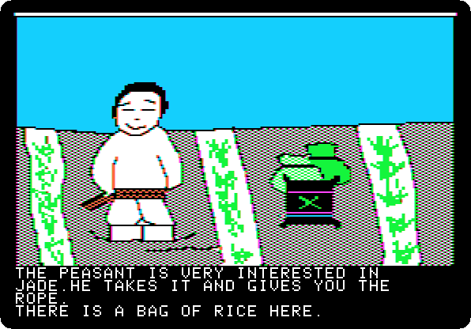 

**Type `WITH JADE`**

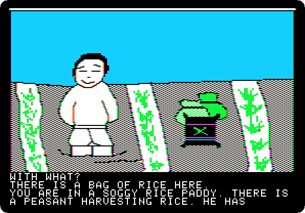 

**Type `BUY RICE`**

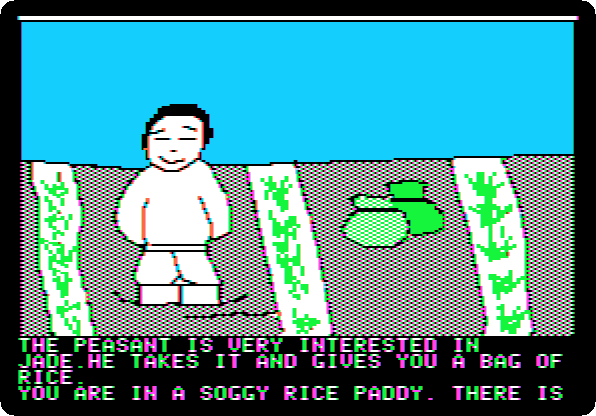 

**Type `WITH JADE`**

 
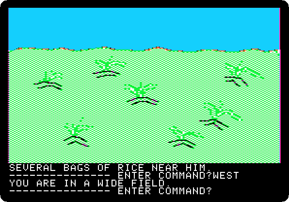

**Type `WEST`**

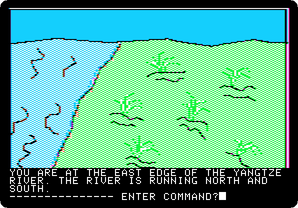

**Type `WEST`**

**Type `NORTH`**

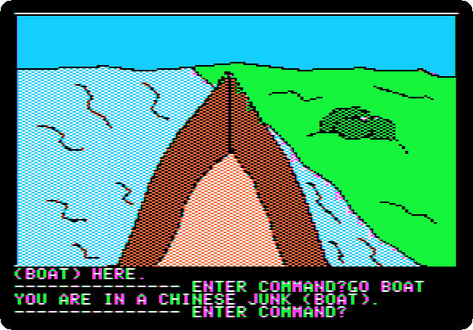

**Type `GO BOAT`**

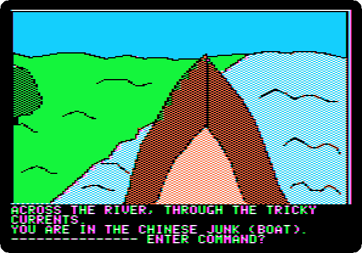

**Type `WEST`**

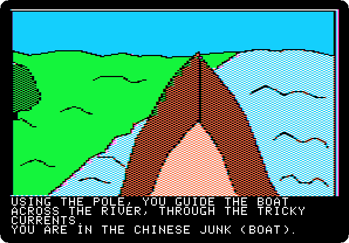 
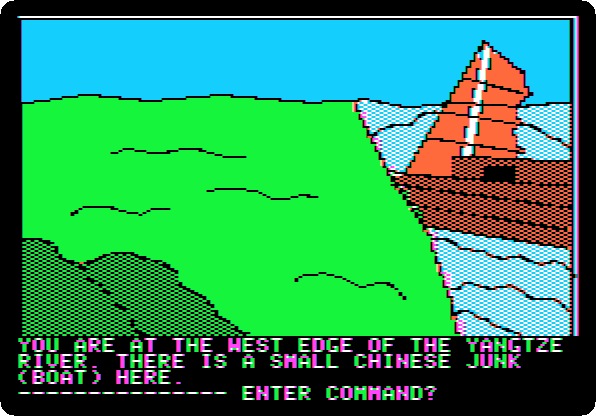

**Type `EXIT BOAT`**

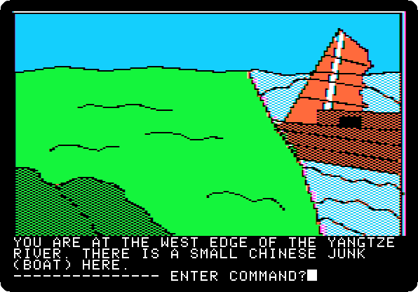

**Type `NORTH`**

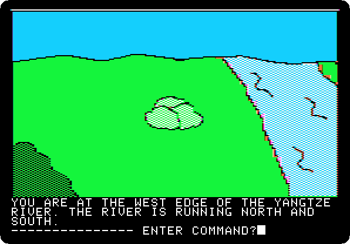

**Type `NORTH`**

**Type `WEST`**

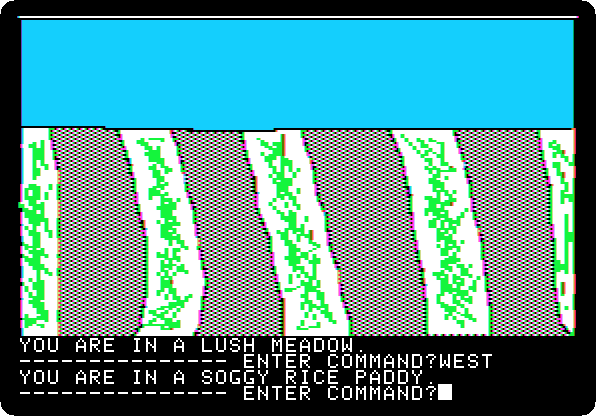

**Type `WEST`**

**Type `WEST`**

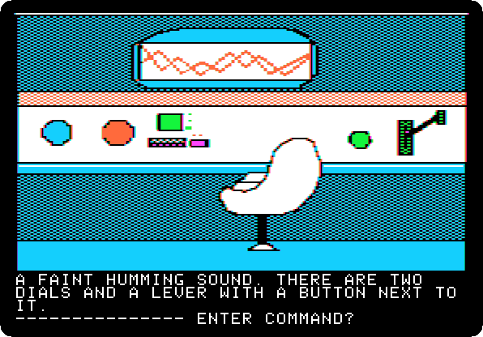

**Type `GO MACHINE`**

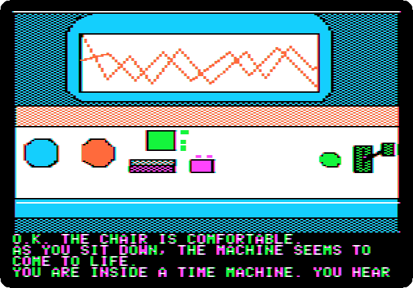 
 

*Side 1B: drop `Time Zone (4am and san inc crack) disk B.dsk` on drive 1, and press Return.*

**Type `SIT`**

 

**Type `EUROPE`**

 

**Type `1400AD`**

 

**Type `PULL LEVER`**

 
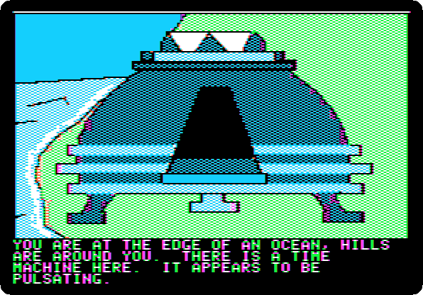 

**Type `EXIT MACHINE`**

## What next

**Next:** [Time Zone: 6. Europe, 1400 AD](timezone-06.md).

[Time Zone, from the start to the end](timezone.md) has the list of all the parts.
