# Time Zone: 6. Europe, 1400 AD

[Activities](../README.md) › [Play](../sections/play.md) › [Time Zone, from the start to the end](timezone.md)

 
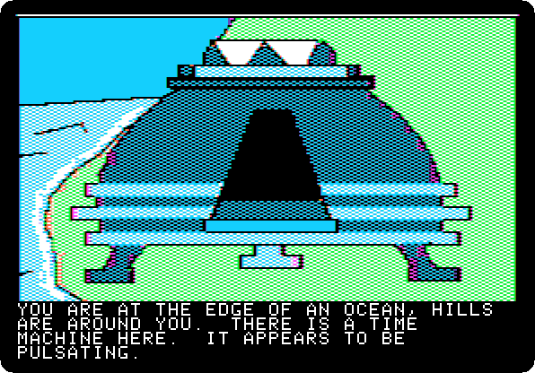 
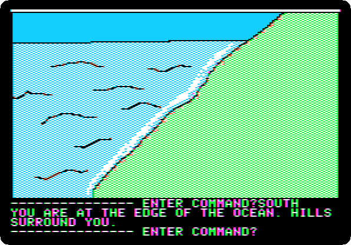

*Side 2C: drop `Time Zone (4am and san inc crack) disk C.dsk` on drive 1, and press Return.*

**Type `SOUTH`**

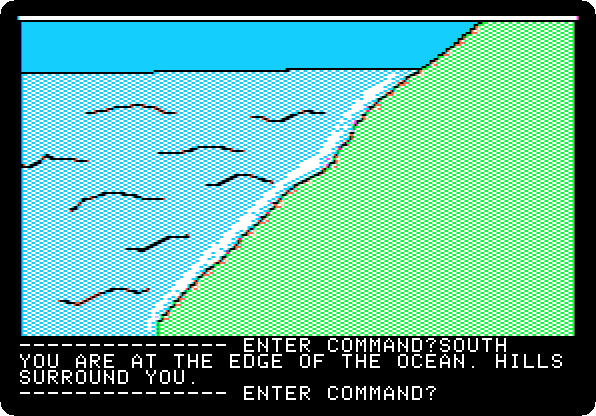

**Type `SOUTH`**

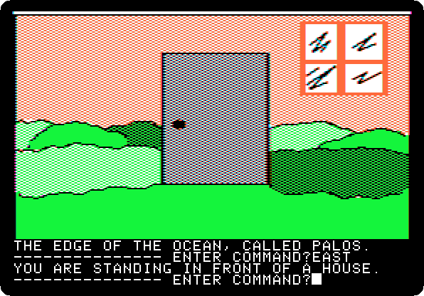

**Type `EAST`**

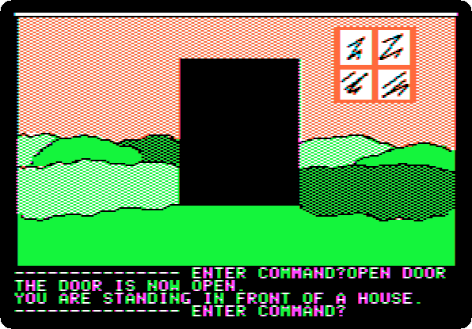

**Type `OPEN DOOR`**

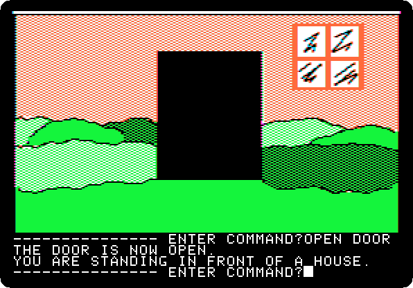

**Type `GO DOOR`**

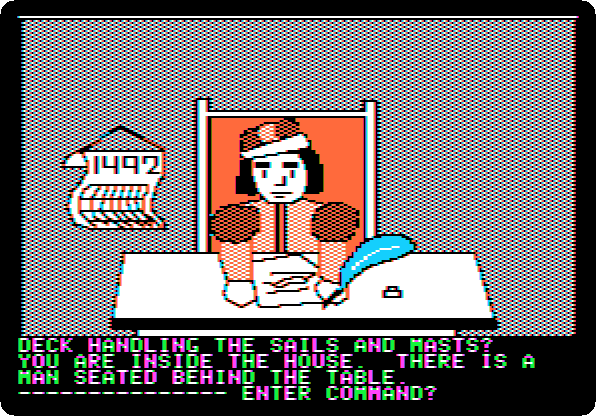

**Type `SIGN UP`**

 

**Type `ON DECK`**

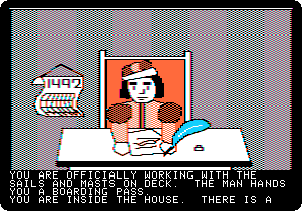 

**Type `SOUTH`**

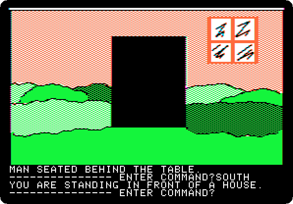

**Type `WEST`**

**Type `SOUTH`**

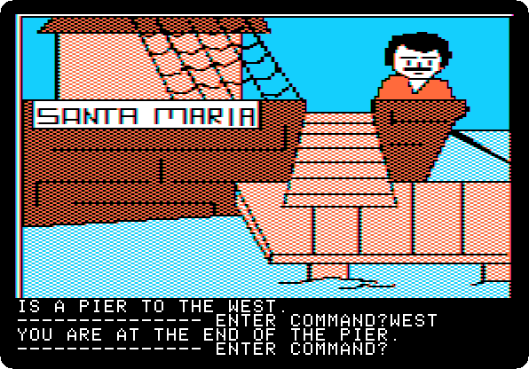

**Type `WEST`**

**Type `SHOW PASS`**

 

**Type `NORTH`**

 

**Type `WEST`**

**Type `WEST`**

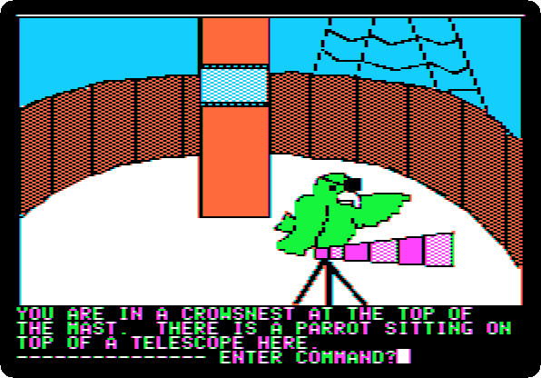

**Type `UP`**

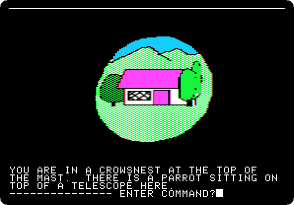

**Type `LOOK TELESCOPE`**

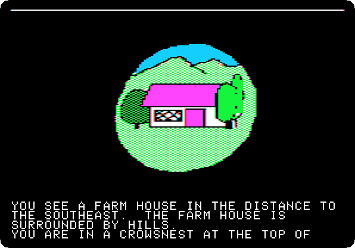 

**Type `DOWN`**

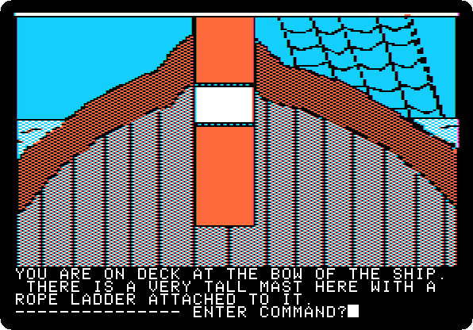

**Type `EAST`**

**Type `EAST`**

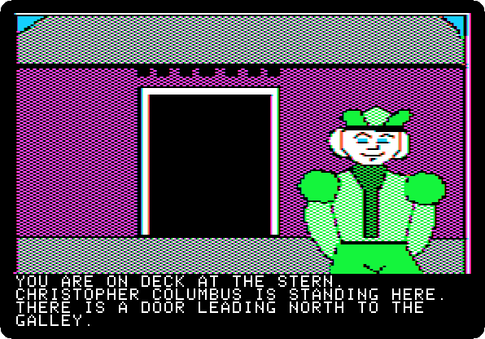 
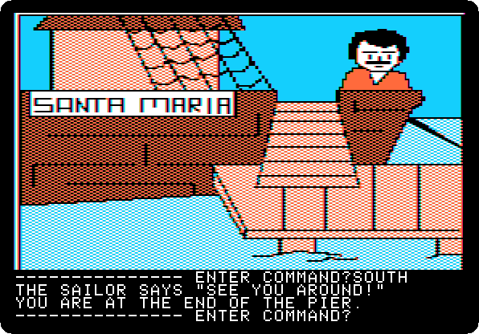

**Type `SOUTH`**

**Type `EAST`**

**Type `EAST`**

**Type `SOUTH`**

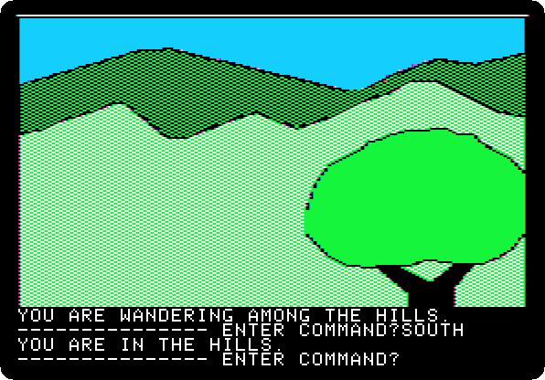

**Type `EAST`**

**Type `SOUTH`**

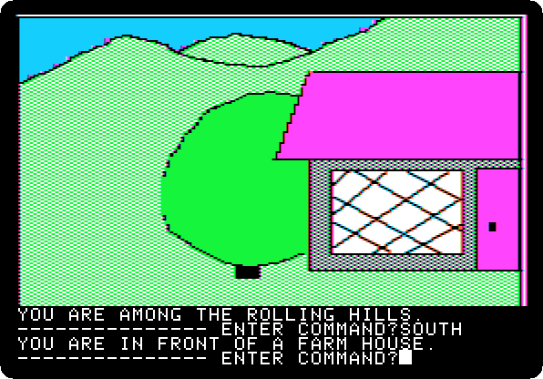

**Type `OPEN DOOR`**

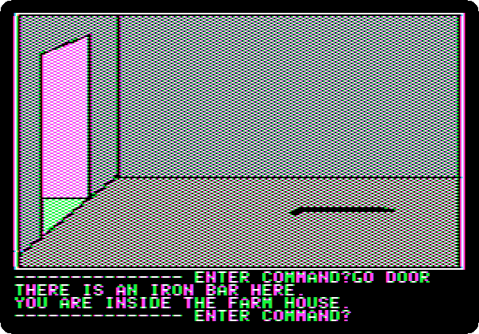

**Type `GO DOOR`**

**Type `GET BAR`**

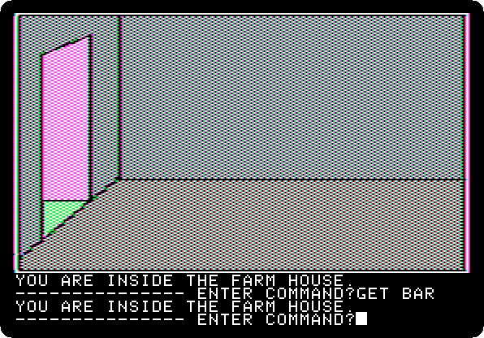

**Type `WEST`**

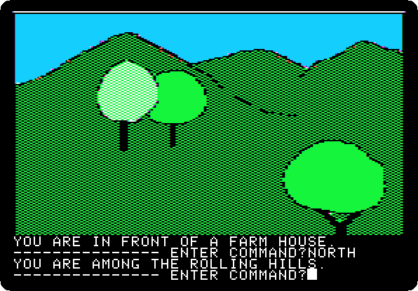

**Type `NORTH`**

**Type `WEST`**

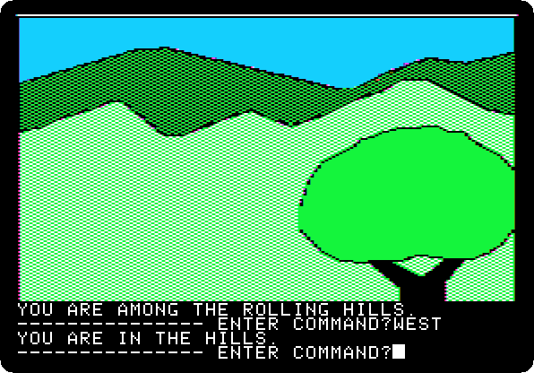

**Type `NORTH`**

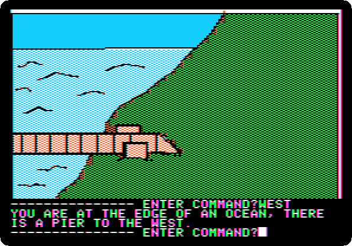

**Type `WEST`**

**Type `NORTH`**

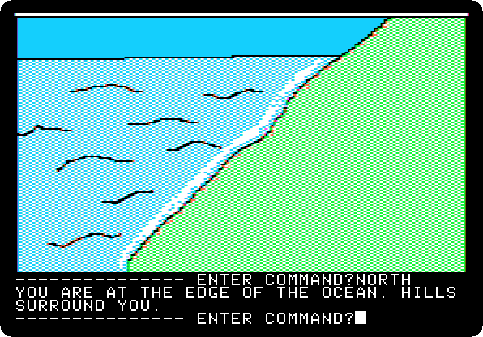

**Type `NORTH`**

**Type `NORTH`**

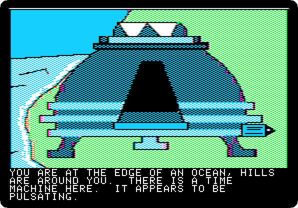 

**Type `DROP PASS`**

 

**Type `GO MACHINE`**

 
 

*Side 1B: drop `Time Zone (4am and san inc crack) disk B.dsk` on drive 1, and press Return.*

**Type `SIT`**

 

**Type `AUSTRALIA`**

 

**Type `1700AD`**

 

**Type `PULL LEVER`**

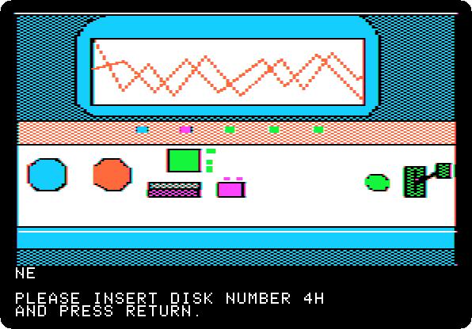 
 

**Type `EXIT MACHINE`**

## What next

**Next:** [Time Zone: 7. Australia, 1700 AD](timezone-07.md).

[Time Zone, from the start to the end](timezone.md) has the list of all the parts.
