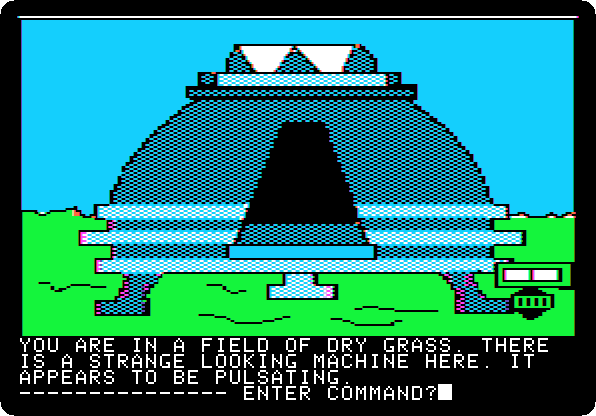
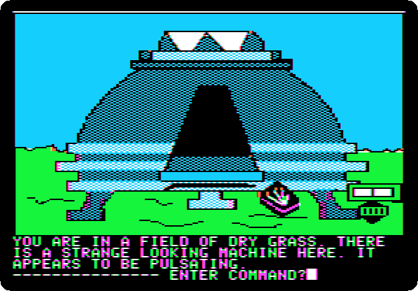
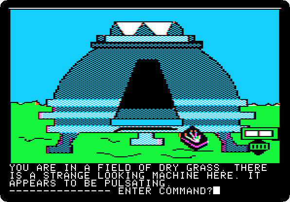
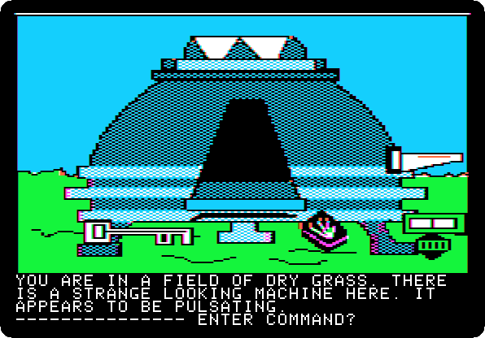
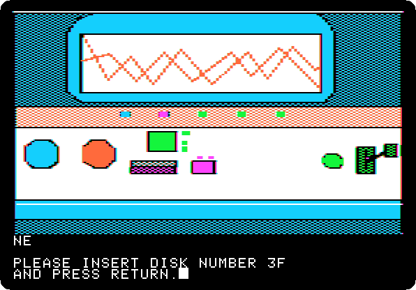
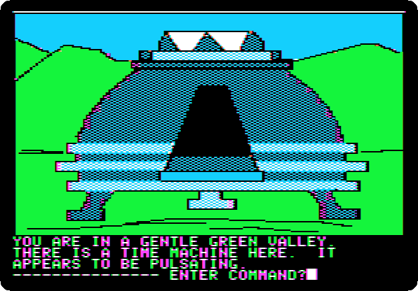

# Time Zone: 10. Home, 1982

[Activities](../README.md) › [Play](../sections/play.md) › [Time Zone, from the start to the end](timezone.md)

**Type `LIGHT TORCH`**

**Type `DROP MATCHES`**

**Type `DROP BAR`**

**Type `DROP KEY`**

**Type `DROP SAW`**

**Type `GO MACHINE`**

 

**Type `SIT`**

 

**Type `EUROPE`**

 

**Type `1700AD`**

 

**Type `PULL LEVER`**

 
 

**Type `EXIT MACHINE`**

## What next

**Next:** [Time Zone: 11. Europe, 1700 AD](timezone-11.md).

[Time Zone, from the start to the end](timezone.md) has the list of all the parts.
