# Time Zone: 11. Europe, 1700 AD

[Activities](../README.md) › [Play](../sections/play.md) › [Time Zone, from the start to the end](timezone.md)

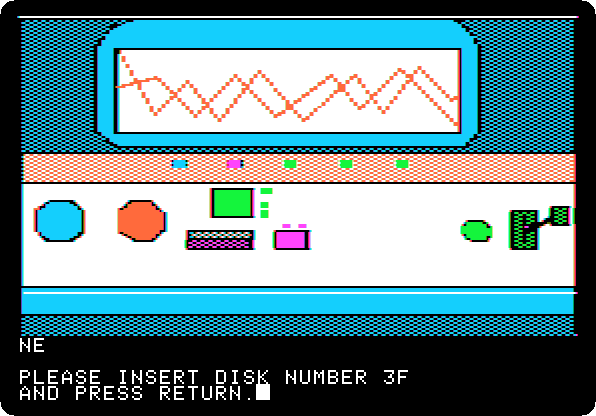 
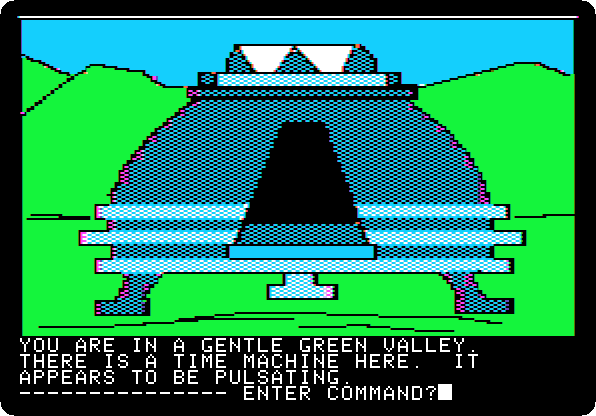

*Side 3F: drop `Time Zone (4am and san inc crack) disk F.dsk` on drive 1, and press Return.*

**Type `NORTH`**

**Type `NORTH`**

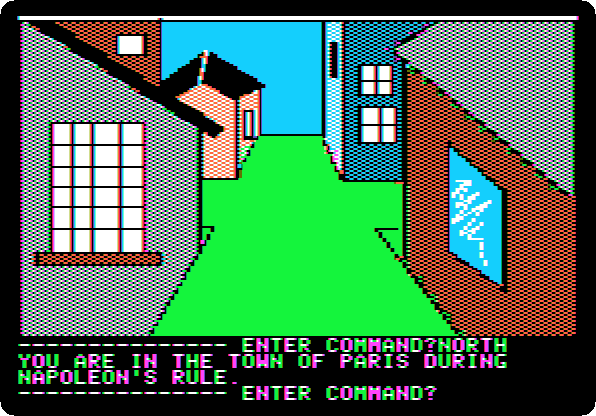

**Type `NORTH`**

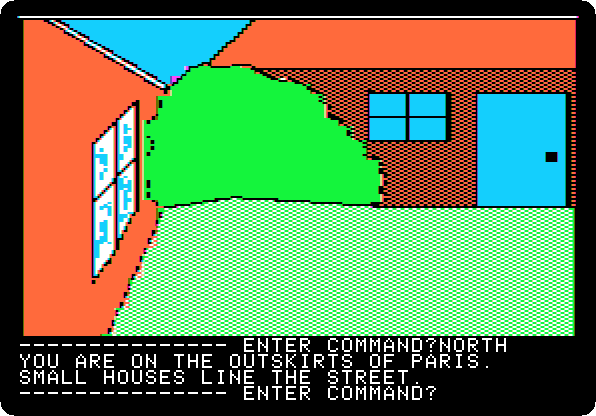

**Type `NORTH`**

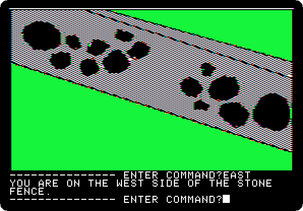

**Type `EAST`**

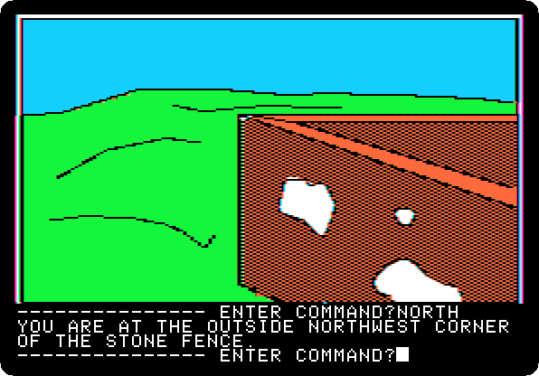

**Type `NORTH`**

**Type `EAST`**

**Type `CLIMB FENCE`**

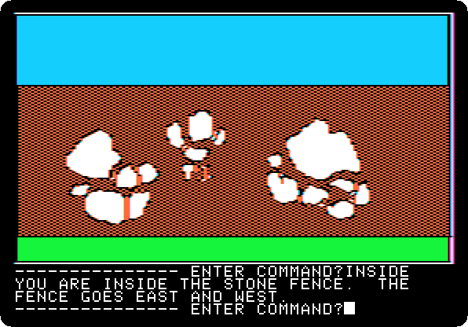

**Type `INSIDE`**

**Type `SOUTH`**

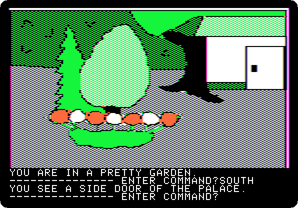

**Type `SOUTH`**

**Type `OPEN DOOR`**

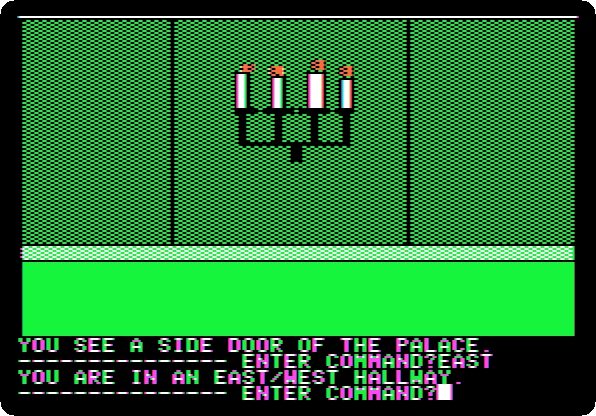

**Type `EAST`**

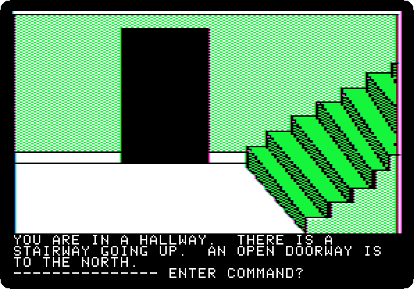

**Type `EAST`**

**Type `UP`**

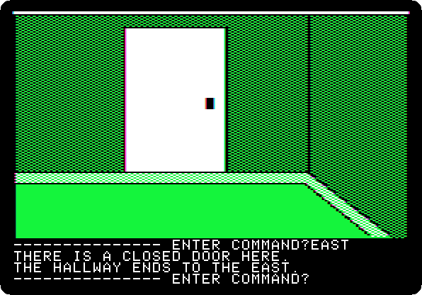

**Type `EAST`**

**Type `OPEN DOOR`**

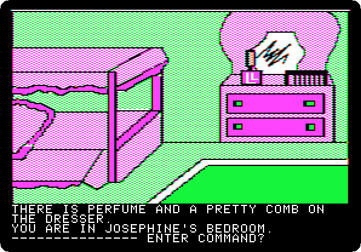

**Type `NORTH`**

**Type `GET PERFUME`**

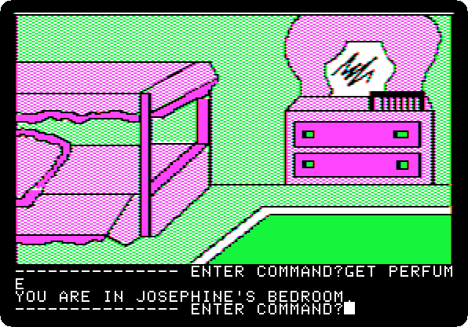

**Type `GET COMB`**

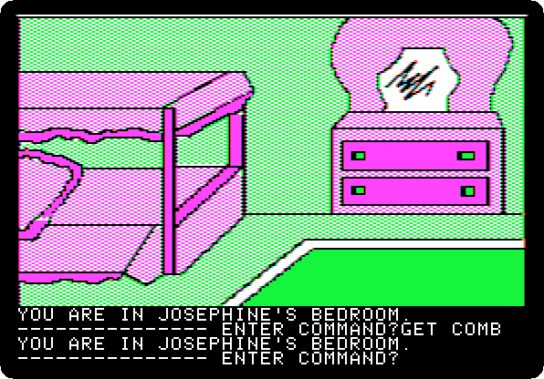

**Type `SOUTH`**

**Type `WEST`**

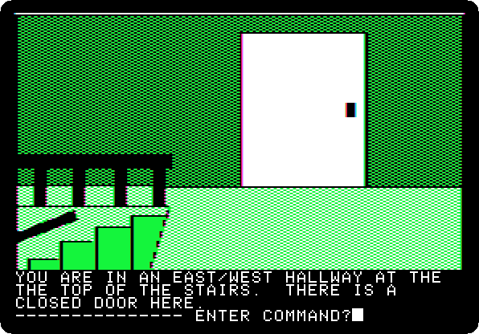

**Type `DOWN`**

**Type `WEST`**

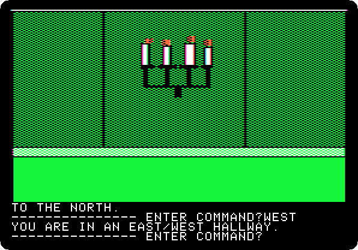

**Type `WEST`**

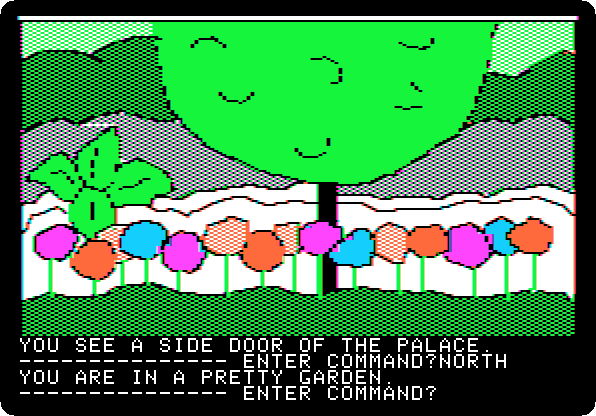

**Type `NORTH`**

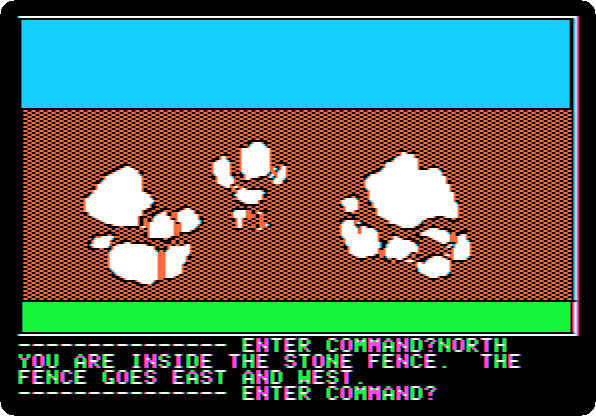

**Type `NORTH`**

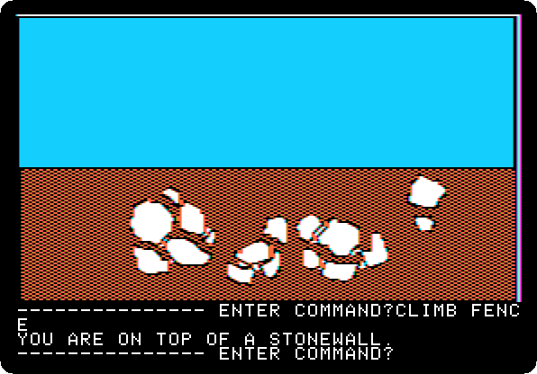

**Type `CLIMB FENCE`**

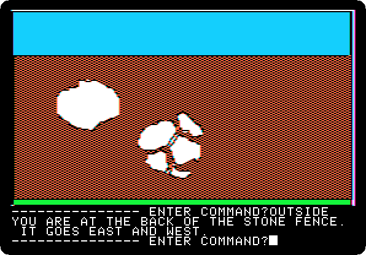

**Type `OUTSIDE`**

**Type `WEST`**

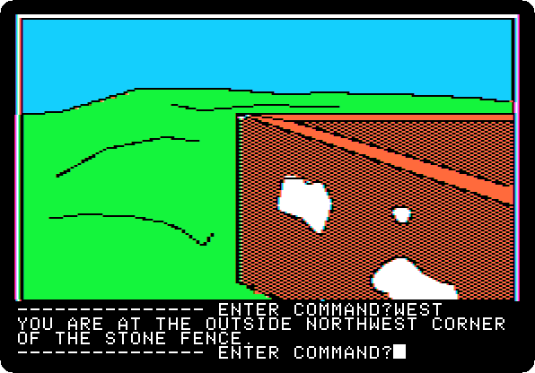

**Type `SOUTH`**

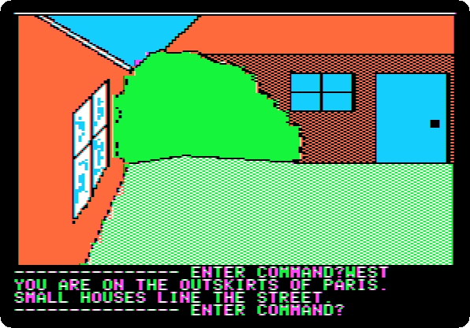

**Type `WEST`**

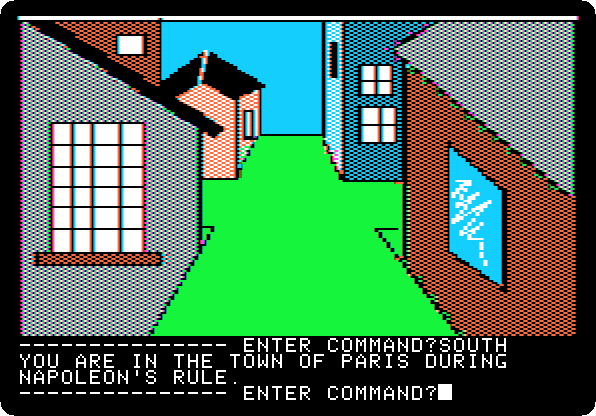

**Type `SOUTH`**

**Type `SOUTH`**

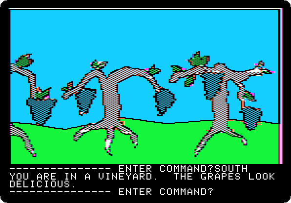

**Type `SOUTH`**

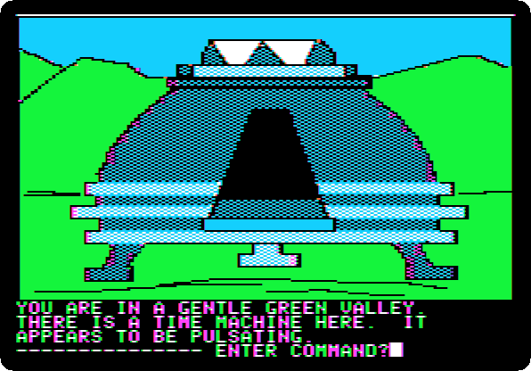

**Type `SOUTH`**

**Type `GO MACHINE`**

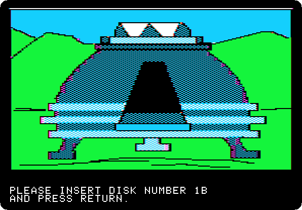 
 

*Side 1B: drop `Time Zone (4am and san inc crack) disk B.dsk` on drive 1, and press Return.*

**Type `SIT`**

 

**Type `NA`**

 

**Type `1400AD`**

 

**Type `PULL LEVER`**

 
 
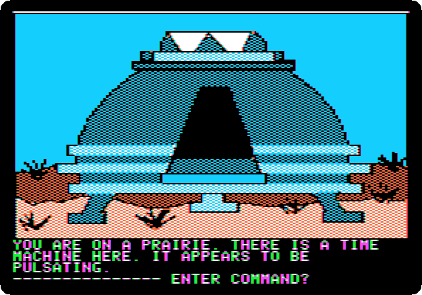

**Type `EXIT MACHINE`**

## What next

**Next:** [Time Zone: 12. North America, 1400 AD](timezone-12.md).

[Time Zone, from the start to the end](timezone.md) has the list of all the parts.
