# Time Zone: 12. North America, 1400 AD

[Activities](../README.md) › [Play](../sections/play.md) › [Time Zone, from the start to the end](timezone.md)

 
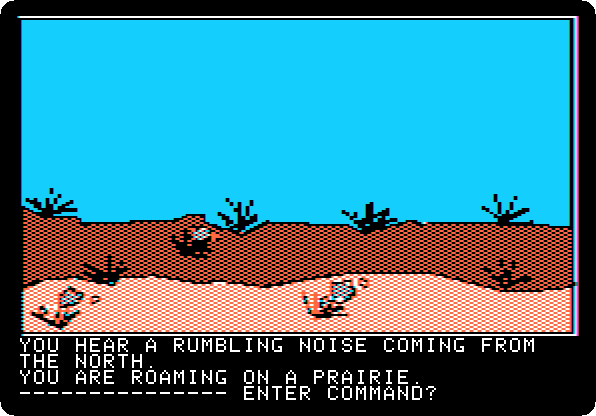

*Side 2C: drop `Time Zone (4am and san inc crack) disk C.dsk` on drive 1, and press Return.*

**Type `WEST`**

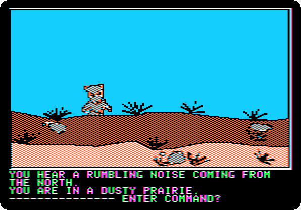

**Type `WEST`**

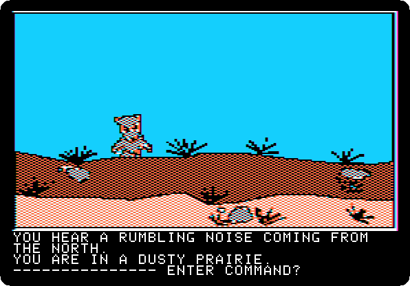

**Type `SOUTH`**

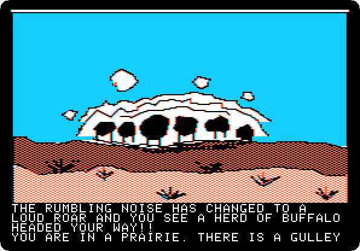 
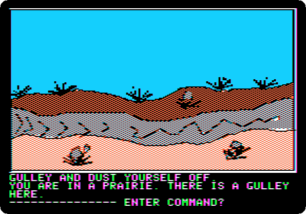

**Type `GO GULLEY`**

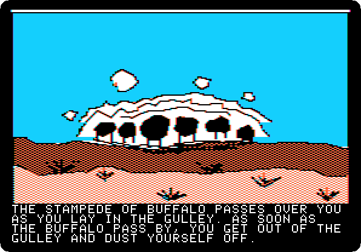 
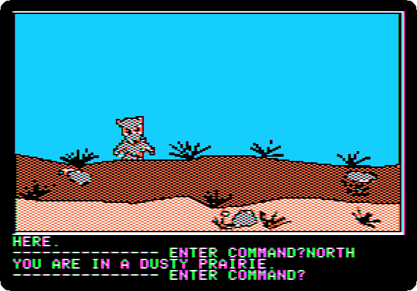

**Type `NORTH`**

**Type `EAST`**

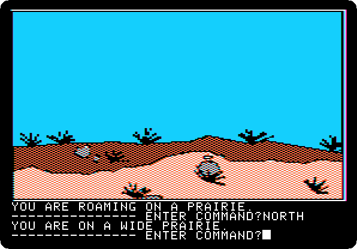

**Type `NORTH`**

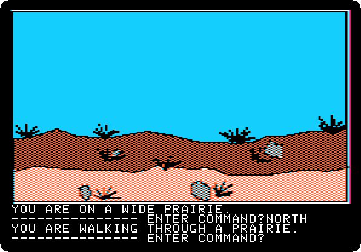

**Type `NORTH`**

**Type `NORTH`**

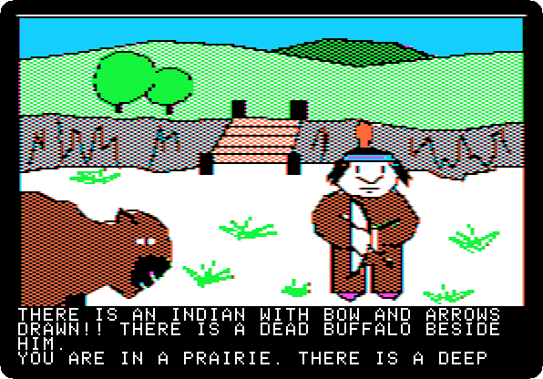 

**Type `NORTH`**

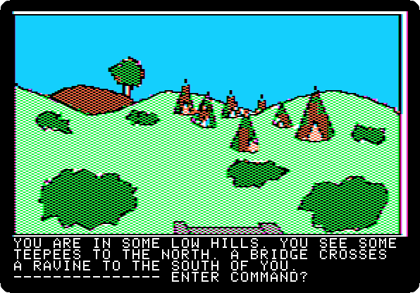

**Type `NORTH`**

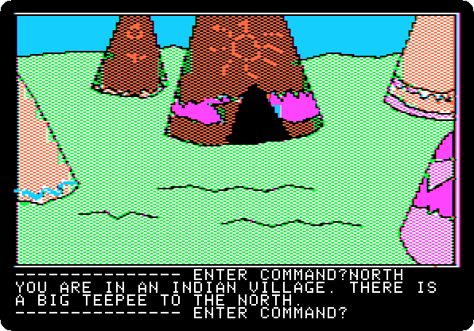

**Type `GO TEEPEE`**

**Type `TRADE COMB`**

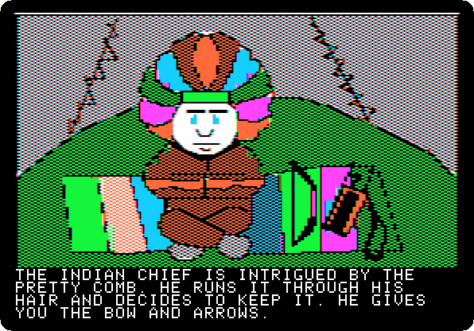 
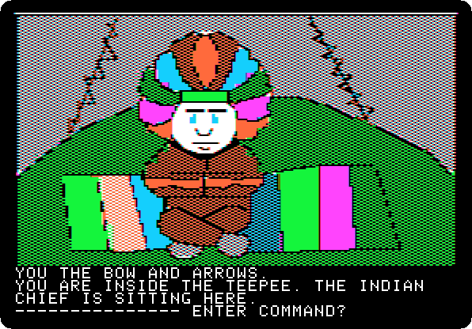

**Type `SOUTH`**

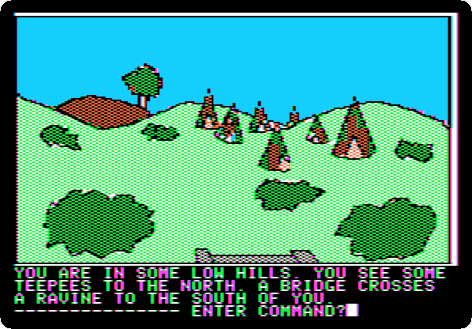

**Type `SOUTH`**

**Type `SOUTH`**

**Type `SOUTH`**

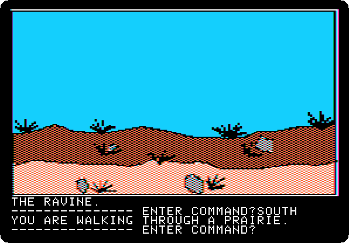

**Type `SOUTH`**

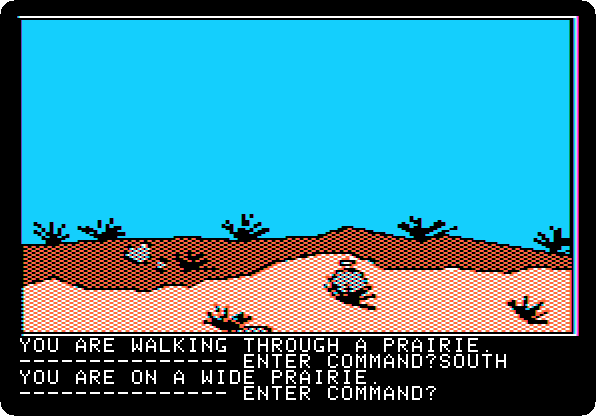

**Type `SOUTH`**

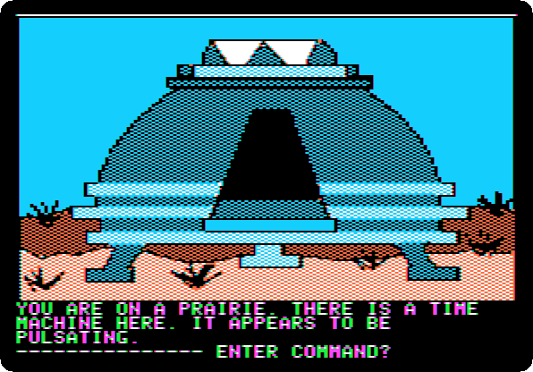

**Type `EAST`**

**Type `GO MACHINE`**

 
 

*Side 1B: drop `Time Zone (4am and san inc crack) disk B.dsk` on drive 1, and press Return.*

**Type `SIT`**

 

**Type `EUROPE`**

 

**Type `1000AD`**

 

**Type `PULL LEVER`**

 
 

**Type `EXIT MACHINE`**

## What next

**Next:** [Time Zone: 13. Europe, 1000 AD](timezone-13.md).

[Time Zone, from the start to the end](timezone.md) has the list of all the parts.
