# Time Zone: 13. Europe, 1000 AD

[Activities](../README.md) › [Play](../sections/play.md) › [Time Zone, from the start to the end](timezone.md)

 
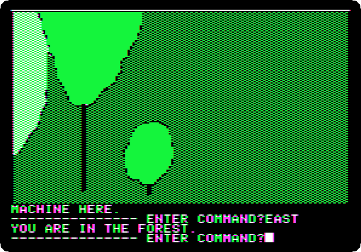

*Side 3E: drop `Time Zone (4am and san inc crack) disk E.dsk` on drive 1, and press Return.*

**Type `EAST`**

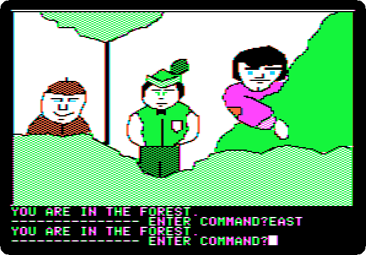

**Type `EAST`**

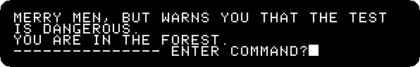

**Type `TALK ROBIN`**

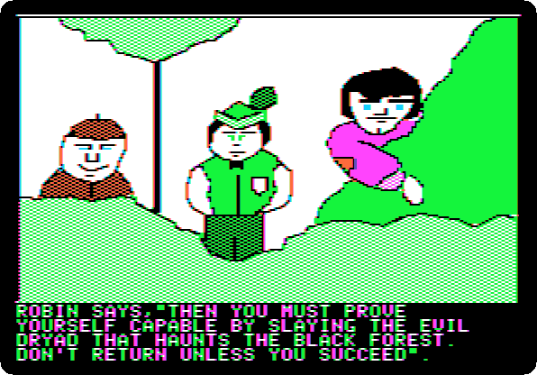 

**Type `YES`**

 
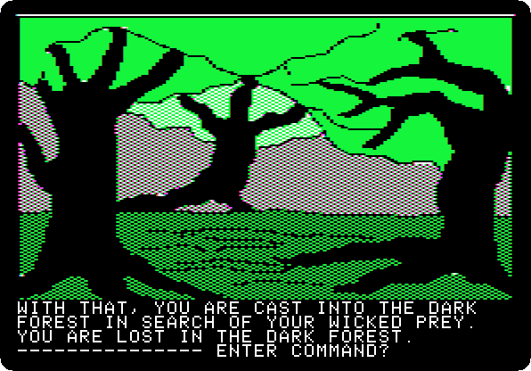

**Type `SOUTH`**

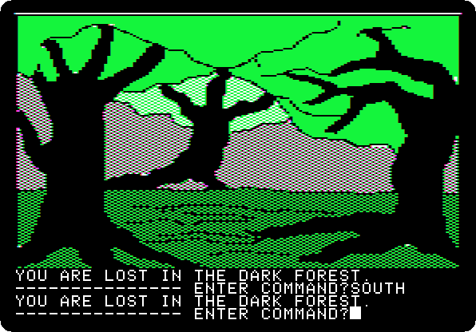

**Type `SOUTH`**

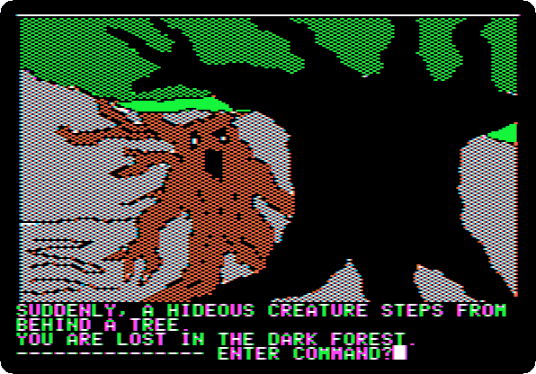

**Type `EAST`**

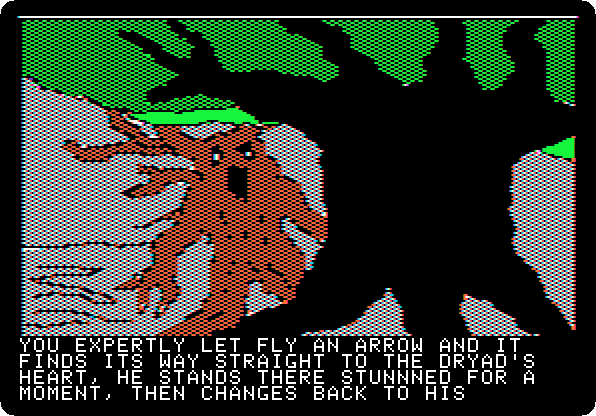 

**Type `USE BOW`**

 
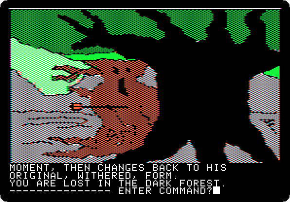

**Type `SOUTH`**

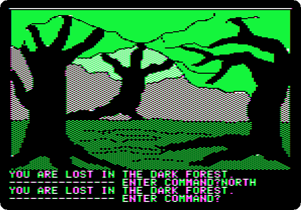

**Type `NORTH`**

**Type `SOUTH`**

**Type `WEST`**

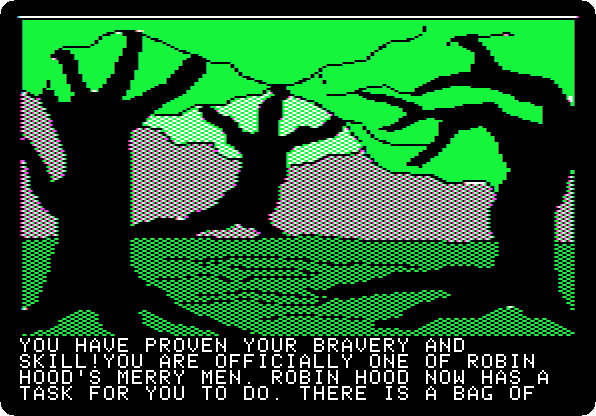 
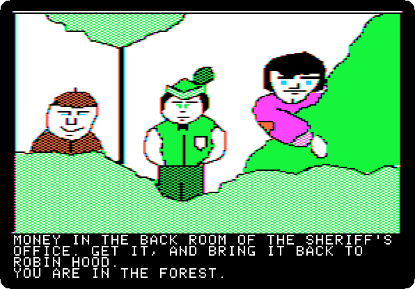 

**Type `WEST`**

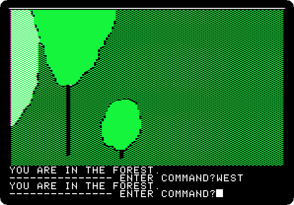

**Type `NORTH`**

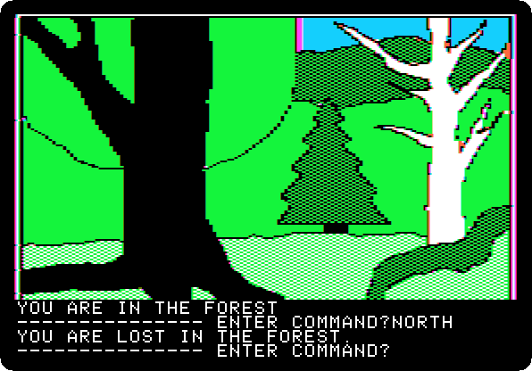

**Type `NORTH`**

**Type `NORTH`**

**Type `NORTH`**

**Type `NORTH`**

**Type `WEST`**

 

**Type `WEST`**

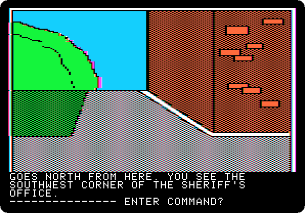

**Type `WEST`**

 

**Type `WEST`**

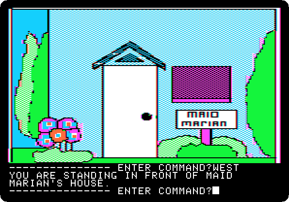

**Type `OPEN DOOR`**

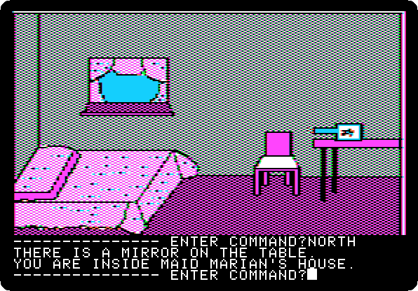

**Type `NORTH`**

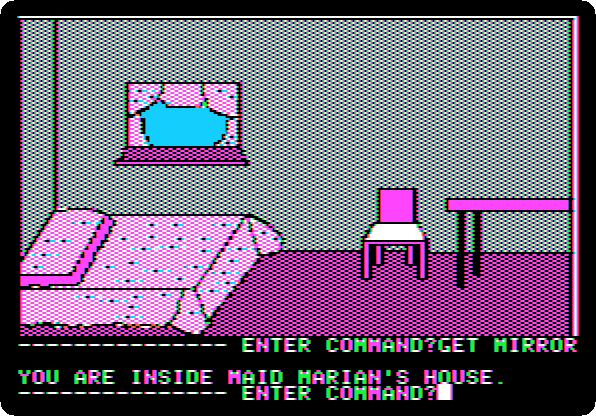

**Type `GET MIRROR`**

**Type `SOUTH`**

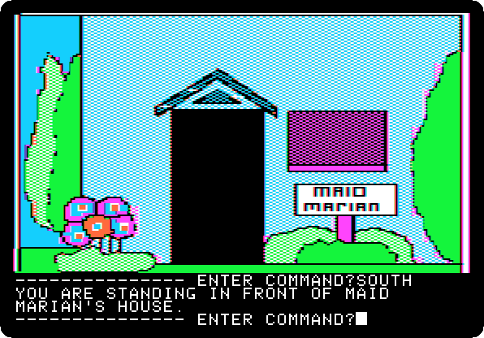

**Type `EAST`**

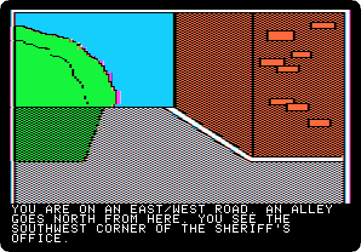 
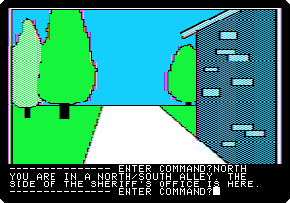

**Type `NORTH`**

**Type `NORTH`**

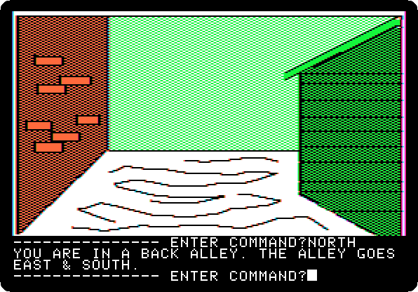

**Type `EAST`**

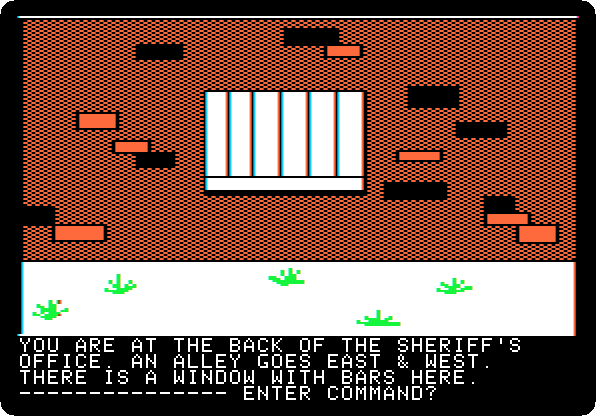

**Type `LOOK WINDOW`**

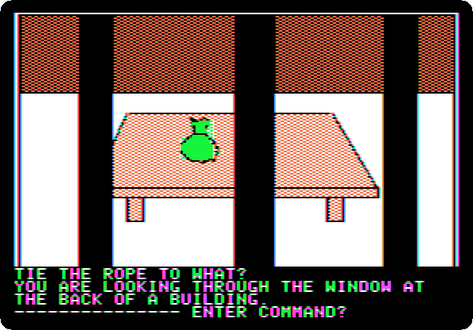

**Type `TIE ROPE`**

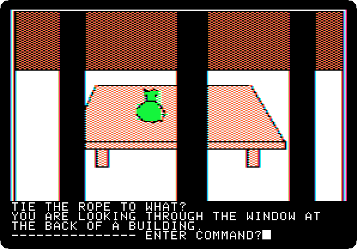

**Type `TO ARROW`**

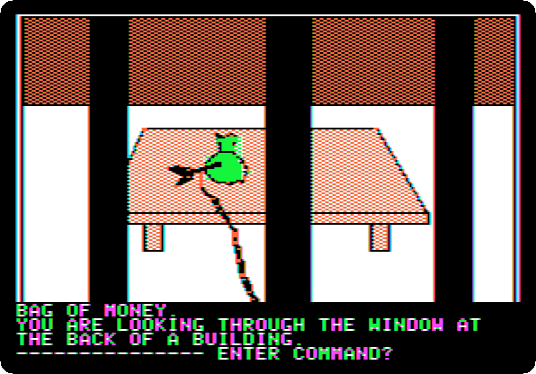

**Type `SHOOT ARROW`**

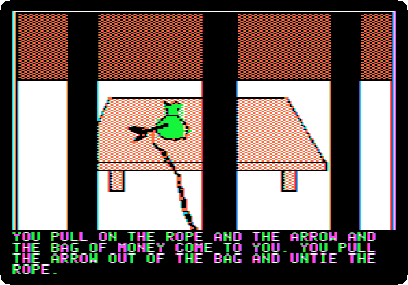 

**Type `PULL ROPE`**

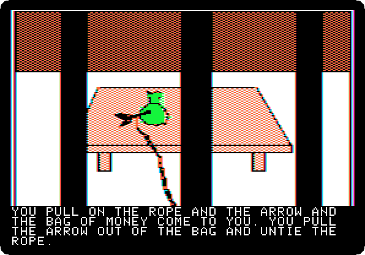 
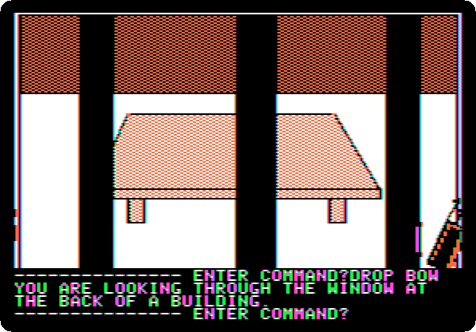

**Type `DROP BOW`**

**Type `EAST`**

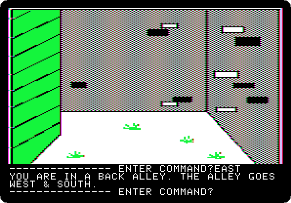

**Type `SOUTH`**

**Type `SOUTH`**

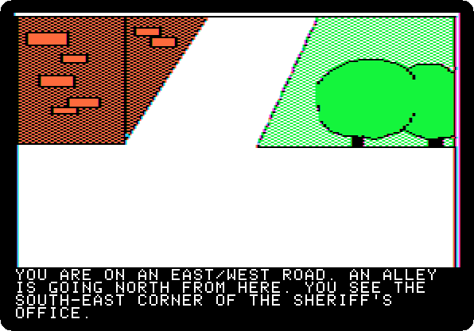 

**Type `EAST`**

**Type `SOUTH`**

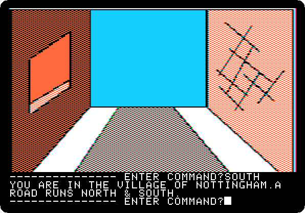

**Type `SOUTH`**

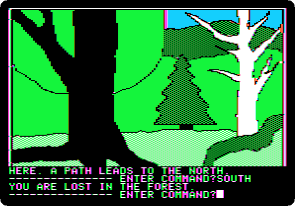

**Type `SOUTH`**

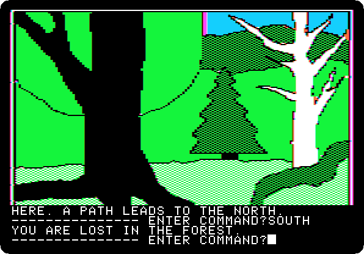

**Type `SOUTH`**

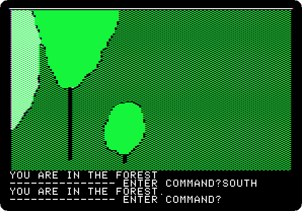

**Type `SOUTH`**

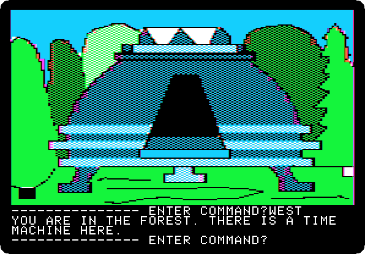

**Type `WEST`**

**Type `GO MACHINE`**

 
 

*Side 1B: drop `Time Zone (4am and san inc crack) disk B.dsk` on drive 1, and press Return.*

**Type `SIT`**

 

**Type `AUSTRALIA`**

 

**Type `PULL LEVER`**

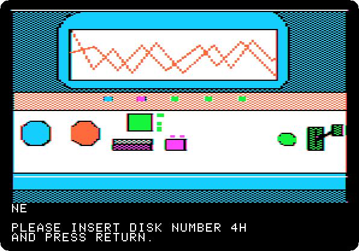 
 

**Type `EXIT MACHINE`**

## What next

**Next:** [Time Zone: 14. Australia, 1000 AD](timezone-14.md).

[Time Zone, from the start to the end](timezone.md) has the list of all the parts.
