# Time Zone: 15. Europe, 1000 AD, again

[Activities](../README.md) › [Play](../sections/play.md) › [Time Zone, from the start to the end](timezone.md)

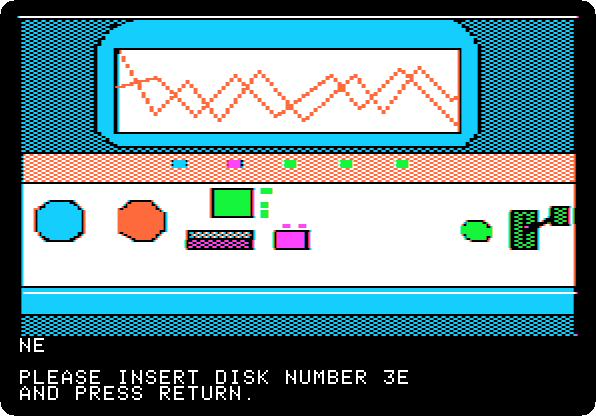 
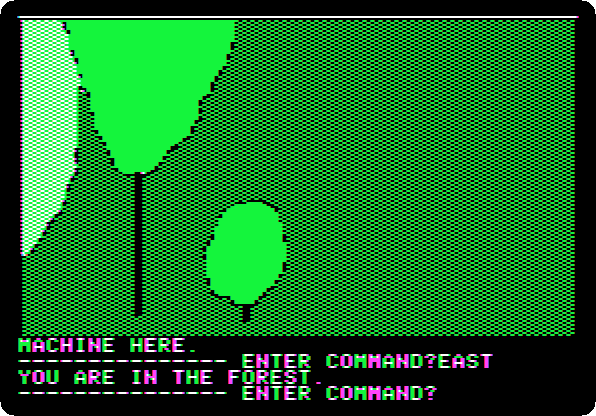

*Side 3E: drop `Time Zone (4am and san inc crack) disk E.dsk` on drive 1, and press Return.*

**Type `EAST`**

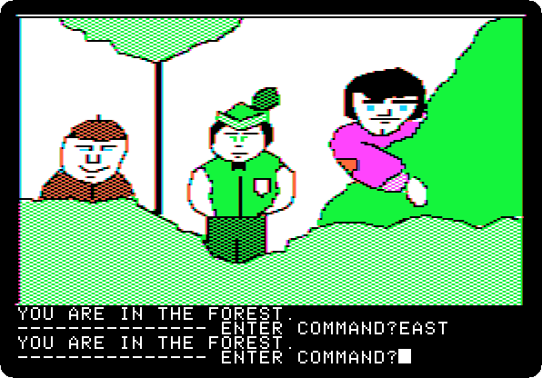

**Type `EAST`**

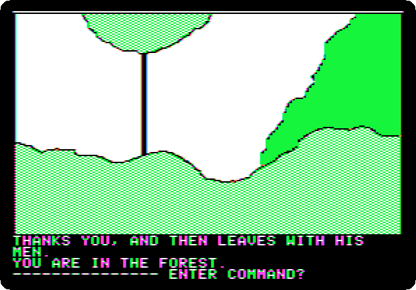

**Type `GIVE MONEY`**

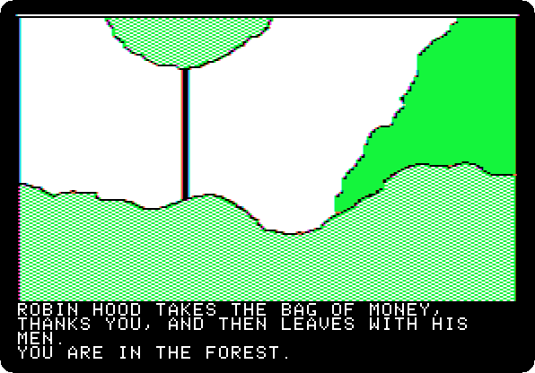 

**Type `WEST`**

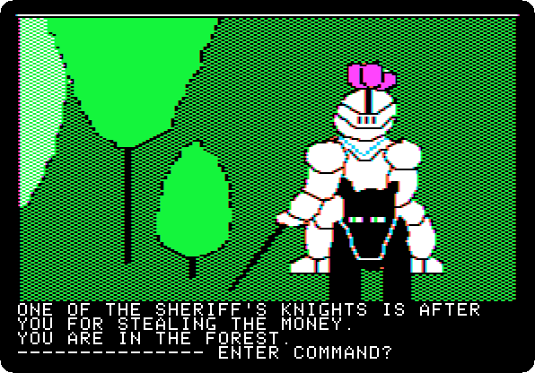

**Type `THROW BOOMERANG`**

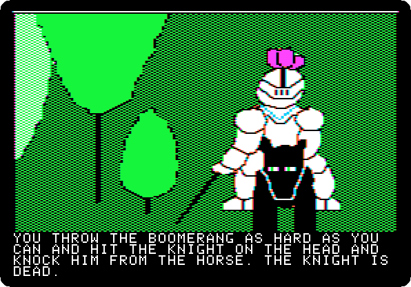 

**Type `GET LANCE`**

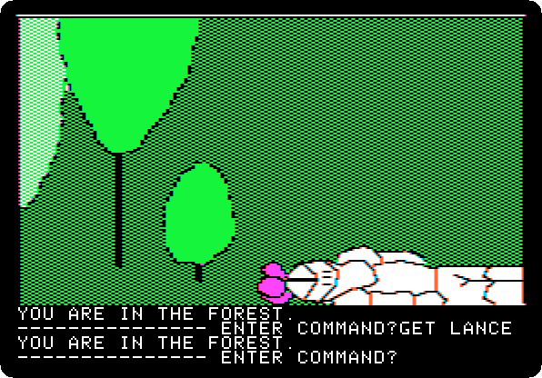

**Type `WEST`**

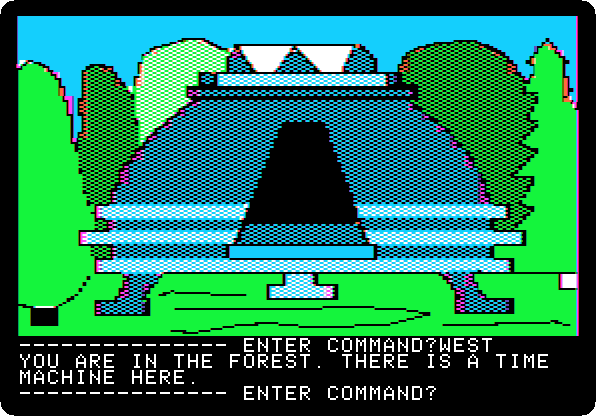

**Type `GO MACHINE`**

 
 

*Side 1B: drop `Time Zone (4am and san inc crack) disk B.dsk` on drive 1, and press Return.*

**Type `SIT`**

 

**Type `AFRICA`**

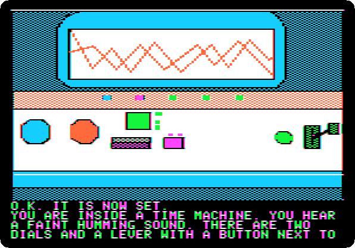 

**Type `50BC`**

 

**Type `PULL LEVER`**

 
 
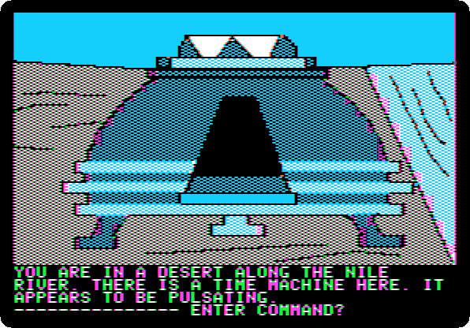

**Type `EXIT MACHINE`**

## What next

**Next:** [Time Zone: 16. Africa, 50 BC](timezone-16.md).

[Time Zone, from the start to the end](timezone.md) has the list of all the parts.
