# Time Zone: 16. Africa, 50 BC

[Activities](../README.md) › [Play](../sections/play.md) › [Time Zone, from the start to the end](timezone.md)

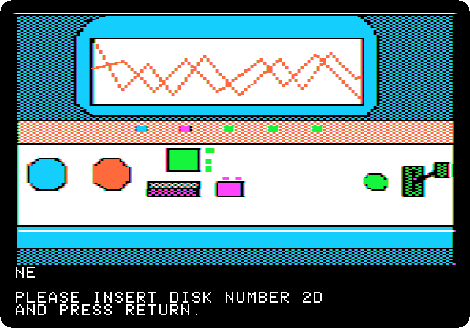 
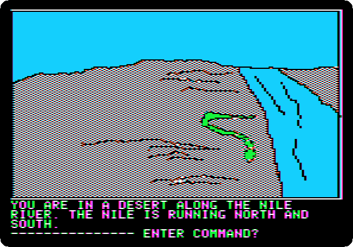

*Side 2D: drop `Time Zone (4am and san inc crack) disk D.dsk` on drive 1, and press Return.*

**Type `SOUTH`**

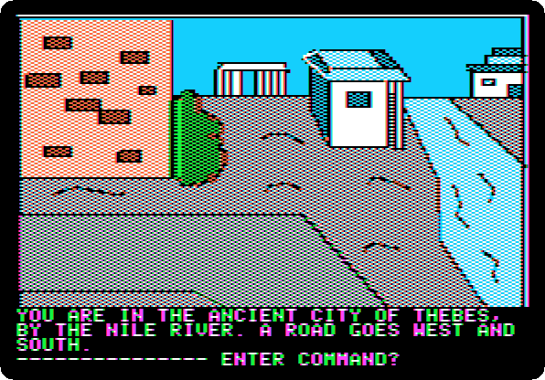

**Type `SOUTH`**

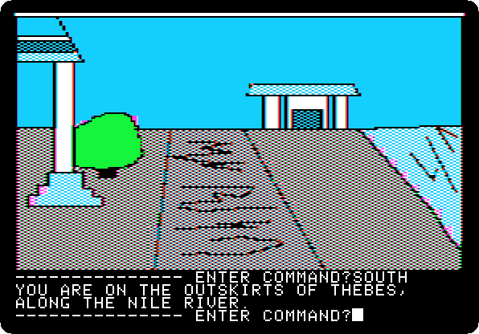

**Type `SOUTH`**

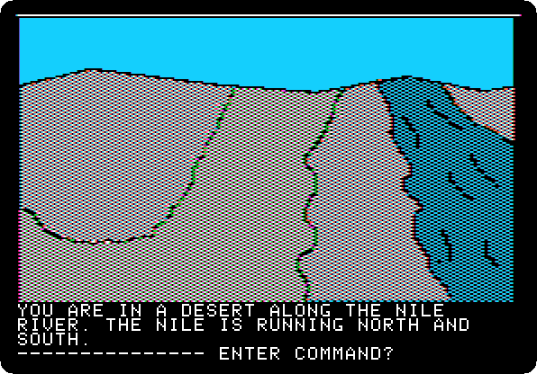

**Type `SOUTH`**

**Type `WEST`**

**Type `NORTH`**

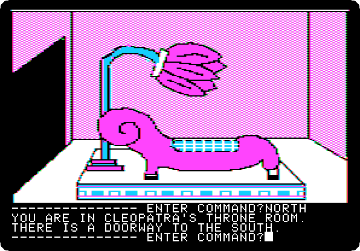

**Type `WEST`**

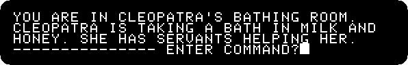

**Type `GIVE PERFUME`**

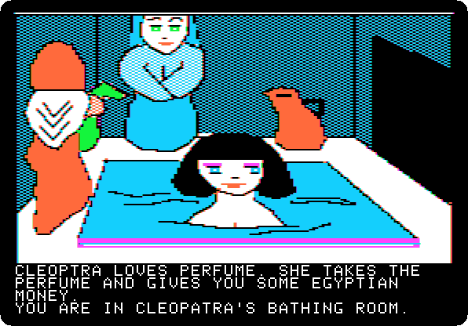 

**Type `EAST`**

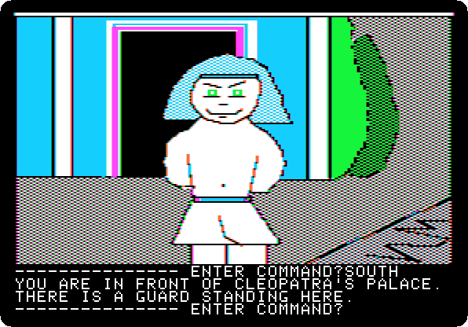

**Type `SOUTH`**

**Type `EAST`**

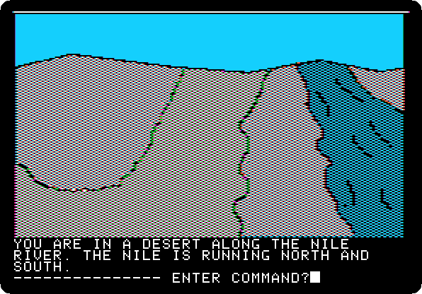

**Type `NORTH`**

**Type `NORTH`**

**Type `WEST`**

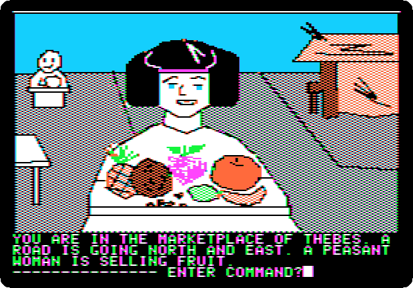

**Type `USE MONEY`**

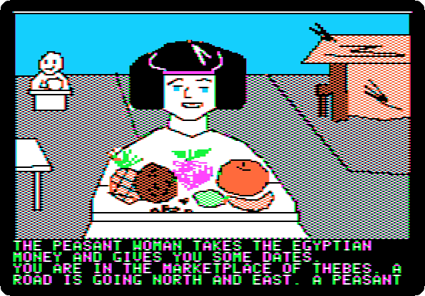 

**Type `YES`**

 
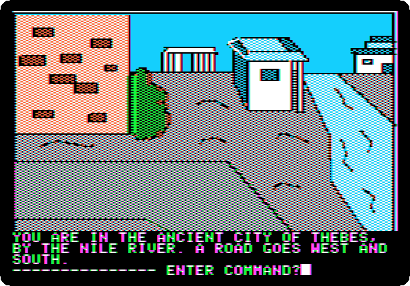

**Type `EAST`**

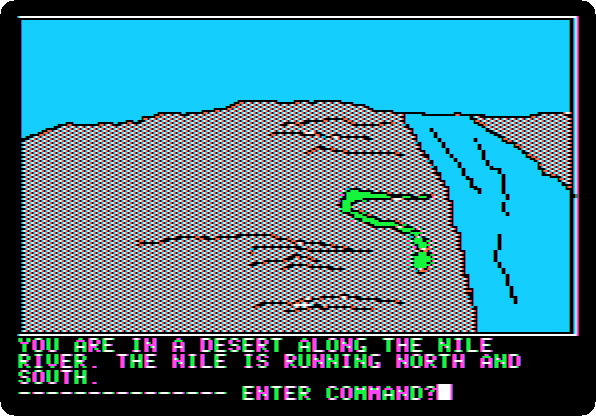

**Type `NORTH`**

**Type `NORTH`**

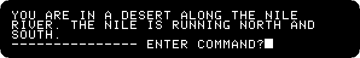

**Type `NORTH`**

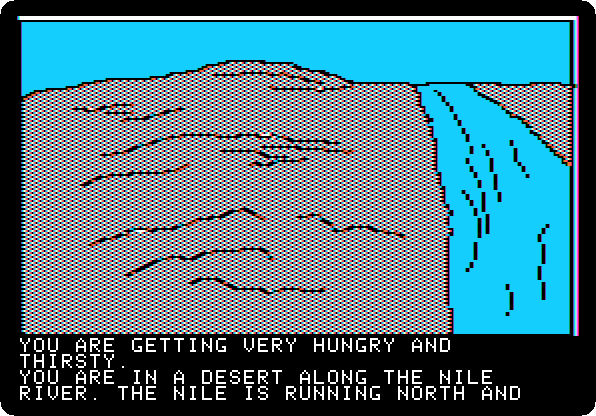 

**Type `DRINK WATER`**

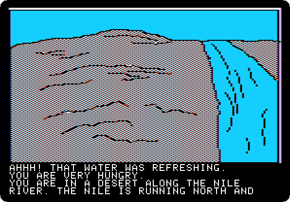 

**Type `EAT DATES`**

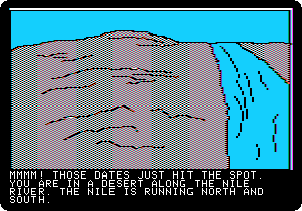 
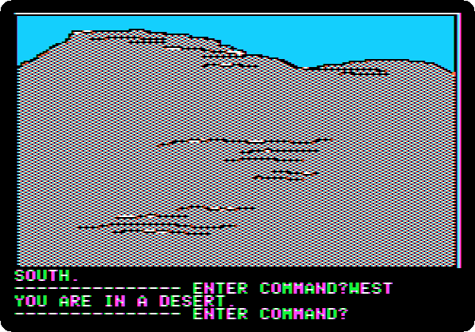

**Type `WEST`**

**Type `NORTH`**

**Type `NORTH`**

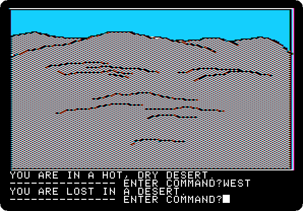

**Type `WEST`**

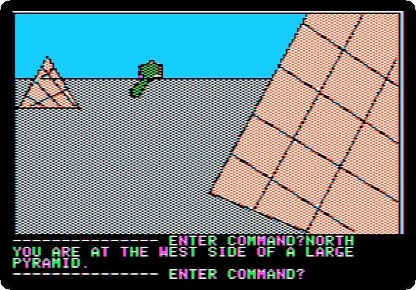

**Type `NORTH`**

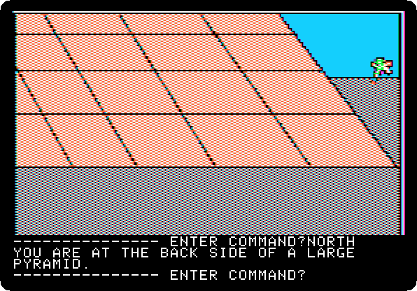

**Type `NORTH`**

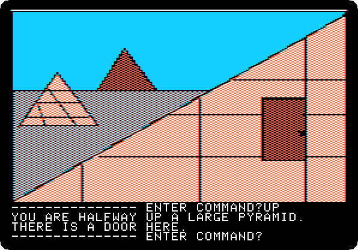

**Type `UP`**

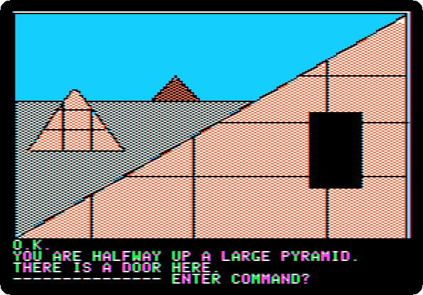

**Type `OPEN DOOR`**

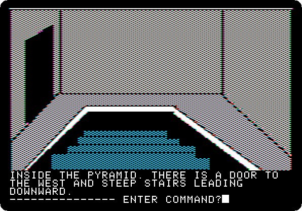

**Type `GO DOOR`**

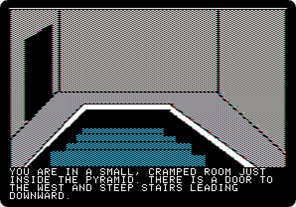 

**Type `DOWN`**

**Type `DOWN`**

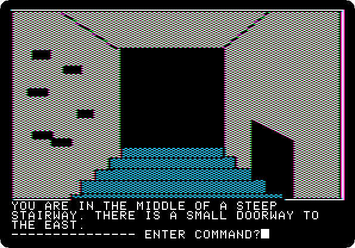

**Type `DOWN`**

**Type `MOVE STONE`**

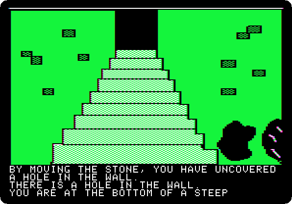 

**Type `GO HOLE`**

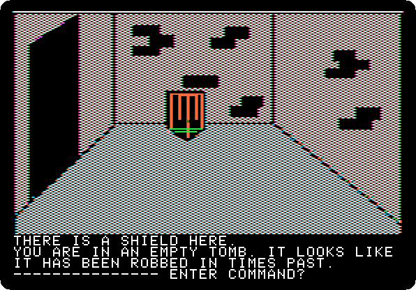

**Type `EAST`**

**Type `GET SHIELD`**

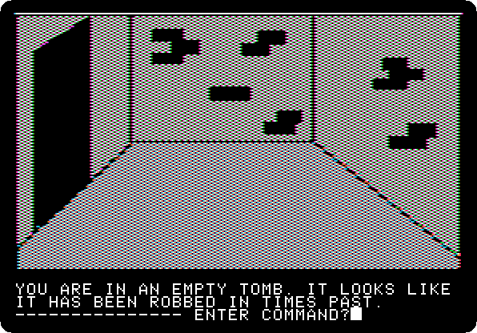

**Type `WEST`**

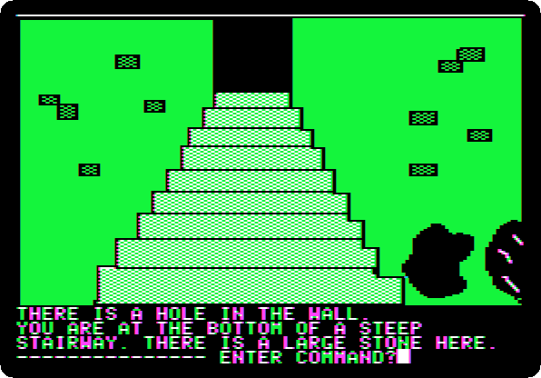

**Type `GO HOLE`**

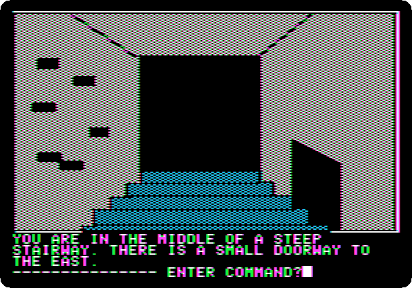

**Type `UP`**

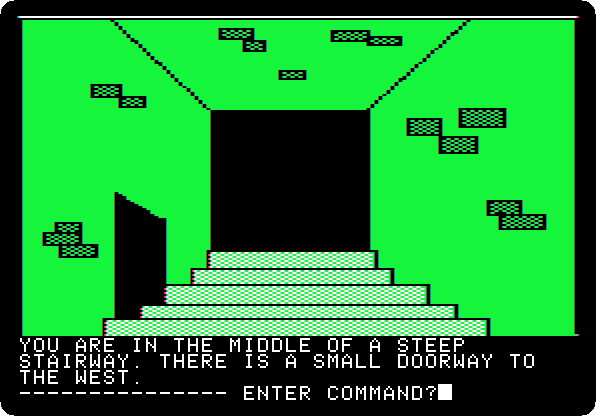

**Type `UP`**

**Type `UP`**

 

**Type `GO DOOR`**

**Type `DOWN`**

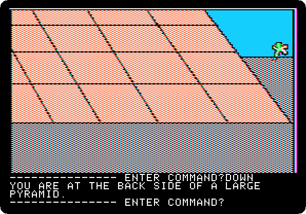

**Type `SOUTH`**

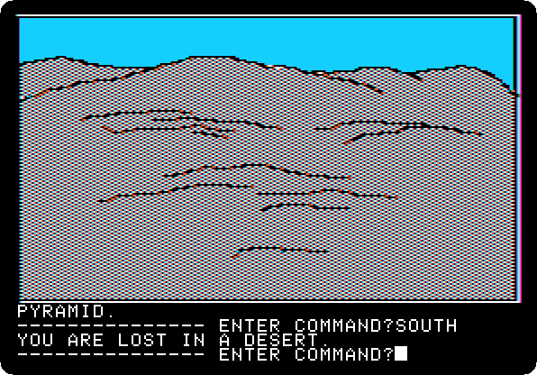

**Type `SOUTH`**

**Type `EAST`**

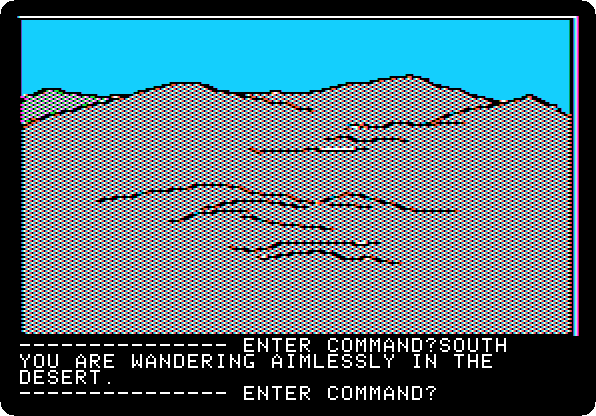

**Type `SOUTH`**

**Type `SOUTH`**

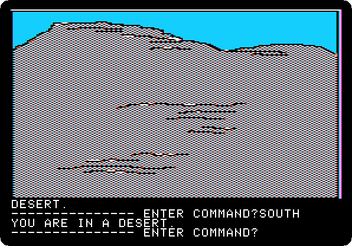

**Type `EAST`**

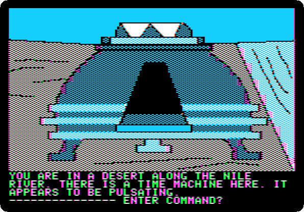

**Type `SOUTH`**

**Type `GO MACHINE`**

 
 

*Side 1B: drop `Time Zone (4am and san inc crack) disk B.dsk` on drive 1, and press Return.*

**Type `SIT`**

 

**Type `ASIA`**

 

**Type `1400AD`**

 

**Type `PULL LEVER`**

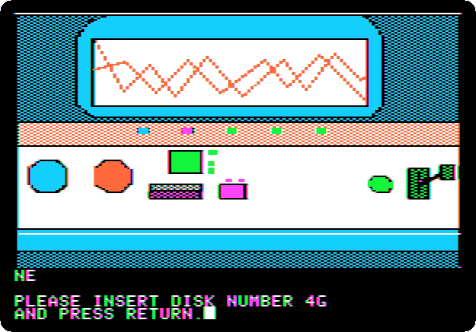 
 

**Type `EXIT MACHINE`**

## What next

**Next:** [Time Zone: 17. Asia, 1400 AD](timezone-17.md).

[Time Zone, from the start to the end](timezone.md) has the list of all the parts.
