# Time Zone: 18. Europe, 50 BC

[Activities](../README.md) › [Play](../sections/play.md) › [Time Zone, from the start to the end](timezone.md)

 
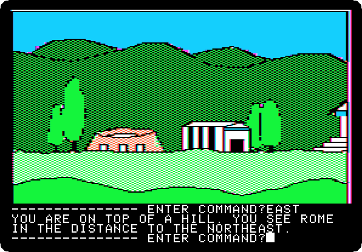

*Side 2C: drop `Time Zone (4am and san inc crack) disk C.dsk` on drive 1, and press Return.*

**Type `EAST`**

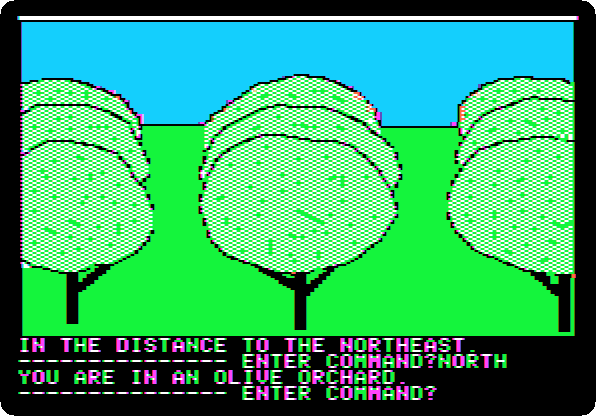

**Type `NORTH`**

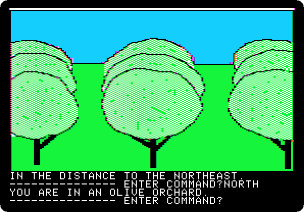

**Type `NORTH`**

**Type `EAST`**

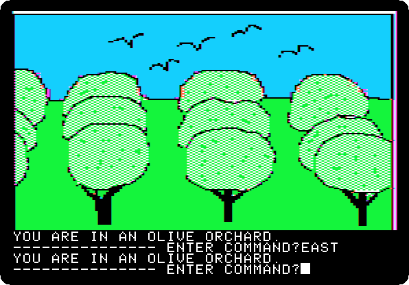

**Type `NORTH`**

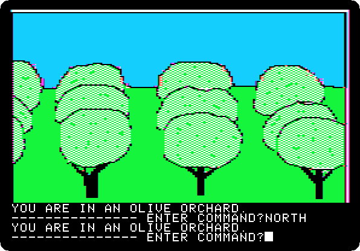

**Type `NORTH`**

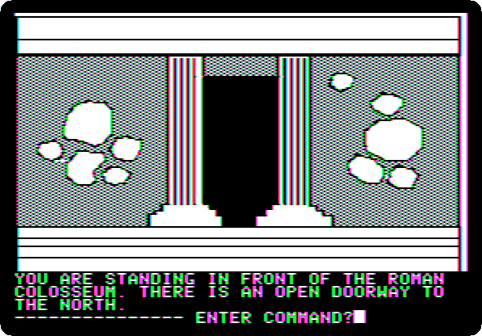

**Type `NORTH`**

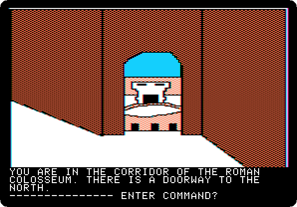

**Type `NORTH`**

**Type `WEST`**

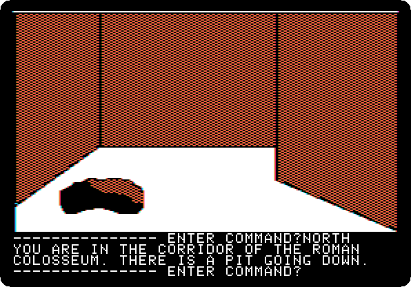

**Type `NORTH`**

**Type `DOWN`**

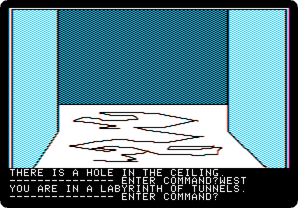

**Type `WEST`**

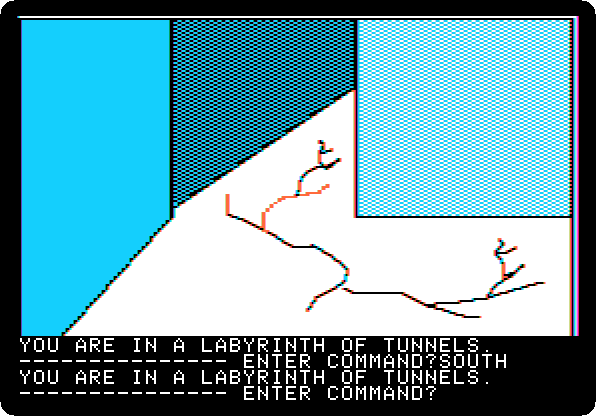

**Type `SOUTH`**

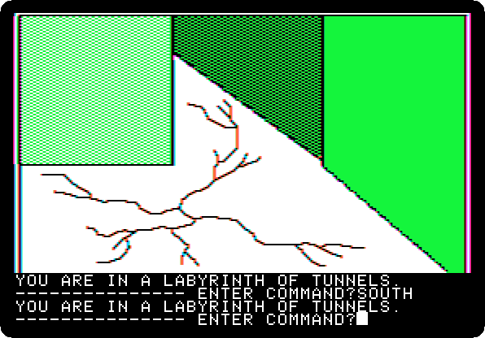

**Type `SOUTH`**

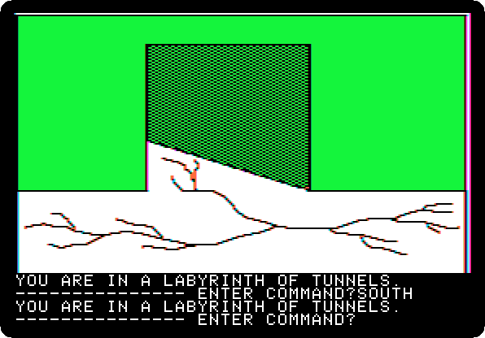

**Type `SOUTH`**

**Type `EAST`**

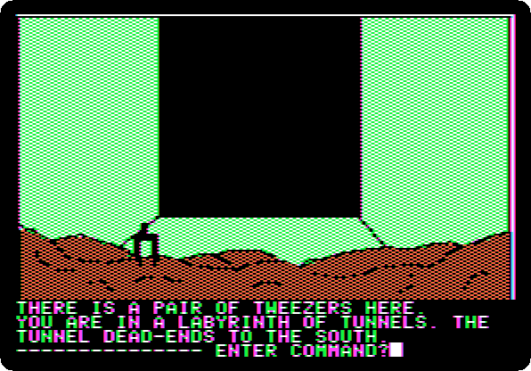

**Type `SOUTH`**

**Type `GET TWEEZERS`**

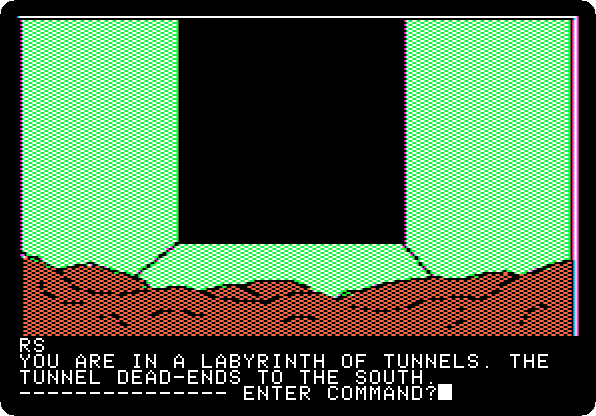

**Type `NORTH`**

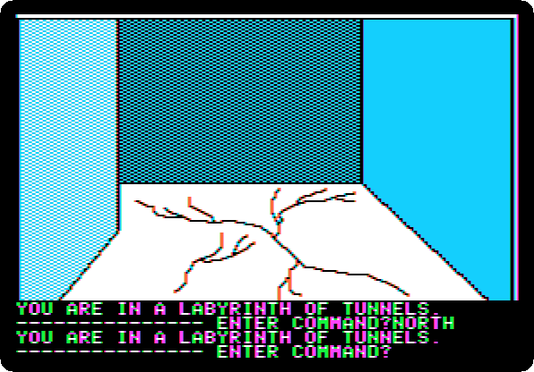

**Type `NORTH`**

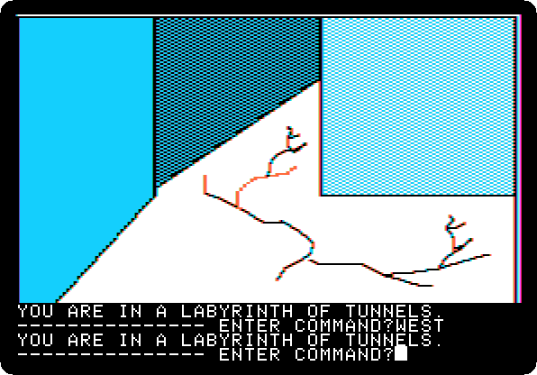

**Type `WEST`**

**Type `NORTH`**

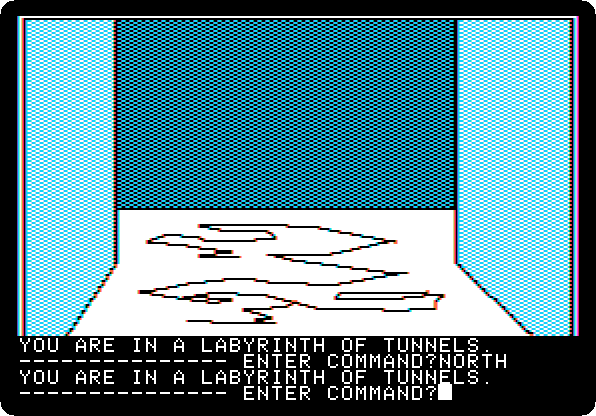

**Type `EAST`**

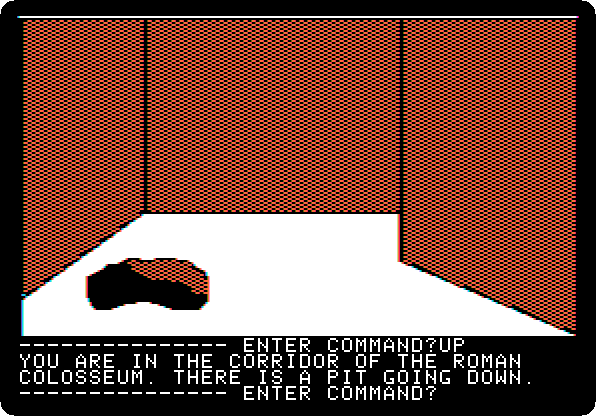

**Type `UP`**

**Type `EAST`**

**Type `LOOK`**

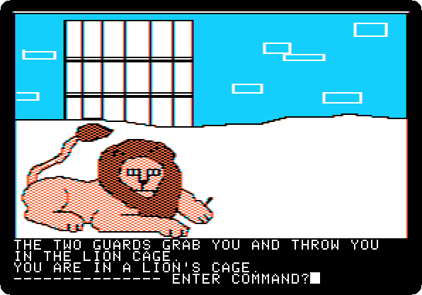

**Type `USE TWEEZERS`**

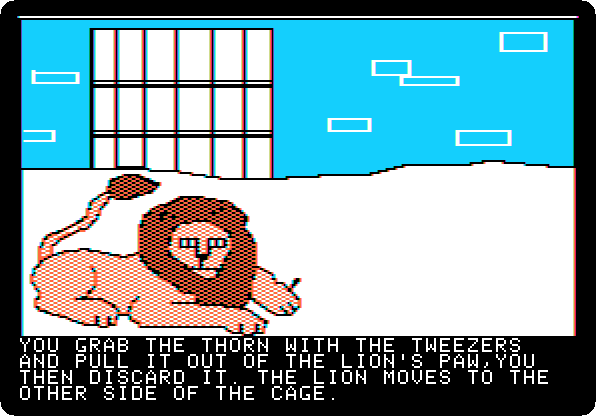 
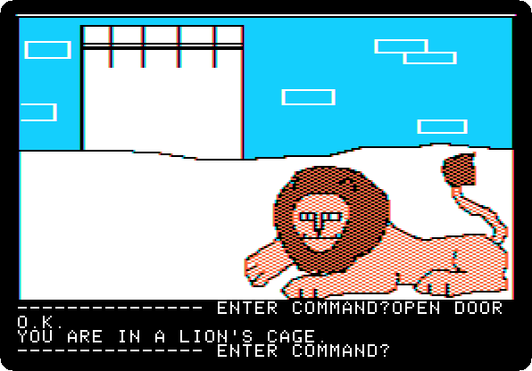

**Type `OPEN DOOR`**

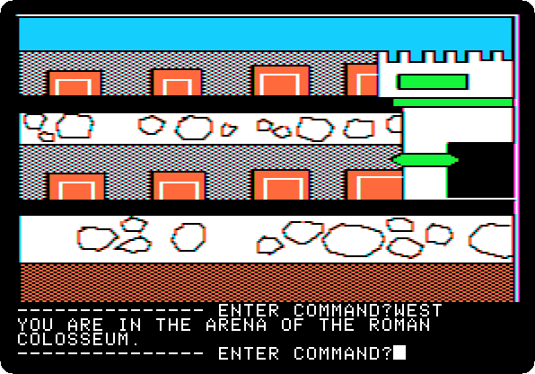

**Type `WEST`**

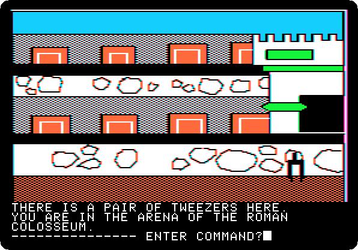

**Type `DROP TWEEZERS`**

**Type `SOUTH`**

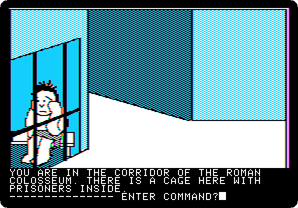

**Type `WEST`**

**Type `NORTH`**

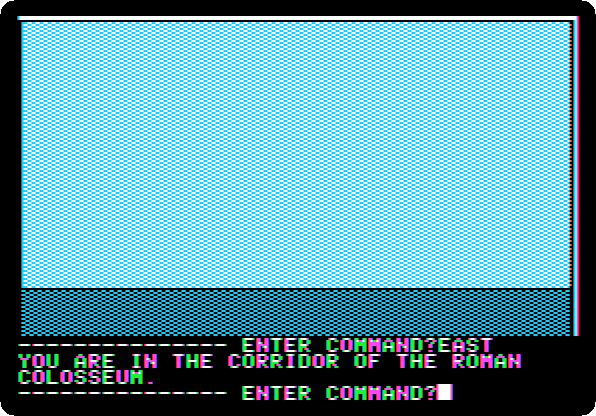

**Type `EAST`**

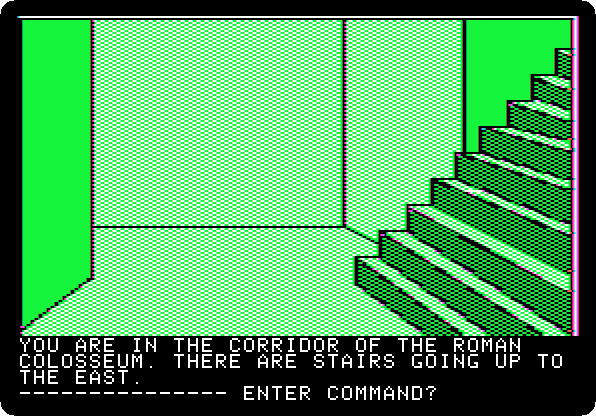

**Type `EAST`**

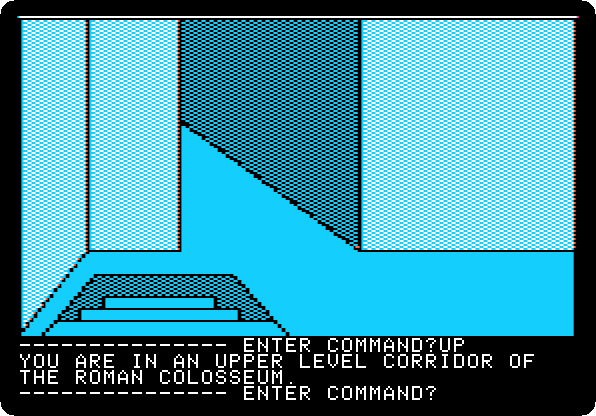

**Type `UP`**

**Type `EAST`**

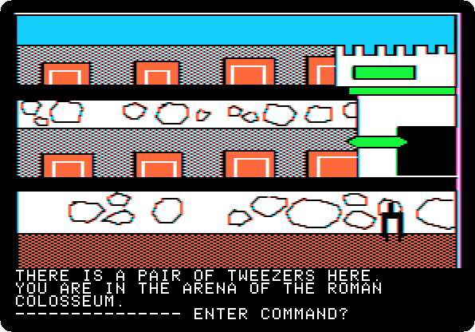

**Type `LOOK`**

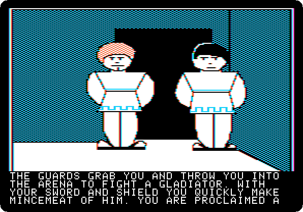 
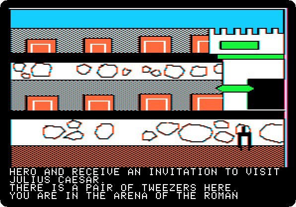 

**Type `SOUTH`**

**Type `SOUTH`**

**Type `EAST`**

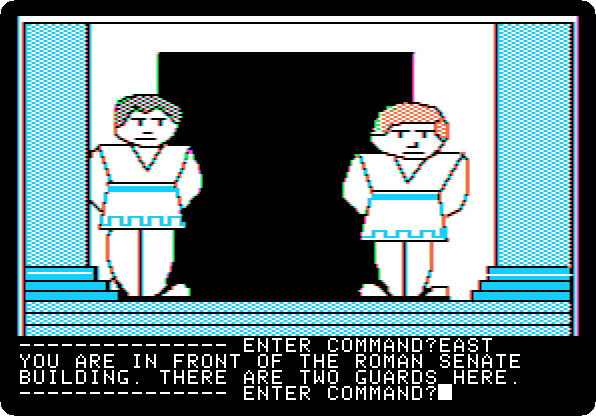

**Type `NORTH`**

**Type `WEST`**

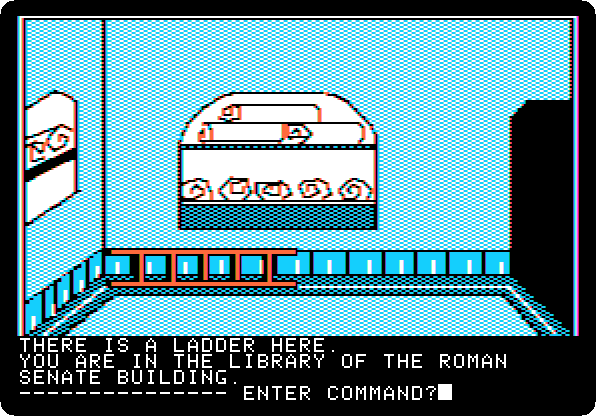

**Type `GET LADDER`**

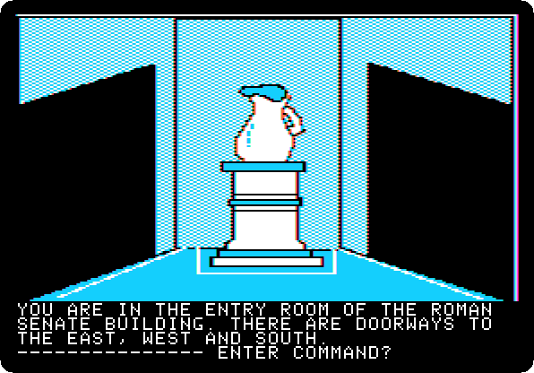

**Type `EAST`**

**Type `SOUTH`**

**Type `WEST`**

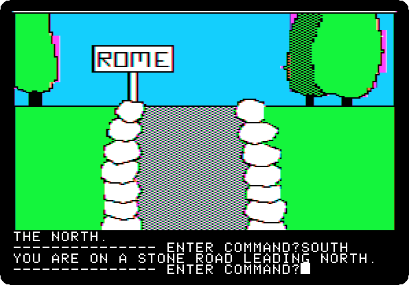

**Type `SOUTH`**

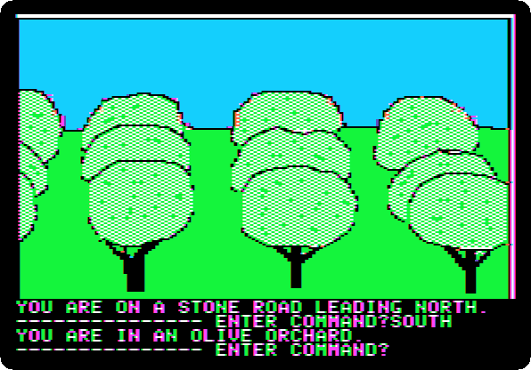

**Type `SOUTH`**

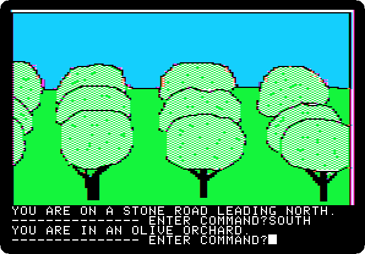

**Type `SOUTH`**

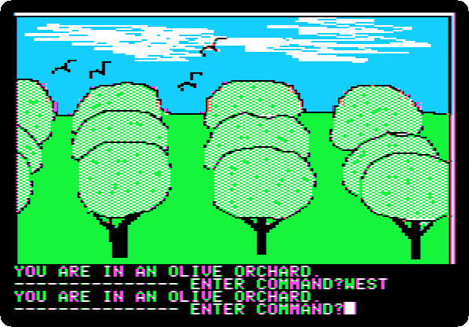

**Type `WEST`**

**Type `SOUTH`**

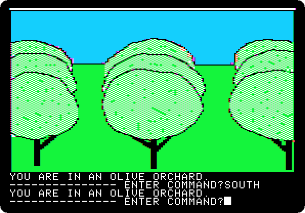

**Type `SOUTH`**

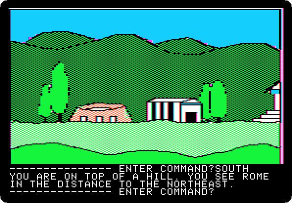

**Type `WEST`**

**Type `GO MACHINE`**

 
 

*Side 1B: drop `Time Zone (4am and san inc crack) disk B.dsk` on drive 1, and press Return.*

**Type `SIT`**

 

**Type `AFRICA`**

 

**Type `1000AD`**

 

**Type `PULL LEVER`**

 
 
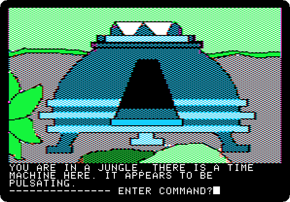

**Type `EXIT MACHINE`**

## What next

**Next:** [Time Zone: 19. Africa, 1000 AD](timezone-19.md).

[Time Zone, from the start to the end](timezone.md) has the list of all the parts.
