# Time Zone: 21. Asia, 1000 AD

[Activities](../README.md) › [Play](../sections/play.md) › [Time Zone, from the start to the end](timezone.md)

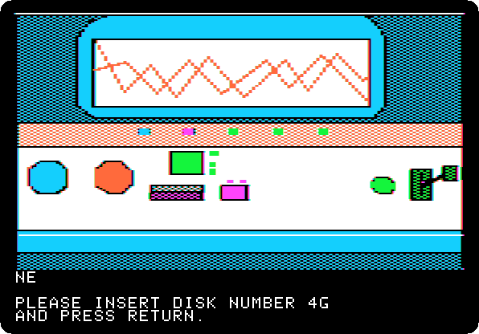 
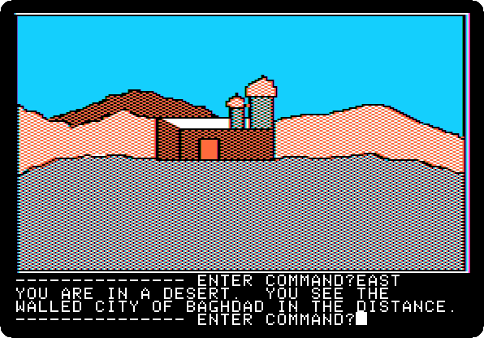

*Side 4G: drop `Time Zone (4am and san inc crack) disk G.dsk` on drive 1, and press Return.*

**Type `EAST`**

**Type `NORTH`**

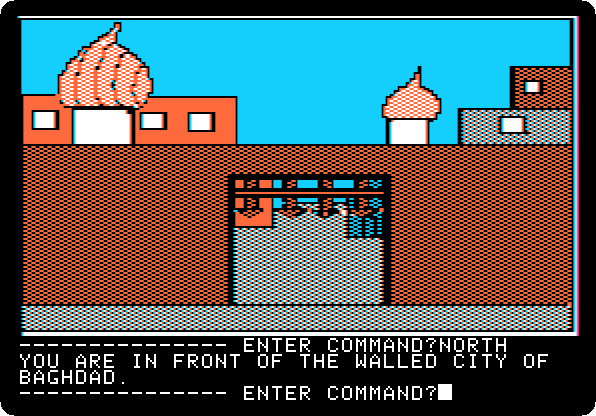

**Type `NORTH`**

**Type `EAST`**

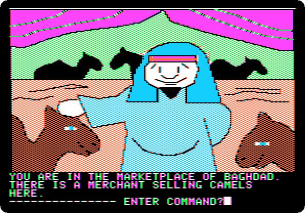

**Type `TRADE RUG`**

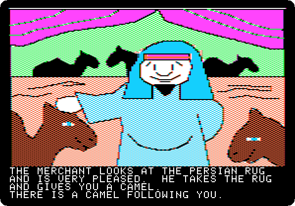 
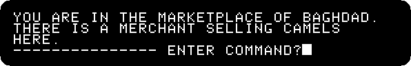

**Type `RIDE CAMEL`**

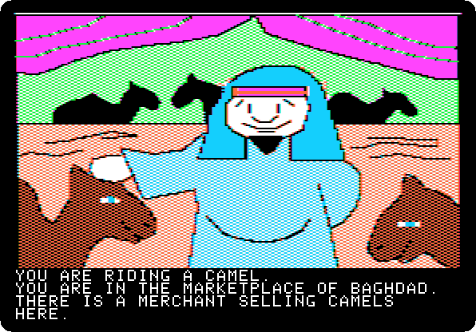 

**Type `WEST`**

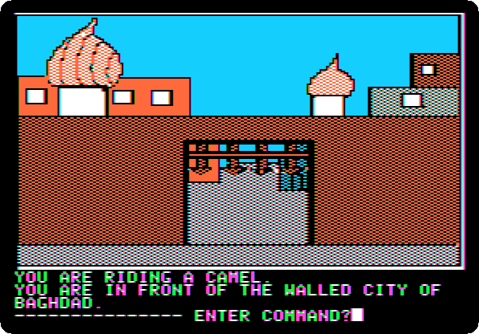

**Type `SOUTH`**

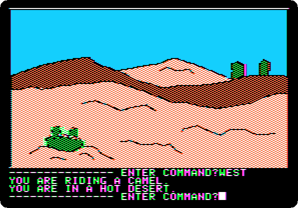

**Type `WEST`**

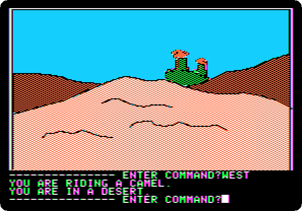

**Type `WEST`**

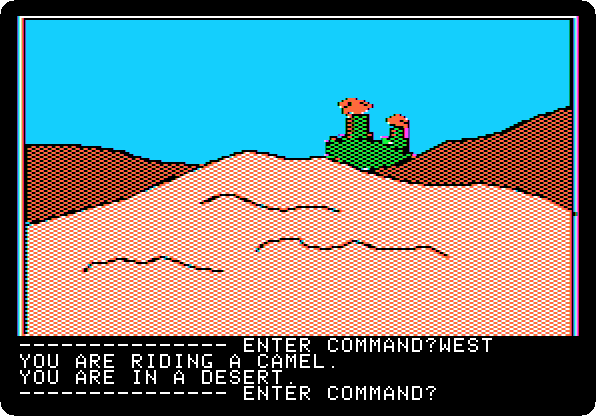

**Type `NORTH`**

**Type `NORTH`**

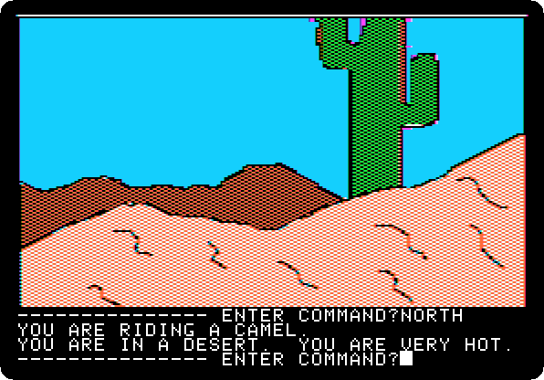

**Type `NORTH`**

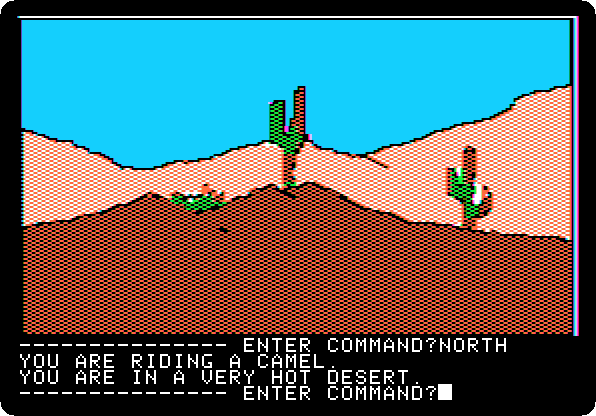

**Type `EAST`**

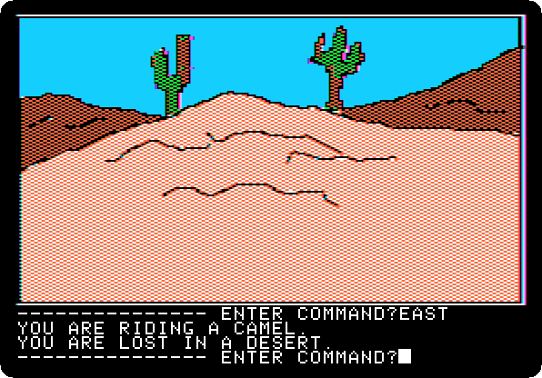

**Type `EAST`**

**Type `NORTH`**

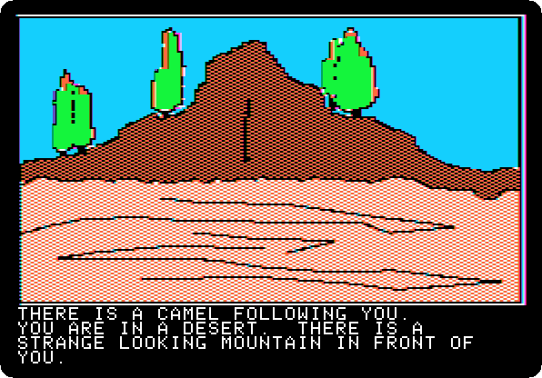 

**Type `DISMOUNT CAMEL`**

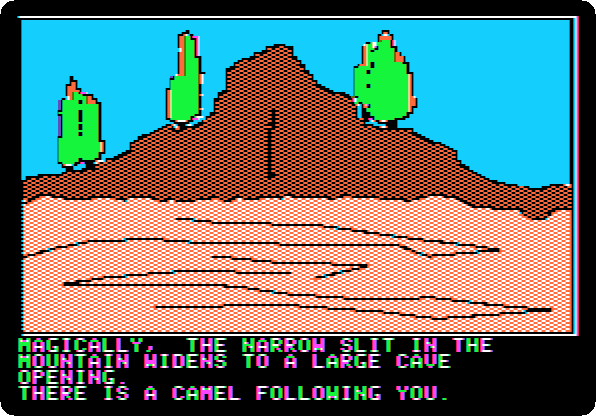 
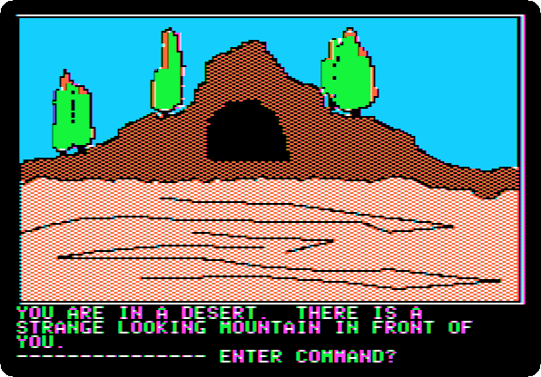

**Type `OPEN SESAME`**

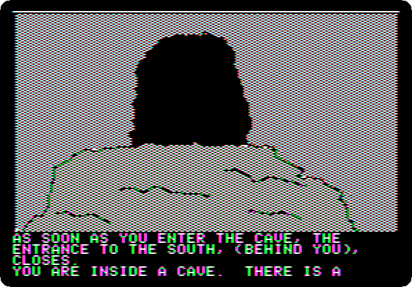 
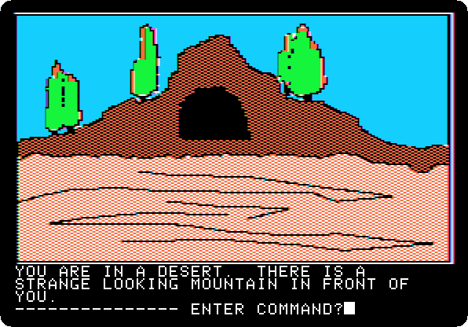

**Type `GO CAVE`**

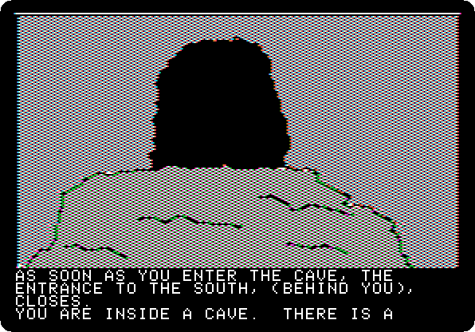 

**Type `NORTH`**

**Type `EAST`**

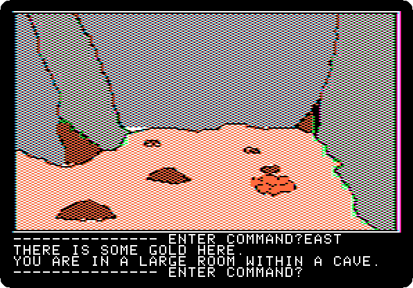

**Type `GET GOLD`**

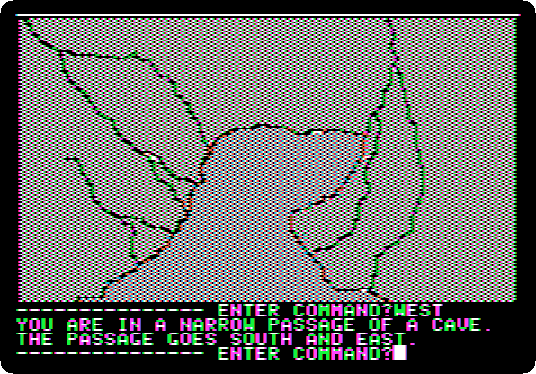

**Type `WEST`**

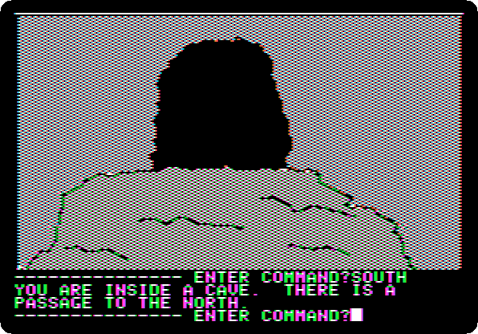

**Type `SOUTH`**

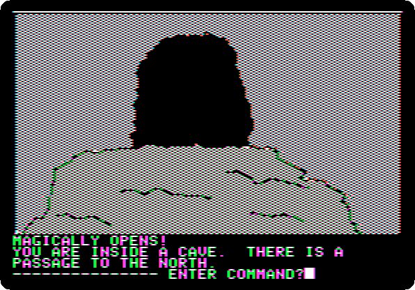

**Type `OPEN SESAME`**

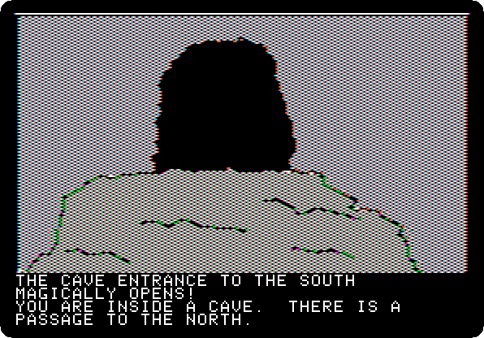 

**Type `SOUTH`**

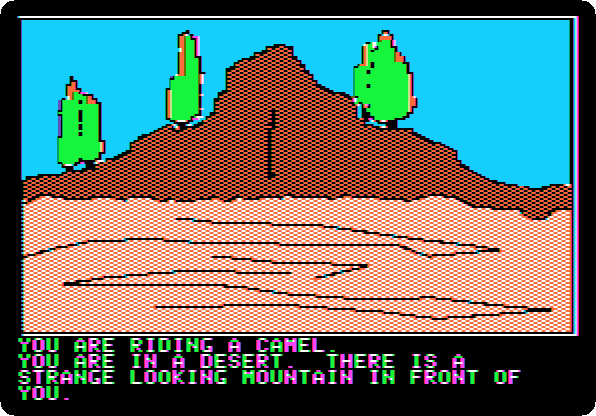 

**Type `RIDE CAMEL`**

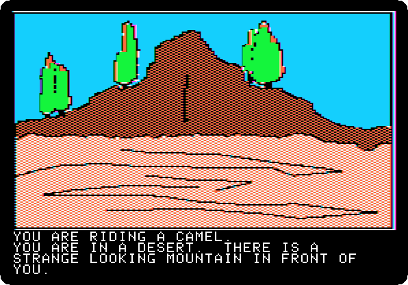 

**Type `SOUTH`**

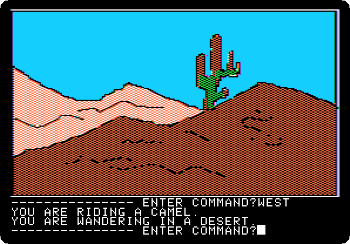

**Type `WEST`**

**Type `WEST`**

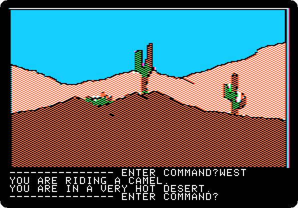

**Type `SOUTH`**

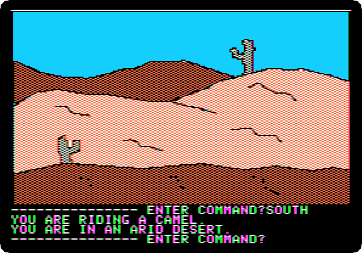

**Type `SOUTH`**

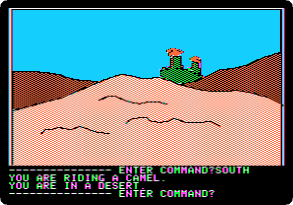

**Type `SOUTH`**

**Type `SOUTH`**

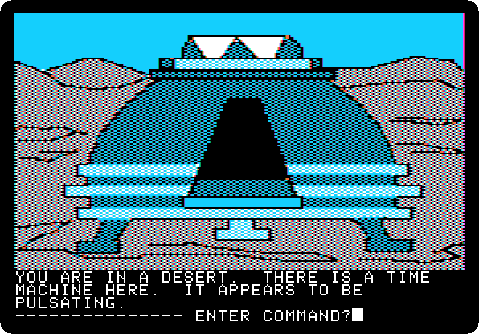

**Type `EAST`**

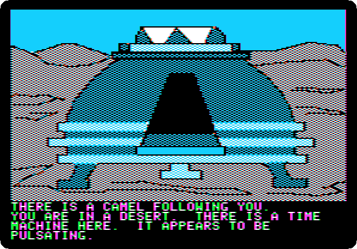 

**Type `DISMOUNT CAMEL`**

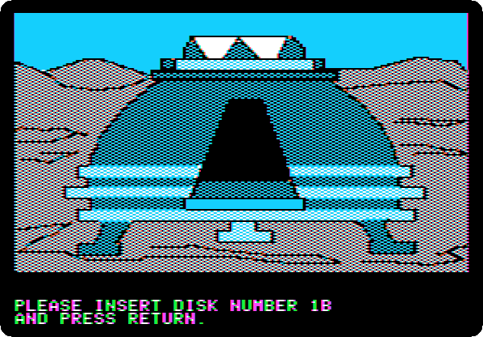 

**Type `GO MACHINE`**

 
 

*Side 1B: drop `Time Zone (4am and san inc crack) disk B.dsk` on drive 1, and press Return.*

**Type `SIT`**

 

**Type `AUSTRALIA`**

 

**Type `2082AD`**

 

**Type `PULL LEVER`**

 
 

**Type `EXIT MACHINE`**

## What next

**Next:** [Time Zone: 22. Australia, 2082 AD](timezone-22.md).

[Time Zone, from the start to the end](timezone.md) has the list of all the parts.
