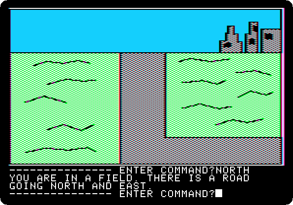
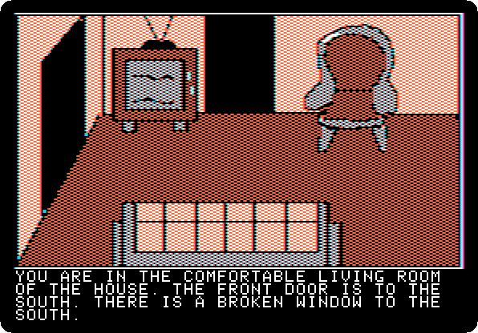
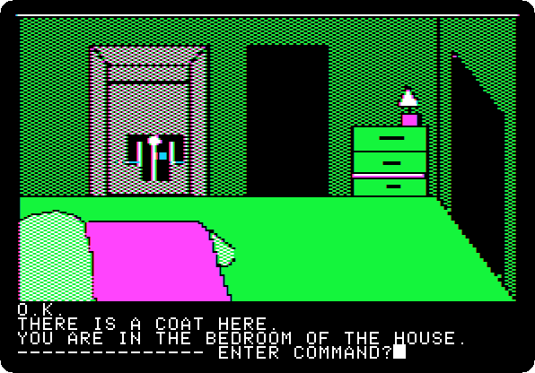
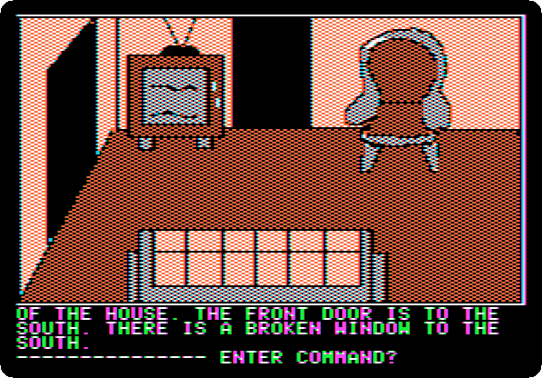
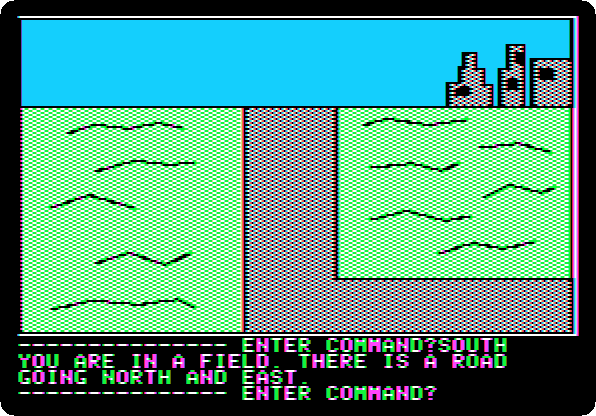
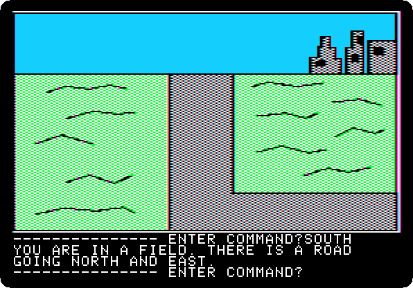
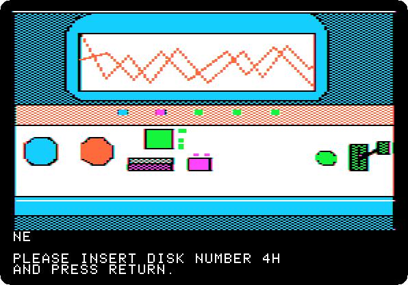
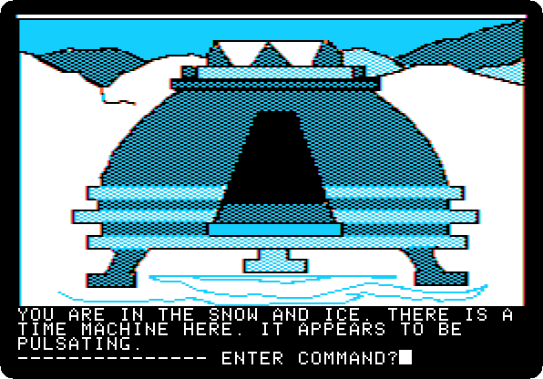

# Time Zone: 22. Australia, 2082 AD

[Activities](../README.md) › [Play](../sections/play.md) › [Time Zone, from the start to the end](timezone.md)

 

*Side 3E: drop `Time Zone (4am and san inc crack) disk E.dsk` on drive 1, and press Return.*

**Type `NORTH`**

**Type `NORTH`**

**Type `BREAK WINDOW`**

 

**Type `GO WINDOW`**

 

**Type `WEST`**

**Type `OPEN CLOSET`**

**Type `GET COAT`**

**Type `EAST`**

 

**Type `GO WINDOW`**

**Type `SOUTH`**

**Type `SOUTH`**

**Type `GO MACHINE`**

 
 

*Side 1B: drop `Time Zone (4am and san inc crack) disk B.dsk` on drive 1, and press Return.*

**Type `SIT`**

 

**Type `ASIA`**

 

**Type `1700AD`**

 

**Type `PULL LEVER`**

 
 

**Type `EXIT MACHINE`**

## What next

**Next:** [Time Zone: 23. Asia, 1700 AD](timezone-23.md).

[Time Zone, from the start to the end](timezone.md) has the list of all the parts.
