# Time Zone: 23. Asia, 1700 AD

[Activities](../README.md) › [Play](../sections/play.md) › [Time Zone, from the start to the end](timezone.md)

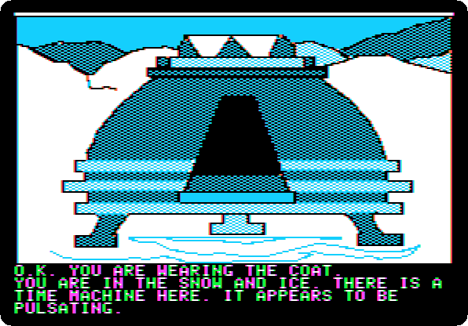 

*Side 4H: drop `Time Zone (4am and san inc crack) disk H.dsk` on drive 1, and press Return.*

**Type `WEAR COAT`**

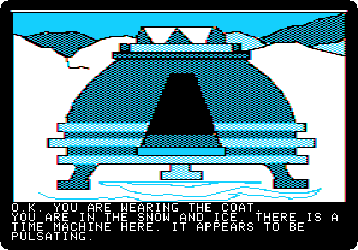 
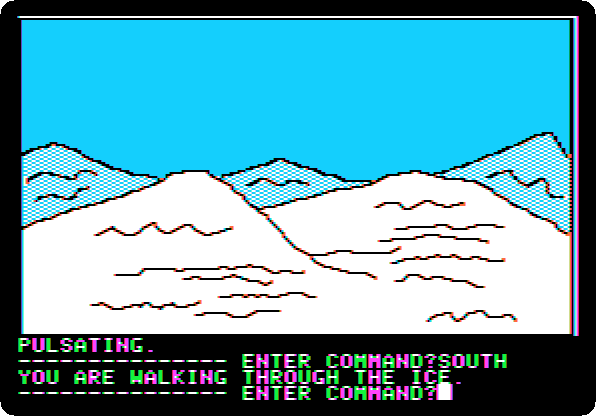

**Type `SOUTH`**

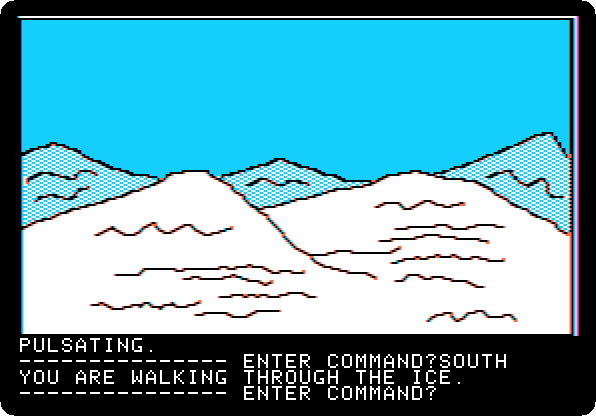

**Type `SOUTH`**

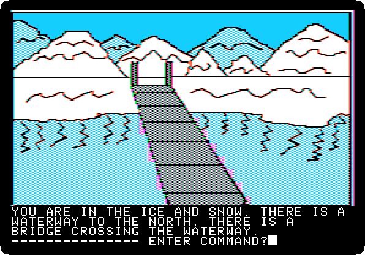

**Type `SOUTH`**

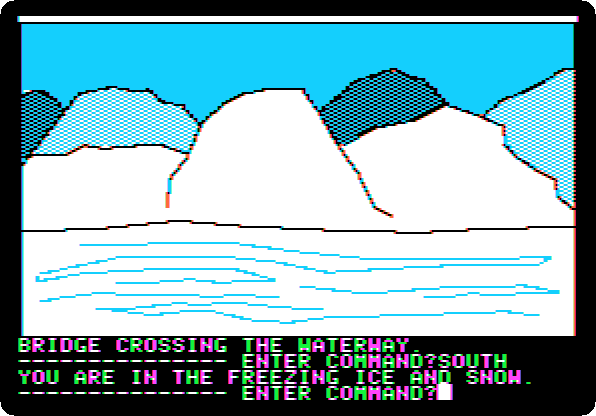

**Type `SOUTH`**

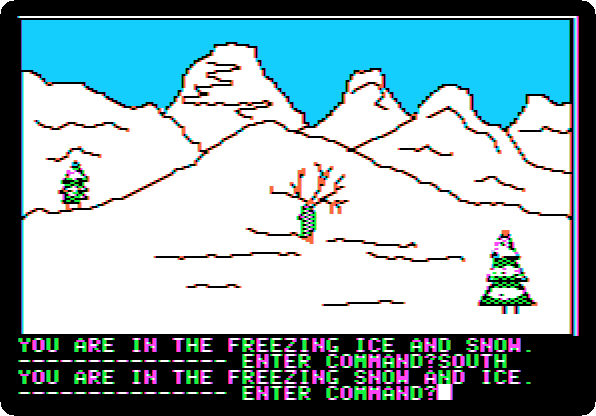

**Type `SOUTH`**

**Type `EAST`**

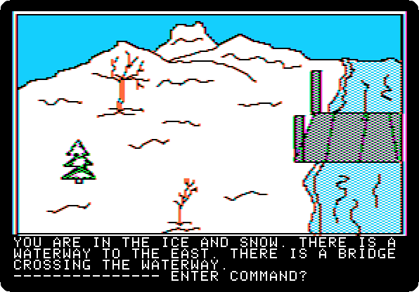

**Type `EAST`**

 
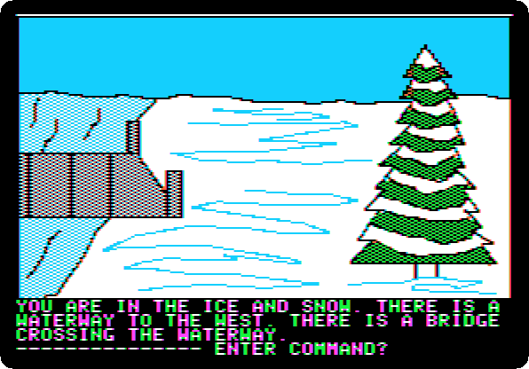

**Type `KILL KOSSACK`**

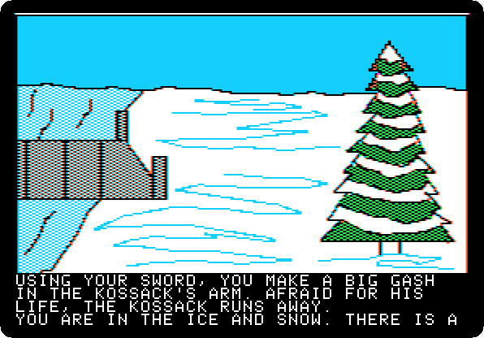 
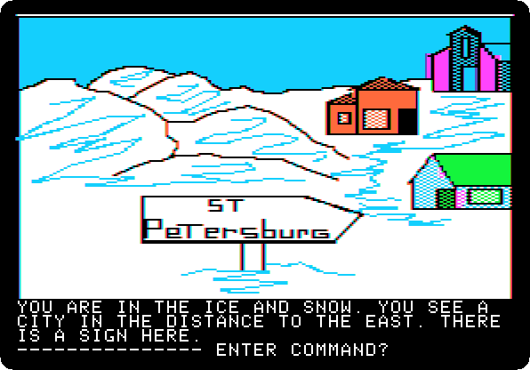

**Type `EAST`**

**Type `EAST`**

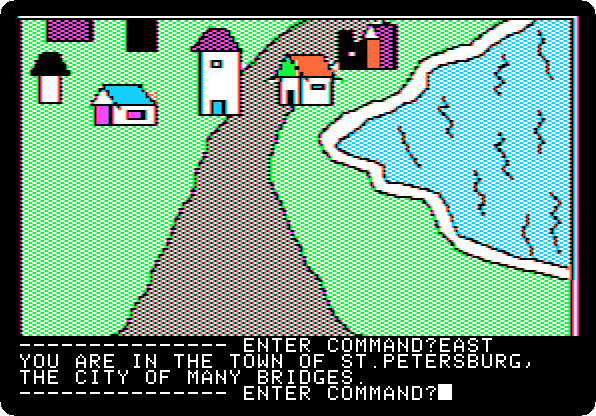

**Type `NORTH`**

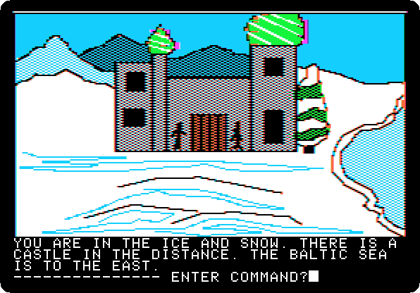

**Type `NORTH`**

**Type `LOOK`**

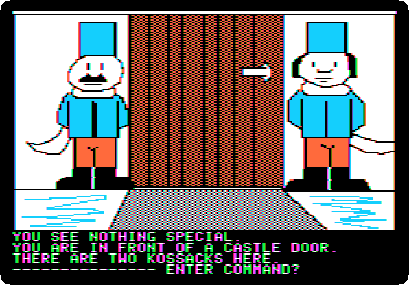

**Type `LOOK`**

**Type `LOOK`**

**Type `LOOK`**

**Type `LOOK`**

 
 

**Type `LOOK`**

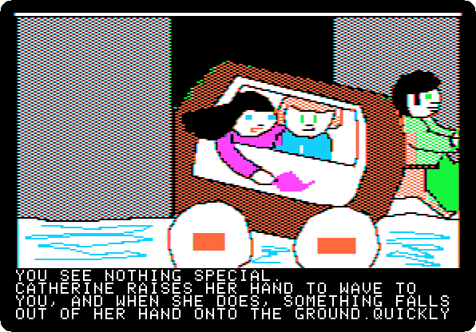 
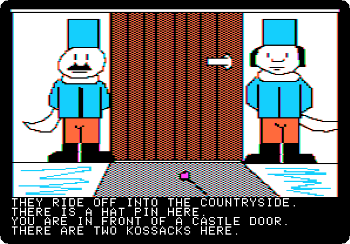 
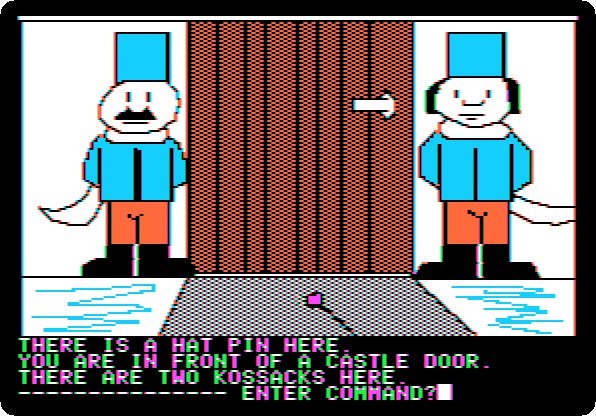

**Type `LOOK`**

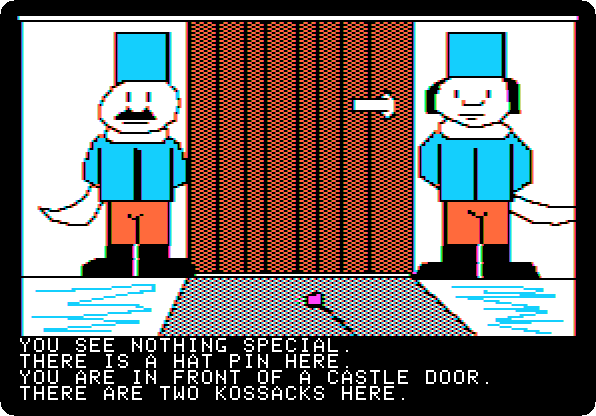 

**Type `GET PIN`**

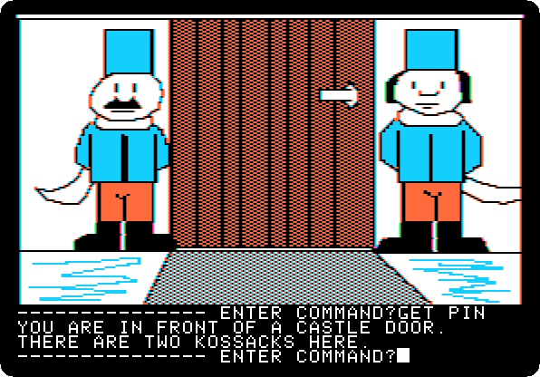

**Type `SOUTH`**

**Type `SOUTH`**

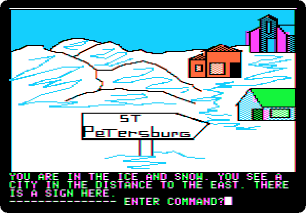

**Type `WEST`**

**Type `WEST`**

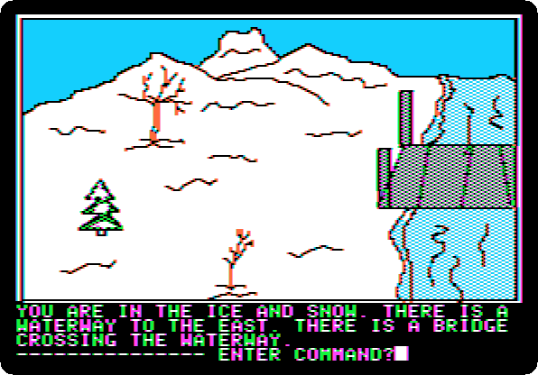

**Type `WEST`**

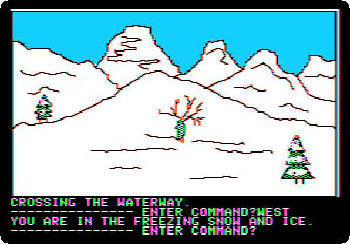

**Type `WEST`**

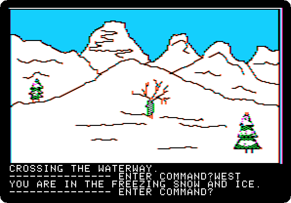

**Type `NORTH`**

**Type `NORTH`**

**Type `NORTH`**

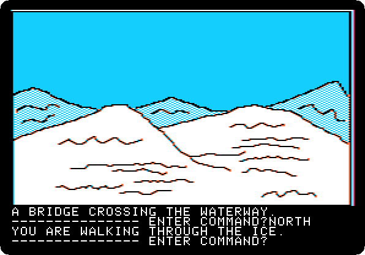

**Type `NORTH`**

**Type `NORTH`**

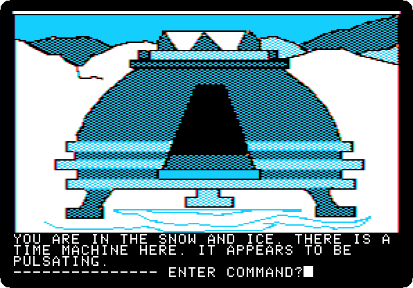

**Type `GO MACHINE`**

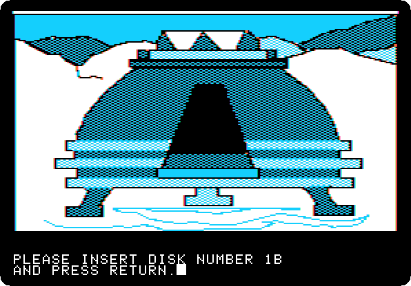 
 

*Side 1B: drop `Time Zone (4am and san inc crack) disk B.dsk` on drive 1, and press Return.*

**Type `SIT`**

 

**Type `PUSH BUTTON`**

 
 
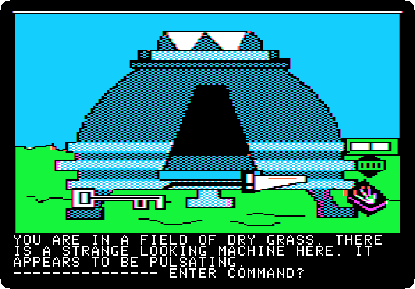

**Type `EXIT MACHINE`**

## What next

**Next:** [Time Zone: 24. Home, 1982](timezone-24.md).

[Time Zone, from the start to the end](timezone.md) has the list of all the parts.
