# Time Zone: 25. North America, 2082 AD

[Activities](../README.md) › [Play](../sections/play.md) › [Time Zone, from the start to the end](timezone.md)

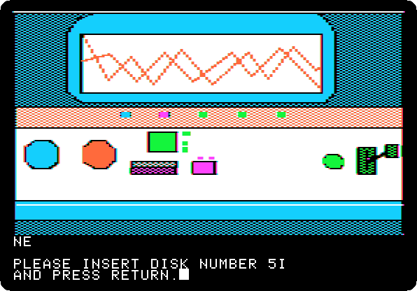 

*Side 5I: drop `Time Zone (4am and san inc crack) disk I.dsk` on drive 1, and press Return.*

**Type `SOUTH`**

**Type `SOUTH`**

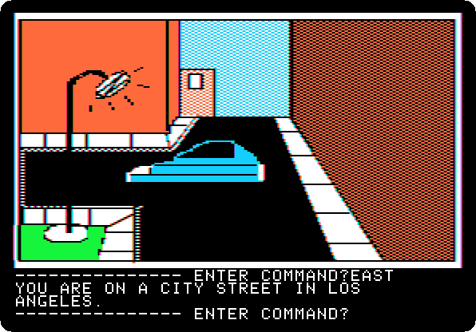

**Type `EAST`**

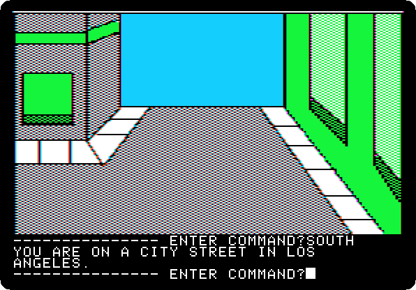

**Type `SOUTH`**

**Type `WEST`**

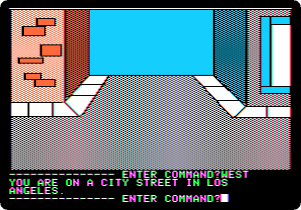

**Type `WEST`**

**Type `WEST`**

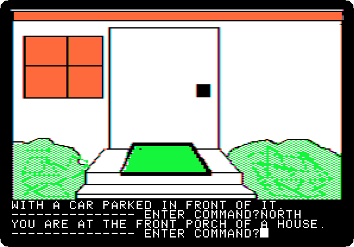

**Type `NORTH`**

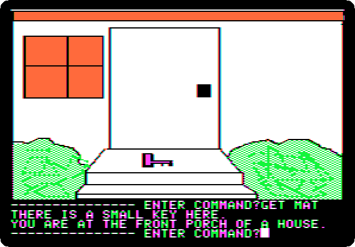

**Type `GET MAT`**

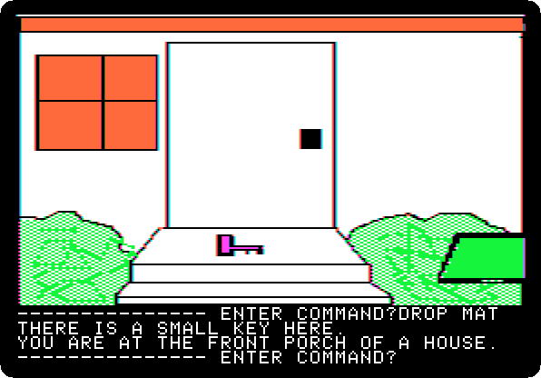

**Type `DROP MAT`**

**Type `GET KEY`**

**Type `SOUTH`**

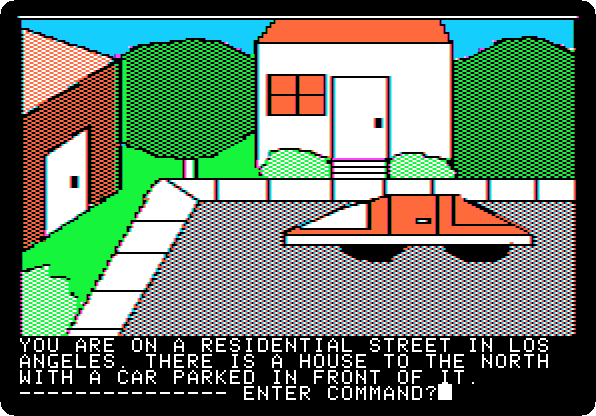

**Type `UNLOCK TRUNK`**

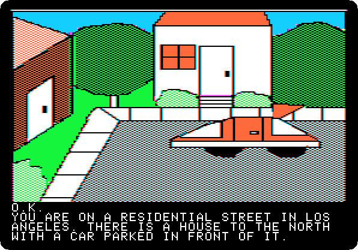 

**Type `OPEN TRUNK`**

 
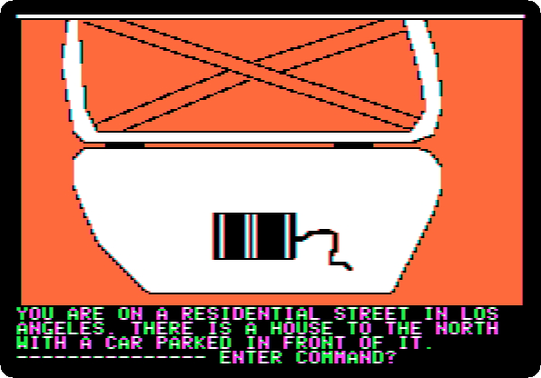

**Type `LOOK TRUNK`**

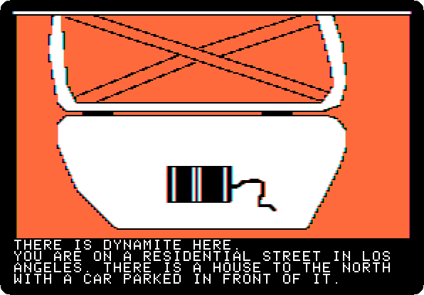 
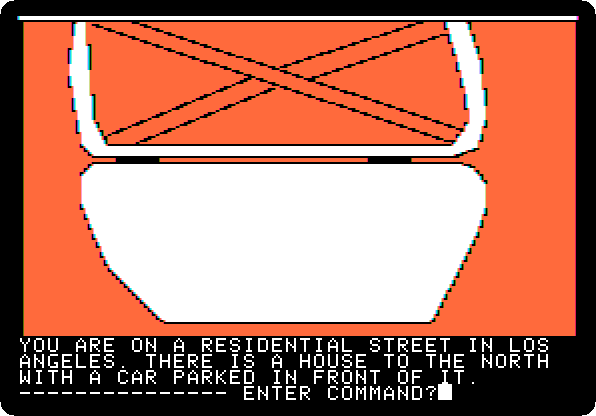

**Type `GET DYNAMITE`**

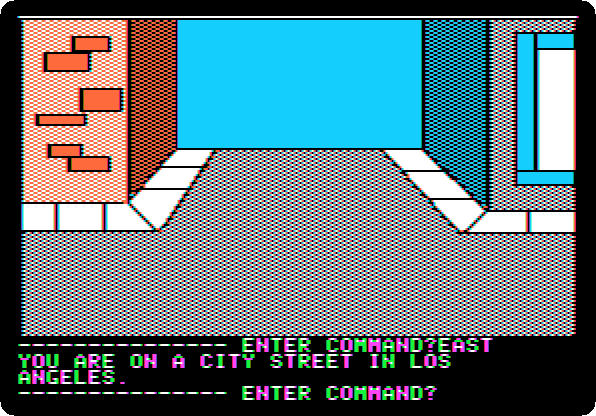

**Type `EAST`**

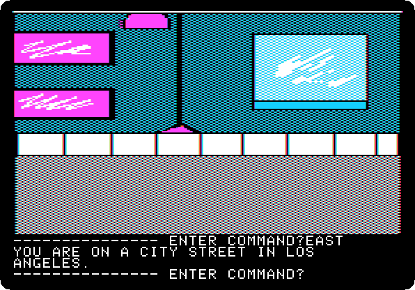

**Type `EAST`**

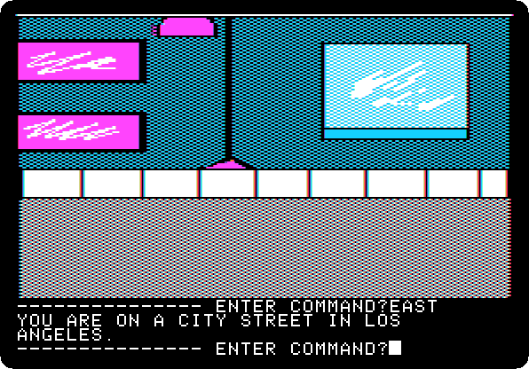

**Type `EAST`**

**Type `NORTH`**

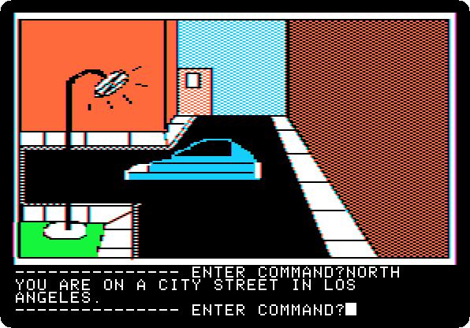

**Type `WEST`**

**Type `NORTH`**

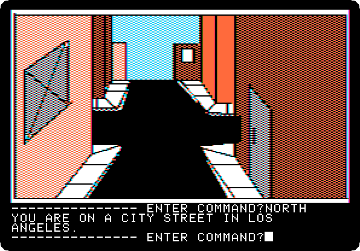

**Type `NORTH`**

**Type `GO MACHINE`**

 
 

*Side 1B: drop `Time Zone (4am and san inc crack) disk B.dsk` on drive 1, and press Return.*

**Type `SIT`**

 

**Type `EUROPE`**

 

**Type `2082AD`**

 

**Type `PULL LEVER`**

 
 
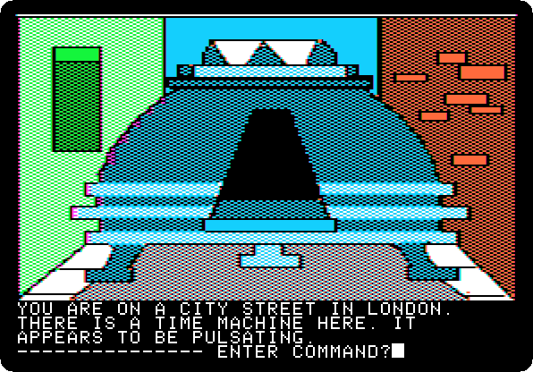

**Type `EXIT MACHINE`**

## What next

**Next:** [Time Zone: 26. Europe, 2082 AD](timezone-26.md).

[Time Zone, from the start to the end](timezone.md) has the list of all the parts.
